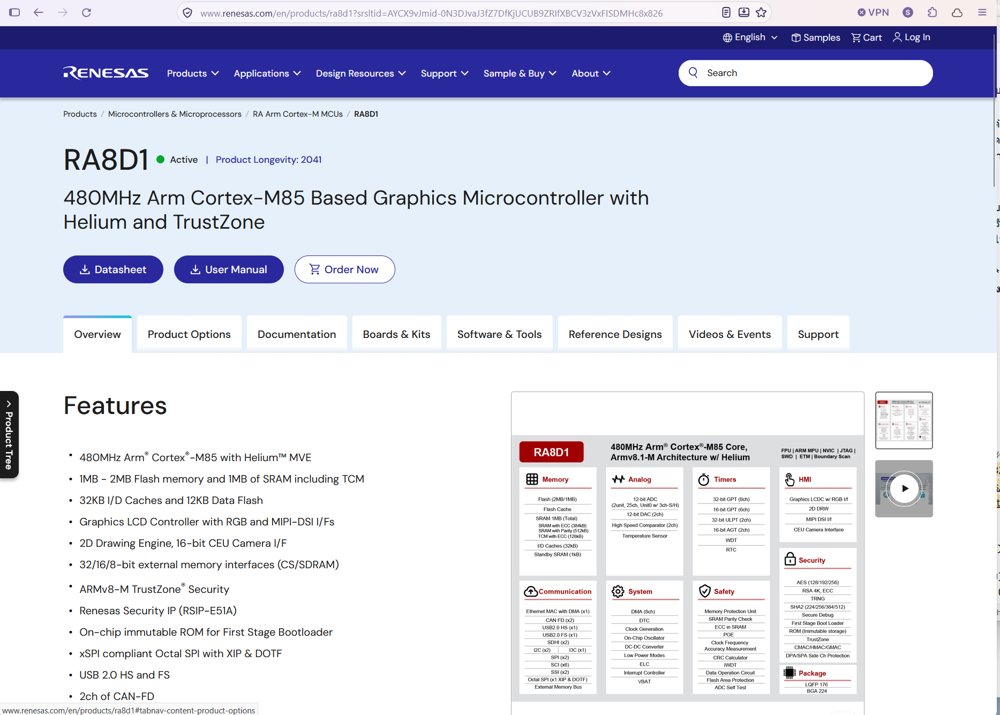
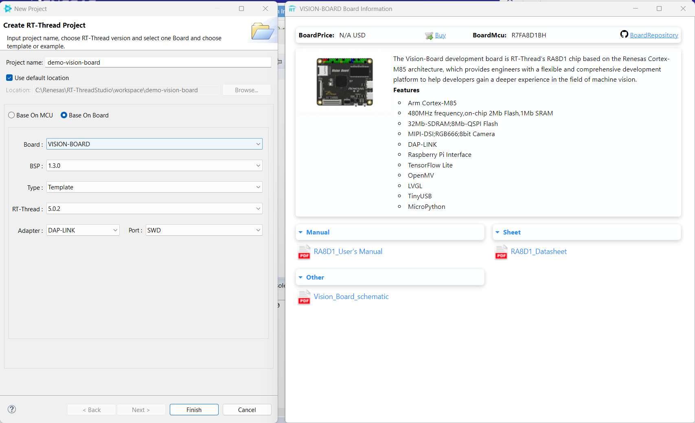

# RT-Thread กับการ พัฒนา Chip RA8D1

**บอร์ดที่ทีม RT-Thread นำชิปรุ่น RA8D1 ของบริษัท Renesas (ซึ่งใช้แกนประมวลผลสถาปัตยกรรม Cortex-M85 อันทรงพลังของ Arm) มาพัฒนาต่อยอดให้พร้อมใช้งานด้าน Machine Vision และระบบปฏิบัติการ RTOS**

!!! info 
    The Vision-Board development board is RT-Thread's RA8D1 chip based on the Renesas Cortex-M85 architecture, which provides engineers with a flexible and comprehensive development platform to help developers gain a deeper experience in the field of machine vision.  

    - Features  
    - Arm Cortex-M85  
    - 480MHz frequency,on-chip 2Mb Flash,1Mb SRAM  
    - 32Mb-SDRAM;8Mb-QSPI Flash  
    - MIPI-DSI;RGB666;8bit Camera  
    - DAP-LINK  
    - Raspberry Pi Interface  
    - TensorFlow Lite  
    - OpenMV  
    - LVGL  
    - TinyUSB  
    - MicroPython  

**Renesas RA8D1 microcontroller (480 MHz Arm Cortex-M85)** หมายถึง ==**ชิปไมโครคอนโทรลเลอร์ (สมองกลฝังตัว) รุ่น RA8D1 ของบริษัท Renesas ที่ใช้สถาปัตยกรรมประมวลผล Arm Cortex-M85 ความเร็วสูงสุด 480 MHz**== ครับ

สามารถแบ่งความหมายออกเป็น 3 ส่วนหลัก เพื่อให้เข้าใจง่ายขึ้นดังนี้ครับ:

- **Renesas RA8D1 (ชื่อผู้ผลิตและรุ่นชิป):**
    - **Renesas** คือบริษัทผู้ผลิตเซมิคอนดักเตอร์รายใหญ่จากญี่ปุ่น
    - **RA8D1** คือตระกูลชิปไมโครคอนโทรลเลอร์ประสิทธิภาพสูง (ตระกูล RA8) โดยตัวอักษร **"D"** ย่อมาจาก **Display / Graphics** ซึ่งหมายความว่าชิปรุ่นนี้ถูกออกแบบมาให้มีวงจรประมวลผลกราฟิก 2D และรองรับการต่อหน้าจอความละเอียดสูง รวมถึงกล้องได้โดยตรง
- **Arm Cortex-M85 (สถาปัตยกรรมแกนประมวลผล):**
    - เป็นแกนสมองกล (CPU Core) รุ่นเรือธงที่ทรงพลังที่สุดในตระกูล Cortex-M ของบริษัท Arm
    - จุดเด่นสำคัญคือเทคโนโลยี **Arm Helium** ซึ่งช่วยเร่งความเร็วในการคำนวณด้าน AI / Machine Learning และการประมวลผลสัญญาณดิจิทัล (DSP) ทำให้ชิปขนาดเล็กสามารถประมวลผลภาพ (Computer Vision) หรือเสียงได้โดยไม่ต้องพึ่งพาชิปขนาดใหญ่หรือกินไฟมาก
- **480 MHz (ความเร็วสัญญาณนาฬิกา):**
    - คือความเร็วในการทำงานของซีพียู (480 ล้านรอบต่อวินาที) ซึ่งถือว่าสูงมากสำหรับไมโครคอนโทรลเลอร์ทั่วไป (บอร์ดอย่าง Arduino Uno มีความเร็วแค่ 16 MHz หรือ ESP32 อยู่ที่ 240 MHz) ทำให้รับส่งและคำนวณข้อมูลภาพจากกล้องได้แบบเรียลไทม์

**สรุปสั้นๆ:** นี่คือ "ชิปสมองกลขนาดเล็กแต่ความเร็วสูงมาก" ที่เกิดมาเพื่อทำงานด้าน **การประมวลผลภาพจากกล้อง (Machine Vision), หน้าจอแสดงผลสวยงาม (GUI) และงาน AI บนอุปกรณ์ (Edge AI)** โดยเฉพาะครับ

## เปรียบเทียบ กับ ESP32-S3 และ Rasperry PI

หากเปรียบเทียบกันในโลกของงานพัฒนาฮาร์ดแวร์และ Edge AI ทั้ง 3 ตัวนี้ยืนอยู่คนละระดับชั้นกันชัดเจนครับ โดย ==**Renesas RA8D1 (Vision-Board) อยู่ตรงกลางระหว่าง ESP32-S3 และ Raspberry Pi** (เช่น [Raspberry Pi 4](https://www.raspberrypi.com/products/raspberry-pi-4-model-b/) หรือ [Raspberry Pi 5](https://www.raspberrypi.com/products/raspberry-pi-5/)) ทั้งในแง่ความแรง การกินไฟ และรูปแบบการใช้งาน==

|คุณสมบัติ|ESP32-S3|Renesas RA8D1 (Vision-Board)|Raspberry Pi (รุ่น 4 / 5)|
|---|---|---|---|
|**ประเภทอุปกรณ์**|ไมโครคอนโทรลเลอร์ (MCU)|ไมโครคอนโทรลเลอร์ (High-End MCU)|คอมพิวเตอร์บอร์ดเดี่ยว (SBC)|
|**สถาปัตยกรรม CPU**|Dual-Core Xtensa LX7 @ 240 MHz|**Arm Cortex-M85 @ 480 MHz** (+Helium)|Quad-Core Cortex-A72/A76 @ 1.5–2.4 GHz|
|**หน่วยความจำ (RAM)**|512 KB SRAM (+PSRAM ภายนอก 2–8 MB)|1 MB SRAM + 32 MB SDRAM บนบอร์ด|1 GB – 16 GB LPDDR4/LPDDR4X|
|**ระบบปฏิบัติการ (OS)**|ไม่ใช้ OS / RTOS (FreeRTOS)|RTOS (RT-Thread, Zephyr)|Linux เต็มรูปแบบ (Raspberry Pi OS, Ubuntu)|
|**การเชื่อมต่อไร้สาย**|**มี Wi-Fi & Bluetooth 5 ในตัว**|ไม่มีในชิปหลัก (ต้องต่อโมดูลเพิ่ม)|**มี Wi-Fi & Bluetooth 5 ในตัว**|
|**การประมวลผล AI / ภาพ**|TinyML, ตรวจจับใบหน้า/วัตถุพื้นฐาน (เฟรมเรตต่ำ)|**Machine Vision แบบเรียลไทม์, รันโมเดลขนาดกลางได้ลื่น**|**รันโมเดลใหญ่ได้เต็มรูปแบบ (YOLO, OpenCV, LLM เล็กๆ)**|
|**กราฟิกและหน้าจอ**|จอเล็ก SPI / Parallel RGB พื้นฐาน|**มีตัวเร่งกราฟิก 2D (DAVE2D) ต่อจอ MIPI-DSI ลื่นไหล**|ต่อจอความละเอียดสูงระดับ 4K ผ่าน HDMI ได้|
|**การกินไฟและการบูต**|กินไฟต่ำมาก, เปิดปุ๊บติดปั๊บ (< 1 วินาที)|กินไฟต่ำ, เปิดปุ๊บติดปั๊บ (< 1 วินาที)|กินไฟสูง (ต้องใช้อะแดปเตอร์ 15W–27W), บูตระบบนาน|

## ตารางเปรียบเทียบสัดส่วน Memory เชิงลึก

|ส่วนประกอบ Memory|Espressif ESP32-S3|Renesas RA8D1 (สเปก Vision-Board)|
|---|---|---|
|**Internal ROM**|**384 KB** (เก็บ Bootloader & ฟังก์ชันพื้นฐาน)|**มี (Immutable ROM)** สำหรับ First Stage Bootloader|
|**Internal Flash (เก็บโค้ด)**|**ไม่มีในตัวชิป** (ต้องพึ่ง External Flash)|**2 MB** Code Flash (ในตัวชิป รันโค้ดได้ทันที)|
|**Data Flash / EEPROM**|ไม่มี (จำลองพื้นที่บน External Flash แทน)|**12 KB** Data Flash แยกอิสระ (สำหรับเก็บ Config/Calibrate)|
|**Internal SRAM (รวม)**|**512 KB** (แบ่งเป็น IRAM + DRAM)|**1 MB (1,024 KB)** (แบ่งย่อยตามหน้าที่และความเร็ว)|
|**หน่วยความจำความเร็วสูงสุด**|**IRAM** (ดึงพื้นที่จาก 512 KB SRAM มาแบ่งใช้)|**128 KB TCM** (Tightly Coupled Memory - Zero Wait-State)|
|**RTC / Standby RAM**|**16 KB** RTC SRAM (คงข้อมูลตอน Deep Sleep)|**1 KB** Standby SRAM + **384 KB** VBAT SRAM (พร้อม ECC)|
|**External RAM (ขยายเพิ่ม)**|**PSRAM** (นิยม 2 MB – 8 MB ผ่าน Octal/Quad SPI)|**32 MB SDRAM** (ต่อตรงผ่านบัสขนาน 16/32-bit)|
|**External Flash (ขยายเพิ่ม)**|**SPI Flash** (นิยม 4 MB – 16 MB ผ่าน Quad/Octal SPI)|**8 MB QSPI Flash** (รองรับสูงสุดถึง 64 MB+ ผ่าน Octal SPI)|
