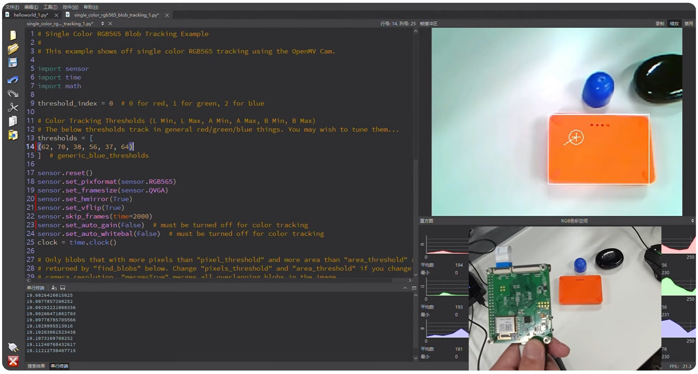
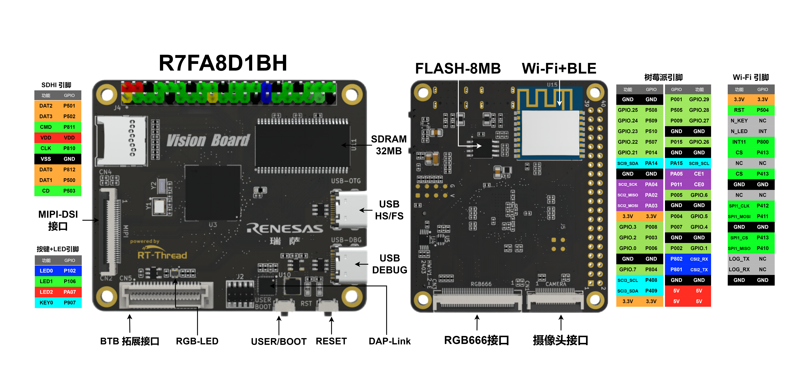
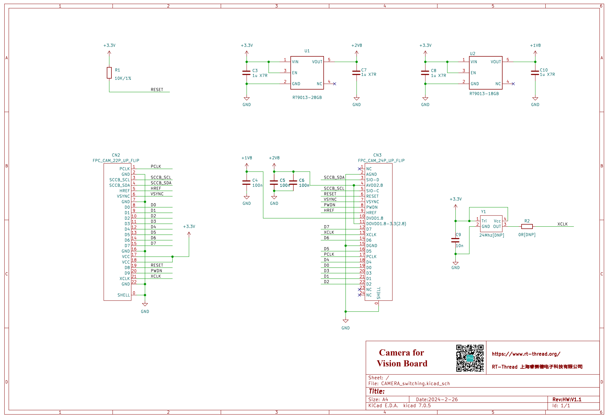

## Video

[https://www.youtube.com/watch?v=OQ3br-fBoqQ](https://www.youtube.com/watch?v=OQ3br-fBoqQ)

## pinout 1

## pinout 2

1 ขา 40-Pin Expansion Header (ฝั่งขวาของบอร์ดด้านหลัง)
(เรียงตามคู่พิน 39-40 ลงมาถึง 1-2 ตามภาพ)

| ฟังก์ชัน | ขา MCU (ซ้าย) | ขา MCU (ขวา) | ฟังก์ชัน |
| :--- | :--- | :--- | :--- |
| **GND** | `GND` | `P001` | GPIO.29 |
| GPIO.25 | `P508` | `P505` | GPIO.28 |
| GPIO.24 | `P509` | `P002` | GPIO.27 |
| GPIO.23 | `P510` | `GND` | **GND** |
| GPIO.22 | `P507` | `P015` | GPIO.26 |
| GPIO.21 | `P014` | `GND` | **GND** |
| SCI0_SDA | `PA14` | `PA15` | SCI0_SCL |
| **GND** | `GND` | `PA05` | CE1 |
| SCI2_SCK | `PA04` | `P011` | CE0 |
| SCI2_MISO | `PA02` | `P005` | GPIO.6 |
| SCI2_MOSI | `PA03` | `GND` | **GND** |
| **3.3V** | `3.3V` | `P004` | GPIO.5 |
| GPIO.3 | `P008` | `P007` | GPIO.4 |
| GPIO.2 | `P003` | `GND` | **GND** |
| GPIO.0 | `P006` | `P002` | GPIO.1 |
| **GND** | `GND` | `P802` | SCI2_RX |
| GPIO.7 | `P804` | `P801` | SCI2_TX |
| SCI3_SCL | `P408` | `GND` | **GND** |
| SCI3_SDA | `P409` | `5V` | **5V** |
| **3.3V** | `3.3V` | `5V` | **5V** |

2 ขาเชื่อมต่ออุปกรณ์บนบอร์ด (ฝั่งซ้ายและขวาสุดของภาพ)  
- ช่องเสียบ SD Card (SDHI): DAT2 (P501), DAT3 (P502), CMD (P511), CLK (P510), DAT0 (P512), DAT1 (P500), CD (P503)  
- ปุ่มกดและไฟ LED: LED0 (P102), LED1 (P106), LED2 (PA07), KEY0 (P907)  
- โมดูล Wi-Fi + BLE (RW007): RST (P504), INT11 (P800), CS (P413), SPI1_CLK (P412), SPI1_MOSI (P411), SPI1_MISO (P410)  

## RT-Thread Vision Board Camera Schematic

[vision board camera schematic pdf ](./docs/vision_board_camera_schematic.pdf)

## RT-Thread Vision Board Schematics
[RT-Thread vision board schematics pdf](./docs/vision_board_schematic.pdf)

## RT-Thread Board Size
[RT-thread Board Size pdf](./docs/vision_board_size-marking.pdf)