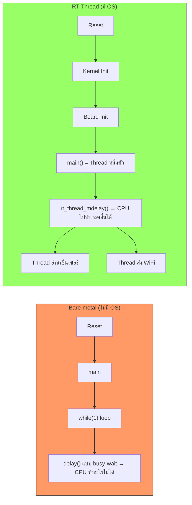

# RT-Thread Boot Flow บนฮาร์ดแวร์

<span class="md-tag">Foundation</span> <span class="md-tag">20 นาที</span>

## ทำไมต้องรู้เรื่องนี้?

ถ้าคุณเคยเขียนโปรแกรมแบบ **Bare-metal** (ไม่มี OS) จะคุ้นเคยกับ pattern นี้:

```c
// Bare-metal: บูตเสร็จ → วิ่งเข้า main() ทันที
void main(void) {
    while(1) {
        // ทำงานซ้ำ ๆ คนเดียว
    }
}
```

แต่พอใช้ **RT-Thread (RTOS)** การบูตจะซับซ้อนขึ้น เพราะต้องตั้งค่า Kernel ก่อน แล้วค่อยส่งต่อให้ `main()` ของเรา โดยที่ `main()` กลายเป็นแค่ **"เธรดหนึ่งตัว"** ไม่ใช่จุดเริ่มต้นอีกต่อไป

---

## แผนที่การบูต (Boot Map)

```text
[ เปิดเครื่อง / กด Reset ]
         │
         ▼
┌─────────────────────────────────────────────────────────┐
│ 1️⃣ ฮาร์ดแวร์อ่าน Reset Vector                           │
│    • ARM Cortex-M85 อ่านตำแหน่งเริ่มต้นจาก Flash          │
│    • กระโดดไปที่ `Reset_Handler` ในไฟล์ Assembly         │
│    📁 ไฟล์: startup_ra8d1.s                              │
└─────────────────────────────────────────────────────────┘
         │
         ▼
┌─────────────────────────────────────────────────────────┐
│ 2️⃣ Startup Assembly                                      │
│    • ตั้งค่า Stack Pointer (SP)                            │
│    • คัดลอกตัวแปรเริ่มต้น → RAM (Data Section)             │
│    • เคลียร์ค่าแรม (BSS Section)                           │
│    • เรียก `SystemInit()` ตั้งค่านาฬิกา                    │
│    📁 ไฟล์: libraries/HAL_Drivers/startup/startup_ra8d1.s  │
└─────────────────────────────────────────────────────────┘
         │
         ▼
┌─────────────────────────────────────────────────────────┐
│ 3️⃣ RT-Thread Kernel Entry                                │
│    • `entry()` หรือ `rtthread_startup()`                  │
│    • เรียก `rt_hw_board_init()` → ตั้งค่าฮาร์ดแวร์บอร์ด    │
│    • เรียก `rt_system_scheduler_init()` → สร้าง Kernel      │
│    📁 ไฟล์: rt-thread/src/components.c                    │
└─────────────────────────────────────────────────────────┘
         │
         ▼
┌─────────────────────────────────────────────────────────┐
│ 4️⃣ Board Initialization                                  │
│    • ตั้งค่า System Tick (1ms interrupt)                  │
│    • เปิดใช้งาน UART / Console                             │
│    • ตั้งค่า Heap สำหรับจองหน่วยความจำแบบไดนามิก           │
│    📁 ไฟล์: board/board.c                                 │
└─────────────────────────────────────────────────────────┘
         │
         ▼
┌─────────────────────────────────────────────────────────┐
│ 5️⃣ Main Thread ของเรา                                    │
│    • RT-Thread สร้างเธรด "main" ขึ้นมา                    │
│    • ส่งต่อให้ `main()` ใน applications/main.c             │
│    • เริ่ม Scheduler → CPU สลับงานหลายเธรด                 │
│    📁 ไฟล์: applications/main.c                            │
└─────────────────────────────────────────────────────────┘
```

---

## แยกย่อยทีละขั้น

### ขั้น 1: Reset Vector (จุดเริ่มต้นของฮาร์ดแวร์)

เมื่อเปิดเครื่องหรือกด Reset CPU (ARM Cortex-M) จะอ่านจาก **Vector Table** ที่อยู่ใน Flash:

| ตำแหน่ง | ค่า |
|---------|-----|
| `0x0000_0000` | ค่าเริ่มต้นของ Stack Pointer |
| `0x0000_0004` | ที่อยู่ของ `Reset_Handler` |

```armasm
; ตัวอย่างจาก startup_ra8d1.s
    AREA    RESET, DATA, READONLY
    EXPORT  __Vectors
    EXPORT  __Vectors_End
    EXPORT  __Vectors_Size

__Vectors
    DCD     __initial_sp              ; Top of Stack
    DCD     Reset_Handler             ; Reset Handler ← เริ่มตรงนี้
    DCD     NMI_Handler               ; NMI Handler
    ...
```

!!! info "Vector Table คืออะไร?"
    คือ **ตารางจุดกระโดด** ที่ ARM CPU อ่านอัตโนมัติตอนบูต บอกว่า "ถ้าเกิดเหตุการณ์นี้ → ไปทำงานที่ฟังก์ชันนี้"

---

### ขั้น 2: Startup Assembly

`Reset_Handler` เป็นฟังก์ชันเขียนด้วย Assembly ทำหน้าที่เตรียม RAM ก่อนเรียก C code:

```armasm
Reset_Handler:
    ; คัดลอก Data Section จาก Flash → RAM
    LDR     R0, =__data_start__
    LDR     R1, =__data_end__
    LDR     R2, =__data_load__
    BL      memcpy

    ; เคลียร์ BSS Section (ตัวแปรที่ไม่มีค่าเริ่มต้น)
    LDR     R0, =__bss_start__
    LDR     R1, =__bss_end__
    MOV     R2, #0
    BL      memset

    ; เรียก SystemInit() ตั้งค่านาฬิกา
    BL      SystemInit

    ; กระโดดเข้า entry() ของ RT-Thread
    BL      entry
```

| ส่วน | ทำอะไร | เปรียบเทียบ |
|-------|--------|-------------|
| Data Section | คัดลอกตัวแปรที่มีค่าเริ่มต้น (เช่น `int x = 5;`) จาก Flash ไป RAM | เหมือนการ "ย้ายของ" |
| BSS Section | เคลียร์ค่าแรมเป็น 0 สำหรับตัวแปรที่ไม่มีค่าเริ่มต้น | เหมือนการ "เช็ดโต๊ะให้ว่าง" |
| `SystemInit()` | ตั้งค่าความถี่ CPU, เปิด PLL | ปลุกชิปให้ตื่น |

---

### ขั้น 3: RT-Thread Kernel Startup

`entry()` คือจุดเชื่อมต่อระหว่าง Assembly กับ RT-Thread Kernel:

```c
// rt-thread/src/components.c (สรุป)
void entry(void)
{
    rt_hw_interrupt_disable();      // ปิด Interrupt ชั่วคราว
    rt_hw_board_init();             // ตั้งค่าฮาร์ดแวร์บอร์ด
    rt_system_timer_init();         // เริ่มต้นระบบ Timer
    rt_system_scheduler_init();     // เริ่มต้น Scheduler
    rt_application_init();          // สร้าง Main Thread
    rt_system_scheduler_start();    // เริ่มสลับงาน (ไม่กลับมาที่นี่อีก)
}
```

!!! warning "จุดสำคัญ"
    พอ `rt_system_scheduler_start()` ทำงาน → CPU จะเริ่มสลับไปมาระหว่างเธรดต่าง ๆ และ **ไม่มีวันกลับมาที่ฟังก์ชัน `entry()` อีก**

---

### ขั้น 4: ตั้งค่าฮาร์ดแวร์บอร์ด (`board.c`)

`rt_hw_board_init()` อยู่ในไฟล์ `board/board.c`:

```c
// board/board.c (สรุป)
void rt_hw_board_init(void)
{
    // 1. ตั้งค่า System Tick (ให้เกิด Interrupt ทุก 1ms)
    //    → ใช้นับเวลา, delay, สลับเธรด
    SysTick_Config(SystemCoreClock / RT_TICK_PER_SECOND);

    // 2. เปิดใช้งาน UART สำหรับ Console
    //    → ให้ rt_kprintf() ส่งข้อความออกไปได้
    rt_console_init();

    // 3. ตั้งค่า Heap (พื้นที่จองหน่วยความจำแบบไดนามิก)
    //    → ให้ rt_malloc() / rt_free() ใช้งานได้
    rt_system_heap_init(...);
}
```

**ถ้าขั้นนี้พัง = ทุกอย่างพัง:**
- System Tick ไม่ทำงาน → `rt_thread_mdelay()` ใช้ไม่ได้
- Console ไม่เปิด → `rt_kprintf()` ไม่แสดงผล
- Heap ไม่มี → `rt_malloc()` คืน NULL

---

### ขั้น 5: Main Thread ของเรา

RT-Thread สร้างเธรด "main" ให้อัตโนมัติ แล้วส่งไปที่ `main()`:

```c
// rt-thread/src/components.c
static void rt_thread_entry(void *parameter)
{
    extern int main(void);
    main();                         // ← เรียก main() ของเรา!
    /* ถ้า main() return → รอจนกว่าจะถูก terminate */
}

void rt_application_init(void)
{
    rt_thread_t tid;
    tid = rt_thread_create("main",
                           rt_thread_entry,   // ← ฟังก์ชันที่จะรัน
                           RT_NULL,
                           2048,              // Stack size
                           RT_THREAD_PRIORITY_MAX / 3,
                           20);
    rt_thread_startup(tid);             // ← ส่งเข้าคิว Scheduler
}
```

!!! success "Checkpoint"
    `main()` ของเราไม่ใช่จุดเริ่มต้นอีกต่อไป แต่เป็น **"เธรดหนึ่งตัว"** ที่ Scheduler จัดการ!

---

## ตารางสรุป: ไฟล์ไหน อยู่ตรงไหน ทำอะไร

| ขั้น | ไฟล์ | หน้าที่ | แก้ได้ไหม |
|------|------|---------|----------|
| 1. Reset | `startup_ra8d1.s` | อ่าน Vector, ตั้ง SP, คัดลอก Data/BSS | ❌ ห้ามแก้ |
| 2. Clock | `system.c` | ตั้งค่า PLL, ความถี่ CPU | ⚠️ ระวัง |
| 3. Kernel | `rt-thread/src/components.c` | สร้างเธรด, เริ่ม Scheduler | ❌ ห้ามแก้ |
| 4. Board | `board/board.c` | ตั้งค่า Tick, UART, Heap | ✅ แก้ได้ |
| 5. User | `applications/main.c` | เขียนโค้ดแอปพลิเคชันของเรา | ✅ แก้ได้ |

---

## Bare-metal vs RT-Thread: ต่างกันตรงไหน?



| ลักษณะ | Bare-metal | RT-Thread |
|--------|-----------|-----------|
| `main()` คือ | จุดเริ่มต้นและจุดสิ้นสุด | เพียงเธรดหนึ่งตัว |
| `while(1)` | ครอง CPU ไม่ปล่อย | วนได้ แต่ `delay()` จะสลับให้เธรดอื่น |
| งานพร้อมกัน | ทำไม่ได้ (ต้องใช้ Interrupt เอง) | สร้าง Thread ได้ไม่จำกัด |
| หน่วงเวลา | `delay_ms()` = busy-wait | `rt_thread_mdelay()` = yield CPU |

---

## ทำไม GitHub ไม่มีโฟลเดอร์ `applications/`?

!!! question "คำถามที่พบบ่อย"
    ดูใน GitHub ไม่เจอโฟลเดอร์ `applications/` หรือไฟล์ `main.c` แต่พอสร้างโปรเจกต์ใน RT-Thread Studio กลับมี?

**คำตอบ:** โปรเจกต์ใน GitHub คือ **BSP Template** (แม่พิมพ์) ส่วน RT-Thread Studio จะ **สร้างโครงสร้างสมบูรณ์** ตอน Generate:

```text
GitHub (Template — ดิบ)
    projects/
    └── vision_board_blink_led/
        ├── libraries/      ← HAL, Drivers
        ├── rt-thread/      ← Kernel Source
        └── rtconfig.h      ← ค่าตั้งต้น

RT-Thread Studio (Generate แล้ว — พร้อมใช้)
    Hello-World/
    ├── applications/
    │   └── main.c          ← ← ← อยู่นี่! (Studio สร้างให้)
    ├── board/
    │   └── board.c         ← Studio คัดลอกมา
    ├── libraries/          ← จาก Template
    ├── rt-thread/          ← จาก Template
    └── SConstruct          ← ไฟล์ Build
```

!!! tip "สรุป"
    - **GitHub** = ต้นฉบับ (ยังไม่มี `applications/` เพราะเป็นส่วนที่ผู้ใช้เติมเอง)
    - **Studio** = สร้างโครงสร้าง + สร้าง `main.c` เริ่มต้นให้คุณแก้ไข

---

## สรุป: เนื้อหาสำคัญที่ต้องจำ

1. **บูตเริ่มที่ฮาร์ดแวร์** → อ่าน Vector Table → วิ่งเข้า `Reset_Handler`
2. **Assembly เตรียม RAM** → คัดลอก Data → เคลียร์ BSS → เรียก `SystemInit()`
3. **`entry()` เข้า Kernel** → ตั้งค่าบอร์ด → สร้างเธรด → เริ่ม Scheduler
4. **`main()` เป็นแค่เธรดหนึ่งตัว** — CPU จะสลับไปทำเธรดอื่นได้
5. **GitHub ไม่มี `applications/`** เพราะ Studio จะสร้างให้ตอน Generate

---

??? failure "ยังงงอยู่? (Troubleshooting ความเข้าใจ)"
    **"ถ้า main() เป็นแค่เธรด แล้วใครเรียก main()?"**
    - RT-Thread สร้างเธรด "main" และให้เธรดนั้นเรียก `main()` ให้เอง

    **"แล้วถ้า main() return ไป จะเกิดอะไรขึ้น?"**
    - เธรด "main" จะถูก suspend (หยุด) แต่เธรดอื่น (idle, timer) ยังทำงานต่อ

    **"ทำไมต้องมี System Tick?"**
    - เป็นจังหวะให้ Scheduler ตัดสินใจว่าจะสลับไปเธรดไหน (เหมือนเสียงนาฬิกาพัก)

    **"จะ debug ตอนบูตยังไง?"**
    - ใช้ JTAG/SWD Debugger → ตั้ง breakpoint ที่ `entry()` ใน `components.c`
    - หรือเพิ่ม `rt_kprintf()` ใน `rt_hw_board_init()` เพื่อดูว่าถึงขั้นไหนแล้ว
