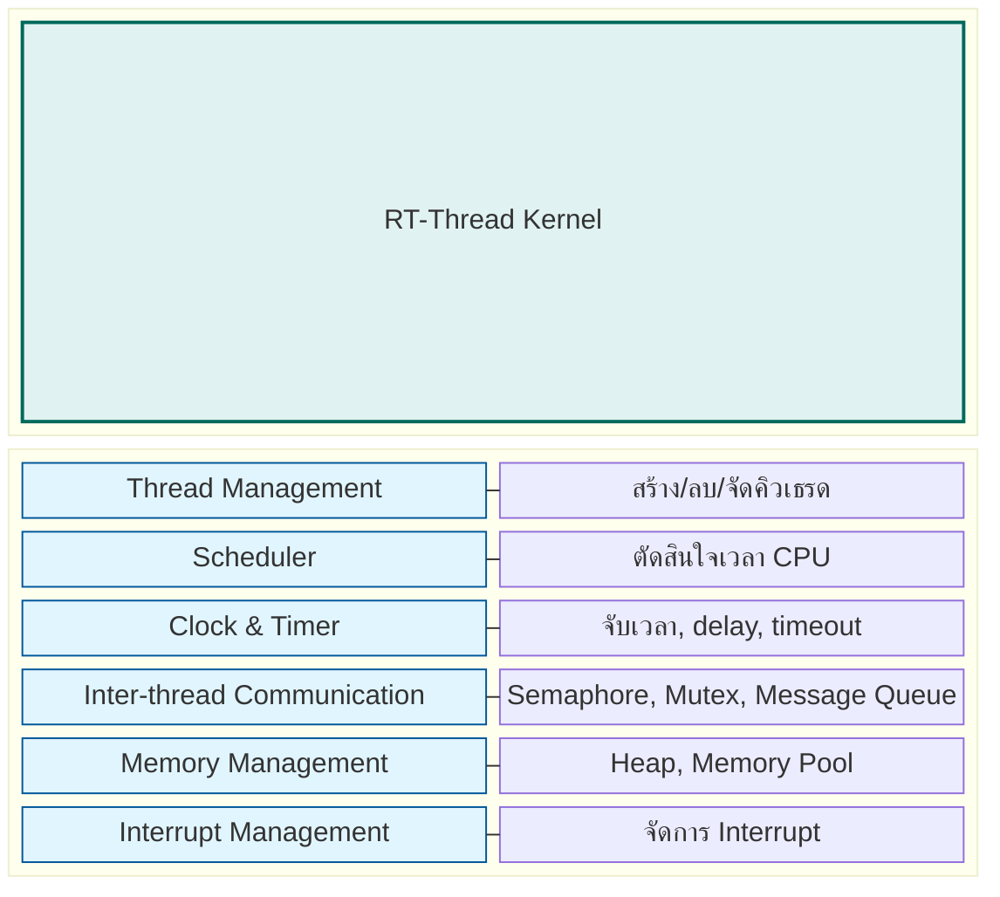

# พื้นฐาน RT-Thread Kernel

Foundation 15 นาที

## สิ่งที่คุณจะเข้าใจ

- [ ] โครงสร้าง Kernel Layer
- [ ] Thread, Scheduler, IPC คืออะไร
- [ ] ความแตกต่าง RTOS vs General OS

---

## Kernel Layer ประกอบด้วยอะไร

---

## ส่วนประกอบหลัก

### Thread
เธรด = หน่วยทำงานที่เล็กที่สุดใน RTOS

| คำสั่ง | ทำอะไร |
|--------|--------|
| `rt_thread_create()` | สร้างเธรดใหม่ |
| `rt_thread_startup()` | เริ่มเธรด |
| `rt_thread_delete()` | ลบเธรด |
| `rt_thread_mdelay()` | หน่วงเวลาแบบปล่อย CPU |

### Scheduler
ตัวจัดการคิวเวลา CPU

- **Preemptive Priority**: สูงกว่า = ได้ทำก่อน
- **Round-robin**: ระดับเดียวกัน = สลับกันทำ

### IPC (Inter-Process Communication)
เครื่องมือสื่อสารระหว่างเธรด

| ชื่อ | ใช้เมื่อ |
|------|---------|
| Semaphore | เธรดรอเหตุการณ์ |
| Mutex | ป้องกันเข้าถึงทรัพยากรพร้อมกัน |
| Message Queue | ส่งข้อมูลข้ามเธรด |
| Event | รอหลายเหตุการณ์พร้อมกัน |
