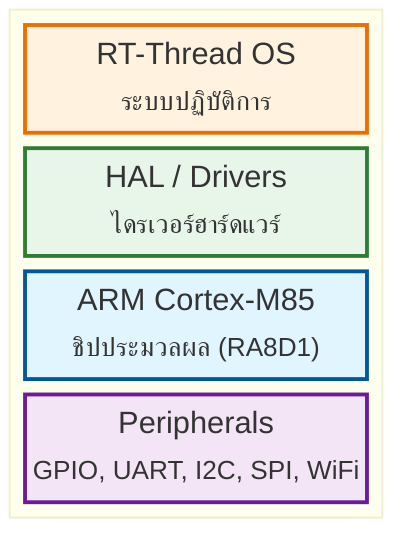

# แนะนำ STM และ ARM Cortex-M

Foundation 10 นาที

## เนื้อหานี้สำหรับ

- [ ] เข้าใจว่าทำไม RT-Thread ถึงรันบน ARM Cortex-M
- [ ] รู้ว่า ARM Cortex-M85 (RA8D1) มีอะไรพิเศษ
- [ ] เข้าใจลำดับการบูตบน ARM

---

## ARM Cortex-M คืออะไร

**ARM Cortex-M** = ตระกูลไมโครคอนโทรลเลอร์จาก ARM

| รุ่น | ลักษณะ | ใช้กับ |
|------|--------|--------|
| Cortex-M0/M0+ | ง่าย ประหยัดพลังงาน | IoT Sensor |
| Cortex-M3/M4 | ปานกลาง มี DSP | STM32 |
| Cortex-M7 | เร็ว | High-performance |
| **Cortex-M85** | **เร็วสุด + Helium** | **RA8D1 (Vision-Board)** |

!!! info "Helium เทคโนโลยี"
    Cortex-M85 มี **Helium** = SIMD สำหรับ Machine Learning
    ทำให้รันโมเดล AI บน MCU ได้เร็วขึ้น

---

## ทำไม RT-Thread ถึงเลือก ARM Cortex-M

1. **สถาปัตยกรรมเปิด** → หลายบริษัทผลิตชิป (Renesas, STM, NXP)
2. **พลังงานต่ำ** → เหมาะกับ IoT / Battery-powered
3. **ต้นทุนถูก** → ชิปละไม่กี่เหรีญ
4. **Ecosystem ใหญ่** → เครื่องมือเยอะ

---

## ความสัมพันธ์ ARM + RT-Thread

---

## สรุป

- ARM Cortex-M85 = เครื่องยนต์
- RT-Thread = ระบบปฏิบัติการที่บริหารเครื่องยนต์
- Vision-Board (RA8D1) = รถคันหนึ่งที่มีทั้งเครื่องยนต์และระบบปฏิบัติการ
