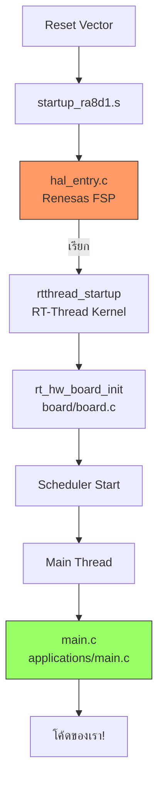

# BSP Architecture: บอร์ด คุยกับ RTOS อย่างไร

<span class="md-tag">Foundation</span> <span class="md-tag">15 นาที</span>

## สิ่งที่คุณจะเข้าใจหลังอ่านหน้านี้

- [ ] ทำไม RT-Thread Studio ถึงรู้จักบอร์ด Vision-Board ได้
- [ ] BSP กับ FSP ต่างกันอย่างไร ใครเป็นใคร
- [ ] เปิด GitHub แล้วต้องดูไฟล์ไหนเป็นหลัก
- [ ] `hal_entry.c` กับ `main.c` อยู่โลกคนละใบ
- [ ] `libraries/` ซ่อน FSP ทั้งหมดไว้ข้างใน

---

## 3 ผู้เล่นหลักในโครงสร้าง

```text
┌─────────────────────────────────────────────────────────────┐
│                      RT-Thread Studio                        │
│                         (IDE ของเรา)                          │
└──────────────┬──────────────────────────────────────────────┘
               │ อ่านข้อมูลบอร์ด
               ▼
┌─────────────────────────────────────────────────────────────┐
│           BSP (Board Support Package)                        │
│         ────── ของ RT-Thread ──────                          │
│  • โครงสร้างโปรเจกต์ (applications/, board/, rtconfig.h)    │
│  • Linker Script (กำหนด RAM/Flash)                          │
│  • Board Config (rt_hw_board_init)                           │
│  • ยกเครื่อง FSP มาฝังไว้ใน libraries/                     │
└──────────────┬──────────────────────────────────────────────┘
               │ เรียกไดรเวอร์ระดับต่ำ
               ▼
┌─────────────────────────────────────────────────────────────┐
│           FSP (Flexible Software Package)                    │
│         ────── ของ Renesas ──────                            │
│  • ไดรเวอร์ชิป RA8D1 (GPIO, UART, I2C, SPI, etc.)           │
│  • HAL API (ควบคุม register โดยตรง)                         │
│  • Startup Code (startup_ra8d1.s)                           │
│  • RASC (RA Smart Configurator)                             │
└─────────────────────────────────────────────────────────────┘
```

---

## BSP vs FSP: ใครเป็นใคร?

| ตัว | มาจากไหน | ทำอะไร | อยู่ที่ไหนในโปรเจกต์ |
|------|---------|--------|---------------------|
| **BSP** | RT-Thread | เชื่อมระบบปฏิบัติการเข้ากับบอร์ด | รากฐานทั้งหมด |
| **FSP** | Renesas | ไดรเวอร์ควบคุมชิป RA8D1 | ถูกฝังใน `libraries/` |

!!! info "ทำไม FSP ถึงอยู่ใน BSP?"
    ทีมงาน RT-Thread ที่พอร์ตบอร์ด Vision-Board เขารู้ว่าถ้าให้ผู้ใช้ไปโหลด FSP แยกเอง จะยุ่งยาก จึง **"ก๊อปปี้ FSP มาแพ็กรวมไว้ใน BSP"** — คุณได้ทั้งสองอย่างในครั้งเดียว

---

## เปิด GitHub แล้วดูไฟล์ไหน?

Repo: `https://github.com/RT-Thread/rt-thread/tree/master/bsp/renesas/ra8d1-vision-board`

| ลำดับ | โฟลเดอร์/ไฟล์ | ทำอะไร | ต้องแก้ไหม |
|-------|-------------|--------|----------|
| 1 | `applications/main.c` | จุดเริ่มต้นของแอปเรา (`main()` thread) | ✅ แก้บ่อย |
| 2 | `board/board.c` | ตั้งค่า Tick, UART, Heap (`rt_hw_board_init`) | ⚠️ แก้เฉพาะจำเป็น |
| 3 | `board/board.h` | Pin mapping, ค่าคงที่ของบอร์ด | ⚠️ แก้เฉพาะจำเป็น |
| 4 | `board/linker_scripts/` | แผนผังหน่วยความจำ (Flash/RAM layout) | ❌ ห้ามแก้ |
| 5 | `rtconfig.h` | เปิด/ปิดฟีเจอร์ RT-Thread | ✅ แก้ผ่าน Menuconfig |
| 6 | `libraries/` | **FSP ทั้งหมด** (ไดรเวอร์ Renesas) | ❌ ห้ามแก้ |
| 7 | `SConscript` | บอกว่าต้องคอมไพล์ไฟล์ไหนบ้าง | ⚠️ แก้ถ้าเพิ่มไฟล์ |

!!! tip "ทริคดูไฟล์ใน GitHub"
    ถ้าเปิด GitHub แล้วไม่เจอ `applications/` — ไม่ต้องตกใจ! GitHub แสดง **BSP Template** ซึ่งยังไม่มี `applications/` เพราะ RT-Thread Studio จะสร้างให้ตอน Generate โปรเจกต์

---

## `hal_entry.c` vs `main.c`: โลกคนละใบ

### `src/hal_entry.c` — โลกของ Renesas FSP

- **มาจาก**: Renesas FSP (ไม่ใช่ RT-Thread)
- **ทำอะไร**: เป็นจุดเริ่มต้นหลัง Startup Assembly สำหรับชิป RA8D1
- **ฟังก์ชันหลัก**: `hal_entry()` — ตั้งค่าฮาร์ดแวร์เฉพาะชิป แล้วส่งไม้ต่อให้ RT-Thread
- **ใช้เมื่อไหร่**: เมื่อต้องการเขียนแบบ **Bare-metal** (ไม่ใช้ RTOS) หรือผ่าน FSP โดยตรง

```c
// src/hal_entry.c (ของ Renesas)
void hal_entry(void)
{
    // ตั้งค่าฮาร์ดแวร์ RA8D1 ด้วย FSP API
    // ถ้าใช้ RT-Thread: ตรงนี้จะเรียก rtthread_startup()
}
```

### `applications/main.c` — โลกของ RT-Thread Application

- **มาจาก**: RT-Thread Studio (สร้างให้ตอน Generate โปรเจกต์)
- **ทำอะไร**: เขียนแอปพลิเคชันของเรา ภายใต้การดูแลของ RTOS
- **ฟังก์ชันหลัก**: `main()` — แต่เป็น **Thread หนึ่งตัว** ไม่ใช่จุดเริ่มต้นอีกต่อไป
- **ใช้เมื่อไหร่**: **ทุก Workshop นี้** — เราเขียนโค้ดที่นี่หมด

```c
// applications/main.c (ของเรา)
int main(void)
{
    // โค้ดแอปพลิเคชันของเรา
    // สร้าง Thread, ควบคุม LED, ส่ง WiFi, อ่านกล้อง
    while(1) {
        rt_thread_mdelay(500);
    }
    return 0;
}
```

!!! warning "อย่าสับสน"
    `main()` ใน `applications/main.c` **ไม่ใช่** จุดเริ่มต้นแรกของ CPU! จุดเริ่มต้นจริงคือ `Reset_Handler` ใน `startup_ra8d1.s` → ผ่าน `hal_entry()` → เข้า RT-Thread Kernel → สร้าง Main Thread → เรียก `main()` ของเรา

---

## ลำดับการทำงานจริงบนบอร์ด



| จุด | ไฟล์ | ใครดูแล |
|------|------|---------|
| บูตฮาร์ดแวร์ | `startup_ra8d1.s` | Renesas (FSP) |
| เข้า Kernel | `hal_entry.c` | Renesas (FSP) |
| ตั้งค่าบอร์ด | `board/board.c` | RT-Thread (BSP) |
| เขียนแอป | `applications/main.c` | **เรา!** |

---

## `libraries/` ซ่อน FSP ทั้งหมดไว้

เปิดโฟลเดอร์ `libraries/` ในโปรเจกต์ที่ Studio สร้าง:

```text
libraries/
├── ra/
│   ├── fsp/
│   │   ├── inc/              ← Header ไฟล์ FSP
│   │   ├── src/
│   │   │   ├── bsp/
│   │   │   │   ├── mcu_all/
│   │   │   │   │   ├── bsp_clocks.c      ← ตั้งค่านาฬิกา
│   │   │   │   │   ├── bsp_irq.c         ← จัดการ Interrupt
│   │   │   │   │   ├── bsp_io.c          ← ควบคุม GPIO
│   │   │   │   │   └── ...
│   │   │   ├── r_ioport/
│   │   │   │   └── r_ioport.c            ← GPIO driver
│   │   │   ├── r_sci_uart/
│   │   │   │   └── r_sci_uart.c          ← UART driver
│   │   │   └── ...
│   └── fsp_cfg/              ← ไฟล์ config ที่ RASC สร้าง
├── HAL_Drivers/
│   └── drv_gpio.c            ← RT-Thread ห่อ FSP ให้เป็น Device API
└── ...
```

!!! info "เห็นอะไรบ้าง?"
    - `fsp/src/bsp/mcu_all/` = ไดรเวอร์ระดับต่ำของ Renesas
    - `HAL_Drivers/drv_gpio.c` = RT-Thread ห่อ (wrap) FSP ให้ใช้ผ่าน `rt_device_xxx()` API
    - เรา **ไม่ต้องแตะ** `libraries/` โดยตรง — ใช้ API ของ RT-Thread แทน

---

## สรุปสั้น ๆ

| คำถาม | คำตอบ |
|--------|--------|
| Studio รู้จักบอร์ดยังไง? | อ่าน metadata จาก BSP |
| BSP ต่างจาก FSP ยังไง? | BSP = ของ RT-Thread, FSP = ของ Renesas |
| ทำไม FSP อยู่ใน BSP? | ทีม RT-Thread แพ็กมาให้พร้อมใช้ |
| `hal_entry.c` คืออะไร? | จุดเริ่มต้นของ FSP (Renesas) |
| `main.c` คืออะไร? | จุดเริ่มต้นของแอปเรา (RT-Thread Thread) |
| ดูไฟล์ไหนใน GitHub? | `applications/main.c`, `board/board.c`, `rtconfig.h` |

---

??? failure "คำถามที่พบบ่อย"
    **"เปิด GitHub ไม่เจอ `applications/` หรือ `main.c`?"**
    - GitHub แสดง **BSP Template** ซึ่งยังไม่มี `applications/` — Studio จะสร้างให้ตอน Generate

    **"แก้ `hal_entry.c` ได้ไหม?"**
    - ได้ แต่ระวัง! ถ้าใช้ RT-Thread ควรเขียนใน `applications/main.c` แทน

    **"ถ้าไม่ใช้ RT-Thread ล่ะ?"**
    - ใช้ `hal_entry.c` เป็นจุดเริ่มต้นได้เลย — คุณจะเขียนแบบ Bare-metal ผ่าน FSP API

    **"FSP อัปเดตเวอร์ชันใหม่ ต้องทำยังไง?"**
    - รอทีม RT-Thread อัปเดต BSP ใหม่ หรือใช้ RASC แยกต่างหากถ้าต้องการ feature ใหม่
