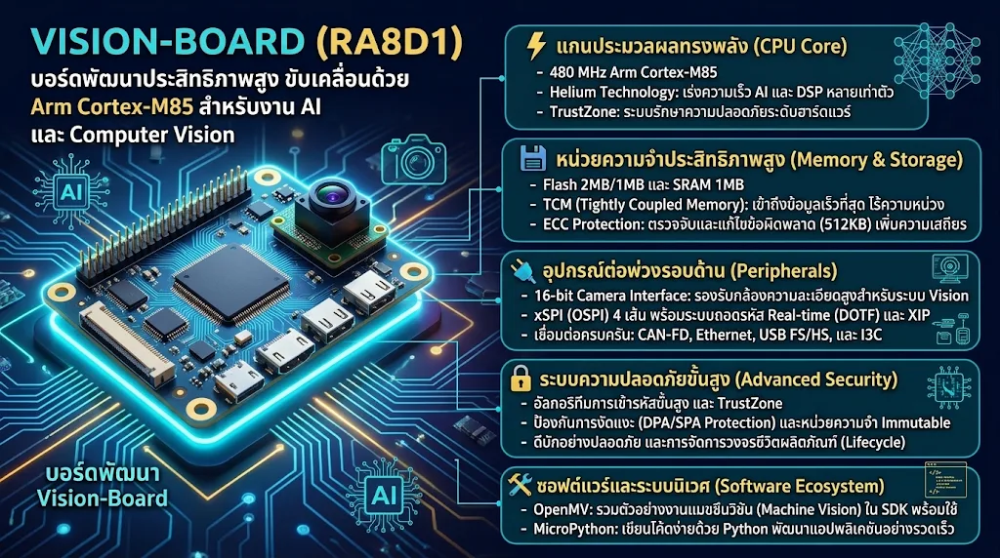

### 🌟 ข้อมูลสรุป: บอร์ดพัฒนา Vision-Board (RA8D1)

บอร์ดพัฒนา Vision-Board เปิดตัวโดย RT-Thread โดยใช้ชิป RA8D1 สถาปัตยกรรม Arm Cortex-M85 ของ Renesas ขับเคลื่อนด้วยเทคโนโลยี Helium และ TrustZone ทำให้มีประสิทธิภาพสูงมาก เหมาะสำหรับงานประมวลผลประสิทธิภาพสูง เช่น AI, Machine Learning ขนาดเล็ก และระบบคอมพิวเตอร์วิทัศน์ (Computer Vision)

---

### ⚙️ คุณสมบัติเด่นของฮาร์ดแวร์

* **แกนประมวลผล (Core)**
* ความเร็ว 480 MHz Arm Cortex-M85 พร้อมเทคโนโลยี Helium และ TrustZone

* **Helium Technology:** ชุดคำสั่งเวกเตอร์ที่ช่วยเร่งความเร็วในการคำนวณด้าน AI และ DSP ให้สูงขึ้นหลายเท่าตัว
* **TrustZone:** ระบบรักษาความปลอดภัยระดับฮาร์ดแวร์ แยกส่วนการทำงานที่ปลอดภัยออกจากส่วนปกติ

* **หน่วยความจำ (Memory & Storage)**
* บิวท์อิน Flash ขนาด 2MB/1MB และ SRAM 1MB (รวม TCM พร้อมระบบป้องกัน ECC 512KB)

* **TCM (Tightly Coupled Memory):** เข้าถึงข้อมูลได้ด้วยความเร็วสูงสุดโดยไม่มีความหน่วง
* **ECC Protection:** ระบบตรวจสอบและแก้ไขข้อผิดพลาดหน่วยความจำอัตโนมัติ เพิ่มความเสถียรให้ระบบ

* **อุปกรณ์ต่อพ่วง (Peripherals)**
* รองรับ xSPI 4 เส้น (OSPI) พร้อม XIP และระบบถอดรหัสแบบ Real-time (DOTF), CAN-FD, Ethernet, USB FS/HS, อินเทอร์เฟซกล้อง 16-bit และ I3C

* **16-bit Camera Interface:** จุดเด่นสำคัญที่รองรับการต่อกล้องความละเอียดสูงเพื่อทำระบบ Vision
* **OSPI with XIP:** อนุญาตให้ซีพียูรันโค้ดจาก Flash ภายนอกได้โดยตรง พร้อมระบบถอดรหัสลับข้อมูลทันที

* **ความปลอดภัยขั้นสูง (Advanced Security)**
* อัลกอริทึมการเข้ารหัสที่ยอดเยี่ยม, TrustZone, หน่วยความจำแบบเปลี่ยนแปลงไม่ได้, ระบบป้องกันการงัดแงะ (รองรับการป้องกันการโจมตีแบบ DPA/SPA), การดีบักอย่างปลอดภัย, การโปรแกรมในโรงงาน และการจัดการวงจรชีวิตผลิตภัณฑ์

* **ซอฟต์แวร์และ SDK (Software Ecosystem)**
* ภายในแพ็กเกจ SDK มีการรวมตัวอย่างงานแมชชีนวิชัน OpenMV ไว้ให้พร้อม

* เมื่อใช้งานร่วมกับตัวแปลชุดคำสั่ง MicroPython จะช่วยให้สามารถพัฒนาแอปพลิเคชันด้านแมชชีนวิชันได้อย่างราบรื่นและรวดเร็ว