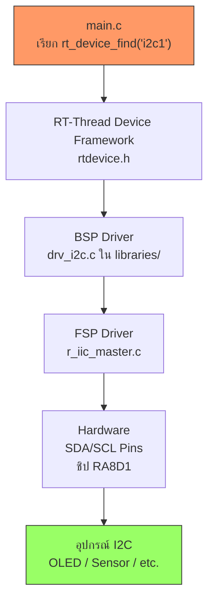

# ใช้งาน I2C บน RT-Thread

<span class="md-tag">Foundation</span> <span class="md-tag">I2C</span> <span class="md-tag">Device Framework</span>

## สิ่งที่คุณจะเข้าใจหลังอ่านหน้านี้

- [ ] ตั้งค่า I2C บนชิป RA8D1 ผ่าน FSP (RA Smart Configurator)
- [ ] เขียนโค้ด `main.c` คุยกับ I2C ผ่าน RT-Thread Device API
- [ ] เข้าใจว่า `#include <rtthread.h>` กับ `#include <rtdevice.h>` ต่างกันอย่างไร
- [ ] รู้ว่า `main.c` คุยกับ OS เรื่องอะไร และคุยกับ BSP เรื่องอะไร
- [ ] ใช้ Software Package ลดงานเขียนโค้ด I2C เอง

---

## โครงสร้างชั้นการทำงาน (จากล่างขึ้นบน)

```text
+-------------------------------------------------------+
| 💻 ชั้นที่ 4: User Application (applications/main.c)   |
|     โค้ดที่เราเขียน — วิ่งเป็น Thread หนึ่งใน OS       |
+-------------------------------------------------------+
| 🧵 ชั้นที่ 3: RT-Thread OS Kernel & Device Framework  |
|     จัดคิวเธรด, จัดการเวลา, ห่อ Driver ให้เป็น API    |
+-------------------------------------------------------+
| 🧩 ชั้นที่ 2: BSP (Board Support Package)             |
|     รวม FSP + ค่าบอร์ด + Linker Script ไว้ในพานเดียว  |
+-------------------------------------------------------+
| ⚙️ ชั้นที่ 1: Renesas FSP & Hardware Drivers           |
|     ไดรเวอร์ระดับต่ำคุยกับชิป RA8D1 โดยตรง           |
+-------------------------------------------------------+
| 🔌 ชั้นล่างสุด: Hardware (Vision-Board / I2C Pins)    |
|     SDA / SCL บนบอร์ดจริง                             |
+-------------------------------------------------------+
```

---

## ขั้นตอนที่ 1: ตั้งค่าฮาร์ดแวร์ I2C

### เปิดใช้งาน I2C ผ่าน FSP

1. เปิด **RA Smart Configurator** ใน RT-Thread Studio
2. ไปที่ **Connectivity → I2C Master**
3. เลือกช่อง I2C (เช่น **I2C0** หรือ **I2C1**)
4. กำหนด Pin **SDA** และ **SCL** ให้ตรงกับบอร์ด Vision-Board
5. กด **Generate Project Content**

### เปิดใช้งาน I2C Driver ใน RT-Thread Settings

1. เปิด **RT-Thread Settings** (icon รูปเฟือง)
2. ไปที่ **Device Drivers**
3. เปิด **Using I2C Bus**

!!! info "ทำไมต้องเปิดสองที่?"
    - **FSP** = ตั้งค่ารีจิสเตอร์ฮาร์ดแวร์ชิป (Renesas)
    - **RT-Thread Settings** = บอก Kernel ว่าให้คอมไพล์ไลบรารี I2C Framework เข้ามาด้วย

---

## ขั้นตอนที่ 2: เขียนโค้ดใน `main.c`

### 2.1 ค้นหา I2C Bus Device

```c
#include <rtthread.h>      // (1) คุยกับ OS
#include <rtdevice.h>      // (2) คุยกับ Hardware Framework

#define I2C_BUS_NAME    "i2c1"  // ชื่อ bus ที่ตั้งไว้

int main(void)
{
    struct rt_i2c_bus_device *i2c_bus = RT_NULL;

    // ค้นหา I2C Bus จากชื่อ
    i2c_bus = (struct rt_i2c_bus_device *)rt_device_find(I2C_BUS_NAME);
    
    if (i2c_bus == RT_NULL)
    {
        rt_kprintf("can't find %s device!\n", I2C_BUS_NAME);
        return -RT_ERROR;
    }

    rt_kprintf("I2C Bus Initialized Successfully!\n");
    // ... โค้ดใช้งาน I2C ต่อ
    return 0;
}
```

1. `rtthread.h` = คุยกับ **RT-Thread OS** (Thread, Delay, Memory)
2. `rtdevice.h` = คุยกับ **Device Framework** (I2C, SPI, UART, GPIO)

!!! tip "ทำไมต้อง `#include` 2 ไฟล์?"
    - `rtthread.h` = พาสปอร์ตเข้าโลกของ **RTOS** (Scheduler, Thread, Timer)
    - `rtdevice.h` = พาสปอร์ตเข้าโลกของ **Hardware** (I2C Bus, UART Port, GPIO Pin)
    - ถ้าไม่ `#include` → คอมไพเลอร์ไม่รู้จัก `rt_device_find()`, `rt_i2c_bus_device`

---

### 2.2 ส่งข้อมูล (Write) ผ่าน I2C

```c
struct rt_i2c_msg msgs;
uint8_t buf[2] = {0x00, 0x55};  // Register address + Data

msgs.addr  = 0x3C;        // Slave Address (เช่น OLED)
msgs.flags = RT_I2C_WR;   // โหมดเขียน
msgs.buf   = buf;
msgs.len   = 2;

if (rt_i2c_transfer(i2c_bus, &msgs, 1) == 1) {
    rt_kprintf("I2C Write OK\n");
}
```

---

### 2.3 อ่านข้อมูล (Read) ผ่าน I2C

```c
struct rt_i2c_msg msgs[2];
uint8_t reg_addr = 0x00;
uint8_t read_data[1];

// ข้อความที่ 1: บอกอุปกรณ์ว่าจะอ่านรีจิสเตอร์ไหน
msgs[0].addr  = 0x68;       // Slave Address (เช่น MPU6050)
msgs[0].flags = RT_I2C_WR;  // เขียน register address
msgs[0].buf   = &reg_addr;
ms[0].len    = 1;

// ข้อความที่ 2: อ่านค่ากลับมา
msgs[1].addr  = 0x68;
msgs[1].flags = RT_I2C_RD;  // โหมดอ่าน
msgs[1].buf   = read_data;
msgs[1].len   = 1;

rt_i2c_transfer(i2c_bus, msgs, 2);
rt_kprintf("Read: 0x%02X\n", read_data[0]);
```

---

## `main.c` คุยกับ OS เรื่องอะไร vs คุยกับ BSP เรื่องอะไร

| คุยกับ | เรื่องที่คุย | ตัวอย่าง | API ที่ใช้ |
|--------|------------|---------|----------|
| **RT-Thread OS** | จัดการระบบ, จัดคิว, เวลา | หน่วงเวลาไม่บล็อก CPU, สร้าง Thread, จอง RAM | `rt_thread_mdelay()`, `rt_thread_create()`, `rt_malloc()` |
| **BSP (Hardware)** | ควบคุมอุปกรณ์บนบอร์ด | เปิด/ปิด LED, ส่งข้อมูล I2C, อ่าน UART | `rt_device_find()`, `rt_i2c_transfer()`, `rt_pin_write()` |

!!! info "เหมือนอะไร?"
    - **คุยกับ OS** = คุยกับ **ผู้จัดการโรงงาน** — ขอเวลาพัก, ขอจัดสรรคน, ขอห้องประชุม
    - **คุยกับ BSP** = คุยกับ **เครื่องจักรในไลน์ผลิต** — เปิดมอเตอร์, อ่านเซ็นเซอร์, ส่งข้อมูล

---

## ขั้นตอนที่ 3: ใช้ Software Package (ทางลัด)

ถ้าอุปกรณ์ที่ต่อเป็นอุปกรณ์ยอดนิยม (เช่น OLED SSD1306, SHT30, MPU6050) **ไม่ต้องเขียน `rt_i2c_transfer()` เอง!**

### วิธีใช้ Package

1. เปิด **RT-Thread Settings → Software Packages**
2. ค้นหาชื่ออุปกรณ์ (เช่น `ssd1306`, `sht3x`, `mpu6xxx`)
3. กด **Add to Project**
4. ใน `main.c` เรียกใช้ฟังก์ชันสำเร็จรูป:

```c
#include <ssd1306.h>    // Package header

int main(void)
{
    ssd1306_init();              // เรียก init จาก Package
    ssd1306_clear_screen();      // ล้างจอ
    ssd1306_show_string(0, 0, "Hello RT-Thread!");
    return 0;
}
```

!!! tip "ข้อดีของ Package"
    - ไม่ต้องนั่งเขียนโค้ด I2C protocol เอง
    - ไม่ต้องจำ Slave Address / Register Map
    - มีตัวอย่างให้ศึกษา

---

## สรุป Flow การใช้งาน I2C



| ขั้น | เราเขียน | ระบบจัดการให้ |
|------|---------|--------------|
| 1. ตั้งค่า Pin | เลือกใน RASC | FSP สร้าง `hal_data.h` |
| 2. เปิด I2C Driver | ติ๊กใน RT-Thread Settings | Kernel คอมไพล์ I2C Framework |
| 3. หา Bus | `rt_device_find("i2c1")` | BSP จับคู่ชื่อกับ FSP driver |
| 4. ส่ง/รับข้อมูล | `rt_i2c_transfer()` | Device Framework → BSP → FSP → Hardware |
| 5. ใช้ Package (optional) | เรียก `ssd1306_init()` | Package ครอบ I2C protocol ไว้หมด |

---

## ตารางเปรียบเทียบ: ทำเอง vs ใช้ Package

| วิธี | ข้อดี | ข้อเสีย | เหมาะกับ |
|------|------|--------|----------|
| **เขียน `rt_i2c_transfer()` เอง** | เข้าใจลึก, ควบคุมทุก byte | ต้องอ่าน datasheet เอง, เขียนเยอะ | อุปกรณ์ที่ไม่มี Package, อยากเรียนรู้ |
| **ใช้ Software Package** | เร็ว, มีตัวอย่าง, ไม่ต้องจดจำ register | อาจไม่รองรับ feature ลึก, ต้องรออัปเดต | อุปกรณ์ยอดนิยม, ทำโปรเจกต์จริง |

---

??? failure "พบปัญหาเบื้องต้น"
    **"can't find i2c1 device!"**
    - ตรวจสอบว่าเปิด **Using I2C Bus** ใน RT-Thread Settings
    - ตรวจสอบว่า RASC Generate แล้ว และ Build ใหม่
    - ตรวจสอบชื่อ bus (`i2c0`, `i2c1`, `i2c2`) ว่าตรงกับที่ตั้งไว้

    **"I2C Write ไม่สำเร็จ"**
    - ตรวจสอบ **Slave Address** (เช่น OLED มักเป็น `0x3C` หรือ `0x3D`)
    - ตรวจสอบ **Pull-up resistor** บน SDA/SCL (I2C ต้องมี Pull-up)
    - ตรวจสอบสายต่อถูก Pin หรือไม่

    **"Package หาไม่เจอใน RT-Thread Settings"**
    - กด **Refresh** ที่ Package Center
    - ตรวจสอบว่าต่อเน็ตได้ (Package ดาวน์โหลดจากอินเทอร์เน็ต)
    - ลองค้นหาด้วยคำอื่น (เช่น `ssd1306` อาจอยู่ในหมวด `peripheral`)
