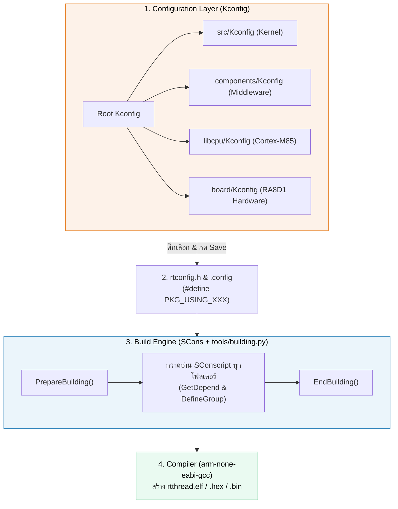

# รู้จัก SCons และ SConscript: ระบบ Build เบื้องหลัง RT-Thread

<span class="md-tag">Foundation to Deep Dive</span> <span class="md-tag">Build System</span> <span class="md-tag">SCons</span> <span class="md-tag">Env</span>

> 💡 **ทำไมต้องรู้จัก SCons?**
> ทุกครั้งที่คุณกดปุ่ม **Build** ใน RT-Thread Studio หรือรันคำสั่งใน Terminal ตัวระบบไม่ได้ใช้ `Makefile` แบบดั้งเดิม แต่ใช้ **SCons** ซึ่งเป็นระบบ Build ที่เขียนด้วยภาษา Python คอยควบคุมทั้งหมด การเข้าใจ SCons ตั้งแต่พื้นฐานไปจนถึงระดับโครงสร้างภายใน จะช่วยให้คุณสร้างโมดูลโค้ดของตัวเอง ปรับแต่ง Compiler Flags ย้ายโปรเจกต์ไปใช้บน IDE อื่น (เช่น VS Code, Keil) และแก้ปัญหา Build Error ได้อย่างแม่นยำ

## สิ่งที่คุณจะเข้าใจหลังอ่านหน้านี้

- [ ] **SCons** คืออะไร และต่างจาก `Makefile` แบบเดิมอย่างไร
- [ ] หน้าที่ของไฟล์สำคัญ 3 ตัว: **`SConstruct`**, **`SConscript`**, และ **`rtconfig.py`**
- [ ] ความสัมพันธ์แบบลูกโซ่ระหว่าง **`Kconfig` → `rtconfig.h` → `SConscript`**
- [ ] วิธีเขียนไฟล์ `SConscript` (`DefineGroup`, `GetDepend`, `SrcRemove`) เพื่อเพิ่มโฟลเดอร์โค้ดและปรับแต่ง Compiler Flags ในโปรเจกต์ RA8D1
- [ ] วงจรการทำงานเบื้องหลังของ **`tools/building.py`** (`PrepareBuilding` → `SConscript` → `EndBuilding`)
- [ ] คำสั่ง SCons และการใช้งานร่วมกับ **RT-Thread Env** (`menuconfig`, `pkgs --update`)

---

## 1. SCons คืออะไร?

**SCons (Software Construction)** คือระบบสร้างโปรเจกต์ (Build System) แบบโอเพนซอร์สที่ใช้ **ภาษา Python** เป็นหลัก ซึ่ง RT-Thread นำมาใช้แทน `Make` เพื่อคอมไพล์ซอร์สโค้ด จัดการโครงสร้างโปรเจกต์แบบโมดูล และสร้างไฟล์โปรเจกต์สำหรับ IDE ต่างๆ

### เปรียบเทียบ: Makefile (แบบเก่า) vs SCons (ใน RT-Thread)

| หัวข้อเปรียบเทียบ | Makefile (แบบเก่า) | SCons (ใน RT-Thread) |
| :--- | :--- | :--- |
| **ภาษาที่ใช้เขียน** | Syntax เฉพาะของ Make (ซับซ้อน อ่านยาก) | **ภาษา Python** (เขียนเงื่อนไข `if-else`, `loop` ได้เต็มรูปแบบ) |
| **การเช็กไฟล์เปลี่ยนแปลง** | ดูจากเวลาแก้ไขไฟล์ (Timestamp) | ดูจากเนื้อหาไฟล์จริง (**MD5 Signature**) แม่นยำกว่า |
| **การจัดการ Dependency** | ต้องเขียนกฎเชื่อมไฟล์ `.h` เอง | สแกน `#include` ให้อัตโนมัติ |
| **การแปลงโปรเจกต์ข้าม IDE** | ทำได้ยาก | พิมพ์คำสั่งเดียวแปลงเป็นไฟล์โปรเจกต์ Keil, IAR, VS Code ได้ทันที |

---

## 2. ไฟล์สำคัญในการทำงานของ SCons

เมื่อเปิดดูในโฟลเดอร์โปรเจกต์ RA8D1 หรือโฟลเดอร์ BSP คุณจะพบไฟล์หลัก 3 ตัวที่ทำงานประสานกัน:

```text
Hello-World/
├── SConstruct               ← [1] สคริปต์หลักระดับโปรเจกต์ (ควบคุมภาพรวม)
├── rtconfig.py              ← [2] ตั้งค่า CPU (Cortex-M85), Compiler, Optimization
├── rtconfig.h               ← ผลลัพธ์ค่าคอนฟิกจาก RT-Thread Settings / menuconfig
├── src/
│   ├── SConscript           ← [3] สคริปต์ย่อยสั่งคอมไพล์ไฟล์ในโฟลเดอร์ src/
│   └── hal_entry.c
├── libraries/
│   └── SConscript           ← [3] สคริปต์ย่อยสั่งคอมไพล์ไดรเวอร์ FSP และ HAL_Drivers
└── rt-thread/
    └── SConscript           ← [3] สคริปต์ย่อยสั่งคอมไพล์ Kernel ของ RT-Thread
```

1. **`SConstruct` (ตัวใหญ่ - มีไฟล์เดียว):** สคริปต์หลักระดับโปรเจกต์/BSP ที่ควบคุมกระบวนการ Build ภาพรวม เปรียบเสมือน **"ผู้จัดการใหญ่"** ที่โหลดค่าจาก `rtconfig.py` แล้ววิ่งไปกวาดอ่านไฟล์ `SConscript` ในโฟลเดอร์ย่อยทั้งหมด
2. **`rtconfig.py`:** ไฟล์กำหนดค่าสถาปัตยกรรม CPU (เช่น `arm`, `cortex-m85`), คอมไพเลอร์ (`gcc`, `keil`, `iar`), พาธของเครื่องมือ (`EXEC_PATH`) และระดับการ Optimize โค้ด (`-O0`, `-O2`)
3. **`SConscript` (ตัวเล็ก - มีทุกโฟลเดอร์):** สคริปต์ย่อยในแต่ละโฟลเดอร์หรือโมดูล ใช้ฟังก์ชันอย่าง `DefineGroup()` และ `GetDepend()` เพื่อเลือกคอมไพล์ไฟล์ตามค่าคอนฟิกจาก `rtconfig.h`

---

## 3. สถาปัตยกรรมและการทำงานร่วมกัน: `Kconfig` → `rtconfig.h` → `SConscript`

ระบบ Build ของ RT-Thread แยกความรับผิดชอบออกเป็นชั้นอย่างชัดเจน เพื่อให้ Kernel (`src/`), Middleware (`components/`), สถาปัตยกรรมซีพียู (`libcpu/`) และโค้ดเฉพาะบอร์ด (`board/`) ทำงานร่วมกันได้โดยไม่ผูกมัดกัน:



* ไฟล์ไหนที่ **ไม่ถูกติ๊กเปิด** ใน `Kconfig` → จะไม่มี `#define` ใน `rtconfig.h` → `SConscript` จะ **ไม่ส่งไฟล์ `.c` นั้นไปคอมไพล์** ทำให้ขนาดไฟล์เฟิร์มแวร์เล็กและประหยัด Flash ที่สุด!

### ตัวอย่างตัวเลือกสำคัญระดับ Kernel ใน `src/Kconfig`

| Configuration Option | ชนิดข้อมูล | ค่าเริ่มต้น | คำอธิบาย |
| :--- | :--- | :--- | :--- |
| `RT_NAME_MAX` | `int` | `12` (หรือ `8`) | ความยาวตัวอักษรสูงสุดของชื่อ Kernel Object (Thread, Mutex, Device) |
| `RT_THREAD_PRIORITY_MAX` | `choice` | `32` | จำนวนระดับความสำคัญของ Thread (เลือกได้ `8`, `32`, หรือ `256` ระดับ) |
| `RT_TICK_PER_SECOND` | `int` | `1000` | ความถี่ของ OS Tick (`1000` = 1 Tick เท่ากับ 1 มิลลิวินาที) |
| `RT_USING_SMP` | `bool` | `n` | เปิดใช้งานโหมด Multi-core (Symmetric Multiprocessing) |
| `RT_USING_SMART` | `bool` | `n` | เปิดใช้งานโหมด Hybrid Microkernel (สำหรับชิปที่มี MMU) |

---

## 4. Hands-on: วิธีสร้างโฟลเดอร์ใหม่และเขียน `SConscript` เอง

สมมติว่าคุณต้องการสร้างโฟลเดอร์ชื่อ **`my_app/`** ไว้ในโปรเจกต์เพื่อแยกโค้ดอ่านเซ็นเซอร์ให้เป็นระเบียบ:

### ขั้นตอนที่ 1: สร้างโฟลเดอร์และไฟล์โค้ด
```text
Hello-World/
└── my_app/
    ├── SConscript           ← ไฟล์สั่งงาน SCons (สร้างใหม่)
    ├── my_sensor.h
    └── my_sensor.c
```

### ขั้นตอนที่ 2: เขียนคำสั่งใน `my_app/SConscript`

```python title="my_app/SConscript" linenums="1"
from building import *
import os

# 1. ดึงตำแหน่งโฟลเดอร์ปัจจุบัน (my_app/)
cwd = GetCurrentDir()

# 2. รวบรวมไฟล์ .c ทั้งหมดในโฟลเดอร์นี้
src = Glob('*.c')
# หมายเหตุ: หากต้องการคอมไพล์เฉพาะตอนที่เปิดสวิตช์ใน rtconfig.h สามารถใช้เงื่อนไขได้:
# if GetDepend(['RT_USING_I2C']):
#     src += ['my_sensor.c']

# 3. เพิ่มโฟลเดอร์นี้เข้าไปใน Include Paths (-I) อัตโนมัติ
CPPPATH = [cwd]

# 4. สร้างกลุ่มการคอมไพล์ชื่อ 'MyApp' และส่งกลับให้ SConstruct
group = DefineGroup('MyApp', src, depend = [''], CPPPATH = CPPPATH)

Return('group')
```

### ขั้นตอนที่ 3: กด Refresh และ Build
1. ใน RT-Thread Studio คลิกขวาที่ชื่อโปรเจกต์ → กด **Refresh (F5)**
2. กดปุ่ม **Build (🔨)** → SCons จะตรวจพบโฟลเดอร์ `my_app/` และคอมไพล์ `my_sensor.c` รวมเข้าไปในเฟิร์มแวร์ให้อัตโนมัติ

---

## 5. เจาะลึกห้องเครื่อง (`tools/building.py`) และฟังก์ชันขั้นสูง

เบื้องหลังการทำงานของ SCons ใน RT-Thread ขับเคลื่อนด้วยโมดูล **`tools/building.py`** ซึ่งแบ่งวงจรการทำงานออกเป็น **3 ระยะ (Phases)**:

1. **Initialization Phase (`PrepareBuilding()`):** เตรียมสภาพแวดล้อม กำหนดตำแหน่ง Root ของ OS (`RTT_ROOT`) และตำแหน่งของบอร์ด (`BSP_ROOT`)
2. **Component Compilation (`SConscript` Execution):** วิ่งเข้าไปในแต่ละโฟลเดอร์ย่อยเพื่อรันไฟล์ `SConscript` และคัดกรองซอร์สโค้ดตามเงื่อนไขใน `rtconfig.h`
3. **Build Process Completion (`EndBuilding()`):** ลิงก์โค้ดสร้างไฟล์เฟิร์มแวร์ (`rtthread.elf`, `.hex`, `.bin`) สร้างไฟล์โปรเจกต์ IDE (`--target=...`) หรือสร้างชุดแจกจ่าย (`--make-dist`)

### ตารางฟังก์ชันควบคุมการ Build ใน `SConscript`

| ฟังก์ชัน | หน้าที่การทำงาน | ตัวอย่างการใช้งาน |
| :--- | :--- | :--- |
| **`GetCurrentDir()`** | ดึง Path ปัจจุบันของโฟลเดอร์ที่ไฟล์ `SConscript` นี้อยู่ | `cwd = GetCurrentDir()` |
| **`Glob('*.c')`** | กวาดรายชื่อไฟล์ `.c` ทุกไฟล์ในโฟลเดอร์นี้ | `src = Glob('*.c')` |
| **`GetConfigValue(name)`** | ดึงค่าตัวเลขหรือข้อความที่ตั้งไว้ใน `rtconfig.h` | `tick = GetConfigValue('RT_TICK_PER_SECOND')` |
| **`GetDepend(depend)`** | ตรวจสอบว่าเปิด Macro นี้ไว้หรือไม่ (รองรับทั้ง String และ List) | `if GetDepend(['RT_USING_I2C', 'BSP_USING_I2C0']):` |
| **`SrcRemove(src, list)`** | ลบไฟล์ `.c` ที่ไม่ต้องการออกจากรายการคอมไพล์ | `SrcRemove(src, ['unused_driver.c'])` |
| **`DefineGroup(...)`** | สร้างกลุ่มโมดูลพร้อมกำหนด Compiler/Linker Flags เฉพาะกลุ่ม | ดูตัวอย่างขั้นสูงด้านล่าง |

### ตัวอย่างการใช้ `DefineGroup()` ปรับแต่ง Compiler Flags ขั้นสูง

คุณสามารถกำหนดค่า Optimization หรือ Preprocessor Macro เฉพาะเจาะจงให้แต่ละโมดูลได้โดยไม่กระทบส่วนอื่นของโปรเจกต์ (เช่น เปิด `-O3` เฉพาะงานคำนวณ DSP/AI บน Cortex-M85):

```python title="ตัวอย่างการใช้ DefineGroup() แบบเต็มรูปแบบ"
from building import *

cwd = GetCurrentDir()
src = Glob('*.c')

# ตัวอย่างการคัดไฟล์ที่ไม่ใช้ออกตามเงื่อนไข
if GetDepend('USE_LEGACY_ALGO') == False:
    SrcRemove(src, ['legacy_algo.c'])

group = DefineGroup(
    'MyCustomDSP',
    src,
    depend = ['PKG_USING_MY_DSP'],           # คอมไพล์เฉพาะเมื่อเปิด Macro นี้
    CPPPATH = [cwd, cwd + '/inc'],           # Include Paths (-I)
    CPPDEFINES = ['USE_FAST_MATH', 'VER=2'], # Preprocessor Macros (-D)
    CFLAGS = ' -O3 -ffast-math',             # C Compiler Flags เฉพาะกลุ่มนี้
    CXXFLAGS = ' -std=c++17',                # C++ Compiler Flags
    LINKFLAGS = ' -lm'                       # Linker Options (เช่น ลิงก์ Math Library)
)

Return('group')
```

---

## 6. คำสั่ง SCons และการทำงานร่วมกับ RT-Thread Env

หากคุณเปิดหน้าต่าง Terminal (หรือ **RT-Thread Env**) เข้าไปในโฟลเดอร์โปรเจกต์ สามารถพิมพ์คำสั่งเหล่านี้ได้โดยตรง:


## Workflow การใช้งานร่วมกับ RT-Thread Env (CLI)

1. menuconfig → เปิดหน้าต่างตั้งค่าระบบและเลือกแพ็กเกจ (สร้างไฟล์ .config และอัปเดต rtconfig.h) 
2. pkgs --update → ดาวน์โหลดหรืออัปเดต Software Packages ที่เลือกไว้ใน menuconfig 
3. scons -j8 → คอมไพล์โค้ดทั้งหมดสร้างเป็นไฟล์เฟิร์มแวร์ (rtthread.elf, rtthread.hex, rtthread.bin) 


!!! warning "ข้อควรระวังสำคัญในการตั้งชื่อโฟลเดอร์"
    แนะนำให้เก็บโปรเจกต์และเครื่องมือ Env ไว้ในพาธที่ ไม่มีเว้นวรรค (Spaces) และไม่มีอักขระพิเศษหรือภาษาไทย (เช่น C:\RT-Thread\projects\ra8d1_lab) เพื่อป้องกันปัญหาสคริปต์ Python และ Compiler หาไฟล์ไม่เจอระหว่าง Build

??? failure "แก้ปัญหาเบื้องต้นเกี่ยวกับ SCons"
    สร้างไฟล์ .c ใหม่แล้ว แต่กด Build ไม่คอมไพล์ (ขึ้น Undefined reference)
    - ตรวจสอบว่าในโฟลเดอร์นั้นมีไฟล์ SConscript อยู่หรือไม่ (หากไม่มี SCons จะข้ามโฟลเดอร์นั้นไป)
    - คลิกขวาที่โปรเจกต์ใน RT-Thread Studio แล้วกด Refresh (F5) 1 ครั้งเพื่อให้ IDE อัปเดตรายชื่อไฟล์ใหม่ก่อนกด Build
    ต้องการดูว่า Compiler ส่ง Flag อะไรไปบ้างตอน Build Error
    - หากใช้ผ่าน Terminal ให้รัน scons --verbose เพื่อดูคำสั่ง arm-none-eabi-gcc แบบเต็มบรรทัด ซึ่งจะช่วยให้เห็นว่าขาด Include Path (-I) หรือ Macro (-D) ตัวไหน
    
    สั่ง scons ใน Terminal แล้วขึ้น 'scons' is not recognized
    - คำสั่ง scons ถูกติดตั้งอยู่ในชุดเครื่องมือ RT-Thread Env ไม่ได้อยู่ใน Windows PATH ปกติ หากต้องการรันผ่าน Terminal ให้เปิดผ่านโปรแกรม Env Console ของ RT-Thread แทน