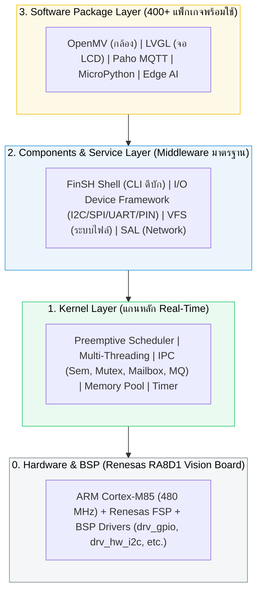

# RT-Thread Programming บนบอร์ด RA8D1 Vision Board

<span class="md-tag">Core Programming</span> <span class="md-tag">Multi-Threading</span> <span class="md-tag">IPC</span> <span class="md-tag">Vision Board</span>

> 🚀 **ก้าวข้ามการเขียนโค้ดแบบวนลูปเดียว (`while(1)`):**
> บอร์ด **RA8D1 Vision Board** มาพร้อมขุมพลัง **ARM Cortex-M85 ความเร็วสูงถึง 480 MHz** ซึ่งออกแบบมาเพื่อรองรับงานหนักพร้อมกันหลายอย่าง (เช่น ประมวลผลภาพกล้อง OpenMV, แสดงผลหน้าจอ LVGL, อ่านเซ็นเซอร์ และส่งข้อมูลขึ้น Cloud) บทนี้จะสอนให้คุณใช้ **RT-Thread Kernel** แบ่งงานเหล่านั้นออกเป็น Thread อิสระที่ทำงานประสานกันได้อย่างลื่นไหล

## สิ่งที่คุณจะเข้าใจหลังอ่านหน้านี้

- [ ] สถาปัตยกรรม 3 ชั้นของ **RT-Thread** เมื่อนำมาจับคู่กับฮาร์ดแวร์ของ **RA8D1 Vision Board**
- [ ] แนวคิด **Object-Oriented C** ของ RT-Thread Kernel
- [ ] การสร้างและจัดการ **Multi-threading** (`rt_thread_create`, Priority, Time Slice)
- [ ] การสื่อสารและซิงโครไนซ์ระหว่าง Thread (**IPC**: Semaphore และ Message Queue)
- [ ] การสร้างคำสั่ง **FinSH Shell (`MSH_CMD_EXPORT`)** เพื่อสั่งงานและดีบักบอร์ดแบบ Real-time

---

## 1. สถาปัตยกรรม RT-Thread บนบอร์ด RA8D1 Vision Board

RT-Thread ถูกออกแบบเป็นโครงสร้างแบบโมดูล 3 ชั้น (Modular Layers) และใช้สไตล์การเขียนโปรแกรมภาษา C แบบ **Object-Oriented (OOP)** ซึ่งทำงานร่วมกับบอร์ด Vision Board ดังนี้:



### ทำไม Vision Board ถึงใช้รุ่น **RT-Thread Standard** (ไม่ใช่ Nano)?
* **RT-Thread Nano:** ออกแบบมาสำหรับชิปขนาดเล็กมาก (ใช้ Flash เพียง 3 KB / RAM 1.2 KB) มีเฉพาะ Kernel พื้นฐาน
* **RT-Thread Standard (ใช้บน Vision Board):** ดึงศักยภาพของชิป RA8D1 (ที่มี Flash 2MB, SRAM 1MB และ SDRAM ภายนอก 32MB) ออกมาได้เต็มที่ ทั้งระบบไฟล์ (SD Card), Wi-Fi/BLE, กล้อง, หน้าจอ และแพ็กเกจเสริมกว่า 400 ตัว

---

## 2. แนวคิด Object-Oriented C ของ RT-Thread

แม้ RT-Thread จะเขียนด้วยภาษา C แต่โครงสร้างข้อมูลภายในถูกออกแบบให้เหมือน **Class และ Object**:  
* **Kernel Object Control Block:** ทุกอย่างในระบบ (Thread, Semaphore, Mutex, Device) มีโครงสร้างพื้นฐานร่วมกัน (ชื่อ, ประเภท, List)  
* **วงจรชีวิตมาตรฐาน (Lifecycle):**  
  1. **สร้าง (Create / Init):** จองหน่วยความจำและกำหนดค่าเริ่มต้น (เช่น `rt_thread_create`)  
  2. **เริ่มต้นทำงาน (Startup):** ส่งเข้าคิวให้ Scheduler ดูแล (`rt_thread_startup`)  
  3. **ทำงาน / รอคอย (Running / Suspend):** สลับการทำงานตาม Priority หรือหยุดรอ Event/Delay (`rt_thread_mdelay`)  
  4. **ลบ / คืนค่า (Delete / Detach):** คืนหน่วยความจำเมื่อเลิกใช้งาน  

---

## 3. Hands-on 1: การสร้าง Multi-Threading บน Vision Board

ในตัวอย่างนี้ เราจะสร้าง **2 Threads** ทำงานพร้อมกันโดยไม่ขัดจังหวะกัน:
1. **`led_thread` (Priority 20):** สั่งไฟ LED บนบอร์ดกะพริบทุกๆ 500ms
2. **`sensor_thread` (Priority 15 - สำคัญกว่า):** จำลองการอ่านค่าเซ็นเซอร์ทุกๆ 1,000ms

```c title="hal_entry.c — ตัวอย่าง Multi-Threading บน RA8D1" linenums="1"
#include <rtthread.h>
#include <rtdevice.h>
#include "hal_data.h"

#define LED_PIN    BSP_IO_PORT_01_PIN_02

/* ฟังก์ชันการทำงานของ Thread ที่ 1: ควบคุมไฟ LED */
static void led_thread_entry(void *parameter)
{
    while (1)
    {
        rt_pin_write(LED_PIN, PIN_HIGH);
        rt_thread_mdelay(500);
        rt_pin_write(LED_PIN, PIN_LOW);
        rt_thread_mdelay(500);
    }
}

/* ฟังก์ชันการทำงานของ Thread ที่ 2: อ่านค่าเซ็นเซอร์ */
static void sensor_thread_entry(void *parameter)
{
    int count = 0;
    while (1)
    {
        count++;
        rt_kprintf("[Sensor Thread] Reading data #%d on Cortex-M85...\n", count);
        rt_thread_mdelay(1000);
    }
}

void hal_entry(void)
{
    rt_thread_t tid_led, tid_sensor;

    /* 1. สร้าง Thread สำหรับ LED (Stack: 512 bytes, Priority: 20, Tick: 10) */
    tid_led = rt_thread_create("led",
                               led_thread_entry,
                               RT_NULL,
                               512,
                               20,
                               10);
    if (tid_led != RT_NULL)
    {
        rt_thread_startup(tid_led); // สั่งให้ Thread เริ่มทำงาน
    }

    /* 2. สร้าง Thread สำหรับ Sensor (Stack: 1024 bytes, Priority: 15, Tick: 10) */
    tid_sensor = rt_thread_create("sensor",
                                  sensor_thread_entry,
                                  RT_NULL,
                                  1024,
                                  15,
                                  10);
    if (tid_sensor != RT_NULL)
    {
        rt_thread_startup(tid_sensor);
    }
}
```

!!! info "เรื่องสำคัญของ Priority ใน RT-Thread"
    - ค่าตัวเลข **ยิ่งน้อย = ยิ่งสำคัญสูง** (เช่น Priority `15` สำคัญกว่า `20`)
    - เมื่อ Thread ที่สำคัญกว่าตื่นขึ้นมา Scheduler จะหยุดพัก Thread ที่สำคัญน้อยกว่าทันที (**Preemptive Scheduling**)

---

## 4. Hands-on 2: การสื่อสารระหว่าง Thread (IPC: Semaphore & Message Queue)

เมื่อแยกงานออกเป็นหลาย Thread แล้ว เราต้องมีกลไกส่งสัญญาณหรือส่งข้อมูลหากันอย่างปลอดภัย (Thread-Safe):

### 4.1 Semaphore (ธงส่งสัญญาณ — เช่น จากปุ่มกด Interrupt ไปหา Thread)
เหมาะสำหรับแจ้งเตือนเหตุการณ์แบบ *"เกิดเหตุการณ์แล้ว!"* โดยไม่กิน CPU รอ:

```c title="ตัวอย่างการใช้ Semaphore เชื่อมกับปุ่ม K1 (P907)"
static rt_sem_t btn_sem = RT_NULL;

/* ISR Callback: ทำงานสั้นที่สุด แค่ปล่อย Semaphore */
void k1_irq_callback(void *args)
{
    rt_sem_release(btn_sem); // ส่งสัญญาณปลุก Thread ที่รออยู่
}

/* Worker Thread: นอนรอจนกว่าปุ่มจะถูกกด */
static void worker_thread_entry(void *parameter)
{
    while (1)
    {
        // หยุดรอ Semaphore แบบไม่มีกำหนด (กิน CPU 0% ระหว่างรอ)
        if (rt_sem_take(btn_sem, RT_WAITING_FOREVER) == RT_EOK)
        {
            rt_kprintf("[Worker] Button K1 pressed! Processing task...\n");
        }
    }
}
```

### 4.2 Message Queue (ท่อส่งข้อมูล — เช่น ส่งค่าเซ็นเซอร์ไปให้ Thread หน้าจอ/WiFi)
เหมาะสำหรับส่งก้อนข้อมูล (Struct หรือ Array) ข้าม Thread โดยไม่เกิดปัญหาข้อมูลชนกัน:

```c title="ตัวอย่างการส่งข้อมูลผ่าน Message Queue"
struct sensor_msg {
    float temp;
    float humi;
};

static rt_mq_t sensor_mq = RT_NULL;

// 1. สร้าง Message Queue (เก็บได้สูงสุด 10 ข้อความ)
// sensor_mq = rt_mq_create("mq_sens", sizeof(struct sensor_msg), 10, RT_IPC_FLAG_FIFO);

// 2. ฝั่งส่ง (Sensor Thread):
// struct sensor_msg data = {26.5f, 58.0f};
// rt_mq_send(sensor_mq, &data, sizeof(data));

// 3. ฝั่งรับ (Cloud/Display Thread):
// struct sensor_msg recv_data;
// if (rt_mq_recv(sensor_mq, &recv_data, sizeof(recv_data), RT_WAITING_FOREVER) == RT_EOK) { ... }
```

---

## 5. Hands-on 3: สร้างคำสั่งควบคุมบอร์ดเองด้วย FinSH (`MSH_CMD_EXPORT`)

จุดเด่นที่สุดอย่างหนึ่งของ RT-Thread คือ **FinSH Console** ที่ให้คุณพิมพ์คำสั่งผ่าน Serial Terminal (`115200`) เพื่อทดสอบฟังก์ชันหรือดูสถานะระบบได้ทันทีโดยไม่ต้อง Flash โค้ดใหม่ทุกครั้ง

```c title="เพิ่มคำสั่ง 'vision_info' เข้าไปใน FinSH Shell"
#include <rtthread.h>

/* ฟังก์ชันที่จะทำงานเมื่อพิมพ์คำสั่งใน Terminal */
static void vision_info(int argc, char **argv)
{
    rt_kprintf("=== RA8D1 Vision Board System Info ===\n");
    rt_kprintf("CPU Core  : ARM Cortex-M85 @ 480 MHz\n");
    rt_kprintf("OS Kernel : RT-Thread v%d.%d.%d\n", RT_VERSION_MAJOR, RT_VERSION_MINOR, RT_VERSION_PATCH);
    
    if (argc > 1)
    {
        rt_kprintf("Argument 1: %s\n", argv[1]);
    }
}
/* ส่งออกฟังก์ชันเป็นคำสั่งใน MSH (Module Shell) */
MSH_CMD_EXPORT(vision_info, Show RA8D1 Vision Board status);
```

### คำสั่ง FinSH พื้นฐานที่ต้องใช้เป็นประจำบน Vision Board

เมื่อเปิด Serial Terminal คุณสามารถพิมพ์คำสั่งเหล่านี้เพื่อตรวจสอบสุขภาพระบบได้ทันที:

| คำสั่ง | หน้าที่การทำงาน |
| :--- | :--- |
| `help` (หรือกดปุ่ม `Tab`) | แสดงรายชื่อคำสั่งทั้งหมดที่มีในระบบ |
| `ps` (หรือ `list thread`) | ดูรายชื่อ Thread ทั้งหมด สถานะ (`running`/`suspend`) และ **อัตราการใช้ Stack สูงสุด** |
| `free` | ดูปริมาณหน่วยความจำ RAM (Heap) ที่ใช้ไปและที่เหลืออยู่ |
| `list device` | ดูรายชื่อฮาร์ดแวร์ทั้งหมดที่ลงทะเบียนใน Device Framework (`uart`, `i2c`, `spi`, `pin`) |
| `vision_info test` | ทดสอบรันคำสั่งที่เราสร้างเองพร้อมส่งพารามิเตอร์ `test` |

---

??? tip "แนวทางปฏิบัติที่ดี (Best Practices) สำหรับการเขียน RT-Thread บน RA8D1"
    1. **อย่าทำงานหนักใน Interrupt (ISR):** ในฟังก์ชัน Callback ของ GPIO หรือ UART ห้ามใส่ `rt_thread_mdelay()` และควรหลีกเลี่ยง `rt_kprintf()` ยาวๆ ให้ใช้ `rt_sem_release()` หรือ `rt_mq_send()` ส่งงานต่อให้ Thread อื่นทำแทน
    2. **เช็ก Stack Overflow เสมอด้วยคำสั่ง `ps`:** หากสร้าง Thread แล้วบอร์ดรีเซ็ตเอง ให้พิมพ์คำสั่ง `ps` ดูคอลัมน์ `max used` หากใกล้เคียง `100%` ให้เพิ่มขนาด Stack ใน `rt_thread_create()` (เช่น จาก `512` เป็น `2048`)
    3. **คืนสิทธิ์ CPU ในทุก Loop:** ใน `while(1)` ของทุก Thread ต้องมีคำสั่งที่ทำให้เกิดการสลับบริบท (Context Switch) เช่น `rt_thread_mdelay()`, `rt_sem_take()` หรือ `rt_mq_recv()` เสมอ
