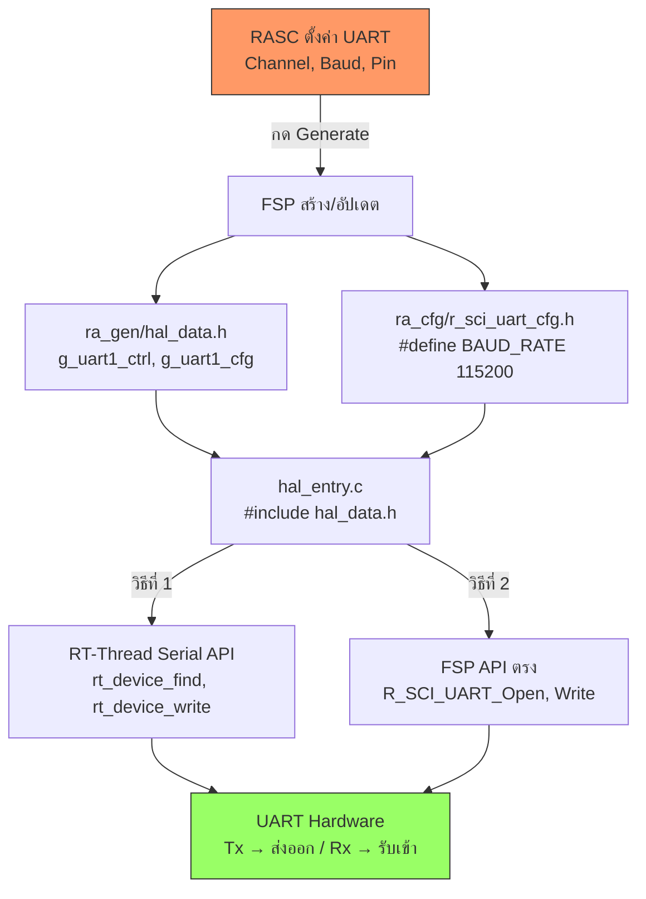

# ใช้งาน UART (Tx/Rx) บน RT-Thread

<span class="md-tag">Foundation</span> <span class="md-tag">UART</span> <span class="md-tag">Serial</span>

## สิ่งที่คุณจะเข้าใจหลังอ่านหน้านี้

- [ ] ตั้งค่า UART บนชิป RA8D1 ผ่าน FSP (RA Smart Configurator)
- [ ] เขียนโค้ด `hal_entry.c` ส่ง/รับข้อมูลผ่าน Tx/Rx
- [ ] เข้าใจว่า `#include "hal_data.h"` หาเจอได้ยังไง
- [ ] รู้ว่า `ra_gen/` และ `ra_cfg/` คืออะไร ทำอะไร
- [ ] ดู Include Paths ใน RT-Thread Studio ได้

---

## โครงสร้างโปรเจกต์ที่เกี่ยวข้อง

```text
Hello-World/
├── src/
│   └── hal_entry.c          ← เขียนโค้ด UART ที่นี่
├── ra_gen/
│   ├── hal_data.h           ← ประตูเชื่อมกับ FSP
│   └── hal_data.c           ← ตัวแปรควบคุมที่ FSP สร้าง
├── ra_cfg/
│   └── r_sci_uart_cfg.h     ← ค่าตั้งค่า UART (Baud, etc.)
├── libraries/
│   └── ra/fsp/src/r_sci_uart/ ← ไดรเวอร์ UART ระดับต่ำ
└── ...
```

---

## `hal_entry.c` เข้าถึง `ra_gen/` และ `ra_cfg/` ได้อย่างไร?

### ผ่าน `#include "hal_data.h"`

```c
#include "hal_data.h"   // ← ประตูเชื่อมกับ FSP
```

| คำสั่ง | ทำอะไร |
|--------|--------|
| `#include "xxx.h"` | ค้นหาในโฟลเดอร์เดียวกันก่อน แล้วค้นตาม Include Paths |
| `#include <xxx.h>` | ค้นหาเฉพาะใน Include Paths (ระบบ) |

!!! info "`hal_data.h` อยู่ที่ไหน?"
    ตำแหน่งจริง: **`ra_gen/hal_data.h`**
    
    แต่คอมไพเลอร์หาเจอเพราะ RT-Thread Studio **เพิ่ม `ra_gen/` เป็น Include Path** ตั้งแต่สร้างโปรเจกต์

---

## `ra_gen/` กับ `ra_cfg/` คืออะไร?

| โฟลเดอร์ | มาจากไหน | มีอะไร | ทำอะไร |
|----------|---------|--------|--------|
| **`ra_gen/`** | FSP สร้างอัตโนมัติ | `hal_data.h`, `hal_data.c`, `pin_data.c` | รวมตัวแปรควบคุมทั้งหมดที่ RASC สร้าง |
| **`ra_cfg/`** | FSP สร้างอัตโนมัติ | `r_xxx_cfg.h` (เช่น `r_sci_uart_cfg.h`) | เก็บค่าคงที่ `#define` ตั้งค่าโมดูล |

### เปรียบเทียบเหมือนอะไร?

- **`ra_gen/`** = **บลูพริ้นท์ (Blueprint)** — บอกว่ามีอะไรบ้าง (ตัวแปร, ฟังก์ชัน)
- **`ra_cfg/`** = **สเปก (Specification)** — บอกว่าตั้งค่ายังไง (Baud rate, Pin, Mode)

!!! tip "อย่าแก้ด้วยมือ!"
    ทั้งสองโฟลเดอร์ถูก **สร้าง/อัปเดตอัตโนมัติ** เมื่อกด **Generate Project Content** ใน RASC
    ถ้าแก้ด้วยมือ → กด Generate ใหม่ → โดนเขียนทับหมด!

---

## ขั้นตอนที่ 1: ตั้งค่า UART ผ่าน FSP

### 1.1 เปิด RA Smart Configurator

1. ดับเบิลคลิก **RA Smart Configurator** ใน Project Explorer
2. ไปที่แท็บ **Stacks**
3. กด **New Stack** → **Driver → Connectivity → UART (r_sci_uart)**

### 1.2 ตั้งค่า UART

| ค่า | ค่าที่ตั้ง | คำอธิบาย |
|-----|-----------|---------|
| Channel | SCI1 (หรือที่ต้องการ) | เลือกช่อง UART |
| Baud Rate | 115200 | ความเร็วส่งข้อมูล |
| TX Pin | P101 | ขาส่งข้อมูล |
| RX Pin | P100 | ขารับข้อมูล |
| Data Bits | 8 | จำนวนบิตข้อมูล |
| Stop Bits | 1 | จำนวนบิตหยุด |
| Parity | None | ไม่ตรวจสอบคู่คี่ |

### 1.3 Generate Project Content

กดปุ่ม **Generate Project Content** (มุมขวาบน)

!!! success "ผลลัพธ์"
    FSP จะสร้าง/อัปเดต:
    - `ra_gen/hal_data.h` → เพิ่มตัวแปร `g_uart1_ctrl`, `g_uart1_cfg`
    - `ra_cfg/r_sci_uart_cfg.h` → เพิ่ม `#define` ค่า Baud rate

---

## ขั้นตอนที่ 2: เขียนโค้ดใน `hal_entry.c`

### วิธีที่ 1: ใช้ RT-Thread Serial Device Framework (แนะนำ)

```c
#include <rtthread.h>
#include <rtdevice.h>
#include "hal_data.h"

#define SAMPLE_UART_NAME    "uart1"   // ชื่อตามที่ตั้งไว้

static rt_device_t serial;

void hal_entry(void)
{
    rt_kprintf("\nUART Test Start!\n");

    // 1. ค้นหา UART Device
    serial = rt_device_find(SAMPLE_UART_NAME);
    if (!serial) {
        rt_kprintf("Find %s failed!\n", SAMPLE_UART_NAME);
        return;
    }

    // 2. เปิดใช้งาน (โหมด Interrupt สำหรับ Tx/Rx)
    rt_device_open(serial, RT_DEVICE_FLAG_INT_RX | RT_DEVICE_FLAG_INT_TX);

    // 3. ส่งข้อมูลออก Tx
    char *msg = "Hello from Vision-Board!\r\n";
    rt_device_write(serial, 0, msg, rt_strlen(msg));

    while (1) {
        // 4. อ่านข้อมูลจาก Rx (ถ้ามี)
        char buf;
        if (rt_device_read(serial, -1, &buf, 1) == 1) {
            rt_kprintf("Received: %c\n", buf);
            // Echo กลับไปที่ Tx
            rt_device_write(serial, 0, &buf, 1);
        }
        rt_thread_mdelay(10);
    }
}
```

### วิธีที่ 2: ใช้ FSP API โดยตรง (Low-level)

```c
#include "hal_data.h"   // มี g_uart1_ctrl, g_uart1_cfg

void hal_entry(void)
{
    // เปิดใช้งาน UART ด้วย FSP API
    R_SCI_UART_Open(&g_uart1_ctrl, &g_uart1_cfg);
    
    // ส่งข้อมูล
    uint8_t data[] = "Hello FSP\r\n";
    R_SCI_UART_Write(&g_uart1_ctrl, data, sizeof(data));
    
    while (1) {
        rt_thread_mdelay(1000);
    }
}
```

| วิธี | ข้อดี | ข้อเสีย | เหมาะกับ |
|------|------|--------|----------|
| **RT-Thread Serial** | ใช้ Device Framework, Buffer จัดการให้, ใช้กับ Packages ได้ | ซับซ้อนกว่าเล็กน้อย | โปรเจกต์ทั่วไป, ใช้กับ Shell/Console |
| **FSP API ตรง** | ควบคุมลึก, เร็ว, ใช้ DMA ได้ | ต้องจัดการ Buffer เอง, ไม่ผ่าน OS | งานพิเศษที่ต้อง Performance สูง |

---

## ขั้นตอนที่ 3: เปิดใช้งาน UART Driver ใน RT-Thread Settings

1. เปิด **RT-Thread Settings** (icon เฟือง)
2. ไปที่ **Device Drivers**
3. เปิด **Using serial device driver framework**
4. เปิด **Enable UART hardware driver**

!!! warning "อย่าลืม!"
    ถ้าไม่เปิดใน RT-Thread Settings → Kernel จะไม่คอมไพล์ Serial Framework → `rt_device_find("uart1")` หาไม่เจอ!

---

## ดู Include Paths ใน RT-Thread Studio

### วิธีที่ 1: ผ่าน Properties

1. **คลิกขวา** ที่ชื่อโปรเจกต์ → **Properties**
2. คลิก **C/C++ General → Paths and Symbols**
3. เลือกแท็บ **Includes** → ภาษา **GNU C**


```text
ตัวอย่างรายการที่จะเห็น:
├── ${workspace_loc:/${ProjName}/ra_gen}      ← นี่แหละ!
├── ${workspace_loc:/${ProjName}/ra_cfg}
├── ${workspace_loc:/${ProjName}/src}
├── ${workspace_loc:/${ProjName}/libraries/ra/fsp/inc}
└── ...
```

### วิธีที่ 2: ผ่าน Build Settings

1. **Properties** → **C/C++ Build → Settings**
2. แท็บ **Tool Settings** → ขยาย **Cross ARM C Compiler**
3. เลือก **Includes**

```text
Include paths (-I):
-I"${workspace_loc:/${ProjName}/ra_gen}"
-I"${workspace_loc:/${ProjName}/ra_cfg}"
-I"${workspace_loc:/${ProjName}/libraries/ra/fsp/inc}"
```

!!! info "ทำไมต้องรู้?"
    ถ้าวันหนึ่งคุณย้ายไฟล์ `hal_data.h` หรือสร้าง Header เอง → ต้องมาเพิ่ม Path ที่นี่ ไม่งั้นคอมไพเลอร์หาไม่เจอ!

---

## สรุป Flow การทำงาน UART



---

## ตารางสรุป: ไฟล์ไหน ทำอะไร อยู่ที่ไหน

| ไฟล์/โฟลเดอร์ | อยู่ที่ไหน | ทำอะไร | ใครสร้าง | แก้ได้ไหม |
|-------------|----------|--------|---------|----------|
| `hal_entry.c` | `src/` | เขียนโค้ดแอปพลิเคชัน | RT-Thread Studio | ✅ แก้ได้ |
| `hal_data.h` | `ra_gen/` | ประกาศตัวแปร FSP (g_uart_ctrl, etc.) | RASC Generate | ❌ ห้ามแก้มือ |
| `hal_data.c` | `ra_gen/` | กำหนดค่าเริ่มต้นตัวแปร FSP | RASC Generate | ❌ ห้ามแก้มือ |
| `r_sci_uart_cfg.h` | `ra_cfg/` | `#define` ค่า Baud, Mode | RASC Generate | ❌ ห้ามแก้มือ |
| `r_sci_uart.c` | `libraries/ra/fsp/src/` | ไดรเวอร์ UART ระดับต่ำ | Renesas | ❌ ห้ามแก้ |
| `drv_uart.c` | `libraries/HAL_Drivers/` | RT-Thread ห่อ FSP เป็น Device API | RT-Thread | ❌ ห้ามแก้ |

---

## ตารางสรุป: วิธีที่ 1 vs วิธีที่ 2

| คุณสมบัติ | วิธีที่ 1: RT-Thread Serial | วิธีที่ 2: FSP API |
|----------|---------------------------|-------------------|
| ความง่าย | ⭐⭐⭐ ง่าย | ⭐⭐ ปานกลาง |
| ควบคุมลึก | ⭐⭐ ปานกลาง | ⭐⭐⭐ ลึก |
| มี Buffer จัดการ | ✅ มี | ❌ ต้องทำเอง |
| ใช้กับ `finsh`/`msh` | ✅ ได้ | ❌ ไม่ได้ |
| ใช้ DMA | ⚠️ ต้องตั้งค่าเพิ่ม | ✅ รองรับโดยตรง |
| ใช้ Software Package | ✅ สะดวก | ⚠️ ต้องดัดแปลง |
| เหมาะกับ | งานทั่วไป, Console, GPS, Bluetooth | งาน High-speed, Custom protocol |

---

??? failure "พบปัญหาเบื้องต้น"
    **"`rt_device_find("uart1")` หาไม่เจอ"**
    - ตรวจสอบว่าเปิด **Using serial device driver framework** ใน RT-Thread Settings
    - ตรวจสอบว่าเปิด **Enable UART hardware driver**
    - ตรวจสอบชื่อ UART (`uart0`, `uart1`, `uart2`) ว่าตรงกับที่ RASC ตั้ง

    **"ส่งข้อมูลออกไปแล้ว แต่ Terminal ไม่เห็น"**
    - ตรวจสอบ Baud rate ตรงกันไหม (ตั้ง 115200 ทั้งบอร์ดและ Terminal)
    - ตรวจสอบ Tx Pin เสียบถูกหรือไม่
    - ตรวจสอบว่าเปิด **Console** ใน RT-Thread Settings (อาจ conflict)

    **"รับข้อมูลจาก Rx ไม่ได้"**
    - ตรวจสอบว่าเปิด Flag `RT_DEVICE_FLAG_INT_RX`
    - ตรวจสอบ Pull-up resistor บน Rx line
    - ลองเปลี่ยน `rt_device_read(serial, -1, ...)` → `rt_device_read(serial, 0, ...)`

    **"Generate แล้ว `hal_data.h` ไม่มี `g_uart1_ctrl`"**
    - ตรวจสอบว่า RASC ตั้งค่า UART เสร็จและกด **Generate**
    - ตรวจสอบว่าเลือก Channel ถูกต้อง
    - ลอง Clean Project แล้ว Build ใหม่
