# ติดตั้ง RT-Thread IDE

RT-Thread Studio คือ Integrated Development Environment (IDE) แบบครบวงจรและฟรี ที่ออกแบบมาเฉพาะสำหรับการพัฒนา IoT ด้วยระบบปฏิบัติการ RT-Thread จุดเด่นคือช่วยลดความยุ่งยากในการพัฒนา embedded system โดยรวมการสร้างโปรเจกต์ การตั้งค่าแบบกราฟิก การเขียนโค้ด การดีบัก และการจัดการแพ็กเกจไว้ในเครื่องมือเดียว

## ขั้นตอน 1 เปิด browser ไปยัง [https://www.rt-thread.io/](https://www.rt-thread.io/)

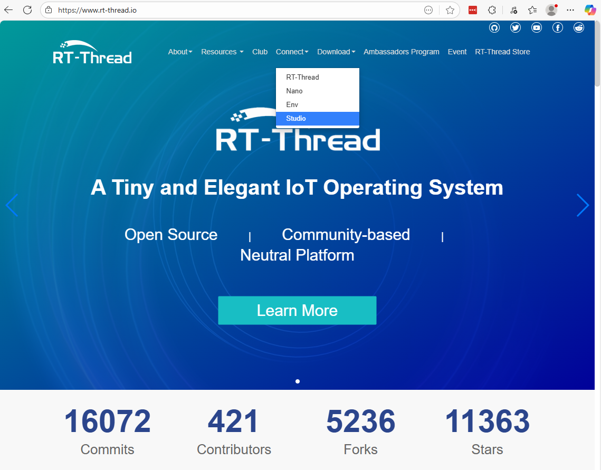

- กดไปยัง เมนู Download > Studio เพื่อเข้าสู่ หน้า Download  RT-Thread Studio
  
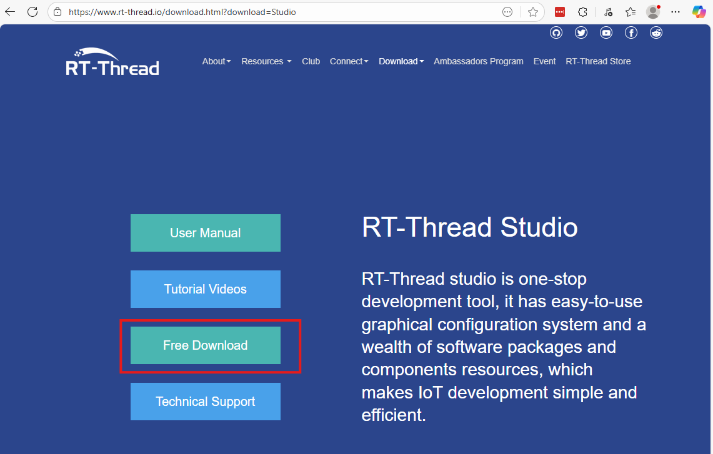

- link จะเป็น github [https://github.com/RT-Thread/rt-thread](https://github.com/RT-Thread/rt-thread)
- ไปยัง เมนู release ทางด้านขวามือ เพื่อ เข้าไป Download

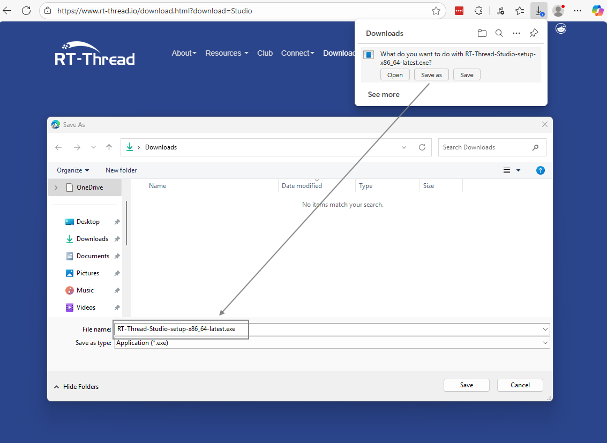

> [!NOTE]
> ให้ Download `RT-Thread-Studio-setup-x86_64-latest.exe` มายังเครื่อง ของเรา ให้เรียบร้อย  ก่อนที่จะทำการติดตั้งให้ เราสร้าง Folder ชื่อ Renesas ที่ drive C: โดย Folder นี้ จะทำหน้าเป็นเสมือน Folder สำหรับ รวมรวม Software ที่จะติดตั้ง Project ของเรา ต่อๆ ทำให้สะดวก คล่องตัวในการพัฒนา

- โครงสร้าง Structure Folder ที่จะใช้  ใน workshop
  
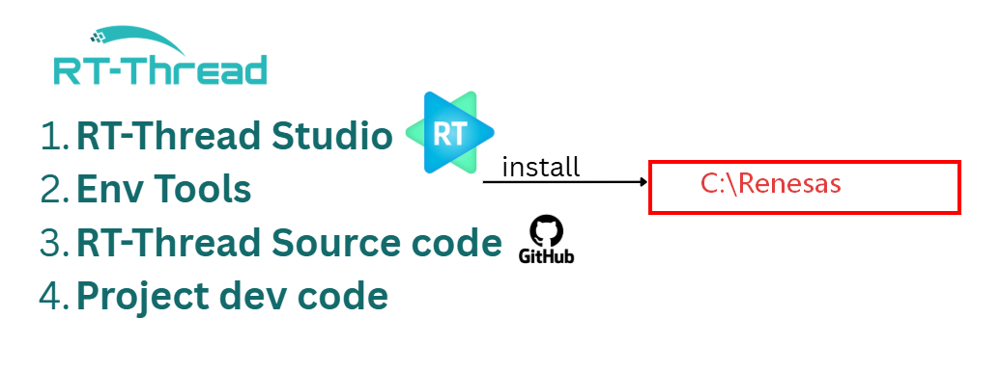

## ขั้นตอน 2 ติดตั้ง โปรแกรม  
**การติดตั้งโปรแกรม:**
- สร้าง folder ``Renesas`` ใน Drive C:
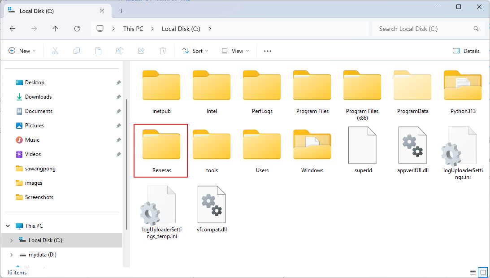
- Double Click  `RT-Thread-Studio-setup-x86_64-latest.exe`
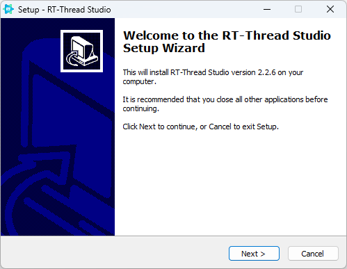
- กด next  
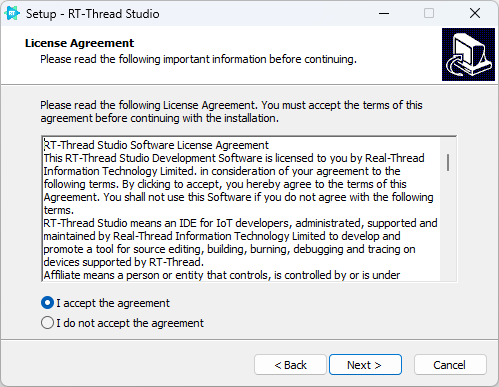
- เลือกยอมรับ ``I Accept Agreement`` และ กด ``Next``  และให้เปลี่ยน จาก D: -> C:\Renesas ก่อน แล้วกด ``ok``
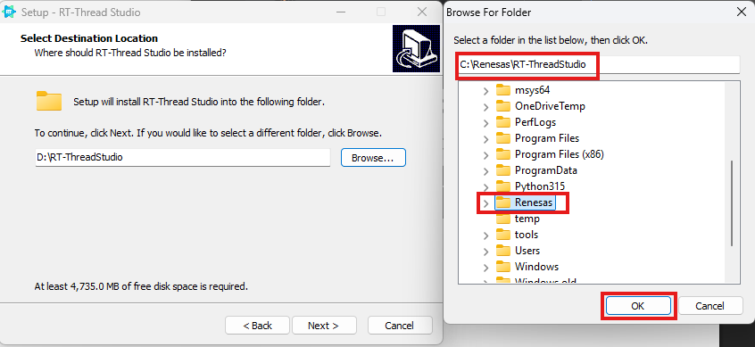
- ให้มั่นใจว่าเรา ติดตั้งใน ตำแหน่งทีต้องการ ถ้าเรียบร้อยให้ดำเนินการกด ``Next`` ได้เลย
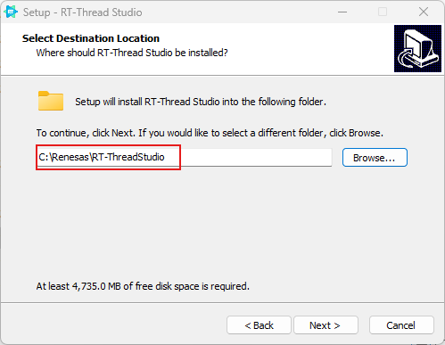
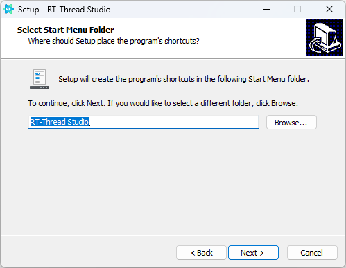
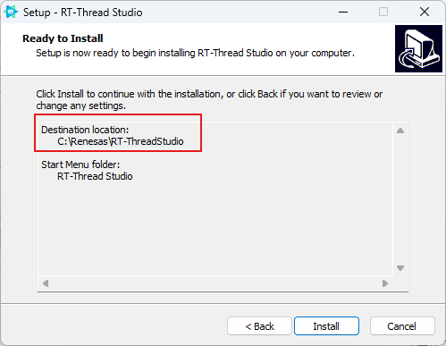

- กด install ได้เลย รอจดกว่าจะเสร็จสิ้น (2-3 นาที)
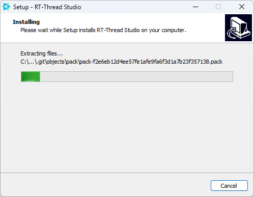
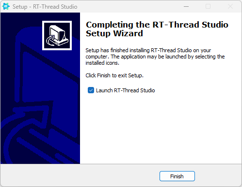

- กด Finish เพื่อ ลอง launch Studio ได้เลย เพื่อดูว่า การติดตั้ง ได้สมบูรณ์ หรือไม่  
  
## เปิดโปรแกรม 
- Load program  
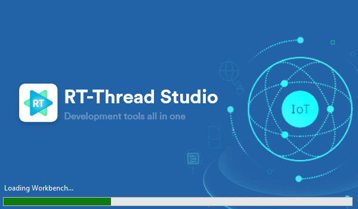
- จะพบกับหน้า welcome มี link ไปยัง Resource ต่างๆ ที่ทาง RT-Thread
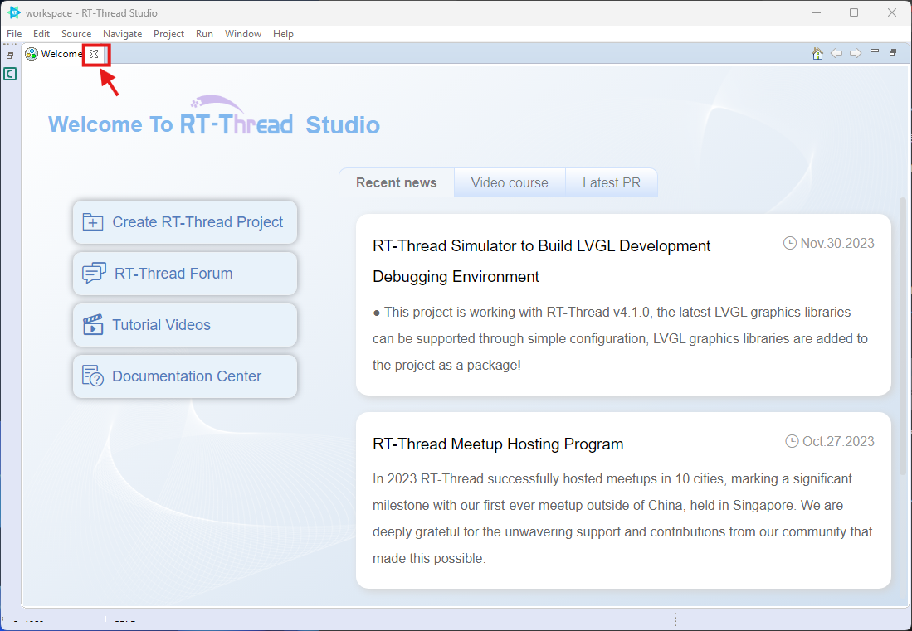

## ติดตั้ง SDK ด้วย SDK Manager   "คลัง Software"
SDK Manager ใน RT-Thread Studio คือเครื่องมือจัดการซอฟต์แวร์ที่ใช้สำหรับดาวน์โหลดและอัปเดตแพ็กเกจซอร์สโค้ดของ RT-Thread แบบออนไลน์ หน้าที่หลักคือช่วยให้คุณได้รับเวอร์ชันเสถียรหรือเวอร์ชันล่าสุดของโค้ดระบบปฏิบัติการ RT-Thread ได้อย่างรวดเร็ว เพื่อใช้ในโครงการพัฒนา

### หน้าหลักของ SDK
- ดาวน์โหลดและอัปเดตออนไลน์ ตาม Version: สามารถดาวน์โหลดแพ็กเกจโค้ดเวอร์ชันเสถียรของ RT-Thread ได้โดยตรงผ่านเครือข่าย และยังสามารถอัปเดตเป็นซอร์สโค้ดเวอร์ชันล่าสุดได้ด้วย
- จัดการทรัพยากรในเครื่อง: ไฟล์ที่ดาวน์โหลดมักจะถูกจัดเก็บไว้ในไดเรกทอรีทรัพยากรของ IDE (เช่น repo\Extract ใต้ไดเรกทอรีติดตั้ง) เพื่อให้โครงการอ้างอิงถึงได้

### ขั้นตอนการเรียกใชั SDK
- ไปที่ยัง shortcut menu ในตำแหน่ง 1 คือ SDK Manager  กด ได้เลย
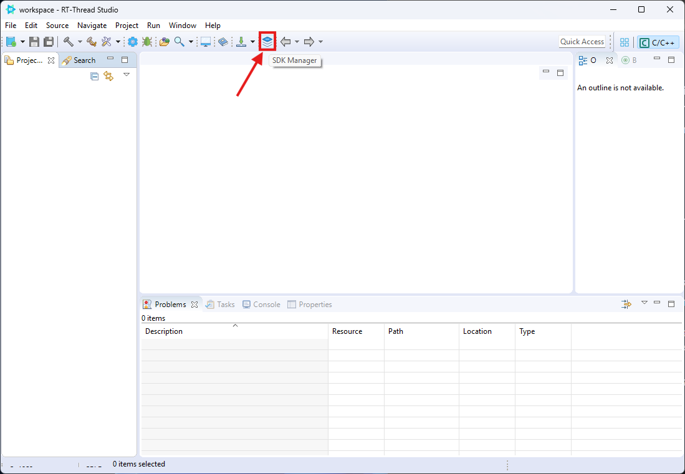
- RT-Thread SDK manager จะถูกเปิดขึ้นมา เพื่อให้เราสามารถ ติดตั้ง SDK ตามต้องการ โดย สรุป เราจะทำการติดตั้ง โดยสามารถใช้ mouse scroll เลือกเพื่อเลือก SDK ที่ต้องการ โดยเป้าหมายของเรา จะเพิ่มเติม Hardware ที่ต้องการพัฒนา โดยเลือกผ่าน BSP
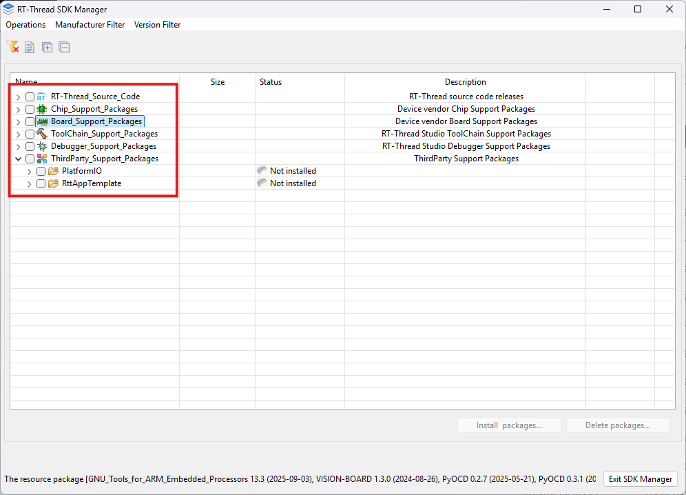

### BSP (Board Support Package) หรือ แพ็กเกจสนับสนุนระดับบอร์ด ใน RT-Thread  

คือชุดโค้ดที่เชื่อมระบบปฏิบัติการเข้ากับฮาร์ดแวร์ของบอร์ดพัฒนาเฉพาะรุ่น ทำหน้าที่เป็น "สะพานเชื่อม" ระหว่างสองส่วนนี้ เพื่อให้ระบบปฏิบัติการสามารถทำงานบนบอร์ดนั้นได้

#### หน้าที่หลักของ BSP
BSP จะห่อหุ้มรายละเอียดฮาร์ดแวร์เฉพาะของบอร์ดนั้นไว้ ช่วยให้นักพัฒนาสามารถเพ่งความสนใจไปที่การพัฒนาแอปพลิเคชันได้ โดยงานหลักๆ ได้แก่:
- เริ่มต้นฮาร์ดแวร์: รับผิดชอบการเริ่มต้นรีจิสเตอร์ภายในของชิป การตั้งค่าจังหวะการทำงานของ RAM ตลอดจนการเริ่มต้นฮีปหน่วยความจำแบบไดนามิก เพื่อสร้างสภาพแวดล้อมพื้นฐานสำหรับการรันระบบปฏิบัติการ
- ให้ไดรเวอร์และอินเทอร์เฟซ: มีไดรเวอร์สำหรับอุปกรณ์ต่อพ่วงบนบอร์ด (เช่น UART, GPIO, อีเทอร์เน็ต, LCD, เป็นต้น) รวมถึงการตั้งค่าพินมัลติเพล็กซ์ (Pinmux) แอปพลิเคชันสามารถควบคุมฮาร์ดแวร์ได้โดยการเรียกใช้อินเทอร์เฟซอุปกรณ์มาตรฐานที่ RT-Thread ให้มา
- ทำให้การพอร์ตง่ายขึ้น: RT-Thread ได้จัดเตรียม BSP ไว้เกือบ 200 รายการสำหรับบอร์ดพัฒนาต่างๆ โดยทั่วไปจะมีโครงสร้างไดเรกทอรีที่คล้ายคลึงกันและมีไฟล์ README ประกอบ นักพัฒนาสามารถอ้างอิง BSP เหล่านี้เพื่อทำความเข้าใจอย่างรวดเร็วหรือดำเนินการพอร์ตกับบอร์ดใหม่
4ด้วย BSP 

สามารถเพ่งความสนใจไปที่การเขียน Application ได้ทันที

#### เลือก Vision Board BSP , Tool chan, Debugger
1. เมนู Board_Support_Packages (BSP) > Renesas > Vision-Board > 1.3.0
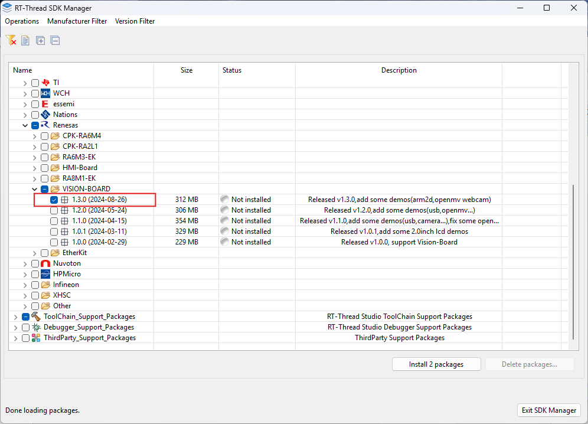

2. เมนู ToolChain_Support_Packages > GNU_Tools_for_ARM_Embeded > 13.3 (2025-09-03)
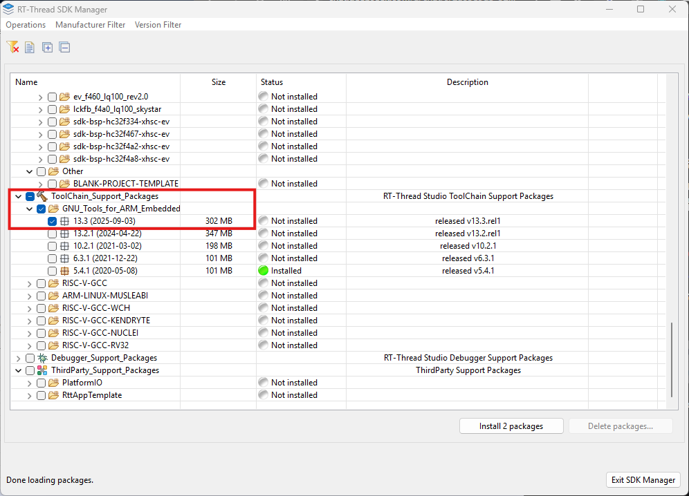

3. เมนู Debugger_Support_Packages > PyOCD > 0.3.1 และ 0.2.7 
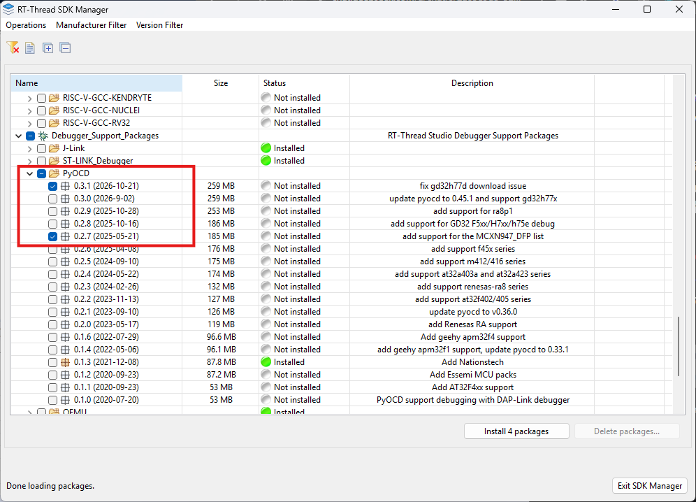

4. กด install
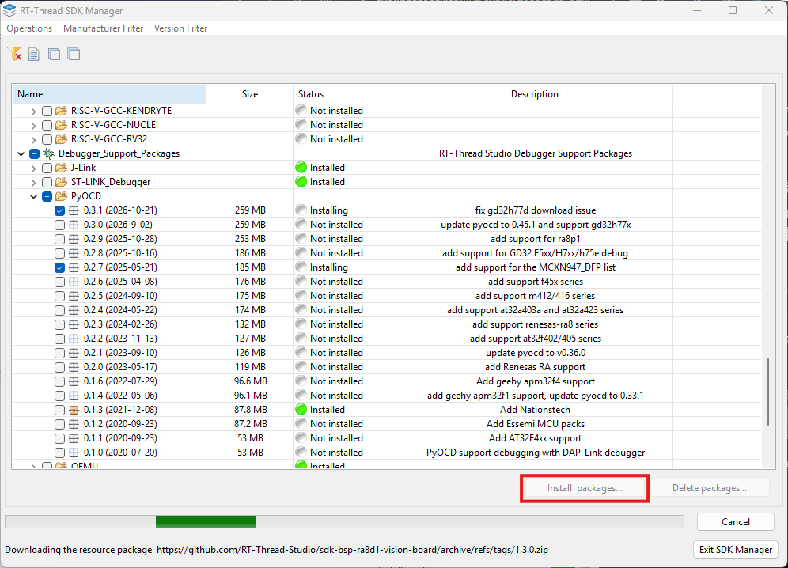

รอจนกระทั้งติดตั้งเสร็จสิ้น
### ตรวจสอบ Version ของ RT-Thread
ลองเปิด [https://github.com/RT-Thread/rt-thread](https://github.com/RT-Thread/rt-thread)
- การใช้งาน นักพัฒนาสามารถเลือก Version Sourcode  RT-Thread ที่ต้องการได้ ในส่วนของ Menu RT-Thread Source Code จะตรงกับ tag ของ Github ตามรูป แต่ใน workshop เรายังไม่เปลี่ยน version แต่หากท่านใดต้องการทดสอบก็ใช้ RT-Thread SDK manager ติดตั้งได้เช่นกัน

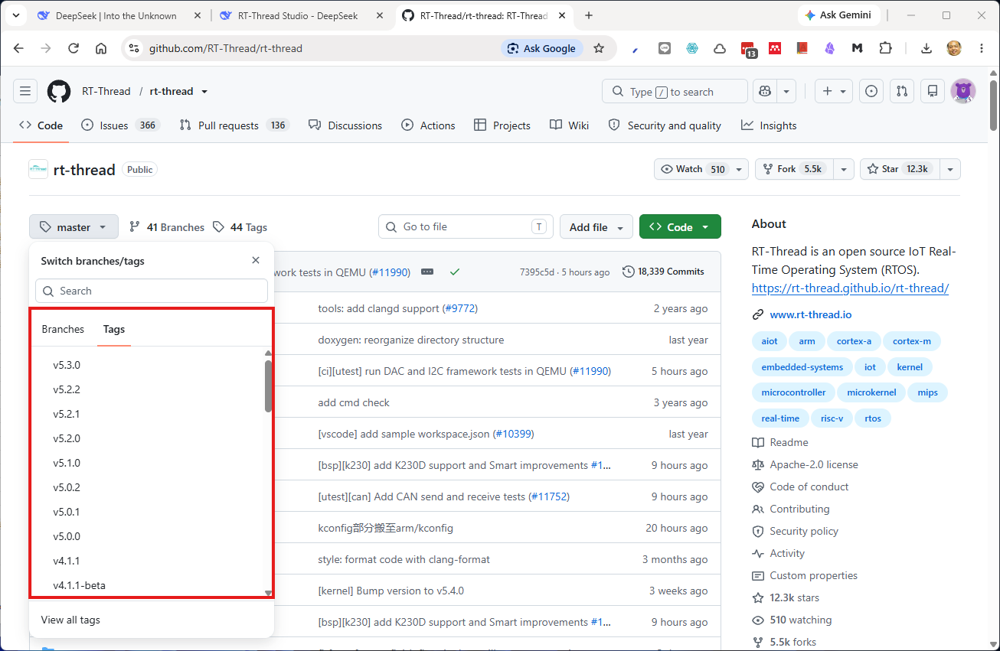

### การ update Version ตาม Github
- เนื่องจาก RT-Thread เป็น Project opensource เราจึงควรที่จะ update version ติดตามการพัฒนาได้
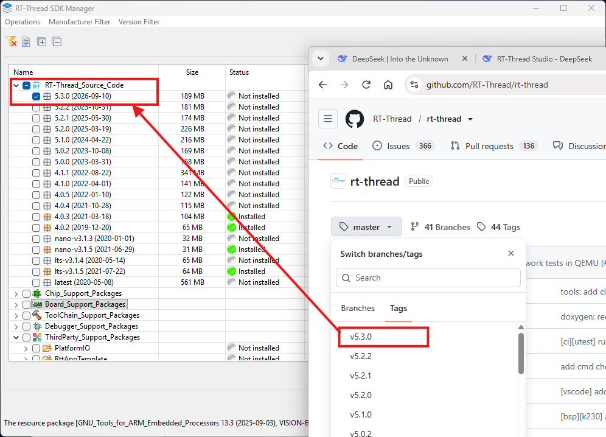
- กด update
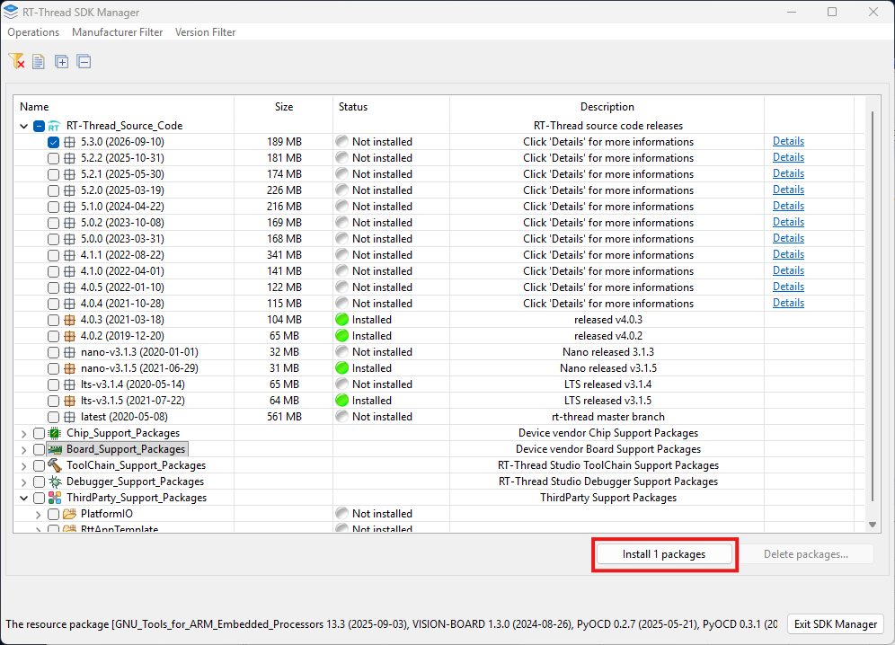

- จะเห็นว่ามี Downlaod version ใหม่
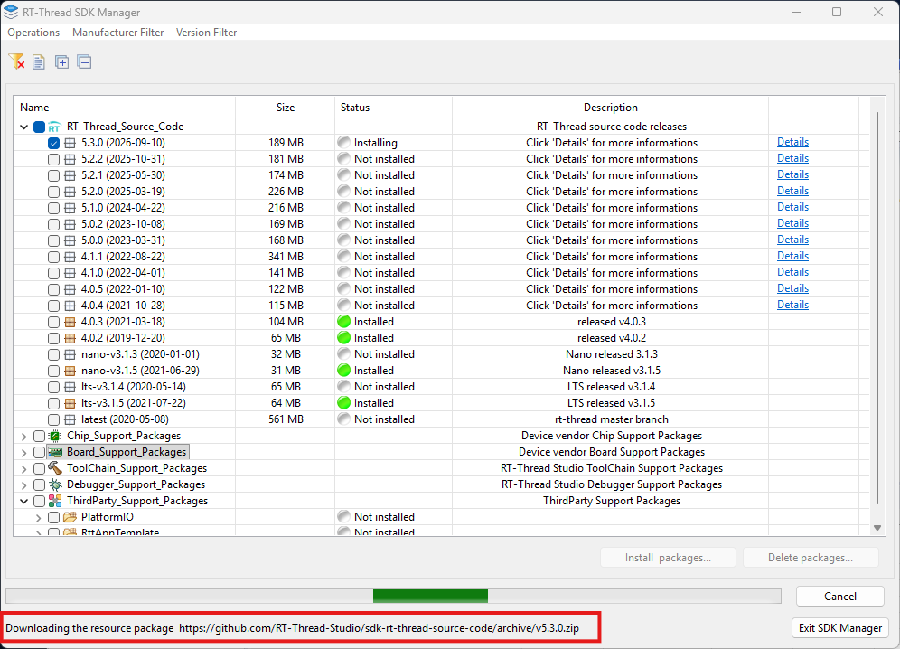

### Ref เพิ่มเติม
*หมายเหตุ* 
ท่านสามารถ ชม clip วิธีการเลือก Version : 

***จบการติดตั้ง ในส่วนของ RT-Thread Studio***
