# ติดตั้ง FSP  (Renesas Flexible Software Package) v5.1  

[Download Docs ](./fsp-flyer-r11pm0012eu0100.pdf)

**RT-Thread FSP** คือ  อะไร
RT-Thread FSP (Flexible Software Package) คือ ชุดเครื่องมือและไลบรารีที่พัฒนาโดย Renesas ร่วมกับ RT-Thread เพื่อทำให้การพัฒนาแอปพลิเคชันบนไมโครคอนโทรลเลอร์ตระกูล Renesas RA ง่ายและรวดเร็วขึ้น

ระบบปฏิบัติการเรียลไทม์ RT-Thread ทำงานร่วมกับ Renesas Flexible Software Package (FSP) ในการสร้างแอปพลิเคชันสำหรับไมโครคอนโทรลเลอร์ตระกูล Renesas RA (เช่น บอร์ด Renesas VisionBoard หรือชิป RA8D1)

[https://github.com/renesas/fsp/](https://github.com/renesas/fsp/)

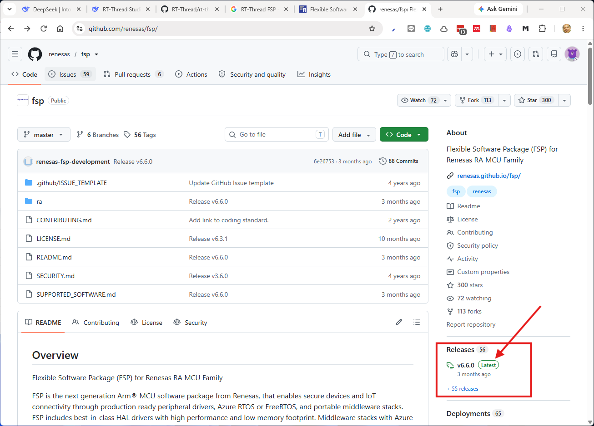{ width="500" }

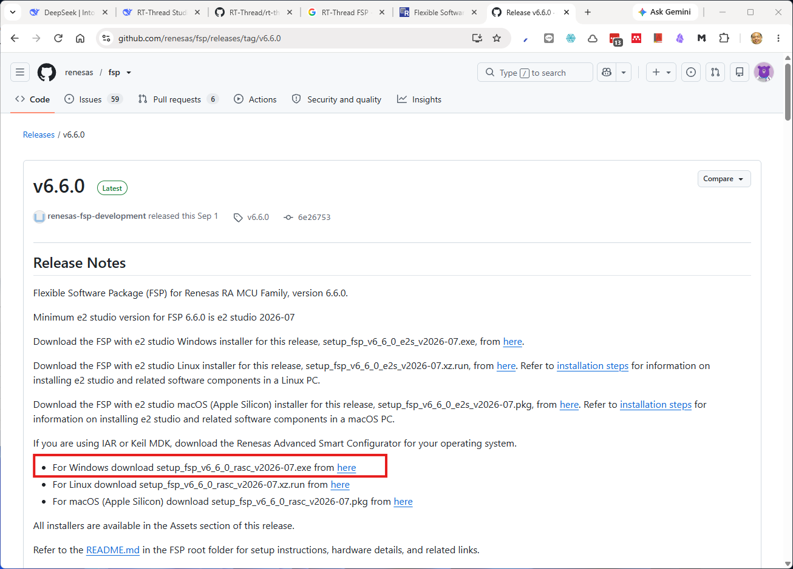{ width="500" }

Click link to dowload v6.6.0  [https://github.com/renesas/fsp/releases/download/v6.6.0/setup_fsp_v6_6_0_rasc_v2026-07.exe](https://github.com/renesas/fsp/releases/download/v6.6.0/setup_fsp_v6_6_0_rasc_v2026-07.exe)

- FSP เป็นเฟรมเวิร์กสำหรับพัฒนาแอปพลิเคชันบนไมโครคอนโทรลเลอร์ตระกูล RA (ARM Cortex-M)
- Renesas Advanced Smart Configurator - RASC  เป็นเครื่องมือที่มีสร้างที่ตั้งค่า และ สร้างโค้ด (Configuration & Code Generation) 
- Code Generation: สร้างโค้ด C ต้นแบบ (boilerplate code) อัตโนมัติจากการตั้งค่าของคุณ เช่น ฟังก์ชัน hal_entry(), initialization code, interrupt handlers

### Note ตำแหน่งในการติดตั้ง 
    เมื่อ download มาแล้ว ก็ให้ Double Click เพื่อตั้งได้เลย เปลี่ยน path ก่อนนะครับ โดยให้ชี้ไปยัง C:\Reneses เช่นเคย  

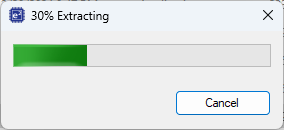{ width="500" }  
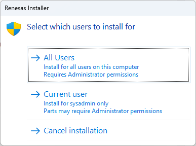{ width="500" }

### เลือก Location  C:\Renesas ในการติดตั้ง
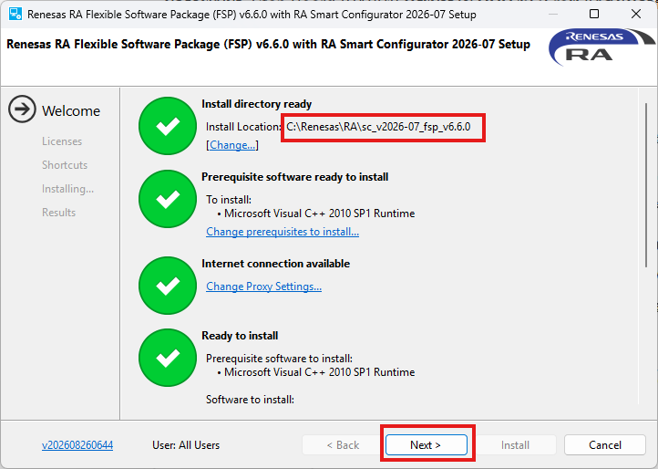{ width="500" }

- ถ้าพร้อมแล้วก็กด Next ได้เลย ยอมรับ Software Agreement และ กด Next
  
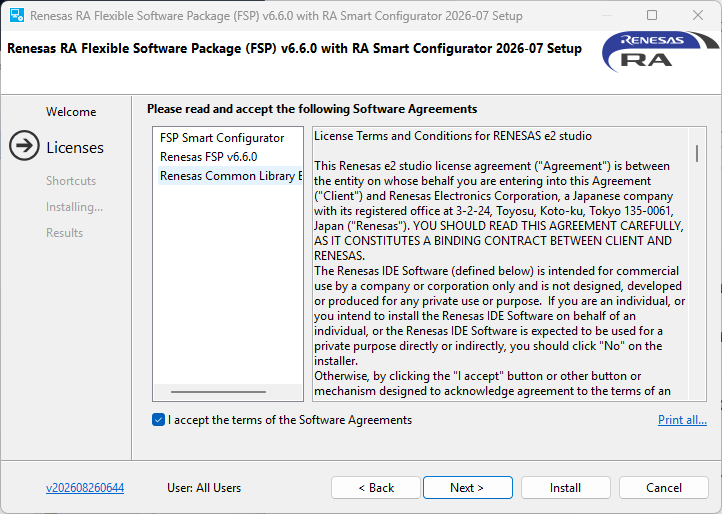{ width="500" }  

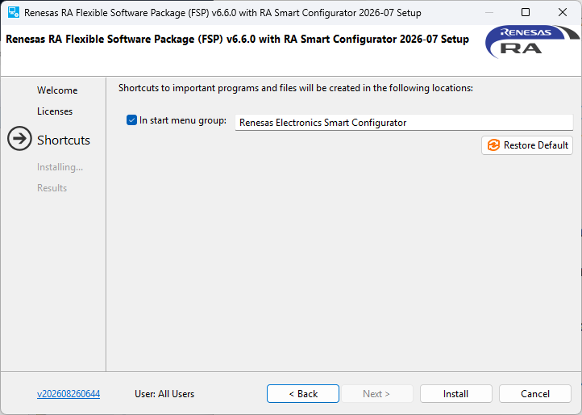{ width="500" }  

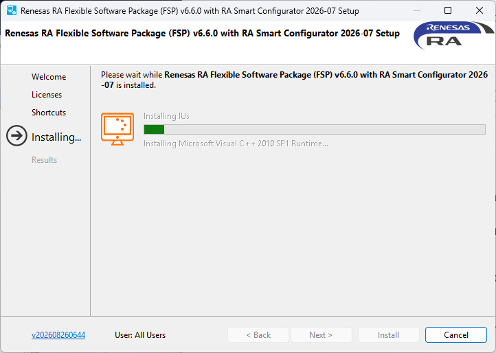{ width="500" }  
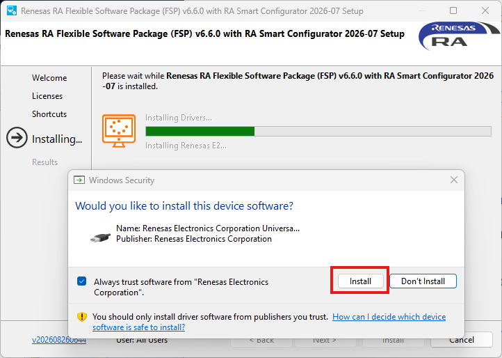{ width="500" }  

- รอประมาณ 2-3 นาที  จนเสร็จเรียบร้อยแล้ว ให้กด ``ok``

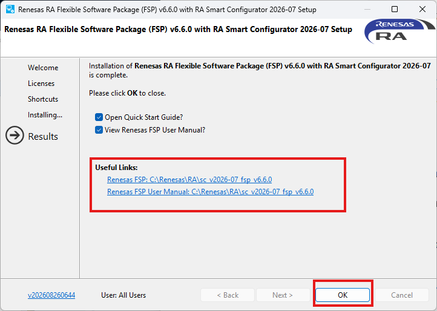{ width="500" }

### Link เข้าไปดู คู่มือ
[C:/Renesas/RA/sc_v2026-07_fsp_v6.6.0/fsp_documentation/v6.6.0/fsp_user_manual_v6.6.0/index.html](C:/Renesas/RA/sc_v2026-07_fsp_v6.6.0/fsp_documentation/v6.6.0/fsp_user_manual_v6.6.0/index.html)

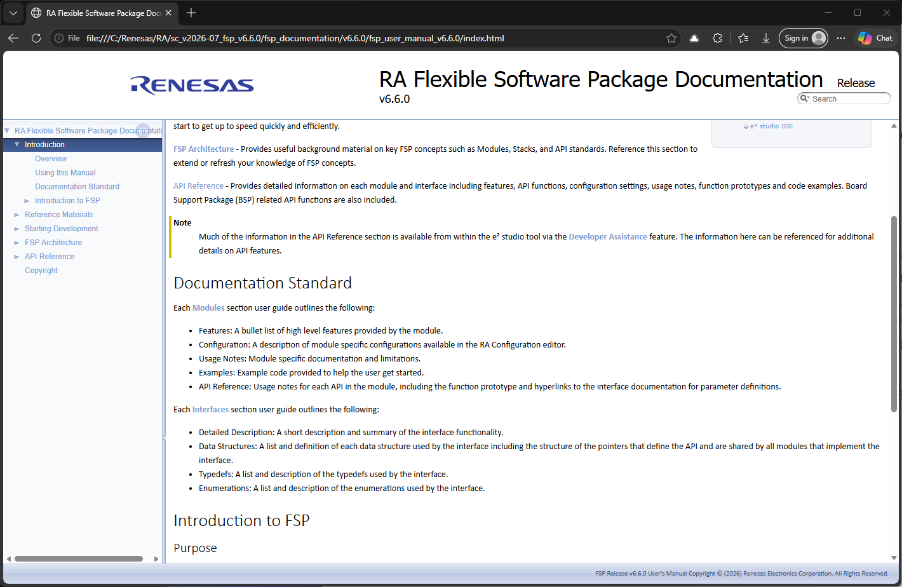{ width="500" }

***จบการติดตั้ง ในส่วนของ fsp***