# ติดตั้ง FSP

<span class="md-tag">Prerequisite</span> <span class="md-tag">10 นาที</span>

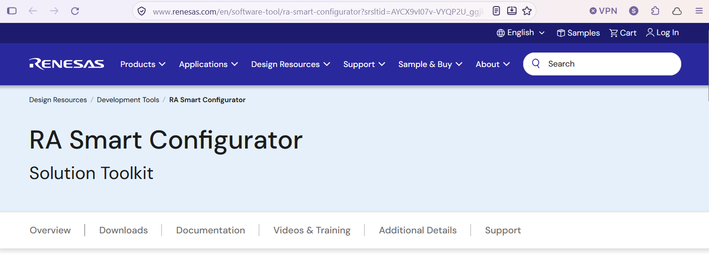

## FSP คืออะไร

**FSP (Flexible Software Package)** = ชุดซอฟต์แวร์จาก Renesas สำหรับชิป RA8D1

- มีไดรเวอร์ GPIO, UART, I2C, SPI, Timer
- มีเครื่องมือ **RA Smart Configurator** ตั้งค่าฮาร์ดแวร์แบบกราฟิก
- Studio จะใช้ FSP ตั้งค่าพินและเปิดใช้งาน peripheral

---

## วิธีติดตั้ง


### ขั้นตอน

1. ไปที่ [Download เว็บไซต์](https://github.com/renesas/fsp/releases)

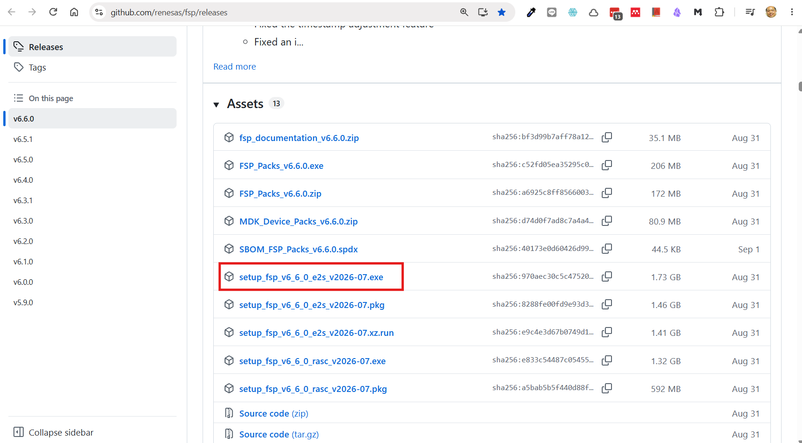

2. ดาวน์โหลด install FSP v6.60  [https://github.com/renesas/fsp/releases/download/v6.6.0/setup_fsp_v6_6_0_e2s_v2026-07.exe](https://github.com/renesas/fsp/releases/download/v6.6.0/setup_fsp_v6_6_0_e2s_v2026-07.exe)

3. Double Click file .exe และ  ติดตั้งในโฟลเดอร์ `C:\Renesas\RA\`

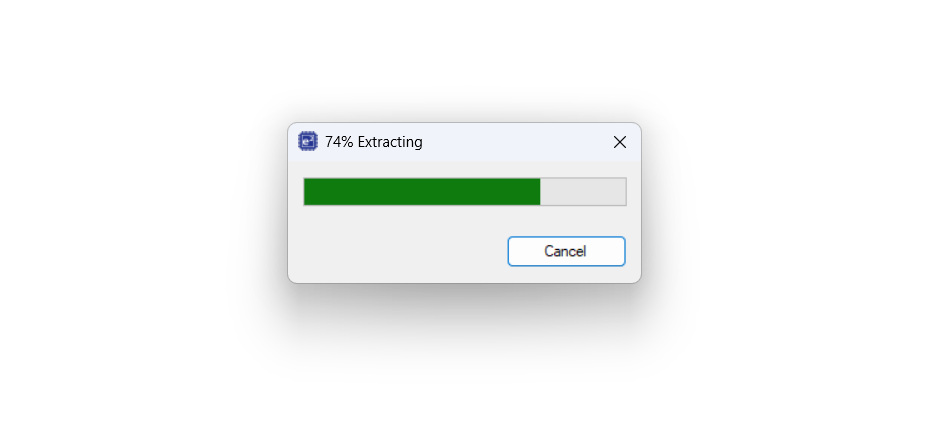

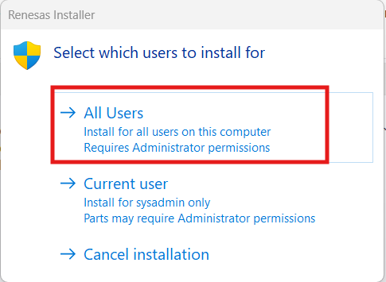

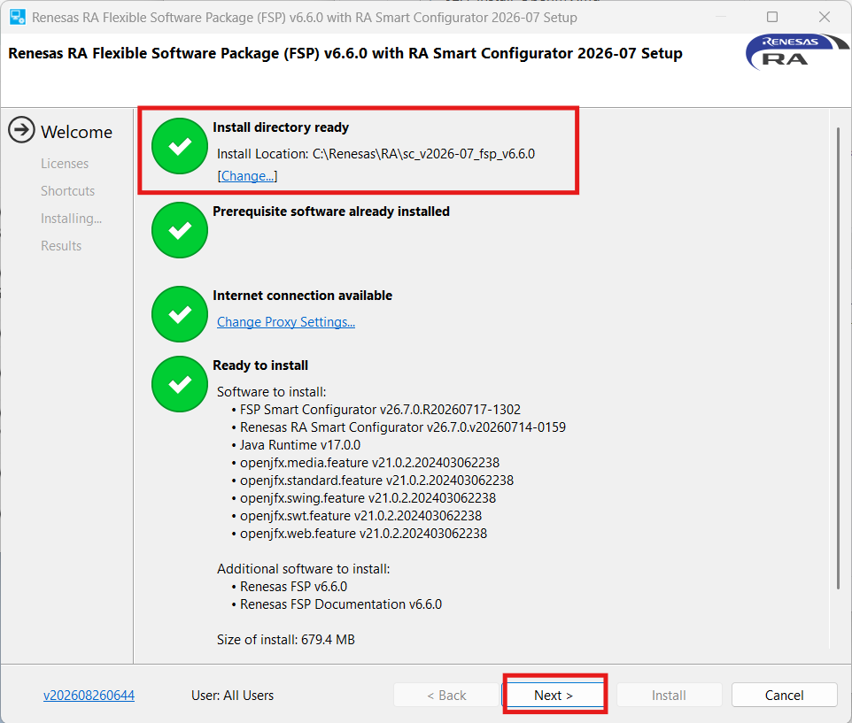

```
   location C:\Renesas\RA\sc_v2026-07_fsp_v6.6.0
```
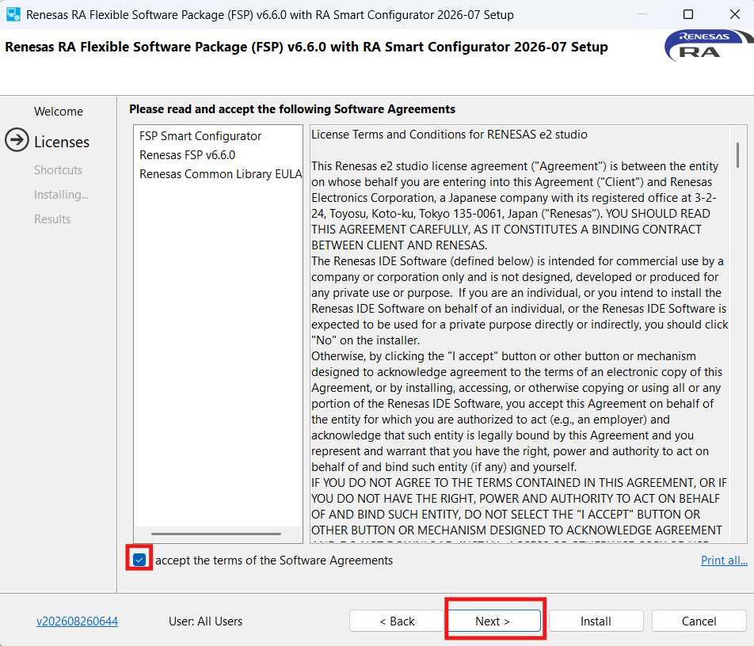

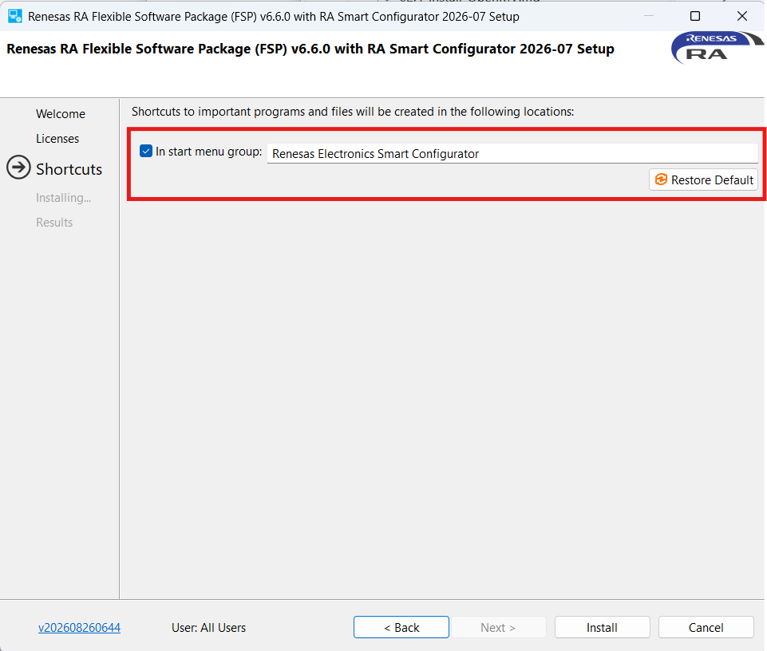

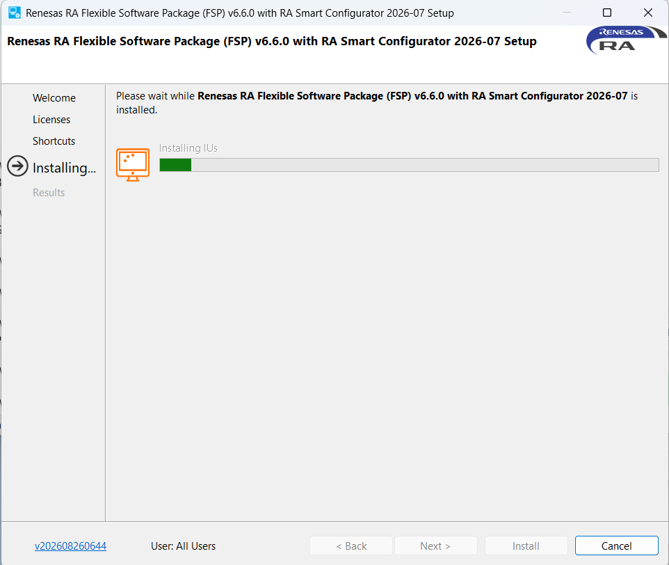


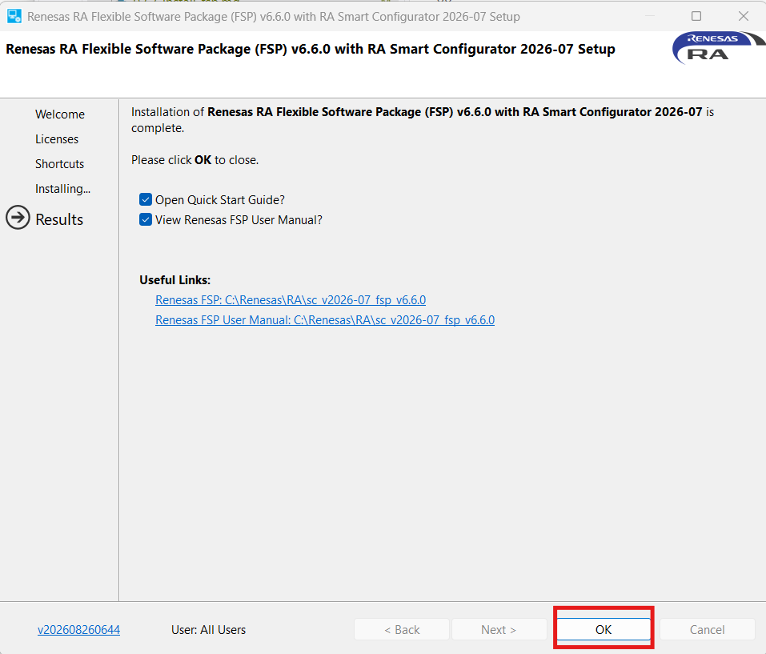

!!! success "Checkpoint"
    ✅ เห็นโฟลเดอร์ `sc_v2026-07_fsp_v6.6.0`  
    ✅ มีไฟล์ `rasc.exe` อยู่ในโฟลเดอร์นั้น

---

## วิธีใช้ FSP ใน RT-Thread Studio

1. เปิดโปรเจกต์ใน Studio

2. Double-click **RA Smart Configurator** ใน Project Explorer ขอ RT-Thread
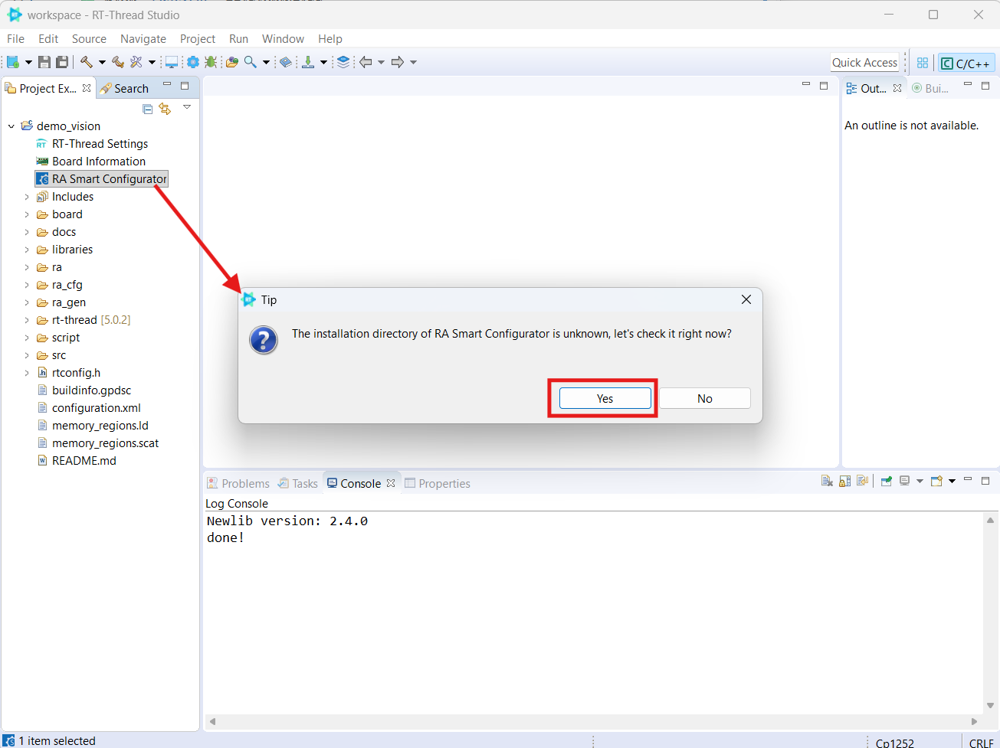

3. RT-Thread Studio จะถามว่า FSP อยู่ที่ไหน → เลือกโฟลเดอร์ที่ติดตั้งไว้
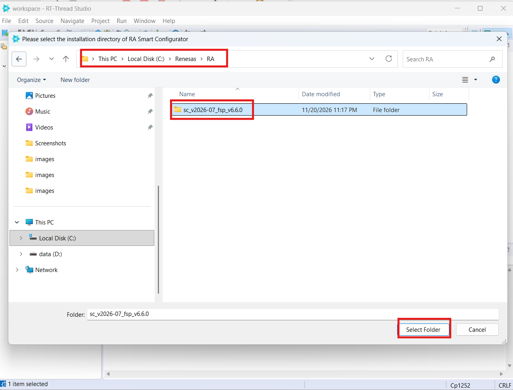

```
   C:\Renesas\RA\sc_v2026-07_fsp_v6.6.0
```
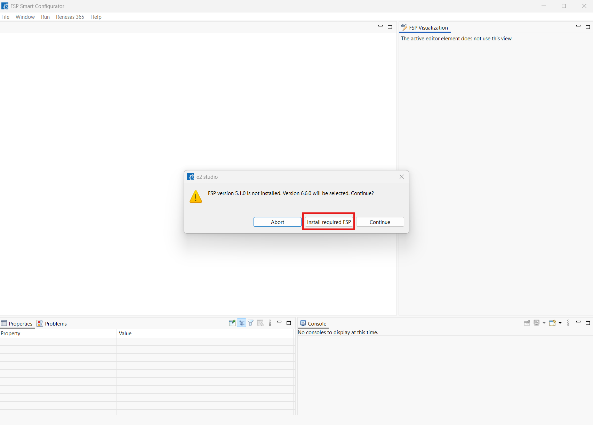

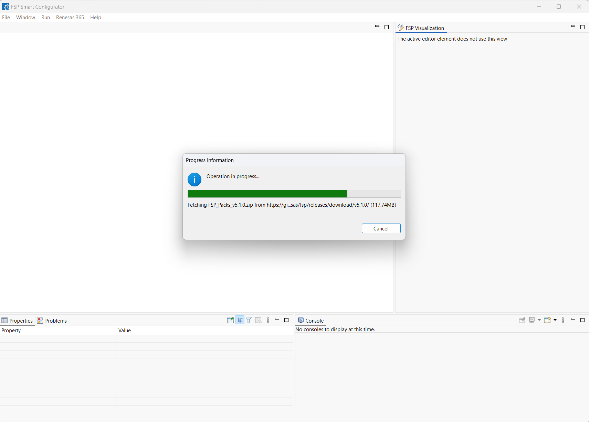

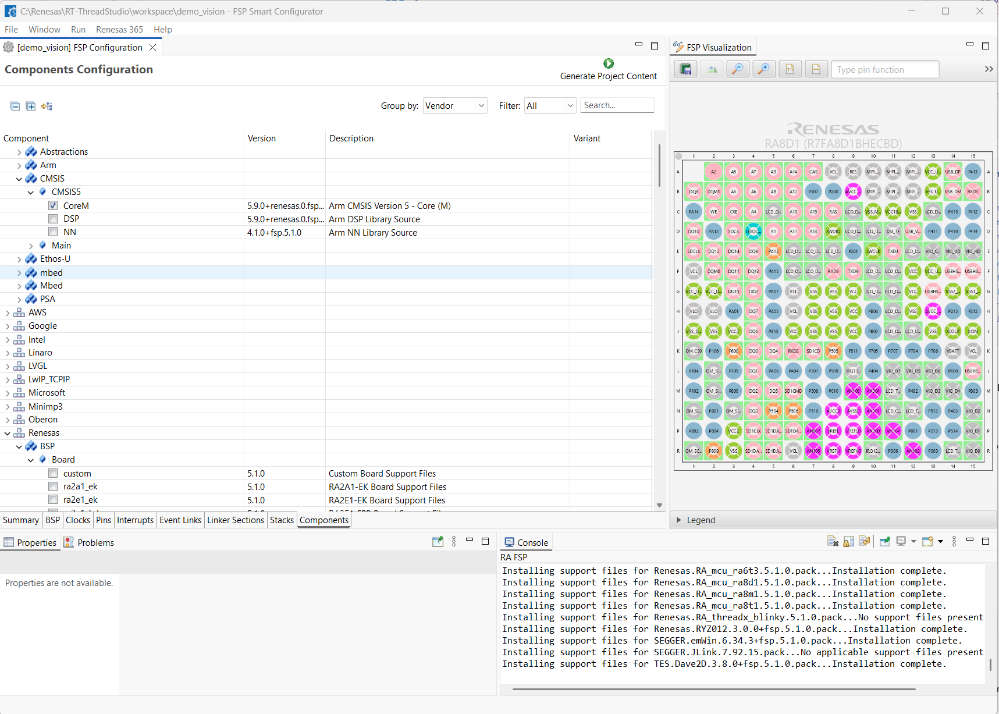


---

## สรุป FSP (Flexible Software Package)

- FSP = คลังซอฟต์แวร์ (ไดรเวอร์ + BSP + RTOS) ของ Renesas สำหรับชิป RA
- RA Smart Configurator = เครื่องมือ GUI ใช้กำหนดค่าและสร้างโค้ดจาก FSP
- Solution Toolkit = กล่องรวมเครื่องมือพัฒนา ของ Renesas (มี RA SC อยู่ข้างใน)

