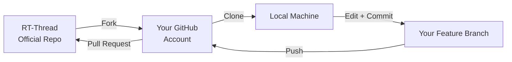
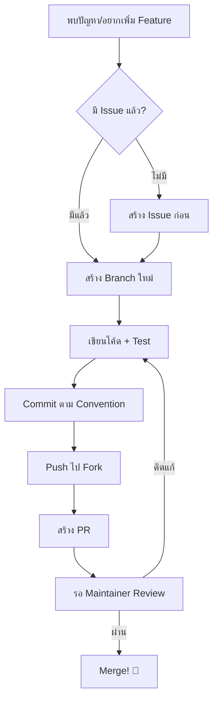

# Developer Guide: จากผู้ใช้สู่นักพัฒนา

<span class="md-tag">Upskill</span> <span class="md-tag">Work-based Learning</span> <span class="md-tag">Open Source</span>

---

## ทำไมต้องเรียน? เรียนอย่างไร? และเรียนเพื่ออะไร?

### 🎯 ทำไมต้องเรียน (Why Learn?)

ถ้าคุณผ่าน Workshop 10 บทมาจนถึงตรงนี้ แปลว่าคุณมีทักษะ **"ใช้งาน"** RT-Thread ได้แล้ว แต่โลกจริงต้องการคนที่ **"พัฒนา"** ได้ — ไม่ใช่แค่ "ใช้เป็น"

| ระดับ | ความสามารถ | ตัวอย่าง |
|-------|-----------|---------|
| **User** | ใช้เครื่องมือที่มี | สร้างโปรเจกต์จาก Template |
| **Contributor** | แก้ Bug เล็ก ๆ น้อย ๆ | แก้ Typo, อัปเดตเอกสาร |
| **Developer** | เขียน Feature/ไดรเวอร์ใหม่ | พอร์ตบอร์ดใหม่, เพิ่ม Driver |
| **Maintainer** | รีวิว PR, วางแผน Roadmap | ตัดสินใจว่า Feature ไหนเข้าไหม |

!!! success "จุดมุ่งหมายของบทนี้"
    เปลี่ยนคุณจาก **User** ให้เป็น **Contributor → Developer** ได้ด้วยตนเอง ผ่านการเข้าร่วมชุมชน Open Source จริง ๆ

### 📖 เรียนอย่างไร (How to Learn?)

** Work-based Learning** — เรียนผ่านการทำจริง:

1. **Read the Source** → อ่านโค้ดจริงของ RT-Thread ไม่ใช่แค่เอกสาร
2. **Break Things** → แก้โค้ดแล้วดูว่าพังยังไง แล้วแก้อย่างไร
3. **Contribute Back** → สิ่งที่ค้นพบ ส่งกลับไปให้ชุมชน

### 🚀 เรียนเพื่ออะไร (What For?)

- **Portfolio ที่พิสูจน์ได้** — PR ที่ถูก Merge คือหลักฐานว่าคุณทำได้จริง
- **Network ระดับโลก** — รู้จักนักพัฒนาที่ด้านทั่วโลก
- **โอกาสในอาชีพ** — บริษัท Tech หลายแห่งดู GitHub Profile ประกอบสัมภาษณ์
- **Self-branding** — "ผมเคยพอร์ตบอร์ดใหม่ให้ RT-Thread" ฟังดูดีกว่า "ผมเคยใช้ RT-Thread"

---

## แนวทางการมีส่วนร่วมในโครงการ RT-Thread

### ขั้นตอนที่ 1: Fork Repository



#### วิธี Fork

1. เข้าไปที่ [https://github.com/RT-Thread/rt-thread](https://github.com/RT-Thread/rt-thread)
2. กดปุ่ม **Fork** มุมขวาบน
3. ตั้งชื่อ Repo ของคุณ (แนะนำให้คงชื่อ `rt-thread`)
4. ตั้งค่า:
   - ✅ Copy the `master` branch only (ไม่ต้องติ๊กถ้าต้องการทุก Branch)

#### Clone ลงเครื่อง

```bash
# แทน your-username ด้วยชื่อ GitHub ของคุณ
git clone https://github.com/your-username/rt-thread.git
cd rt-thread

# เพิ่ม upstream (official repo) เพื่อดึงอัปเดต
origin ที่หล
git remote add upstream https://github.com/RT-Thread/rt-thread.git
git remote -v
# จะเห็น origin (ของคุณ) + upstream (official)
```

#### Sync กับ Upstream อย่างสม่ำเสมอ

```bash
# ดึงอัปเดตล่าสุดจาก Official
git fetch upstream
git checkout master
git merge upstream/master

# ดันไปยัง Fork ของคุณ
git push origin master
```

---

### ขั้นตอนที่ 2: เทคนิคการสร้าง Issue (ที่คนอยากช่วยแก้)

Issue ไม่ใช่แค่ "รายงาน Bug" — มันคือ **จุดเริ่มต้นของการสนทนา**

#### 🟢 Good Issue vs 🔴 Bad Issue

| 🔴 Bad | 🟢 Good |
|--------|---------|
| "Build ไม่ผ่าน" | "Build failed on RA8D1 with GCC 13.2: undefined reference to `__rt_ffs`" |
| "UART ไม่ทำงาน" | "UART0 ส่งข้อมูลออกไม่ครบบน Vision-Board: ส่ง 32 bytes ได้ 28 bytes" |
| "เอกสารผิด" | "Docs: `rt_thread_mdelay()` parameter unit ขาดระบุว่าเป็น milliseconds" |

#### Template สร้าง Issue ที่ได้ผล

```markdown
## ปัญหาที่พบ (Problem)
<!-- อธิบายสั้น ๆ ว่าเกิดอะไรขึ้น -->

## สภาพแวดล้อม (Environment)
- บอร์ด: [ระบุ เช่น RA8D1 Vision Board]
- Toolchain: [เช่น GCC 13.2.1]
- RT-Thread Version: [เช่น v5.1.0]
- IDE: [เช่น RT-Thread Studio 2.2.7]

## ขั้นตอน Reproduce
1. สร้างโปรเจกต์ใหม่ด้วย Template `ra8d1-vision-board`
2. เปิดใช้ UART0 ใน menuconfig
3. Build และ Flash
4. สังเกตว่า...

## ผลลัพธ์ที่คาดหวัง (Expected)
<!-- ควรเป็นอย่างไร -->

## ผลลัพธ์ที่ได้จริง (Actual)
<!-- เป็นอย่างไร -->

## Log / Screenshot
<!-- แนบข้อความ Error หรือรูปภาพ -->
```

#### ประเภท Label ที่ใช้ใน RT-Thread

| Label | ความหมาย | ใช้เมื่อ |
|-------|----------|---------|
| `bug` | มี Bug จริง ๆ | โปรแกรม Crash / ผิดพลาด |
| `enhancement` | ขอ Feature ใหม่ | อยากได้ความสามารถเพิ่ม |
| `documentation` | เอกสารผิด/ขาด | คำอธิบายไม่ชัดเจน |
| `good first issue` | เหมาะสำหรับมือใหม่ | อยากเริ่ม Contribute |
| `BSP` | เกี่ยวกับบอร์ด | ปัญหาเฉพาะบอร์ด |

!!! tip "ทริค: หา Issue ที่ใช่"
    ค้นหา `label:"good first issue"` ใน [Issues](https://github.com/RT-Thread/rt-thread/issues) — นี่คืองานที่ Maintainer แบ่งไว้ให้มือใหม่โดยเฉพาะ

---

### ขั้นตอนที่ 3: สร้าง Pull Request (PR) ที่ได้รับการ Merge

#### Workflow แบบมืออาชีพ



#### ชื่อ Branch ที่ควรใช้

```text
feature/uart-dma-support      ← เพิ่ม Feature
fix/ra8d1-clock-init          ← แก้ Bug
docs/rt-spi-api               ← แก้เอกสาร
bsp/ra8d1-gpio-update         ← ปรับปรุง BSP
```

#### Commit Message Convention

```text
[type]: คำอธิบายสั้น ๆ ภาษาอังกฤษ

[รายละเอียดเพิ่มเติม ถ้ามี]

Signed-off-by: ชื่อ <email@example.com>
```

| Type | ใช้เมื่อ | ตัวอย่าง |
|------|----------|---------|
| `[bsp]` | แก้ไข BSP | `[bsp] ra8d1: fix GPIO interrupt config` |
| `[component]` | แก้ Component | `[component] add lwIP 2.1.3 support` |
| `[doc]` | แก้เอกสาร | `[doc] update build guide for Linux` |
| `[fix]` | แก้ Bug ทั่วไป | `[fix] scheduler: priority inversion in mutex` |
| `[tool]` | แก้เครื่องมือ | `[tool] env: support python3.12` |

!!! warning "อย่าลืม Sign-off"
    RT-Thread ต้องการ `Signed-off-by` ใน Commit เพื่อยืนยันว่าคุณเป็นผู้แต่งจริง ๆ:
    ```bash
    git commit -s -m "[bsp] ra8d1: add SPI0 support"
    # หรือ
    git commit --signoff
    ```

#### สร้าง PR ที่ดี

**Title ต้องชัดเจน:**
```
[bsp] ra8d1-vision-board: Add support for onboard EEPROM
```

**Description ต้องครบ:**
```markdown
## เปลี่ยนแปลง (Changes)
- เพิ่มไดรเวอร์ I2C EEPROM (AT24C02)
- อัปเดต `board/Kconfig` ให้เลือกใช้ได้
- เพิ่มตัวอย่างโค้ดใน `applications/eeprom_demo.c`

## ทดสอบแล้ว (Tested)
- [x] Build ผ่านบน RT-Thread Studio 2.2.7
- [x] อ่าน/เขียน EEPROM 32 bytes ผ่าน I2C0
- [x] ทดสอบบน Vision-Board (RA8D1)

## อ้างอิง (Related)
- Fixes #1234 (ถ้าแก้ Issue ที่มีอยู่)
```

---

## แผนการ Upskill ต่อเนื่อง

### ระดับที่ 1: Contributor (1-2 เดือน)

- [ ] Fork + Clone + Sync ได้คล่อง
- [ ] แก้ Typo / อัปเดตเอกสาร แล้วส่ง PR 1-2 ครั้ง
- [ ] ตอบ Issue ที่คนอื่นถาม (ถ้ารู้คำตอบ)

### ระดับที่ 2: Developer (3-6 เดือน)

- [ ] เพิ่ม Feature เล็ก ๆ น้อย ๆ เช่น ไดรเวอร์ใหม่
- [ ] Review PR ของคนอื่น (comment ได้)
- [ ] Debug ปัญหาซับซ้อนแล้วส่ง Patch

### ระดับที่ 3: Active Member (6-12 เดือน)

- [ ] พอร์ตบอร์ดใหม่เข้า Mainline
- [ ] เป็น Maintainer ของ BSP ที่ตัวเองสนใจ
- [ ] ช่วยตอบคำถามใน Forum / Issues

---

## ช่องทางเข้าร่วมชุมชน

| ช่องทาง | ลิงก์ | ใช้ทำอะไร |
|---------|-------|----------|
| GitHub Issues | [github.com/RT-Thread/rt-thread/issues](https://github.com/RT-Thread/rt-thread/issues) | แจ้ง Bug / ขอ Feature |
| GitHub Discussions | [github.com/RT-Thread/rt-thread/discussions](https://github.com/RT-Thread/rt-thread/discussions) | ถามคำถามทั่วไป |
| Forum (中文) | [club.rt-thread.org](https://club.rt-thread.org) | ฟอรัมภาษาจีน (ใหญ่สุด) |
| Discord / QQ | ค้นหาในเอกสาร | แชทเร็ว |
| WeChat Official | RT-Thread (官方) | ข่าวสาร |

---

!!! quote "คำจำไว้"
    **"ไม่มีใครเกิดมาเป็น Developer — ทุกคนเริ่มจากการกด Fork ครั้งแรก"**

!!! tip "ขั้นตอนถัดไป"
    ลอง Fork [rt-thread](https://github.com/RT-Thread/rt-thread) ตอนนี้เลย แล้วหา Issue ที่มี Label `good first issue` สัก 1 อัน เริ่มจากการอ่านโค้ดและพยายามเข้าใจว่าปัญหาอยู่ตรงไหน — นั่นคือจุดเริ่มต้นของการเป็น Developer จริง ๆ
