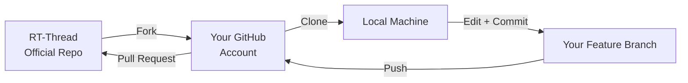
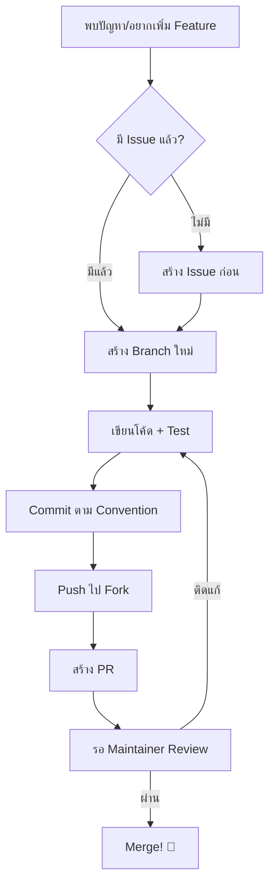

# Developer Guide: จากผู้ใช้สู่นักพัฒนา

<span class="md-tag">Upskill</span> <span class="md-tag">Work-based Learning</span> <span class="md-tag">Open Source</span>

---

## ทำไมต้องเรียน? เรียนอย่างไร? และเรียนเพื่ออะไร?

### 🎯 ทำไมต้องเรียน (Why Learn?)

ถ้าคุณผ่าน Workshop 10 บทมาจนถึงตรงนี้ แปลว่าคุณมีทักษะ **"ใช้งาน"** RT-Thread ได้แล้ว แต่โลกจริงต้องการคนที่ **"พัฒนา"** ได้ — ไม่ใช่แค่ "ใช้เป็น"

| ระดับ | ความสามารถ | ตัวอย่าง |
|-------|-----------|---------|
| **User** | ใช้เครื่องมือที่มี | สร้างโปรเจกต์จาก Template |
| **Contributor** | แก้ Bug เล็ก ๆ น้อย ๆ | แก้ Typo, อัปเดตเอกสาร |
| **Developer** | เขียน Feature/ไดรเวอร์ใหม่ | พอร์ตบอร์ดใหม่, เพิ่ม Driver |
| **Maintainer** | รีวิว PR, วางแผน Roadmap | ตัดสินใจว่า Feature ไหนเข้าไหม |

!!! success "จุดมุ่งหมายของบทนี้"
    เปลี่ยนคุณจาก **User** ให้เป็น **Contributor → Developer** ได้ด้วยตนเอง ผ่านการเข้าร่วมชุมชน Open Source จริง ๆ

### 📖 เรียนอย่างไร (How to Learn?)

** Work-based Learning** — เรียนผ่านการทำจริง:

1. **Read the Source** → อ่านโค้ดจริงของ RT-Thread ไม่ใช่แค่เอกสาร
2. **Break Things** → แก้โค้ดแล้วดูว่าพังยังไง แล้วแก้อย่างไร
3. **Contribute Back** → สิ่งที่ค้นพบ ส่งกลับไปให้ชุมชน

### 🚀 เรียนเพื่ออะไร (What For?)

- **Portfolio ที่พิสูจน์ได้** — PR ที่ถูก Merge คือหลักฐานว่าคุณทำได้จริง
- **Network ระดับโลก** — รู้จักนักพัฒนาที่ด้านทั่วโลก
- **โอกาสในอาชีพ** — บริษัท Tech หลายแห่งดู GitHub Profile ประกอบสัมภาษณ์
- **Self-branding** — "ผมเคยพอร์ตบอร์ดใหม่ให้ RT-Thread" ฟังดูดีกว่า "ผมเคยใช้ RT-Thread"

---

## แนวทางการมีส่วนร่วมในโครงการ RT-Thread

### ขั้นตอนที่ 1: Fork Repository



#### วิธี Fork

1. เข้าไปที่ [https://github.com/RT-Thread/rt-thread](https://github.com/RT-Thread/rt-thread)
2. กดปุ่ม **Fork** มุมขวาบน
3. ตั้งชื่อ Repo ของคุณ (แนะนำให้คงชื่อ `rt-thread`)
4. ตั้งค่า:
   - ✅ Copy the `master` branch only (ไม่ต้องติ๊กถ้าต้องการทุก Branch)

#### Clone ลงเครื่อง

```bash
# แทน your-username ด้วยชื่อ GitHub ของคุณ
# คำสั่งนี้จะดาวน์โหลด repo จาก GitHub ลงเครื่องของคุณ
# สร้าง hidden folder .git/ เก็บประวัติทั้งหมด และสร้าง remote ชื่อ origin ชี้ไปยัง fork ของคุณ
# origin = "แหล่งกำเนิด" ของคุณ (fork บน GitHub)
git clone https://github.com/your-username/rt-thread.git
cd rt-thread

# เช็คว่า remote มีอะไรบ้างตอนนี้ (น่าจะมีแค่ origin)
git remote -v

# เพิ่ม remote อีกตัวชื่อ upstream ชี้ไปยัง official repo
# upstream = "ต้นน้ำ" (repo หลักที่ RT-Thread ดูแล)
# ทำไมต้องมี 2 remote? เพราะ origin เปลี่ยนได้ตามใจคุณ
# แต่ upstream คือของจริงที่คนอื่น commit เข้าไปเรื่อย ๆ
git remote add upstream https://github.com/RT-Thread/rt-thread.git

# เช็คอีกครั้ง ตอนนี้ต้องเห็น 2 คู่: origin + upstream
git remote -v
```

#### Sync กับ Upstream อย่างสม่ำเสมอ

> ⚠️ **ทำไมต้อง sync?** ถ้าคุณเขียนโค้ดบน master ที่ล้าหลัง official นาน ๆ
> เวลาสร้าง PR จะเกิด **Merge Conflict** (โค้ดชนกัน) ซึ่งแก้ยากกว่ามาก

```bash
# Step 1: ดึงข้อมูลล่าสุดจาก upstream มาเก็บในเครื่อง (ยังไม่แตะโค้ดที่คุณแก้)
# fetch = "ไปเอาข้อมูลมา" (safe — ไม่ทำอะไรเสียหาย)
git fetch upstream

# Step 2: ย้ายตัวเองไปอยู่บน branch master (ถ้าอยู่ branch อื่นอยู่ ให้ commit หรือ stash ก่อน)
git checkout master

# Step 3: รวมโค้ดจาก upstream/master เข้า master ของคุณ
# merge = "รวมกัน" (สร้าง merge commit ใหม่ บันทึกว่าเราเอาของ upstream มา)
git merge upstream/master

# Step 4: ดัน master ที่อัปเดตแล้วไปยัง fork บน GitHub
git push origin master
```

**ทางลัด: `git pull` = `git fetch` + `git merge`**
แต่สำหรับมือใหม่ แนะนำให้แยกทำ `fetch` ก่อนเสมอ เพราะคุณจะได้เห็นว่ามีอะไรเปลี่ยนแปลงก่อนตัดสินใจ merge

```bash
# ทางลัด (ระวัง: ถ้ามี conflict จะตกใจ)
git checkout master
git pull upstream master
git push origin master
```

#### สร้าง Feature Branch (อย่าเขียนโค้ดบน master โดยตรง)

> ⚠️ **ทำไมต้องสร้าง branch แยก? ถ้าไม่ทำจะเกิดอะไรขึ้น?**
>
> สมมติคุณแก้โค้ดบน `master` โดยตรง แล้วส่ง PR ไป 1 อัน:
> ```
> master (ของคุณ):  A---B---C---D[แก้ UART]  ← เปิด PR #1 ไป upstream
>                              ↑
>                            คุณอยู่ตรงนี้ มีโค้ดใหม่ที่ยังไม่ merge
> ```
>
> หลังจากนั้นอีก 1 สัปดาห์ คุณอยากแก้ EEPROM อีกเรื่อง และเปิด PR #2:
> ```
> master (ของคุณ):  A---B---C---D[แก้ UART]---E[แก้ EEPROM]
>                              ↑              ↑
>                            PR #1 (รอ)   คุณอยู่ตรงนี้ แต่มีทั้ง D+E!
> ```
>
> **ปัญหาคือ:** PR #2 จะมีทั้งโค้ดแก้ UART + แก้ EEPROM ปนกัน
> เพราะ GitHub เปรียบเทียบ `master` ทั้งหมดของคุณ กับ `upstream/master`
> Maintainer จะบ่น: "ทำไม PR นี้มีโค้ด UART มาด้วย?"
>
> อีกปัญหา: ถ้า PR #1 ถูก reject หรือติดแก้ คุณจะต้องนั่งแก้บน master
> ซึ่งมีโค้ด EEPROM ปนอยู่ — งงและพังแน่นอน

**หลักการสำคัญ: "1 branch = 1 งาน = 1 PR"**

```
upstream/master:     A---B---C---F---G (official อัปเดตตลอด)
                          ↑
master (ของคุณ):    A---B---C          ← sync แล้วทิ้งไว้ให้สะอาด
                          ↓
feature/uart:        A---B---C---D      ← PR #1: แก้ UART อย่างเดียว
                          ↓
feature/eeprom:      A---B---C---E      ← PR #2: แก้ EEPROM อย่างเดียว
```

แต่ละ branch เริ่มต้นจาก `master` ที่สะอาด (sync แล้ว)
ถ้า PR #1 ถูก reject คุณก็แค่ลบ branch `feature/uart` แล้วสร้างใหม่
ไม่กระทบ `master` หรือ PR #2 เลย

```bash
# อยู่ที่ master ที่ sync แล้วก่อน (สำคัญ!)
# ถ้า master ไม่สะอาด branch ใหม่ของคุณจะเอาโค้ดเก่าที่ยังไม่ merge ติดมาด้วย
git checkout master

# สร้าง branch ใหม่ชื่อ feature/uart-dma-support แล้วย้ายไปอยู่บนนั้นทันที
# checkout = "ย้ายไปอยู่ที่" | -b = "สร้างใหม่ (branch)"
git checkout -b feature/uart-dma-support

# เช็คว่าตอนนี้อยู่ branch ไหน (ดูเครื่องหมาย * ด้านหน้า)
git branch
```

**งานเสร็จแล้ว (PR merge แล้ว) ทำความสะอาด:**

```bash
# กลับไป master
git checkout master

# ดึงอัปเดตล่าสุด (ตอนนี้ upstream มี PR คุณแล้ว)
git pull upstream master
git push origin master

# ลบ branch เก่าที่ merge แล้ว (ลบทั้ง local และ remote)
git branch -d feature/uart-dma-support
git push origin --delete feature/uart-dma-support
```

#### เขียนโค้ดแล้ว Commit

```bash
# เช็คว่ามีไฟล์อะไรเปลี่ยนแปลงบ้าง (ดูสีแดง = ยังไม่ staged, เขียว = พร้อม commit)
git status

# ดูความแตกต่างระหว่างไฟล์ในเครื่องกับ commit ล่าสุด
git diff

# เลือกไฟล์ที่จะใส่เข้าไปใน commit (stage)
# add = "เตรียมไฟล์นี้ไว้สำหรับ commit"
git add drivers/drv_uart.c
# หรือถ้าต้องการ add ทุกไฟล์ที่แก้ (ระวังอย่าเอาไฟล์ build หรือเก่าเข้าไป)
git add .

# Commit พร้อม sign-off (-s) ตามกฎของ RT-Thread
# sign-off คือการยืนยัน "ฉันเป็นคนแต่งโค้ดนี้จริง ๆ" (Developer Certificate of Origin)
git commit -s -m "[bsp] ra8d1: add UART DMA support"

# ถ้าลืมใส่ -s สามารถแก้ commit ล่าสุดได้
git commit --amend -s
```

#### Push Branch ขึ้น GitHub

```bash
# ดัน branch ปัจจุบันขึ้นไปยัง origin (fork ของคุณบน GitHub)
# -u (หรือ --set-upstream) = "จำคู่กันไว้" ครั้งหน้าใช้ git push อย่างเดียวได้เลย
git push -u origin feature/uart-dma-support

# หลังจากนี้ถ้าแก้โค้ดอีกและ commit ใหม่ ใช้แค่
git push
```

#### จัดการ Merge Conflict (เมื่อโค้ดชนกัน)

> ⚠️ เกิดเมื่อไหร่? เมื่อ upstream มีคนแก้ไฟล์เดียวกัน ที่บรรทัดเดียวกันกับคุณ
> (โดยเฉพาะถ้าคุณไม่ได้ sync master นาน)

**วิธีแก้:**

```bash
# ตัวอย่าง: คุณอยู่บน feature/xxx แล้วอยากเอาโค้ดล่าสุดจาก upstream/master มารวม
git fetch upstream
git merge upstream/master

# ถ้ามี conflict จะขึ้นประมาณนี้:
# Auto-merging drivers/drv_uart.c
# CONFLICT (content): Merge conflict in drivers/drv_uart.c
```

เปิดไฟล์ที่ conflict จะเห็น marker แบบนี้:

```c
<<<<<<< HEAD
// โค้ดของคุณ (ใน branch ปัจจุบัน)
=======
// โค้ดจาก upstream/master ที่เพิ่งดึงมา
>>>>>>> upstream/master
```

**ขั้นตอนแก้:**
1. อ่านทั้ง 2 ฝั่ง ตัดสินใจว่าจะเอาฝั่งไหน หรือรวมกันอย่างไร
2. **ลบ marker** `<<<<<<<`, `=======`, `>>>>>>>` ออกให้หมด
3. Save ไฟล์
4. บอก Git ว่าแก้แล้ว:

```bash
git add drivers/drv_uart.c
# ทำให้ commit การ merge นี้เสร็จสิ้น (ไม่ต้องใส่ -m เพราะเป็น merge commit)
git commit
```

**ทางเลือกอื่น: Rebase (สำหรับคนที่อยากให้ประวัติสะอาด)**

```bash
# rebase = "ย้าย commit ของคุณไปต่อท้าย upstream/master ล่าสุด"
# ผลลัพธ์คือไม่มี merge commit เกิดขึ้น ประวัติเป็นเส้นตรง (clean history)
git fetch upstream
git rebase upstream/master

# ถ้าเกิด conflict ระหว่าง rebase ให้แก้ไฟล์ -> add -> แล้วต่อด้วย
git rebase --continue

# ถ้ารู้สึกว่าพังแล้วอยากกลับไปก่อน rebase
git rebase --abort
```

> 💡 **มือใหม่ใช้ merge ก่อน** เพราะ rebase ถ้าทำผิดจะงงกว่า
> แต่ถ้าจริงจังกับ Open Source ต้องรู้จัก rebase เพราะ Maintainer หลายคนชอบ history สะอาด

---

### ขั้นตอนที่ 2: เทคนิคการสร้าง Issue (ที่คนอยากช่วยแก้)

Issue ไม่ใช่แค่ "รายงาน Bug" — มันคือ **จุดเริ่มต้นของการสนทนา**

#### 🟢 Good Issue vs 🔴 Bad Issue

| 🔴 Bad | 🟢 Good |
|--------|---------|
| "Build ไม่ผ่าน" | "Build failed on RA8D1 with GCC 13.2: undefined reference to `__rt_ffs`" |
| "UART ไม่ทำงาน" | "UART0 ส่งข้อมูลออกไม่ครบบน Vision-Board: ส่ง 32 bytes ได้ 28 bytes" |
| "เอกสารผิด" | "Docs: `rt_thread_mdelay()` parameter unit ขาดระบุว่าเป็น milliseconds" |

#### Template สร้าง Issue ที่ได้ผล

```markdown
## ปัญหาที่พบ (Problem)
<!-- อธิบายสั้น ๆ ว่าเกิดอะไรขึ้น -->

## สภาพแวดล้อม (Environment)
- บอร์ด: [ระบุ เช่น RA8D1 Vision Board]
- Toolchain: [เช่น GCC 13.2.1]
- RT-Thread Version: [เช่น v5.1.0]
- IDE: [เช่น RT-Thread Studio 2.2.7]

## ขั้นตอน Reproduce
1. สร้างโปรเจกต์ใหม่ด้วย Template `ra8d1-vision-board`
2. เปิดใช้ UART0 ใน menuconfig
3. Build และ Flash
4. สังเกตว่า...

## ผลลัพธ์ที่คาดหวัง (Expected)
<!-- ควรเป็นอย่างไร -->

## ผลลัพธ์ที่ได้จริง (Actual)
<!-- เป็นอย่างไร -->

## Log / Screenshot
<!-- แนบข้อความ Error หรือรูปภาพ -->
```

#### ประเภท Label ที่ใช้ใน RT-Thread

| Label | ความหมาย | ใช้เมื่อ |
|-------|----------|---------|
| `bug` | มี Bug จริง ๆ | โปรแกรม Crash / ผิดพลาด |
| `enhancement` | ขอ Feature ใหม่ | อยากได้ความสามารถเพิ่ม |
| `documentation` | เอกสารผิด/ขาด | คำอธิบายไม่ชัดเจน |
| `good first issue` | เหมาะสำหรับมือใหม่ | อยากเริ่ม Contribute |
| `BSP` | เกี่ยวกับบอร์ด | ปัญหาเฉพาะบอร์ด |

!!! tip "ทริค: หา Issue ที่ใช่"
    ค้นหา `label:"good first issue"` ใน [Issues](https://github.com/RT-Thread/rt-thread/issues) — นี่คืองานที่ Maintainer แบ่งไว้ให้มือใหม่โดยเฉพาะ

---

### ขั้นตอนที่ 3: สร้าง Pull Request (PR) ที่ได้รับการ Merge

#### Workflow แบบมืออาชีพ



#### ชื่อ Branch ที่ควรใช้

```text
feature/uart-dma-support      ← เพิ่ม Feature
fix/ra8d1-clock-init          ← แก้ Bug
docs/rt-spi-api               ← แก้เอกสาร
bsp/ra8d1-gpio-update         ← ปรับปรุง BSP
```

#### Commit Message Convention

```text
[type]: คำอธิบายสั้น ๆ ภาษาอังกฤษ

[รายละเอียดเพิ่มเติม ถ้ามี]

Signed-off-by: ชื่อ <email@example.com>
```

| Type | ใช้เมื่อ | ตัวอย่าง |
|------|----------|---------|
| `[bsp]` | แก้ไข BSP | `[bsp] ra8d1: fix GPIO interrupt config` |
| `[component]` | แก้ Component | `[component] add lwIP 2.1.3 support` |
| `[doc]` | แก้เอกสาร | `[doc] update build guide for Linux` |
| `[fix]` | แก้ Bug ทั่วไป | `[fix] scheduler: priority inversion in mutex` |
| `[tool]` | แก้เครื่องมือ | `[tool] env: support python3.12` |

!!! warning "อย่าลืม Sign-off"
    RT-Thread ต้องการ `Signed-off-by` ใน Commit เพื่อยืนยันว่าคุณเป็นผู้แต่งจริง ๆ:
    ```bash
    git commit -s -m "[bsp] ra8d1: add SPI0 support"
    # หรือ
    git commit --signoff
    ```

#### สร้าง PR บน GitHub (หลังจาก `git push` แล้ว)

```bash
# ถ้าคุณเพิ่ง push branch ใหม่ GitHub จะแสดงปุ่มสีเหลือง "Compare & pull request"
# กดปุ่มนั้น หรือเข้าไปที่หน้า repo ของคุณแล้วเลือก branch ของคุณ > กด "Pull request"
```

**Title ต้องชัดเจน:**
```
[bsp] ra8d1-vision-board: Add support for onboard EEPROM
```

**Description ต้องครบ:**
```markdown
## เปลี่ยนแปลง (Changes)
- เพิ่มไดรเวอร์ I2C EEPROM (AT24C02)
- อัปเดต `board/Kconfig` ให้เลือกใช้ได้
- เพิ่มตัวอย่างโค้ดใน `applications/eeprom_demo.c`

## ทดสอบแล้ว (Tested)
- [x] Build ผ่านบน RT-Thread Studio 2.2.7
- [x] อ่าน/เขียน EEPROM 32 bytes ผ่าน I2C0
- [x] ทดสอบบน Vision-Board (RA8D1)

## อ้างอิง (Related)
- Fixes #1234 (ถ้าแก้ Issue ที่มีอยู่)
```

#### แก้ไขตาม Review (ปกติเกิดเสมอ)

> Maintainer จะ comment บน PR ว่าให้แก้อะไร เช่น "rename variable" หรือ "add null check"
> คุณแก้บนเครื่อง แล้ว push ขึ้นไปใหม่ PR จะอัปเดตอัตโนมัติ

**แบบที่ 1: เพิ่ม Commit ใหม่ (ง่ายสุด แนะนำสำหรับมือใหม่)**

```bash
# แก้โค้ดตาม feedback
git add .
git commit -s -m "[bsp] ra8d1: fix review comments (rename var, add null check)"
git push
# PR บน GitHub จะเห็น commit ใหม่ทันที
```

**แบบที่ 2: แก้ Commit เดิมแล้ว Force Push (history สะอาด แต่ระวัง)**

```bash
# แก้โค้ดตาม feedback
git add .
# --amend = "ฉันไม่ได้ทำใหม่ ฉันแค่แก้ commit เดิม"
git commit --amend -s

# ต้อง force push เพราะ history เปลี่ยน (SHA ของ commit เปลี่ยน)
# --force-with-lease = "บังคับดัน แต่ขอเช็คก่อนว่าไม่มีใคร push ทับในระหว่างที่ฉันแก้"
git push --force-with-lease

# ⚠️ อย่าใช้ --force เปล่า ๆ บน branch ที่มีคนอื่นใช้ร่วม
# แต่บน feature branch ของตัวเองใช้ --force-with-lease ได้ปลอดภัย
```

---

## แผนการ Upskill ต่อเนื่อง

### ระดับที่ 1: Contributor (1-2 เดือน)

- [ ] Fork + Clone + Sync ได้คล่อง
- [ ] แก้ Typo / อัปเดตเอกสาร แล้วส่ง PR 1-2 ครั้ง
- [ ] ตอบ Issue ที่คนอื่นถาม (ถ้ารู้คำตอบ)

### ระดับที่ 2: Developer (3-6 เดือน)

- [ ] เพิ่ม Feature เล็ก ๆ น้อย ๆ เช่น ไดรเวอร์ใหม่
- [ ] Review PR ของคนอื่น (comment ได้)
- [ ] Debug ปัญหาซับซ้อนแล้วส่ง Patch

### ระดับที่ 3: Active Member (6-12 เดือน)

- [ ] พอร์ตบอร์ดใหม่เข้า Mainline
- [ ] เป็น Maintainer ของ BSP ที่ตัวเองสนใจ
- [ ] ช่วยตอบคำถามใน Forum / Issues

---

## ช่องทางเข้าร่วมชุมชน

| ช่องทาง | ลิงก์ | ใช้ทำอะไร |
|---------|-------|----------|
| GitHub Issues | [github.com/RT-Thread/rt-thread/issues](https://github.com/RT-Thread/rt-thread/issues) | แจ้ง Bug / ขอ Feature |
| GitHub Discussions | [github.com/RT-Thread/rt-thread/discussions](https://github.com/RT-Thread/rt-thread/discussions) | ถามคำถามทั่วไป |
| Forum (中文) | [club.rt-thread.org](https://club.rt-thread.org) | ฟอรัมภาษาจีน (ใหญ่สุด) |
| Discord / QQ | ค้นหาในเอกสาร | แชทเร็ว |
| WeChat Official | RT-Thread (官方) | ข่าวสาร |

---

!!! quote "คำจำไว้"
    **"ไม่มีใครเกิดมาเป็น Developer — ทุกคนเริ่มจากการกด Fork ครั้งแรก"**

!!! tip "ขั้นตอนถัดไป"
    ลอง Fork [rt-thread](https://github.com/RT-Thread/rt-thread) ตอนนี้เลย แล้วหา Issue ที่มี Label `good first issue` สัก 1 อัน เริ่มจากการอ่านโค้ดและพยายามเข้าใจว่าปัญหาอยู่ตรงไหน — นั่นคือจุดเริ่มต้นของการเป็น Developer จริง ๆ
