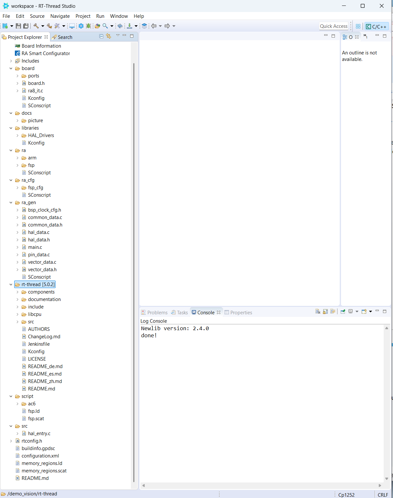
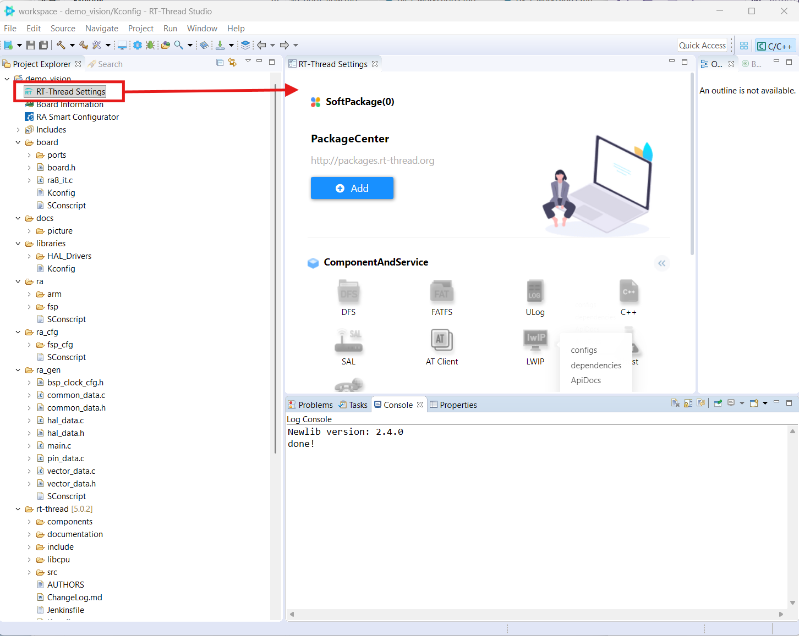

# Project Structure ใน RT-Thread 




จากภาพหน้าจอ นี่คือ **โครงสร้างไฟล์ (File Structure)** ของโปรเจกต์ RT-Thread ที่ทำงานร่วมกับ **Renesas RA8D1** ผ่าน RT-Thread Studio ซึ่งถูกออกแบบมาให้สอดคล้องกับสถาปัตยกรรมแบบแบ่งชั้นที่เราคุยกันไปก่อนหน้านี้ครับ 

ผมขอสรุปโครงสร้างตามภาพที่เห็น โดยแบ่งเป็นหมวดหมู่เพื่อให้เข้าใจง่ายขึ้นดังนี้ครับ:

### 1. ส่วนที่เกี่ยวกับ Hardware & FSP (เชื่อมต่อกับชิป RA8D1)
*   **`RA Smart Configurator`**: ไฟล์สำหรับเปิดหน้า GUI ของ Renesas เพื่อตั้งค่าพินและสร้างโค้ด FSP
*   **`ra/`**: โฟลเดอร์เก็บซอร์สโค้ดของ Renesas FSP (fsp) และส่วนจัดการ ARM (arm)
*   **`ra_gen/`**: **(สำคัญมาก)** โค้ดที่ ** auto-generate** มาจาก RA Smart Configurator เช่น `hal_data.c` (ตั้งค่า Peripheral), `pin_data.c` (ตั้งค่าพิน), `vector_data.c` (ตาราง interrupt)
*   **`ra_cfg/`**: ไฟล์คอนฟิกูเรชันของ FSP (`fsp_cfg`)
*   **`script/`**: เก็บสคริปต์เชื่อมโยง (Linker script) เช่น `fsp.ld`, `fsp.scat`

### 2. ส่วนที่เป็น BSP (Board Support Package)
*   **`board/`**: ประกอบด้วย `ports` (โค้ดพอร์ตเฉพาะบอร์ด), `board.h` และ `ra8_it.c` (จัดการ Interrupt หลักของบอร์ด)
*   **`libraries/`**: เก็บไดรเวอร์เพิ่มเติมของบอร์ด (เช่น `HAL_Drivers`)

### 3. ส่วนของ RT-Thread (ระบบปฏิบัติการ)
*   **`rt-thread/`**: ซอร์สโค้ดหลักของ RT-Thread เวอร์ชัน 5.0.2 ประกอบด้วย:
    *   `components/`: คอมโพเนนต์เสริม (I/O, DFS, SAL ฯลฯ)
    *   `include/`: ไฟล์ Header ของ Kernel
    *   `libcpu/`: โค้ดเชื่อมต่อกับ CPU สถาปัตยกรรม ARM (Cortex-M85)
    *   `src/`: ซอร์สโค้ดหลักของ Kernel (Scheduler, IPC, Memory)

### 4. ส่วนประยุกต์ใช้งานและคอนฟิกูเรชัน (Application & Config)
*   **`src/`**: มีไฟล์ `hal_entry.c` ซึ่งเป็น **จุดเริ่มต้นของโปรแกรม** (Main Entry) ที่คุณจะเขียนโค้ดแอปพลิเคชันลงไป (ใน RT-Thread มักจะใช้ `main.c` แต่สำหรับ RA8D1 จะเริ่มที่ `hal_entry.c`)
*   **`applications/`** (ถ้ามีในอนาคต): มักใช้เก็บโค้ดแอปพลิเคชันหลัก
*   **`rtconfig.h`**: ไฟล์ที่เก็บค่าคอนฟิกูเรชันทั้งหมดที่ได้จากการรัน `menuconfig` (เช่น จะเปิดใช้กล้อง, LVGL หรือไม่)
*   **`configuration.xml`**: ไฟล์สำหรับให้ RT-Thread Studio โหลดค่าต่างๆ
*   **`Kconfig`**: ไฟล์กำหนดเมนูสำหรับ `menuconfig`
*   **ไฟล์อื่นๆ**: `README.md`, `AUTHORS`, `LICENSE` (ข้อมูลโปรเจกต์)

---

!!! Tip "เป้าหมายที่สามารถทำได้"
    - หากต้องการตั้งค่าฮาร์ดแวร์ (เช่น เพิ่ม UART, ตั้งค่ากล้อง) ให้ดับเบิลคลิกที่ **`RA Smart Configurator`**
    - หากต้องการเพิ่มคอมโพเนนต์ (เช่น เปิดใช้ FinSH, เพิ่ม LVGL) ให้คลิกขวาที่โปรเจกต์แล้วเลือก **`RT-Thread Settings`** (หรือรัน `menuconfig`)
    - โค้ดที่คุณจะเขียนทดสอบ เช่น การกะพริบ LED หรือการอ่านค่ากล้อง ให้เริ่มเขียนใน **`src/hal_entry.c`**



### ขั้นตอนเริ่มต้น (Build และ Flash ลงบอร์ด)
1. Build โปรเจกต์: คลิกที่ไอคอนรูป ค้อน (Build) บนแถบเครื่องมือด้านบน (หรือกด Ctrl+B) เพื่อทดสอบการคอมไพล์โค้ดเริ่มต้น   
2. เชื่อมต่อฮาร์ดแวร์: เสียบสาย USB เข้าที่พอร์ต USB-DBG บนบอร์ด Vision Board เพื่อใช้งานทั้งการแฟลชโปรแกรมผ่าน DAP-Link และการดูข้อมูล Serial Console
3. แฟลชเฟิร์มแวร์: คลิกที่ไอคอน Flash Download (รูปชิปมีลูกศรสีเขียวชี้ลงบนแถบเครื่องมือ) เพื่ออัปโหลดโปรแกรมลงบอร์ดผ่าน PyOCD/DAP-Link

##  `ra_gen` หรือ `board` 

ในโฟลเดอร์ `ra_gen/` และ `board/` มีไฟล์ที่สำคัญมากๆ ต่อการทำงานของระบบ RA8D1 ซึ่งหลายคนมักสับสนว่าควรแก้ไขไฟล์ไหน ผมขออธิบายการทำงานของไฟล์หลักๆ ที่คุณเห็นในภาพหน้าจอให้เข้าใจง่ายๆ ดังนี้ครับ:

### 📂 โฟลเดอร์ `ra_gen/` (ไฟล์ที่สร้างจาก RA Smart Configurator)
**ข้อควรระวังสำคัญ:** ไฟล์ในโฟลเดอร์นี้ **ไม่ควรแก้ไขด้วยมือ (Manual)** เพราะมันจะถูกเขียนทับทุกครั้งที่คุณกด Save หรือ Generate Code จากหน้า RA Smart Configurator

*   **`hal_data.c` / `hal_data.h`**: 
    *   **ทำหน้าที่:** เก็บโครงสร้างข้อมูล (Struct) ของการตั้งค่า Peripheral ทั้งหมดที่คุณวาดไว้ใน GUI (เช่น ค่า Baudrate ของ UART, การตั้งค่า I2C, โมดูลกล้อง CEU) 
    *   **การทำงาน:** มันจะถูกเรียกใช้ผ่านฟังก์ชัน `hal_entry()` เพื่อเริ่มต้นการทำงานของฮาร์ดแวร์เหล่านั้น
*   **`pin_data.c` / `pin_data.h`**: 
    *   **ทำหน้าที่:** เก็บข้อมูลการจับคู่พิน (Pin Mapping) ทั้งหมด เช่น พินไหนเป็น TX/RX ของ UART, พินไหนต่อกับ LED, พินไหนใช้สำหรับ MIPI-DSI
    *   **การทำงาน:** ตัว FSP จะใช้ไฟล์นี้เพื่อตั้งค่า寄存器 (Registers) ของพินให้ตรงกับที่คุณกำหนดไว้
*   **`vector_data.c` / `vector_data.h`**: 
    *   **ทำหน้าที่:** เก็บตารางเวกเตอร์อินเทอร์รัพท์ (Interrupt Vector Table) 
    *   **การทำงาน:** เมื่อเกิดอินเทอร์รัพท์ (เช่น มีข้อมูลเข้าที่ UART, กล้องจับภาพเสร็จ) ตัวชิปจะกระโดดมาที่ตารางนี้เพื่อไปเรียกฟังก์ชันจัดการ (Callback) ที่คุณเขียนไว้
*   **`bsp_clock_cfg.h`**: เก็บการตั้งค่าความเร็วสัญญาณนาฬิกา (Clock) ของระบบ
*   **`main.c`**: ไฟล์ main หลักของ FSP (ใน RT-Thread มันจะทำหน้าที่เพียงเรียกไปที่ `hal_entry()`)

---

### 📂 โฟลเดอร์ `board/` (ไฟล์ระดับ Board Support Package)
โฟลเดอร์นี้เป็นส่วนที่ RT-Thread เตรียมไว้ให้เพื่อเชื่อมระบบปฏิบัติการเข้ากับบอร์ด

*   **`board.h`**: 
    *   **ทำหน้าที่:** เป็น Header หลักของบอร์ด รวบรวม `#include` ที่จำเป็นทั้งหมด และมักจะประกาศฟังก์ชันระดับบอร์ด เช่น ฟังก์ชันสำหรับตั้งค่า Clock (`SystemClock_Config`) หรือฟังก์ชันสำหรับหน่วงเวลา (`rt_hw_us_delay`)
*   **`ra8_it.c`**: 
    *   **ทำหน้าที่:** ไฟล์จัดการอินเทอร์รัพท์ (Interrupt Service Routine - ISR) หลักของบอร์ด 
    *   **การทำงาน:** ทำหน้าที่รับอินเทอร์รัพท์จาก `vector_data.c` แล้วส่งต่อไปยังฟังก์ชันของ RT-Thread เช่น อินเทอร์รัพท์ของ Systick (ตัวจับเวลาของ OS) หรืออินเทอร์รัพท์ของ UART เพื่อปลุก Thread ที่กำลังรอรับข้อมูลอยู่
*   **`ports/`**: 
    *   **ทำหน้าที่:** โค้ดเชื่อมต่อเฉพาะทาง (Porting) เช่น การปรับแต่งตัวจับเวลาสำหรับ RT-Thread (`board_timer.c`) หรือการตั้งค่าหน่วยความจำสำหรับระบบปฏิบัติการ

---

### 📄 ไฟล์ `hal_entry.c` (อยู่ในโฟลเดอร์ `src/`)
*   **ทำหน้าที่:** นี่คือ **"ประตูหน้า" ของโปรแกรมคุณ** (แทน `main()` ในโปรแกรม C ทั่วไป) 
*   **การทำงาน:** ใน RT-Thread โฟลเดอร์นี้จะทำหน้าที่:
    1. เรียกใช้ฟังก์ชัน `rtthread_startup()` เพื่อเริ่มระบบปฏิบัติการ
    2. หรือในบาง BSP จะทำหน้าที่กำหนดค่าเริ่มต้น (Init) ฮาร์ดแวร์ผ่าน `R_BSP_WarmStart()` หรือเริ่ม Thread หลักของคุณ

---

💡 **สรุปให้จำง่ายๆ:**
*   ถ้าอยาก **"เปลี่ยนพิน"** หรือ **"เพิ่ม UART/I2C"** → ไปที่ **`RA Smart Configurator`** (ระบบจะเจนลง `ra_gen/`)
*   ถ้าอยาก **"แก้ไขการจัดการอินเทอร์รัพท์"** ระดับลึก → ไปที่ **`board/ra8_it.c`**
*   ถ้าอยาก **"เขียนโค้ดแอปพลิเคชัน"** (เช่น สั่งให้ LED ติด, อ่านค่ากล้อง) → ไปที่ **`src/hal_entry.c`** หรือสร้าง Thread ในโฟลเดอร์ `applications/` (ถ้ามี)

## การเขียน Thread ลงใน hal_entry.c

!!! info
    โปรเจกต์มาตรฐานของ RT-Thread ฟังก์ชัน main() จะถูกเรียกจาก Thread หลักที่ชื่อว่า main_thread อีกที แต่สำหรับบอร์ด RA8D1 ที่ใช้ FSP ฟังก์ชัน hal_entry() จะเป็นจุดเริ่มต้น (Entry point) ที่ระบบเรียกเข้ามาเป็นอันดับแรก

📝 ตัวอย่างโค้ดใน hal_entry.c
```c
#include <rtthread.h>
#include <board.h>
#include "hal_data.h"

static rt_thread_t led_thread = RT_NULL;

static void led_thread_entry(void *parameter)
{
    while (1)
    {
        rt_kprintf("Hello from LED Thread!\n");
        rt_thread_mdelay(1000);
    }
}

void hal_entry(void)
{
    rt_kprintf("System Initialized. Starting RT-Thread...\n");

    led_thread = rt_thread_create("led_th",
                                  led_thread_entry,
                                  RT_NULL,
                                  1024,      /* stack size in bytes */
                                  10,        /* priority */
                                  10);       /* time slice */
    if (led_thread != RT_NULL)
    {
        rt_thread_startup(led_thread);
    }
    else
    {
        rt_kprintf("Failed to create LED thread!\n");
    }
}

```


### 🔍 คำอธิบายการทำงานแบบเจาะลึก

1.  **การสร้าง Thread (`rt_thread_create`)**:
    *   เราไม่สามารถเขียน `while(1)` ลงใน `hal_entry` ตรงๆ ได้ทั้งหมด เพราะจะทำให้ระบบปฏิบัติการไม่สามารถสลับไปทำงานอย่างอื่นได้ (Starve) เราจึงต้องสร้าง Thread แยกออกมา
    *   **Priority**: ในตัวอย่างตั้งไว้ที่ `10` (RT-Thread แนะนำให้ใช้ค่าตั้งแต่ 1-31 โดยค่าน้อยคือสำคัญมาก)
    *   **Time Slice**: คือระยะเวลาที่ Thread นี้จะได้ครอบครอง CPU ก่อนจะถูกสลับไปทำ Thread อื่นที่มี Priority เท่ากัน (ในที่นี้คือรอบละ 10 tick)

2.  **การใช้ `rt_thread_mdelay()` แทน `delay()`**:
    *   **ข้อผิดพลาดที่พบบ่อย**: ห้ามใช้ฟังก์ชัน `delay()` แบบ Busy-wait (เช่น `R_BSP_SoftwareDelay`) ใน Thread เด็ดขาด! เพราะมันจะทำให้ CPU ถูกจองไว้ 100% และ Thread อื่นๆ จะไม่ได้ทำงาน
    *   **วิธีที่ถูกต้อง**: ใช้ `rt_thread_mdelay()` ซึ่งจะเป็นการสั่งให้ Thread นี้ "หลับ" (Block) ไปชั่วคราว ปล่อย CPU ให้ระบบไปทำงานอื่น พอครบเวลาที่กำหนด ระบบ (Scheduler) จะปลุก Thread นี้ขึ้นมาทำงานต่อ

3.  **ความสัมพันธ์กับ Scheduler**:
    *   เมื่อ `hal_entry()` เรียกใช้ `rt_thread_startup(led_thread)` ตัว Thread ใหม่จะถูกเพิ่มเข้าไปในคิวของ Scheduler
    *   จากนั้นเมื่อ `hal_entry()` เรียก `rt_thread_mdelay(10000)` ตัว Scheduler จะสลับบริบท (Context Switch) ไปทำงานที่ `led_thread` แทน

---

ในสถาปัตยกรรมของ **RT-Thread** บนชิป Renesas RA8D1 (`Vision Board`) ไฟล์ `src/hal_entry.c` ทำหน้าที่เป็น **Application Entry Point** หลักแทนฟังก์ชัน `main()` แบบเดิม

### ลำดับการทำงานก่อนเข้าสู่ `hal_entry()`

1. **Startup & Reset Handler**: เริ่มต้นระบบนาฬิกา (Clock) และหน่วยความจำ SRAM/SDRAM
2. **`rtthread_startup()`**: ระบบจัดการ RTOS ทำงานเบื้องหลัง ปิด Interrupt ชั่วคราว ตั้งค่า Heap และเริ่มต้นการทำงานของ Kernel Scheduler
3. **Device & Component Auto-Initialization**: รันฟังก์ชันที่ลงทะเบียนผ่าน `INIT_BOARD_EXPORT()`, `INIT_DEVICE_EXPORT()` และ `INIT_APP_EXPORT()` โดยอัตโนมัติ (เช่น ไดรเวอร์ UART, GPIO, Wi-Fi หรือ lwIP)
4. **`main` Thread เรียก `hal_entry()**`: เมื่อ Scheduler เริ่มทำงาน ระบบจะสร้าง Thread ชื่อ `main` ขึ้นมาเพื่อเรียกใช้งาน `void hal_entry(void)`

---

### โครงสร้างมาตรฐานของ `src/hal_entry.c` (พร้อมตัวอย่างไฟ LED บน Vision Board)

บนบอร์ด Vision Board ขา **LED (สีน้ำเงิน/แดงบนบอร์ด)** มักผูกกับพิน `P001` หรือ `P102` (ขึ้นอยู่กับรุ่นย่อยของบอร์ด สามารถเช็กชื่อพินใน `board/ports/` หรือใช้ `rt_pin_get("P001")`) โค้ดพื้นฐานสำหรับทดสอบการทำงานของ RT-Thread Pin Driver และ Thread Delay เป็นดังนี้:

```c
#include <rtthread.h>
#include <rtdevice.h>
#include "hal_data.h"

/* กำหนดขา LED ของ Vision Board (เช่น P001) */
#define LED_PIN    rt_pin_get("P001")

void hal_entry(void)
{
    rt_kprintf("\n[Vision Board] RT-Thread System Started!\n");

    /* ตั้งค่าโหมดขา GPIO เป็น Output */
    rt_pin_mode(LED_PIN, PIN_MODE_OUTPUT);

    while (1)
    {
        /* สั่งเปิด-ปิด LED สลับกันทุก 500 ms */
        rt_pin_write(LED_PIN, PIN_HIGH);
        rt_thread_mdelay(500);

        rt_pin_write(LED_PIN, PIN_LOW);
        rt_thread_mdelay(500);
    }
}

```

---

### ข้อควรระวังในการเขียนโค้ดใน `hal_entry.c`

* **ห้ามใช้ `R_BSP_SoftwareDelay()` ใน Loop หลัก**: ฟังก์ชันของ Renesas FSP เป็นแบบ Blocking Delay ที่จะขวางการทำงานของ CPU ทำให้ Thread อื่นๆ หรือ FinSH Shell ค้าง ให้ใช้ **`rt_thread_mdelay()`** เสมอเพื่อให้ Scheduler สลับไปรันงานอื่นได้
* **ขนาด Stack ของ `main` Thread**: หากเขียนโค้ดที่มีตัวแปรขนาดใหญ่หรือเรียกฟังก์ชันซ้อนกันลึกๆ ใน `hal_entry()` อาจเกิด Stack Overflow ได้ ควรปรับขนาด `RT_MAIN_THREAD_STACK_SIZE` ใน **RT-Thread Settings** (แนะนำ 2048 หรือ 4096 bytes ขึ้นไป) หรือแยกงานย่อยออกไปสร้างเป็น Thread ใหม่ด้วย `rt_thread_create()`
* **การใช้งาน FinSH Console**: แม้ใน `hal_entry()` จะมี `while (1)` อยู่ แต่เนื่องจากมี `rt_thread_mdelay()` คุณยังสามารถพิมพ์คำสั่งใน Serial Terminal (เช่น `ps` เพื่อดูสถานะ Thread หรือ `free` เพื่อดู RAM คงเหลือ) ได้ตามปกติ

ในสถาปัตยกรรมของ **RT-Thread** บนชิป Renesas RA8D1 (`Vision Board`) ไฟล์ `src/hal_entry.c` ทำหน้าที่เป็น **Application Entry Point** หลักแทนฟังก์ชัน `main()` แบบเดิม

### ลำดับการทำงานก่อนเข้าสู่ `hal_entry()`

1. **Startup & Reset Handler**: เริ่มต้นระบบนาฬิกา (Clock) และหน่วยความจำ SRAM/SDRAM
2. **`rtthread_startup()`**: ระบบจัดการ RTOS ทำงานเบื้องหลัง ปิด Interrupt ชั่วคราว ตั้งค่า Heap และเริ่มต้นการทำงานของ Kernel Scheduler
3. **Device & Component Auto-Initialization**: รันฟังก์ชันที่ลงทะเบียนผ่าน `INIT_BOARD_EXPORT()`, `INIT_DEVICE_EXPORT()` และ `INIT_APP_EXPORT()` โดยอัตโนมัติ (เช่น ไดรเวอร์ UART, GPIO, Wi-Fi หรือ lwIP)
4. **`main` Thread เรียก `hal_entry()**`: เมื่อ Scheduler เริ่มทำงาน ระบบจะสร้าง Thread ชื่อ `main` ขึ้นมาเพื่อเรียกใช้งาน `void hal_entry(void)`

---

### โครงสร้างมาตรฐานของ `src/hal_entry.c` (พร้อมตัวอย่างไฟ LED บน Vision Board)

บนบอร์ด Vision Board ขา **LED (สีน้ำเงิน/แดงบนบอร์ด)** มักผูกกับพิน `P001` หรือ `P102` (ขึ้นอยู่กับรุ่นย่อยของบอร์ด สามารถเช็กชื่อพินใน `board/ports/` หรือใช้ `rt_pin_get("P001")`) โค้ดพื้นฐานสำหรับทดสอบการทำงานของ RT-Thread Pin Driver และ Thread Delay เป็นดังนี้:

```c
#include <rtthread.h>
#include <rtdevice.h>
#include "hal_data.h"

/* กำหนดขา LED ของ Vision Board (เช่น P001) */
#define LED_PIN    rt_pin_get("P001")

void hal_entry(void)
{
    rt_kprintf("\n[Vision Board] RT-Thread System Started!\n");

    /* ตั้งค่าโหมดขา GPIO เป็น Output */
    rt_pin_mode(LED_PIN, PIN_MODE_OUTPUT);

    while (1)
    {
        /* สั่งเปิด-ปิด LED สลับกันทุก 500 ms */
        rt_pin_write(LED_PIN, PIN_HIGH);
        rt_thread_mdelay(500);

        rt_pin_write(LED_PIN, PIN_LOW);
        rt_thread_mdelay(500);
    }
}

```

---

### ข้อควรระวังในการเขียนโค้ดใน `hal_entry.c`

* **ห้ามใช้ `R_BSP_SoftwareDelay()` ใน Loop หลัก**: ฟังก์ชันของ Renesas FSP เป็นแบบ Blocking Delay ที่จะขวางการทำงานของ CPU ทำให้ Thread อื่นๆ หรือ FinSH Shell ค้าง ให้ใช้ **`rt_thread_mdelay()`** เสมอเพื่อให้ Scheduler สลับไปรันงานอื่นได้
* **ขนาด Stack ของ `main` Thread**: หากเขียนโค้ดที่มีตัวแปรขนาดใหญ่หรือเรียกฟังก์ชันซ้อนกันลึกๆ ใน `hal_entry()` อาจเกิด Stack Overflow ได้ ควรปรับขนาด `RT_MAIN_THREAD_STACK_SIZE` ใน **RT-Thread Settings** (แนะนำ 2048 หรือ 4096 bytes ขึ้นไป) หรือแยกงานย่อยออกไปสร้างเป็น Thread ใหม่ด้วย `rt_thread_create()`
* **การใช้งาน FinSH Console**: แม้ใน `hal_entry()` จะมี `while (1)` อยู่ แต่เนื่องจากมี `rt_thread_mdelay()` คุณยังสามารถพิมพ์คำสั่งใน Serial Terminal (เช่น `ps` เพื่อดูสถานะ Thread หรือ `free` เพื่อดู RAM คงเหลือ) ได้ตามปกติ

---

โครงสร้างตัวอย่างโค้ด `src/hal_entry.c` สำหรับบอร์ด **Renesas RA8D1 Vision Board** ที่แยกการทำงานออกเป็น 2 Thread หลักและสื่อสารกันผ่าน **RT-Thread Message Queue (`rt_mq_t`)** เพื่อให้การอ่านค่าเซ็นเซอร์ผ่าน UART (Modbus RTU) และการส่งข้อมูลขึ้น ThingsBoard ผ่าน Paho MQTT ทำงานขนานกันได้อย่างเสถียร:

### สถาปัตยกรรมการทำงานภายใน `hal_entry.c`

1. **`modbus_thread` (Priority 15)**: สื่อสารกับเซ็นเซอร์ RS485 ผ่าน UART (เช่น `uart3`) ควบคุมขา DE/RE สำหรับรับ-ส่งข้อมูล และนำค่าที่อ่านได้ส่งเข้า Message Queue
2. **`mqtt_thread` (Priority 16)**: รอรับข้อมูลจาก Message Queue แล้วแพ็กเป็น JSON Payload ส่งขึ้น ThingsBoard Broker (`v1/devices/me/telemetry`) ผ่าน `mqtt_client.h`
3. **`hal_entry()` (Main Thread)**: ทำหน้าที่สร้าง Message Queue, สร้าง Thread ทั้งสอง และควบคุมไฟ LED สถานะการทำงานของบอร์ด

---

### โค้ดตัวอย่าง `src/hal_entry.c`

```c
#include <rtthread.h>
#include <rtdevice.h>
#include <stdio.h>
#include <string.h>
#include "hal_data.h"
#include "mqtt_client.h"

/* --- การตั้งค่าพินและอุปกรณ์ --- */
#define LED_PIN             rt_pin_get("P001")
#define RS485_DE_PIN        rt_pin_get("P408")   /* ขาควบคุมทิศทาง MAX485 (ปรับตามขาที่ต่อจริง) */
#define MODBUS_UART_NAME    "uart3"              /* ชื่ออุปกรณ์ UART ในระบบ RT-Thread */

/* --- การตั้งค่า ThingsBoard MQTT --- */
#define MQTT_URI            "tcp://demo.thingsboard.io:1883"
#define MQTT_CLIENT_ID      "vision_board_ra8d1"
#define MQTT_USERNAME       "YOUR_ACCESS_TOKEN"  /* ใส่ Access Token ของอุปกรณ์บน ThingsBoard */
#define MQTT_PASSWORD       ""
#define MQTT_PUB_TOPIC      "v1/devices/me/telemetry"

/* โครงสร้างข้อมูลเซ็นเซอร์สำหรับส่งผ่าน Message Queue */
typedef struct {
    float temperature;
    float humidity;
    rt_uint32_t timestamp;
} sensor_data_t;

static rt_mq_t sensor_mq = RT_NULL;
static mqtt_client client;
static rt_bool_t is_mqtt_connected = RT_FALSE;

/* --- Callback จัดการสถานะการเชื่อมต่อ MQTT --- */
static void mqtt_connect_callback(mqtt_client *c)
{
    rt_kprintf("[MQTT] Connected to ThingsBoard Broker!\n");
    is_mqtt_connected = RT_TRUE;
}

static void mqtt_offline_callback(mqtt_client *c)
{
    rt_kprintf("[MQTT] Disconnected from Broker!\n");
    is_mqtt_connected = RT_FALSE;
}

/* --- ฟังก์ชันคำนวณ CRC16 สำหรับ Modbus RTU --- */
static rt_uint16_t modbus_crc16(const rt_uint8_t *buf, rt_uint16_t len)
{
    rt_uint16_t crc = 0xFFFF;
    for (rt_uint16_t pos = 0; pos < len; pos++) {
        crc ^= (rt_uint16_t)buf[pos];
        for (int i = 8; i != 0; i--) {
            if ((crc & 0x0001) != 0) {
                crc >>= 1;
                crc ^= 0xA001;
            } else {
                crc >>= 1;
            }
        }
    }
    return crc;
}

/* --- Thread 1: อ่านข้อมูลเซ็นเซอร์ผ่าน UART / Modbus RTU --- */
static void modbus_thread_entry(void *parameter)
{
    rt_device_t serial;
    struct serial_configure config = RT_SERIAL_CONFIG_DEFAULT;
    sensor_data_t data;

    /* ตั้งค่าขา DE/RE ของ MAX485 เป็นโหมดรับข้อมูล (LOW) */
    rt_pin_mode(RS485_DE_PIN, PIN_MODE_OUTPUT);
    rt_pin_write(RS485_DE_PIN, PIN_LOW);

    /* ค้นหาและตั้งค่าอุปกรณ์ UART */
    serial = rt_device_find(MODBUS_UART_NAME);
    if (!serial) {
        rt_kprintf("[Modbus] Error: Cannot find %s!\n", MODBUS_UART_NAME);
        return;
    }

    config.baud_rate = BAUD_RATE_9600;
    config.data_bits = DATA_BITS_8;
    config.stop_bits = STOP_BITS_1;
    config.parity    = PARITY_NONE;
    rt_device_control(serial, RT_DEVICE_CTRL_CONFIG, &config);
    rt_device_open(serial, RT_DEVICE_FLAG_RDWR | RT_DEVICE_FLAG_INT_RX);

    /* เฟรมคำสั่ง Modbus RTU: Slave ID 0x01, Function 0x03, Start Reg 0x0000, Qty 2 */
    rt_uint8_t tx_frame[8] = {0x01, 0x03, 0x00, 0x00, 0x00, 0x02, 0x00, 0x00};
    rt_uint16_t crc = modbus_crc16(tx_frame, 6);
    tx_frame[6] = crc & 0xFF;
    tx_frame[7] = (crc >> 8) & 0xFF;

    rt_uint8_t rx_buf[16];

    while (1)
    {
        /* 1. สลับ MAX485 เป็นโหมดส่ง (HIGH) และส่งคำสั่ง */
        rt_pin_write(RS485_DE_PIN, PIN_HIGH);
        rt_thread_mdelay(2);
        rt_device_write(serial, 0, tx_frame, sizeof(tx_frame));
        rt_thread_mdelay(10); /* รอให้ส่งครบทุกบิตที่ 9600 bps (~8.3 ms) */

        /* 2. สลับ MAX485 กลับเป็นโหมดรับ (LOW) */
        rt_pin_write(RS485_DE_PIN, PIN_LOW);
        rt_thread_mdelay(100); /* รอเซ็นเซอร์ตอบกลับ */

        /* 3. อ่านข้อมูลตอบกลับจาก UART */
        rt_memset(rx_buf, 0, sizeof(rx_buf));
        rt_size_t rx_len = rt_device_read(serial, 0, rx_buf, sizeof(rx_buf));

        if (rx_len >= 9 && rx_buf[0] == 0x01 && rx_buf[1] == 0x03) {
            rt_uint16_t raw_hum  = (rx_buf[3] << 8) | rx_buf[4];
            rt_uint16_t raw_temp = (rx_buf[5] << 8) | rx_buf[6];

            data.humidity    = raw_hum / 10.0f;
            data.temperature = raw_temp / 10.0f;
            data.timestamp   = rt_tick_get();

            rt_kprintf("[Modbus] Temp: %.1f C, Hum: %.1f %%\n", data.temperature, data.humidity);

            /* ส่งข้อมูลเข้า Message Queue (ไม่บล็อกหากคิวเต็ม) */
            rt_mq_send(sensor_mq, &data, sizeof(sensor_data_t));
        } else {
            rt_kprintf("[Modbus] Timeout or invalid response (len=%d)\n", rx_len);
        }

        /* อ่านค่าทุกๆ 5 วินาที */
        rt_thread_mdelay(5000);
    }
}

/* --- Thread 2: ส่งข้อมูล Telemetry ขึ้น ThingsBoard ผ่าน Paho MQTT --- */
static void mqtt_thread_entry(void *parameter)
{
    MQTTPacket_connectData condata = MQTTPacket_connectData_initializer;
    sensor_data_t recv_data;
    char json_payload[128];

    /* รอให้ระบบ Wi-Fi / Network พร้อมใช้งานก่อนเริ่มเชื่อมต่อ */
    rt_thread_mdelay(5000);

    client.isconnected = 0;
    client.uri = MQTT_URI;

    memcpy(&client.condata, &condata, sizeof(condata));
    client.condata.clientID.cstring = MQTT_CLIENT_ID;
    client.condata.keepAliveInterval = 60;
    client.condata.cleansession = 1;
    client.condata.username.cstring = MQTT_USERNAME;
    client.condata.password.cstring = MQTT_PASSWORD;

    client.buf_size = 1024;
    client.readbuf_size = 1024;
    client.buf = rt_calloc(1, client.buf_size);
    client.readbuf = rt_calloc(1, client.readbuf_size);

    client.connect_callback = mqtt_connect_callback;
    client.offline_callback = mqtt_offline_callback;

    /* เริ่มการทำงานของ Paho MQTT Client */
    paho_mqtt_start(&client);

    while (1)
    {
        /* รอรับข้อมูลจาก Message Queue (รอนานสุด 1 วินาที) */
        if (rt_mq_recv(sensor_mq, &recv_data, sizeof(sensor_data_t), RT_TICK_PER_SECOND) > 0)
        {
            if (is_mqtt_connected)
            {
                rt_snprintf(json_payload, sizeof(json_payload),
                            "{\"temperature\":%.1f,\"humidity\":%.1f}",
                            recv_data.temperature, recv_data.humidity);

                paho_mqtt_publish(&client, QOS1, MQTT_PUB_TOPIC, json_payload);
                rt_kprintf("[MQTT] Published: %s\n", json_payload);
            }
            else
            {
                rt_kprintf("[MQTT] Skip publish (Broker offline)\n");
            }
        }
    }
}

/* --- จุดเริ่มต้นหลักของแอปพลิเคชัน --- */
void hal_entry(void)
{
    rt_kprintf("\n=== Vision Board (RA8D1) Telemetry System ===\n");

    /* สร้าง Message Queue เก็บข้อมูลได้สูงสุด 10 ชุด */
    sensor_mq = rt_mq_create("sensor_mq", sizeof(sensor_data_t), 10, RT_IPC_FLAG_FIFO);
    if (sensor_mq == RT_NULL) {
        rt_kprintf("Failed to create message queue!\n");
        return;
    }

    /* สร้าง Thread สำหรับอ่านค่า Modbus */
    rt_thread_t tid_modbus = rt_thread_create("modbus_th",
                                              modbus_thread_entry,
                                              RT_NULL,
                                              2048,  /* Stack Size */
                                              15,    /* Priority */
                                              10);   /* Time Slice */
    if (tid_modbus != RT_NULL) {
        rt_thread_startup(tid_modbus);
    }

    /* สร้าง Thread สำหรับส่งข้อมูล MQTT */
    rt_thread_t tid_mqtt = rt_thread_create("mqtt_th",
                                            mqtt_thread_entry,
                                            RT_NULL,
                                            4096,  /* Stack Size (Paho MQTT ใช้ Stack ค่อนข้างเยอะ) */
                                            16,    /* Priority */
                                            10);
    if (tid_mqtt != RT_NULL) {
        rt_thread_startup(tid_mqtt);
    }

    /* Main Thread ใช้ควบคุมไฟ LED แสดงสถานะการทำงาน */
    rt_pin_mode(LED_PIN, PIN_MODE_OUTPUT);
    while (1)
    {
        rt_pin_write(LED_PIN, PIN_HIGH);
        rt_thread_mdelay(1000);
        rt_pin_write(LED_PIN, PIN_LOW);
        rt_thread_mdelay(1000);
    }
}

```

---

### สิ่งที่ต้องเปิดใช้งานเพิ่มใน RT-Thread Studio ก่อนกด Build

1. **เปิดแพ็กเกจ Paho MQTT**:
* ดับเบิลคลิกที่ **RT-Thread Settings** -> คลิกไอคอน **+** (Add Packages)
* ค้นหา `pahomqtt` แล้วกด Add -> คลิกขวาที่แพ็กเกจเลือก **Properties** เพื่อเปิดใช้งาน `Enable pahomqtt example` หรือตั้งค่า TLS/Socket ให้เรียบร้อย แล้วกด `Ctrl+S` เพื่อบันทึกและดาวน์โหลดโค้ดอัตโนมัติ


2. **เปิดใช้งาน UART3 (สำหรับ Modbus)**:
* ใน **RT-Thread Settings** -> แท็บ **Hardware** -> ติ๊กเลือก `Enable UART3` (หรือพอร์ต UART ที่ต่อกับโมดูล MAX485)
* เปิด **RA Smart Configurator (`configuration.xml`)** -> แท็บ **Stacks** -> ตรวจสอบ `g_uart3 UART (r_sci_b_uart)` ว่าตรงกับขา TX/RX ที่ใช้งานบนบอร์ด แล้วกด **Generate Project Content**


3. **เชื่อมต่อ Wi-Fi ผ่าน FinSH Shell**:
* หลังจากแฟลชโปรแกรมลงบอร์ด สามารถพิมพ์คำสั่ง `wifi join <SSID> <PASSWORD>` ในหน้าต่าง Serial Terminal เพื่อให้ชิป RW007 เชื่อมต่ออินเทอร์เน็ต หรือตั้งค่า Auto-Connect ในโค้ดเพิ่มเติม

---

เพิ่มส่วนการรับคำสั่ง **RPC (Remote Procedure Call)** จาก ThingsBoard ผ่าน MQTT Subscribe ใน `mqtt_thread` ให้เรียบร้อยแล้ว โดยรองรับทั้งการสั่งควบคุมรีเลย์ 6 ช่อง (ปั๊มน้ำ, ปั๊มปุ๋ย, โซน 1–4) และสามารถส่งสถานะกลับ (RPC Response) ไปอัปเดตบน Dashboard ของ ThingsBoard ได้ทันที

### กลไกการทำงานของ ThingsBoard RPC ผ่าน Paho MQTT

1. **Subscribe Topic**: ลงทะเบียนรับข้อความที่ `v1/devices/me/rpc/request/+` โดยเครื่องหมาย `+` จะรับ `request_id` (เลขลำดับคำสั่งจาก ThingsBoard)
2. **Parse Payload**: เมื่อมีคำสั่งเข้ามา ระบบจะเรียก Callback `mqtt_sub_callback` เพื่อแกะชื่อเมธอด (`method`) เช่น `setRelay1` หรือ `getStateRelay1` และค่าพารามิเตอร์ (`params`)
3. **Control & Response**: สั่งงานขา GPIO ของรีเลย์ (หรือส่งต่อไปยังบอร์ดขยาย I2C Relay) จากนั้น Publish สถานะกลับไปยัง `v1/devices/me/rpc/response/<request_id>` เพื่อให้ปุ่มสวิตช์บน ThingsBoard เปลี่ยนสถานะตามจริง

---

### โค้ด `src/hal_entry.c` (ฉบับสมบูรณ์พร้อม Modbus + MQTT Telemetry + RPC Control)

```c
#include <rtthread.h>
#include <rtdevice.h>
#include <stdio.h>
#include <stdlib.h>
#include <string.h>
#include "hal_data.h"
#include "mqtt_client.h"

/* --- การตั้งค่าพินและอุปกรณ์ --- */
#define LED_PIN             rt_pin_get("P001")
#define RS485_DE_PIN        rt_pin_get("P408")
#define MODBUS_UART_NAME    "uart3"

/* ขา GPIO สำหรับควบคุมรีเลย์ 6 ช่อง (ปรับชื่อพินตามการต่อสายจริงบน Vision Board) */
#define RELAY1_PIN          rt_pin_get("P400")   /* ปั๊มน้ำ */
#define RELAY2_PIN          rt_pin_get("P401")   /* ปั๊มปุ๋ย */
#define RELAY3_PIN          rt_pin_get("P402")   /* โซน 1 */
#define RELAY4_PIN          rt_pin_get("P403")   /* โซน 2 */
#define RELAY5_PIN          rt_pin_get("P404")   /* โซน 3 */
#define RELAY6_PIN          rt_pin_get("P405")   /* โซน 4 */

/* กำหนดระดับลอจิกของบอร์ดรีเลย์ (Active-Low: เปิด=LOW, ปิด=HIGH) */
#define RELAY_ON            PIN_LOW
#define RELAY_OFF           PIN_HIGH

/* --- การตั้งค่า ThingsBoard MQTT --- */
#define MQTT_URI            "tcp://demo.thingsboard.io:1883"
#define MQTT_CLIENT_ID      "vision_board_ra8d1"
#define MQTT_USERNAME       "YOUR_ACCESS_TOKEN"
#define MQTT_PASSWORD       ""

#define MQTT_PUB_TELEMETRY  "v1/devices/me/telemetry"
#define MQTT_PUB_ATTRIBUTES "v1/devices/me/attributes"
#define MQTT_SUB_RPC_REQ    "v1/devices/me/rpc/request/+"
#define MQTT_PUB_RPC_RESP   "v1/devices/me/rpc/response/"

typedef struct {
    float temperature;
    float humidity;
    rt_uint32_t timestamp;
} sensor_data_t;

static rt_mq_t sensor_mq = RT_NULL;
static mqtt_client client;
static rt_bool_t is_mqtt_connected = RT_FALSE;

/* เก็บสถานะปัจจุบันของรีเลย์ทั้ง 6 ช่อง */
static rt_bool_t relay_state[6] = {RT_FALSE, RT_FALSE, RT_FALSE, RT_FALSE, RT_FALSE, RT_FALSE};
static const rt_base_t relay_pins[6] = {
    0, 0, 0, 0, 0, 0 /* จะถูกกำหนดค่าจริงใน init_relays() */
};
static rt_base_t active_relay_pins[6];

/* --- ฟังก์ชันเริ่มต้นและสั่งงานรีเลย์ --- */
static void init_relays(void)
{
    active_relay_pins[0] = RELAY1_PIN;
    active_relay_pins[1] = RELAY2_PIN;
    active_relay_pins[2] = RELAY3_PIN;
    active_relay_pins[3] = RELAY4_PIN;
    active_relay_pins[4] = RELAY5_PIN;
    active_relay_pins[5] = RELAY6_PIN;

    for (int i = 0; i < 6; i++) {
        rt_pin_mode(active_relay_pins[i], PIN_MODE_OUTPUT);
        rt_pin_write(active_relay_pins[i], RELAY_OFF);
        relay_state[i] = RT_FALSE;
    }
}

static void set_relay_channel(int ch, rt_bool_t state)
{
    if (ch < 1 || ch > 6) return;
    int idx = ch - 1;
    relay_state[idx] = state;
    rt_pin_write(active_relay_pins[idx], state ? RELAY_ON : RELAY_OFF);
    rt_kprintf("[RPC] Relay %d -> %s\n", ch, state ? "ON" : "OFF");
}

/* --- Callback เมื่อได้รับข้อความ RPC จาก ThingsBoard --- */
static void mqtt_rpc_callback(mqtt_client *c, MessageData *msg_data)
{
    char topic[128] = {0};
    char payload[256] = {0};
    char resp_topic[128] = {0};
    char resp_payload[64] = {0};

    /* คัดลอก Topic และ Payload ออกมาเป็น C-String */
    rt_size_t topic_len = msg_data->topicName->lenstring.len;
    if (topic_len >= sizeof(topic)) topic_len = sizeof(topic) - 1;
    rt_memcpy(topic, msg_data->topicName->lenstring.data, topic_len);

    rt_size_t payload_len = msg_data->message->payloadlen;
    if (payload_len >= sizeof(payload)) payload_len = sizeof(payload) - 1;
    rt_memcpy(payload, msg_data->message->payload, payload_len);

    rt_kprintf("[RPC] Recv Topic: %s | Payload: %s\n", topic, payload);

    /* ดึง request_id จากท้าย Topic: "v1/devices/me/rpc/request/<request_id>" */
    const char *req_id_ptr = strrchr(topic, '/');
    if (!req_id_ptr) return;
    const char *request_id = req_id_ptr + 1;

    /* ตรวจสอบคำสั่ง setRelay1 .. setRelay6 และ getStateRelay1 .. getStateRelay6 */
    rt_bool_t param_val = (strstr(payload, "true") != NULL || strstr(payload, ":1") != NULL);
    rt_bool_t handled = RT_FALSE;

    for (int ch = 1; ch <= 6; ch++) {
        char set_cmd[24];
        char get_cmd[24];
        rt_snprintf(set_cmd, sizeof(set_cmd), "\"setRelay%d\"", ch);
        rt_snprintf(get_cmd, sizeof(get_cmd), "\"getStateRelay%d\"", ch);

        if (strstr(payload, set_cmd) != NULL) {
            set_relay_channel(ch, param_val);
            rt_snprintf(resp_payload, sizeof(resp_payload), "%s", relay_state[ch - 1] ? "true" : "false");
            handled = RT_TRUE;
            break;
        }
        else if (strstr(payload, get_cmd) != NULL) {
            rt_snprintf(resp_payload, sizeof(resp_payload), "%s", relay_state[ch - 1] ? "true" : "false");
            handled = RT_TRUE;
            break;
        }
    }

    /* ส่งคำตอบกลับไปยัง ThingsBoard เพื่อยืนยันสถานะบน Dashboard */
    if (handled && is_mqtt_connected) {
        rt_snprintf(resp_topic, sizeof(resp_topic), "%s%s", MQTT_PUB_RPC_RESP, request_id);
        paho_mqtt_publish(&client, QOS1, resp_topic, resp_payload);
        rt_kprintf("[RPC] Resp Topic: %s | Payload: %s\n", resp_topic, resp_payload);
    }
}

/* --- Callback สถานะการเชื่อมต่อ MQTT --- */
static void mqtt_connect_callback(mqtt_client *c)
{
    rt_kprintf("[MQTT] Connected to ThingsBoard!\n");
    is_mqtt_connected = RT_TRUE;

    /* ลงทะเบียน Subscribe หัวข้อ RPC ทันทีที่เชื่อมต่อสำเร็จ */
    paho_mqtt_subscribe(c, QOS1, MQTT_SUB_RPC_REQ, mqtt_rpc_callback);
    rt_kprintf("[MQTT] Subscribed to %s\n", MQTT_SUB_RPC_REQ);
}

static void mqtt_offline_callback(mqtt_client *c)
{
    rt_kprintf("[MQTT] Disconnected from Broker!\n");
    is_mqtt_connected = RT_FALSE;
}

/* --- คำนวณ CRC16 สำหรับ Modbus RTU --- */
static rt_uint16_t modbus_crc16(const rt_uint8_t *buf, rt_uint16_t len)
{
    rt_uint16_t crc = 0xFFFF;
    for (rt_uint16_t pos = 0; pos < len; pos++) {
        crc ^= (rt_uint16_t)buf[pos];
        for (int i = 8; i != 0; i--) {
            if ((crc & 0x0001) != 0) {
                crc >>= 1;
                crc ^= 0xA001;
            } else {
                crc >>= 1;
            }
        }
    }
    return crc;
}

/* --- Thread 1: อ่านข้อมูลเซ็นเซอร์ผ่าน UART / Modbus RTU --- */
static void modbus_thread_entry(void *parameter)
{
    rt_device_t serial;
    struct serial_configure config = RT_SERIAL_CONFIG_DEFAULT;
    sensor_data_t data;

    rt_pin_mode(RS485_DE_PIN, PIN_MODE_OUTPUT);
    rt_pin_write(RS485_DE_PIN, PIN_LOW);

    serial = rt_device_find(MODBUS_UART_NAME);
    if (!serial) {
        rt_kprintf("[Modbus] Error: Cannot find %s!\n", MODBUS_UART_NAME);
        return;
    }

    config.baud_rate = BAUD_RATE_9600;
    config.data_bits = DATA_BITS_8;
    config.stop_bits = STOP_BITS_1;
    config.parity    = PARITY_NONE;
    rt_device_control(serial, RT_DEVICE_CTRL_CONFIG, &config);
    rt_device_open(serial, RT_DEVICE_FLAG_RDWR | RT_DEVICE_FLAG_INT_RX);

    rt_uint8_t tx_frame[8] = {0x01, 0x03, 0x00, 0x00, 0x00, 0x02, 0x00, 0x00};
    rt_uint16_t crc = modbus_crc16(tx_frame, 6);
    tx_frame[6] = crc & 0xFF;
    tx_frame[7] = (crc >> 8) & 0xFF;

    rt_uint8_t rx_buf[16];

    while (1)
    {
        rt_pin_write(RS485_DE_PIN, PIN_HIGH);
        rt_thread_mdelay(2);
        rt_device_write(serial, 0, tx_frame, sizeof(tx_frame));
        rt_thread_mdelay(10);

        rt_pin_write(RS485_DE_PIN, PIN_LOW);
        rt_thread_mdelay(100);

        rt_memset(rx_buf, 0, sizeof(rx_buf));
        rt_size_t rx_len = rt_device_read(serial, 0, rx_buf, sizeof(rx_buf));

        if (rx_len >= 9 && rx_buf[0] == 0x01 && rx_buf[1] == 0x03) {
            rt_uint16_t raw_hum  = (rx_buf[3] << 8) | rx_buf[4];
            rt_uint16_t raw_temp = (rx_buf[5] << 8) | rx_buf[6];

            data.humidity    = raw_hum / 10.0f;
            data.temperature = raw_temp / 10.0f;
            data.timestamp   = rt_tick_get();

            rt_mq_send(sensor_mq, &data, sizeof(sensor_data_t));
        }

        rt_thread_mdelay(5000);
    }
}

/* --- Thread 2: จัดการ MQTT Telemetry และ RPC --- */
static void mqtt_thread_entry(void *parameter)
{
    MQTTPacket_connectData condata = MQTTPacket_connectData_initializer;
    sensor_data_t recv_data;
    char json_payload[128];

    rt_thread_mdelay(5000);

    client.isconnected = 0;
    client.uri = MQTT_URI;

    memcpy(&client.condata, &condata, sizeof(condata));
    client.condata.clientID.cstring = MQTT_CLIENT_ID;
    client.condata.keepAliveInterval = 60;
    client.condata.cleansession = 1;
    client.condata.username.cstring = MQTT_USERNAME;
    client.condata.password.cstring = MQTT_PASSWORD;

    client.buf_size = 1024;
    client.readbuf_size = 1024;
    client.buf = rt_calloc(1, client.buf_size);
    client.readbuf = rt_calloc(1, client.readbuf_size);

    client.connect_callback = mqtt_connect_callback;
    client.offline_callback = mqtt_offline_callback;

    paho_mqtt_start(&client);

    while (1)
    {
        if (rt_mq_recv(sensor_mq, &recv_data, sizeof(sensor_data_t), RT_TICK_PER_SECOND) > 0)
        {
            if (is_mqtt_connected)
            {
                rt_snprintf(json_payload, sizeof(json_payload),
                            "{\"temperature\":%.1f,\"humidity\":%.1f}",
                            recv_data.temperature, recv_data.humidity);

                paho_mqtt_publish(&client, QOS1, MQTT_PUB_TELEMETRY, json_payload);
            }
        }
    }
}

/* --- จุดเริ่มต้นหลักของแอปพลิเคชัน --- */
void hal_entry(void)
{
    rt_kprintf("\n=== Vision Board (RA8D1) Smart Control & Telemetry ===\n");

    init_relays();

    sensor_mq = rt_mq_create("sensor_mq", sizeof(sensor_data_t), 10, RT_IPC_FLAG_FIFO);
    if (sensor_mq == RT_NULL) {
        rt_kprintf("Failed to create message queue!\n");
        return;
    }

    rt_thread_t tid_modbus = rt_thread_create("modbus_th",
                                              modbus_thread_entry,
                                              RT_NULL,
                                              2048,
                                              15,
                                              10);
    if (tid_modbus != RT_NULL) {
        rt_thread_startup(tid_modbus);
    }

    rt_thread_t tid_mqtt = rt_thread_create("mqtt_th",
                                            mqtt_thread_entry,
                                            RT_NULL,
                                            4096,
                                            16,
                                            10);
    if (tid_mqtt != RT_NULL) {
        rt_thread_startup(tid_mqtt);
    }

    rt_pin_mode(LED_PIN, PIN_MODE_OUTPUT);
    while (1)
    {
        rt_pin_write(LED_PIN, PIN_HIGH);
        rt_thread_mdelay(1000);
        rt_pin_write(LED_PIN, PIN_LOW);
        rt_thread_mdelay(1000);
    }
}

```

---

### การตั้งค่า Widget บน ThingsBoard Dashboard ให้ตรงกับโค้ด

* **Switch Control Widget**:
* **Set value method**: `setRelay1` (ถึง `setRelay6` สำหรับ ปั๊มน้ำ, ปั๊มปุ๋ย, โซน 1–4)
* **Get value method**: `getStateRelay1` (ถึง `getStateRelay6`)
* **Parse value function**: `return data;` (เนื่องจากโค้ดส่งค่า `"true"` หรือ `"false"` กลับไปตรงๆ)


* **การปรับแก้หากใช้บอร์ด I2C Relay แทน GPIO**: หากควบคุมรีเลย์ผ่านบัส I2C (เช่น PCF8574 หรือโมดูล I2C 8-Channel Relay) สามารถเปลี่ยนคำสั่ง `rt_pin_write()` ภายในฟังก์ชัน `set_relay_channel()` ให้เป็นการส่งไบต์ผ่าน `rt_i2c_master_send()` ได้ทันทีโดยไม่ต้องแก้โครงสร้างส่วน MQTT RPC ครับ