# Workshop 1: RT-Thread IDE Basic

<span class="md-tag">Beginner</span> <span class="md-tag">30 นาที</span>

## ก่อนเริ่ม Lab (Pre-requisites)

- [ ] ติดตั้ง RT-Thread Studio เรียบร้อย (ดู [คู่มือติดตั้ง](../02_Preparation/02.1_install_rt_thread_ide.md))
- [ ] ติดตั้ง SDK สำหรับ Vision-Board + Toolchain 13.2.1
- [ ] มีบอร์ด Vision RA8D1 พร้อมสาย USB-DBG

## เมื่อทำเสร็จ คุณจะได้

- [ ] สร้าง Project ใหม่ได้
- [ ] Build และ Flash โปรแกรมลงบอร์ดได้
- [ ] เห็น LED กะพริบบนบอร์ด
- [ ] อ่านข้อความจากบอร์ดผ่าน Serial Terminal

---

## Lab 1.1: ตรวจสอบการเชื่อมต่อบอร์ด

### ทำอะไร
เชื่อมต่อบอร์ดกับคอมพิวเตอร์ ตรวจสอบว่า Windows รู้จักบอร์ด

### ขั้นตอน

1. **เสียบสาย USB-DBG** (สายสีน้ำเงิน หรือสายที่ติดมากับบอร์ด) เข้ากับ USB ของคอมพิวเตอร์

!!! info "USB-DBG คืออะไร?"
    คือช่องสำหรับดีบักและโปรแกรมเฟิร์มแวร์ ไม่ใช่ช่อง USB ธรรมดาบนบอร์ด


2. **เปิด Device Manager** โดยกด ++win+x++ แล้วเลือก "Device Manager"

3. **ตรวจหา "ART-Link CMSIS-DAP"** ดังรูป

   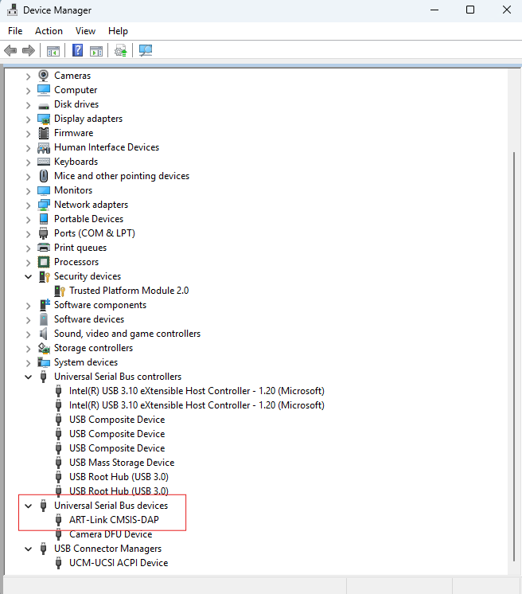{ width="500" }

!!! success "Checkpoint 1.1"
    ✅ เห็น "ART-Link CMSIS-DAP" ใน Device Manager = พร้อมเริ่ม

    ❌ ไม่เห็น = ลองเปลี่ยน USB Port / สาย USB / ตรวจสอบว่าเสียบถูกช่อง


---

## Lab 1.2: สร้าง Workspace และ Project

### ทำอะไร
สร้าง folder เก็บ Project และสร้าง Project ใหม่ใน RT-Thread Studio

### ขั้นตอน

1. **สร้าง folder `workspace`** ใน `C:\Renesas` (หรือที่คุณติดตั้งไว้)

   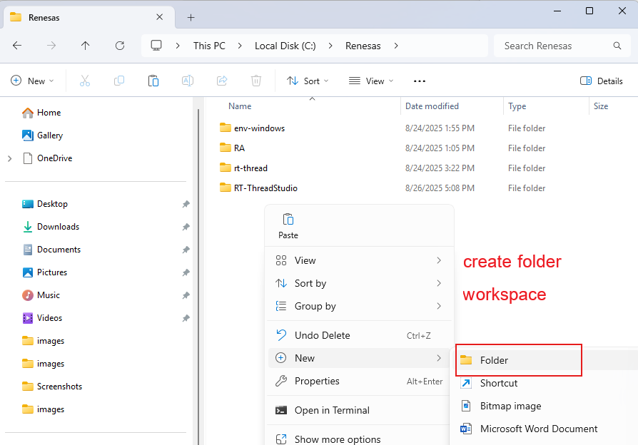{ width="400" }

2. **เปิด RT-Thread Studio** → เลือก **File → New → RT-Thread Project**

   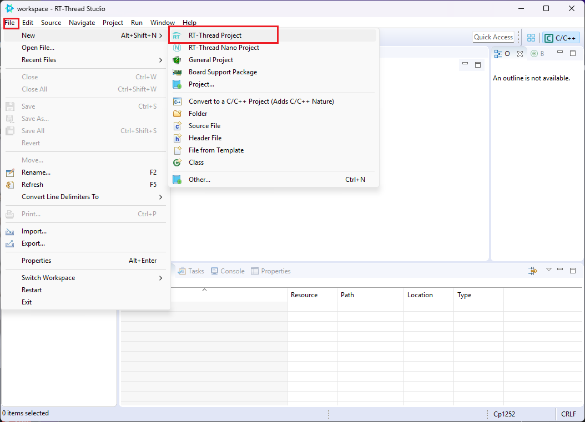{ width="500" }

3. **ตั้งค่า Project:**

   | Field | ค่าที่ตั้ง |
   |-------|-----------|
   | Project Name | `Hello-World` |
   | Location | `C:\Renesas\workspace` (เลือก Custom) |
   | Board | VISION-BOARD |
   | BSP Version | 1.3 |

   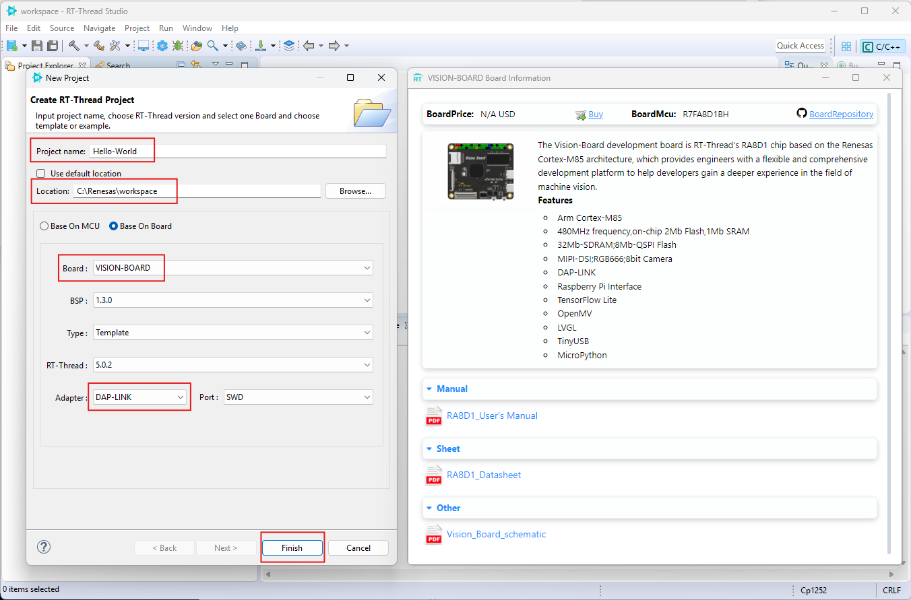{ width="500" }

4. **กด Finish** รอสร้าง Project (ประมาณ 10-20 วินาที)

!!! success "Checkpoint 1.2"
    ✅ ด้านซ้าย Project Explorer แสดง `Hello-World` พร้อม folder `src`, `rt-thread`, `libraries`

    ❌ ไม่เห็น = ตรวจสอบ SDK Manager ว่าติดตั้ง BSP Vision-Board แล้ว


---

## Lab 1.3: Build Project

### ทำอะไร
Compile โค้ดให้เป็นไฟล์ binary (.elf/.hex) เพื่อลงบอร์ด

### ขั้นตอน

1. **กดปุ่ม 🔨 (Build)** หรือกด ++ctrl+b++

   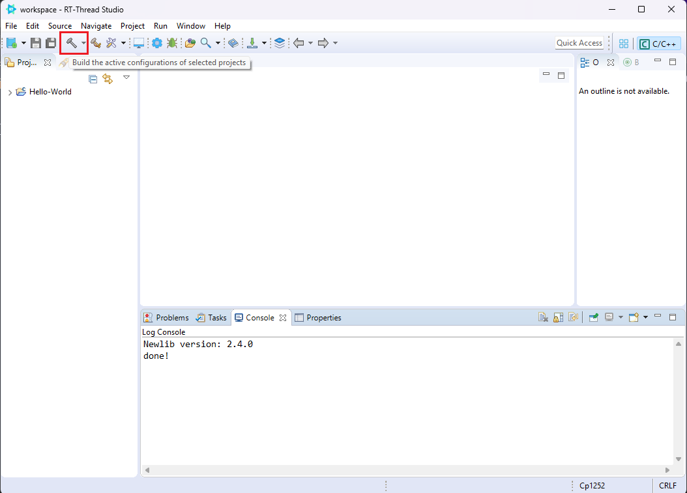{ width="500" }

2. **ดูผลที่ Console** (แท็บด้านล่าง)

   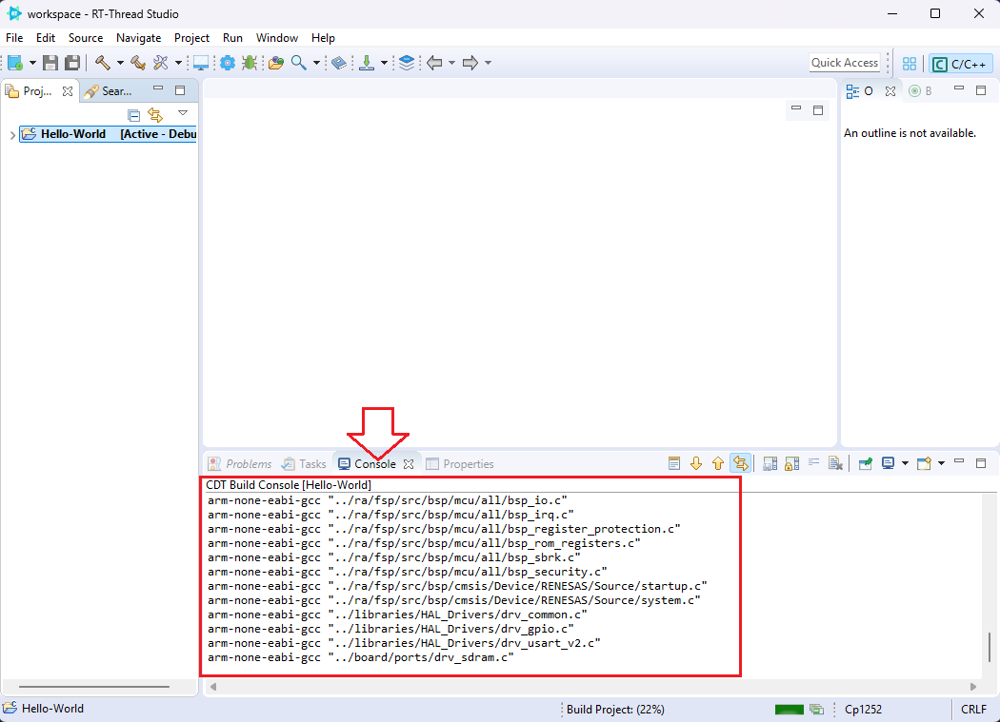{ width="600" }

   รอจนขึ้นข้อความ:

   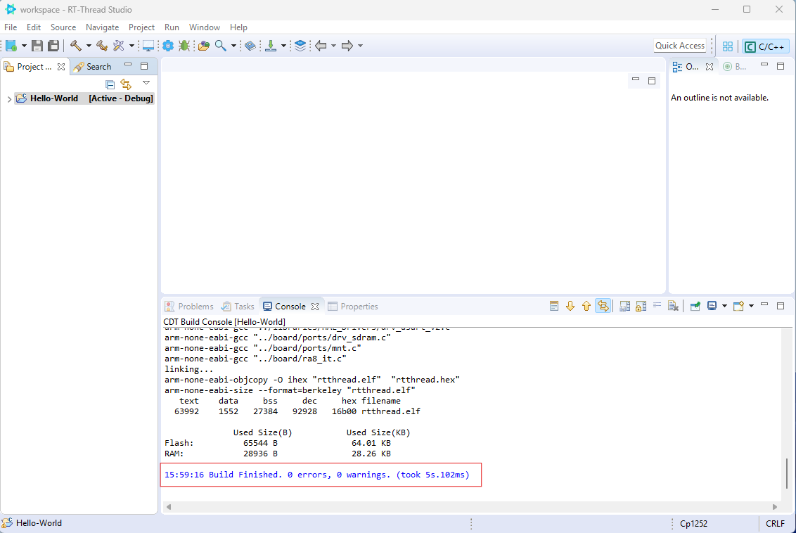{ width="600" }

!!! success "Checkpoint 1.3"
    ✅ Console แสดง `Build Finished. 0 errors, 0 warnings`

    ❌ มี Error = ตรวจสอบว่า Toolchain Version ถูกต้อง (ดู Troubleshooting ด้านล่าง)


---

## Lab 1.4: Flash โปรแกรมลงบอร์ด

### ทำอะไร
โหลดไฟล์ที่ Compile ไปเก็บไว้ในหน่วยความจำบอร์ด

### ขั้นตอน

1. **กดปุ่ม ⬇️ Download/Flash** (รูปลูกศรชี้ลง)

   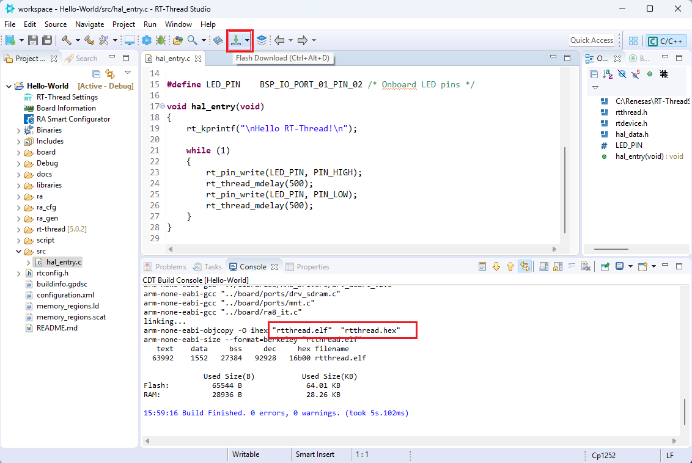{ width="300" }

2. **ดูผลที่ Console**

   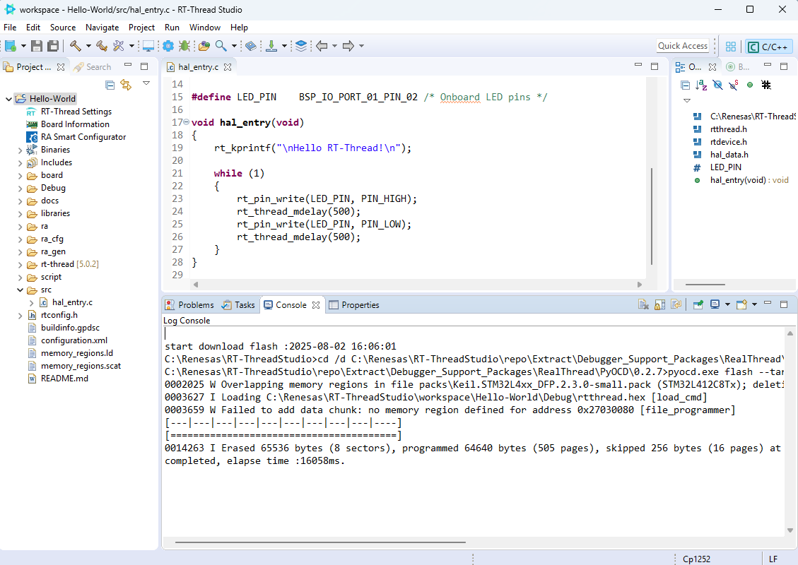{ width="500" }

3. **สังเกต LED บนบอร์ด**

   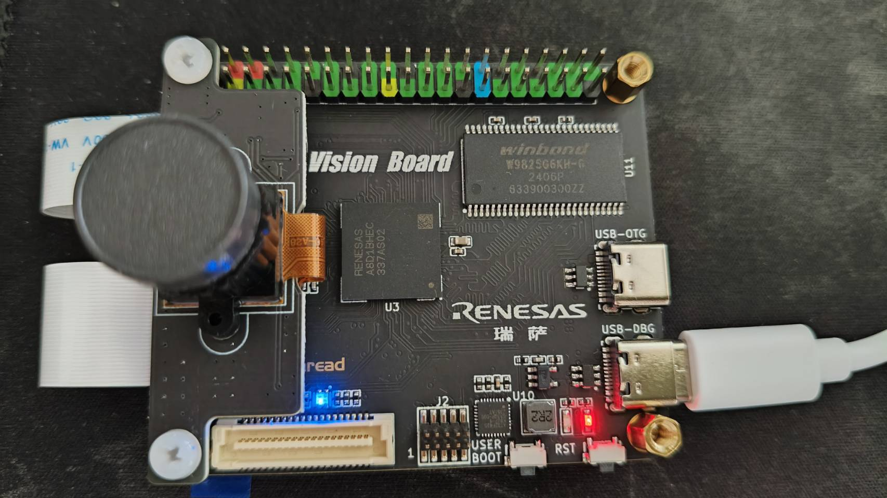{ width="400" }

!!! success "Checkpoint 1.4"
    ✅ LED สีฟ้าด้านหน้าบอร์ดกะพริบทุก ๆ 500 มิลลิวินาที

    ❌ LED ไม่กะพริบ = ตรวจสอบว่า Download สำเร็จ / สาย USB-DBG เสียบแน่น


---

## Lab 1.5: ดูข้อความจากบอร์ด (Serial Terminal)

### ทำอะไร
เปิดหน้าต่าง Terminal เพื่อดูข้อความที่บอร์ดส่งมา

### ขั้นตอน

1. **กดปุ่ม Terminal** ใน IDE → เลือก **Serial Port** ที่ตรงกับ ART-Link

   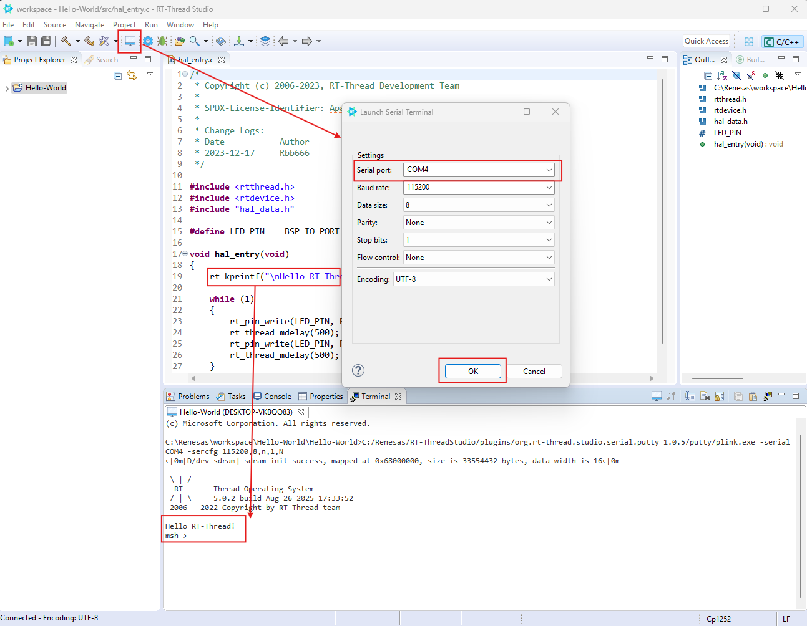{ width="500" }

!!! tip "เลือก Port ยังไง?"
    ดูใน Device Manager → Ports (COM & LPT) → เลือก COM ที่มี "ART-Link" หรือ "J-Link"

    Baud rate: 115200 (default)


2. **ดูผล**

   คุณจะเห็นข้อความ:
   ```
   Hello RT-Thread!
   ```

!!! success "Checkpoint 1.5"
    ✅ Terminal แสดง "Hello RT-Thread!" ซ้ำ ๆ พร้อม LED กะพริบ

    ❌ ไม่เห็นข้อความ = ตรวจสอบ Baud rate / Port / กด Reset บอร์ด


---

## ทำความเข้าใจโค้ดที่รันอยู่

นี่คือโค้ดใน `src/hal_entry.c` ที่คุณเพิ่งรันไป:

``` C title="hal_entry.c" linenums="1"
#include <rtthread.h>      // หัวใจของ RT-Thread OS
#include <rtdevice.h>      // สำหรับ GPIO, UART, etc.
#include "hal_data.h"      // ค่าที่ FSP สร้างไว้ (Pin mapping)

#define LED_PIN    BSP_IO_PORT_01_PIN_02  // LED อยู่ที่ Pin นี้

void hal_entry(void)
{
    rt_kprintf("\nHello RT-Thread!\n");   // ส่งข้อความไป Terminal

    while (1)  // ลูปไม่มีที่สิ้นสุด
    {
        rt_pin_write(LED_PIN, PIN_HIGH);  // เปิด LED
        rt_thread_mdelay(500);            // รอ 500ms
        rt_pin_write(LED_PIN, PIN_LOW);   // ปิด LED
        rt_thread_mdelay(500);            // รอ 500ms
    }
}
```

**สิ่งที่โค้ดทำ:**

| บรรทัด | ทำอะไร |
|--------|--------|
| `rt_kprintf(...)` | ส่งข้อความออกทาง Serial (เห็นใน Terminal) |
| `rt_pin_write(..., PIN_HIGH)` | ให้แรงดันไฟ HIGH ที่ Pin LED = เปิด |
| `rt_thread_mdelay(500)` | หยุดเธรดนี้ 500 มิลลิวินาที **แต่ไม่หยุดระบบ** (RTOS ยังทำงาน) |
| `rt_pin_write(..., PIN_LOW)` | ให้แรงดัน LOW = ปิด LED |

**ทำไมต้อง `rt_thread_mdelay()` ไม่ใช่ `delay()` ธรรมดา?**

เพราะ RT-Thread เป็น **RTOS** — ระบบมีหลายเธรดทำงานพร้อมกัน `rt_thread_mdelay()` บอก OS ว่า "ฉันวางสายนะ ไปทำเธรดอื่นก่อนได้" ทำให้ระบบไม่ hang

---

## สรุป: คุณทำอะไรสำเร็จแล้ว

- [x] สร้าง RT-Thread Project ใหม่
- [x] Build โปรแกรมโดยไม่มี Error
- [x] Flash โปรแกรมลงบอร์ด RA8D1
- [x] เห็น LED กะพริบด้วยตาเนื้อเอง
- [x] อ่านข้อความจากบอร์ดผ่าน Serial Terminal

---

??? failure "แก้ปัญหาเบื้องต้น (Troubleshooting)"
    **"Build Failed: Toolchain not found"**

    - ไปที่ **Project → Properties → Toolchain**

    - เลือก **GNU Tools for ARM → 13.2.1**

    - ถ้าไม่มี เปิด SDK Manager ติดตั้งเพิ่ม


    **"Download Failed: No device found"**

    - ตรวจสอบ Device Manager → ART-Link CMSIS-DAP

    - เปลี่ยน USB Port / ลองสาย USB อื่น

    - กดปุ่ม Reset บนบอร์ดแล้วลองใหม่


    **"Terminal ไม่แสดงข้อความ"**

    - ตรวจสอบ Baud rate = 115200

    - ตรวจสอบเลือก COM Port ถูกต้อง

    - ปิด Terminal แล้วเปิดใหม่

    - กด Reset บนบอร์ด

