# เริ่มต้นการใช้งาน RT-Thread IDE

<span class="md-tag">Beginner</span> <span class="md-tag">30 นาที</span>

## วัตถุประสงค์

- [x] เข้าใจการใช้เครื่องมือ RT-Thread IDE
- [x] สร้าง Project ใหม่ให้ตรงกับ Board
- [x] Build โปรเจคและติดตามผลทาง Console
- [x] Download โปรแกรมลงสู่ Board

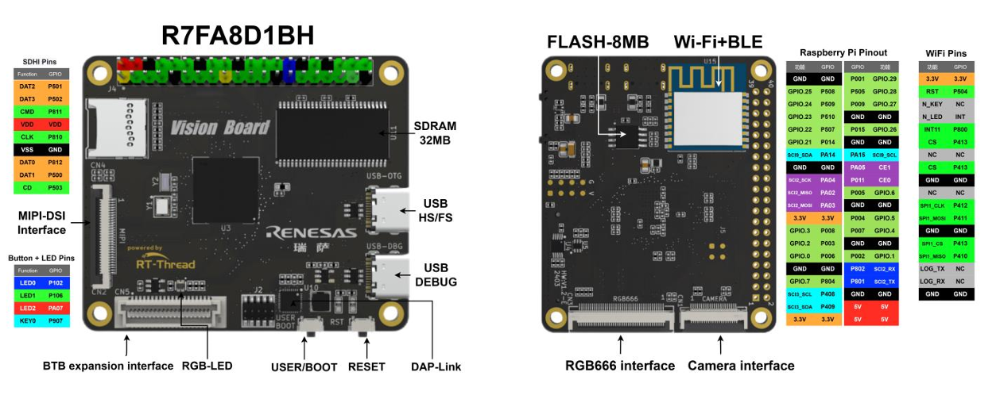{ width="400" }

---

## IDE Structure

องค์ประกอบโครงสร้างของ IDE ที่ควรรู้จัก

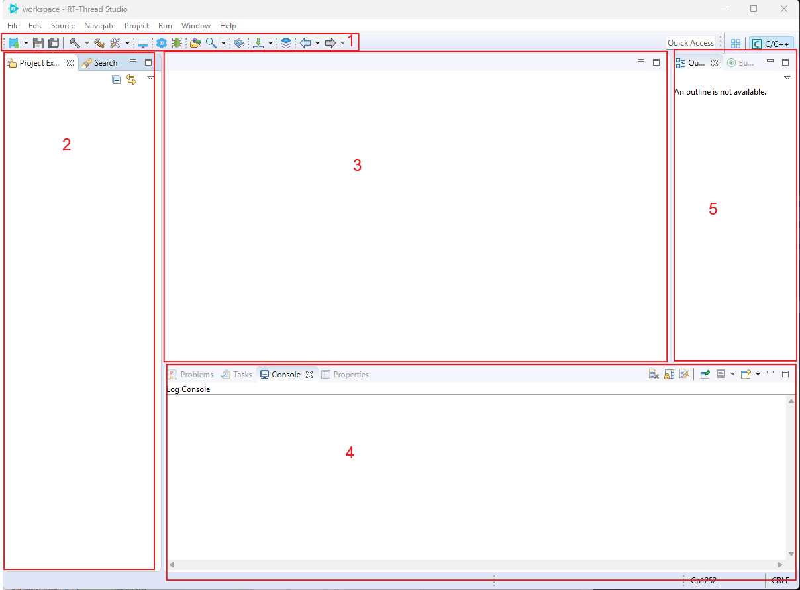{ width="600" }

1. เมนู Shortcut ที่มีการเรียกใช้บ่อย
2. File หรือ Source Code Explorer
3. Working Area สำหรับการแสดง Code
4. แสดง Output
5. แสดง Outline โครงสร้างของ Component

---

## ขั้นตอนที่ 1: เตรียมอุปกรณ์

1. เชื่อมต่อ **USB-DBG** ของ Vision Board เข้ากับ USB ของคอมพิวเตอร์

   !!! info "USB-DBG คืออะไร?"
       USB-DBG ย่อมาจาก USB Debug ทำหน้าที่เป็นอินเทอร์เฟซสำหรับการดีบัก (debug) และโปรแกรมเฟิร์มแวร์ลงในไมโครคอนโทรลเลอร์เรเนซัส RX/RA series

2. กด ++win+x++ เพื่อเรียก **Device Manager** ตรวจสอบว่าพบ Device **ART-Link CMSIS-DAP**

   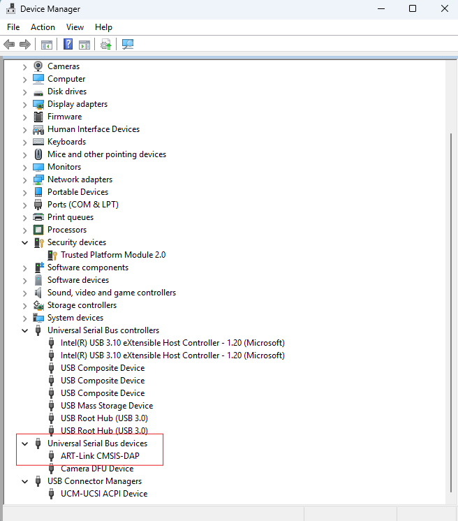{ width="500" }

3. สร้าง folder ชื่อ `workspace` ใน `C:\Renesas`

   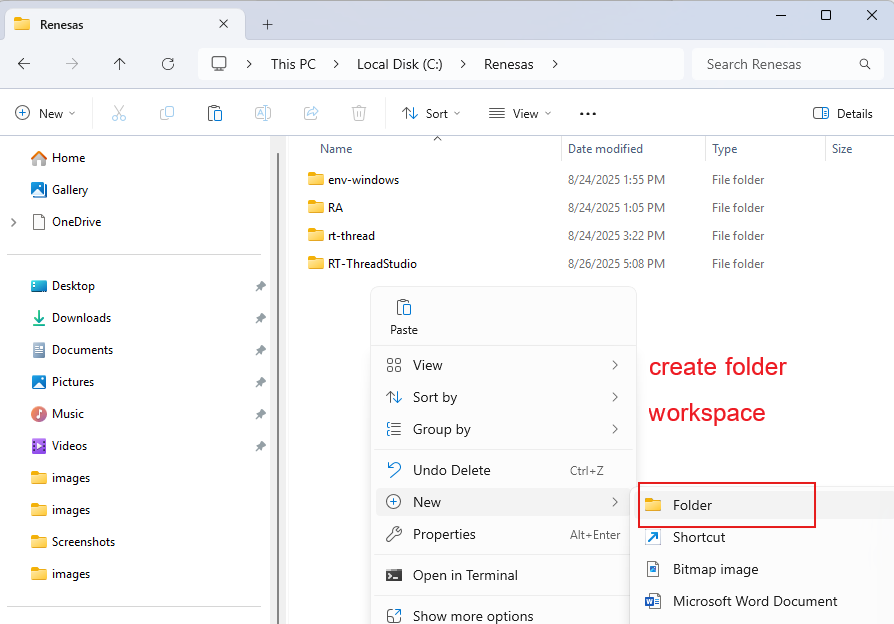{ width="400" }

---

## ขั้นตอนที่ 2: สร้าง Project

1. เปิด RT-Thread Studio เลือก **New → RT-Thread Project**

   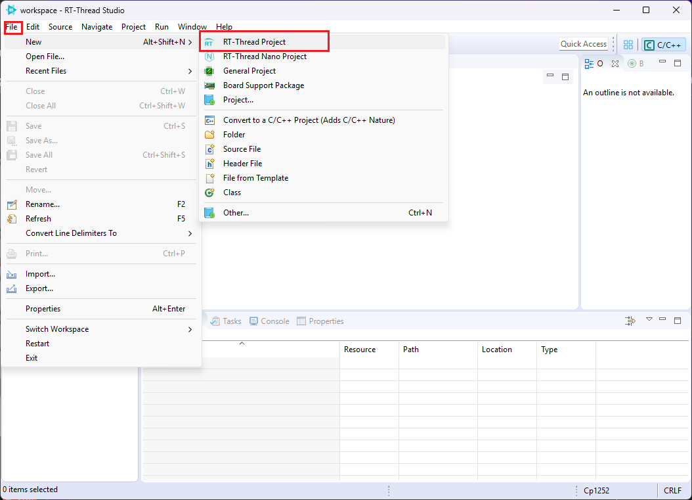{ width="500" }

2. ตั้งชื่อ Project ว่า `Hello-World` เลือก **Custom Location** → `C:\Renesas\workspace` เลือกบอร์ด **VISION-BOARD** BSP Version 1.3

   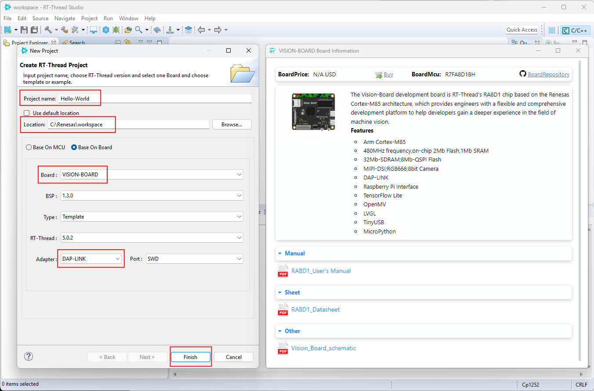{ width="500" }

3. กด **Finish**

4. RT-Thread สร้าง Project ให้ดูที่ tab Project Explorer ด้านซ้าย กดปุ่ม 🔨 เพื่อ Build

   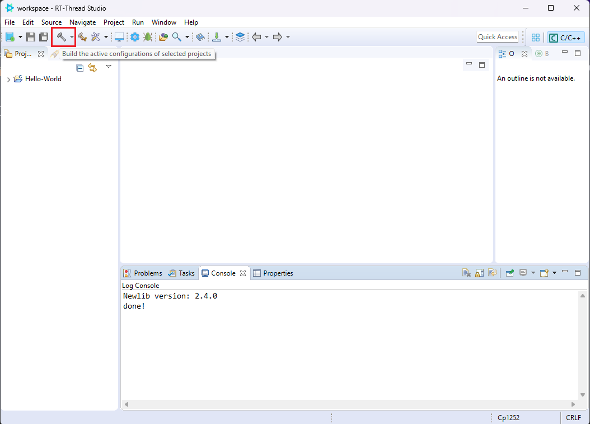{ width="500" }

5. ดูผลการ Compile ที่ Console

   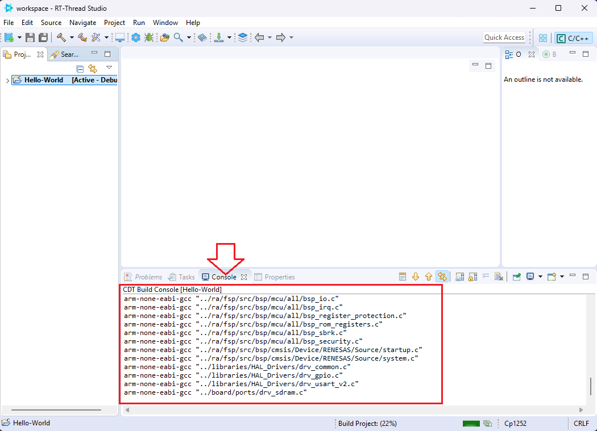{ width="600" }

   รอจนกระทั้งสิ้นสุดกระบวนการ

   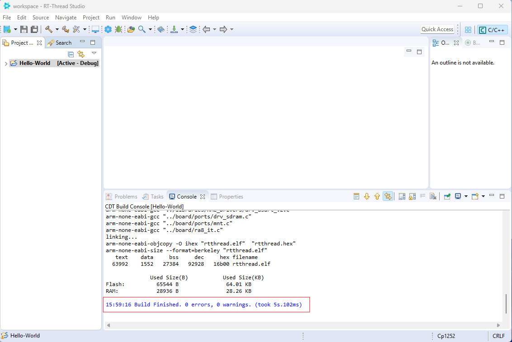{ width="600" }

   !!! success "Build สำเร็จ"
       ดูที่ Console หาก `errors = 0` แสดงว่า Build สำเร็จ

6. กดปุ่ม Download เพื่อนำ Code ลงบอร์ด

   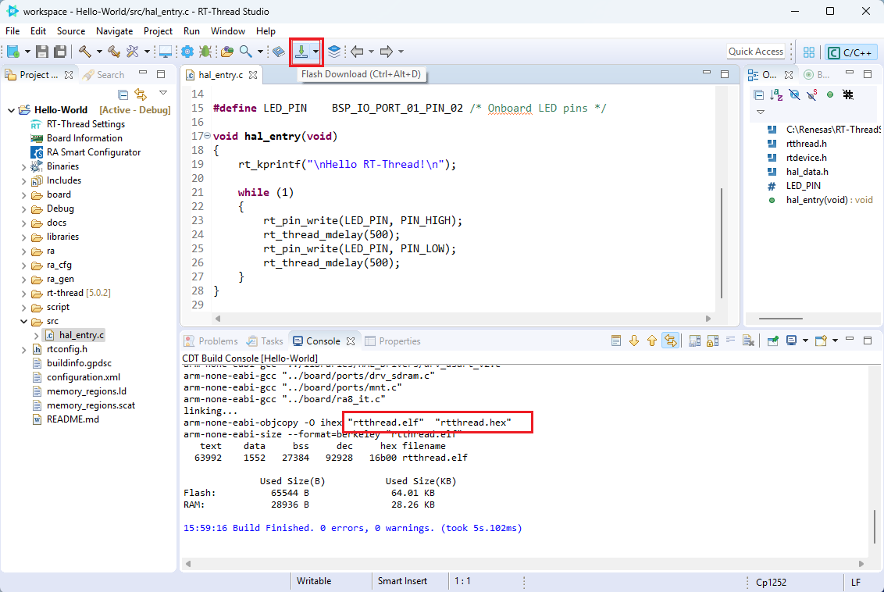{ width="300" }
   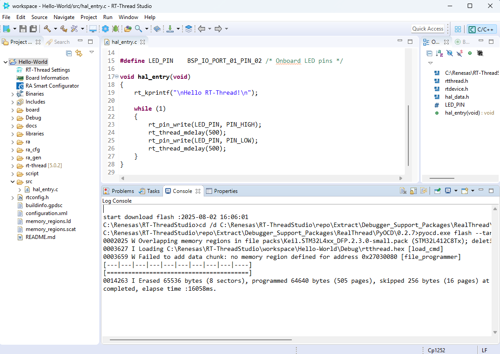{ width="500" }

   !!! tip "สังเกต"
       หลอดไฟ LED สีฟ้าด้านหน้า Board จะกะพริบทุก ๆ 500 ms

   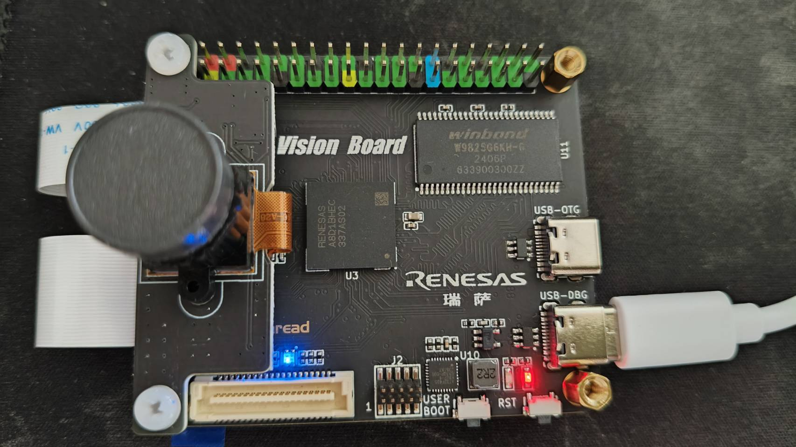{ width="400" }

---

## ตัวอย่าง Screen

{ width="600" }

จากวิดีโอด้านบน สามารถพัฒนาโปรแกรม Build และ Upload ได้แบบง่าย ๆ

---

## Monitor Code ผ่านทาง Terminal

ใน Code ตัวอย่างมีการใช้คำสั่ง `rt_kprintf()` เพื่อ print ค่าออกทาง Terminal

1. กดปุ่ม Terminal เลือก Serial port ให้ตรงกับอุปกรณ์

   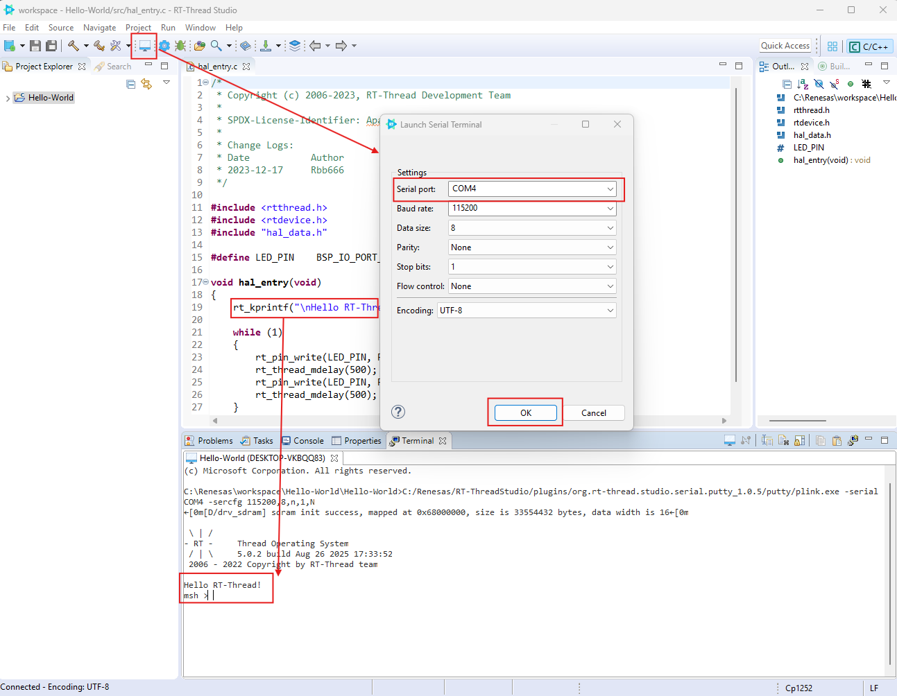{ width="500" }

2. ดูผลลัพธ์แบบ Real-time

   { width="600" }

---

## เรียนรู้พื้นฐานการทำงานโปรแกรม

``` C title="hal_entry.c" linenums="1"
/*
 * Copyright (c) 2006-2023, RT-Thread Development Team
 *
 * SPDX-License-Identifier: Apache-2.0
 */

#include <rtthread.h>      // (1)
#include <rtdevice.h>      // (2)
#include "hal_data.h"      // (3)

#define LED_PIN    BSP_IO_PORT_01_PIN_02 /* Onboard LED pins */

void hal_entry(void)
{
    rt_kprintf("\nHello RT-Thread!\n");  // (4)

    while (1)
    {
        rt_pin_write(LED_PIN, PIN_HIGH); // (5)
        rt_thread_mdelay(500);           // (6)
        rt_pin_write(LED_PIN, PIN_LOW);  // (7)
        rt_thread_mdelay(500);           // (8)
    }
}
```

1. เฮดเดอร์ไฟล์หลักของ RT-Thread OS
2. สำหรับการทำงานกับอุปกรณ์ต่าง ๆ ใน RT-Thread
3. เฮดเดอร์ไฟล์ที่สร้างโดย FSP Configurator สำหรับเรเนซัส RA MCU
4. แสดงข้อความทักทายผ่าน Serial Terminal
5. เปิด LED (ให้ขา GPIO เป็น HIGH)
6. หน่วงเวลา 500 มิลลิวินาที (ไม่บล็อกเธรดอื่น)
7. ปิด LED (ให้ขา GPIO เป็น LOW)
8. หน่วงเวลา 500 มิลลิวินาที

### สรุป Code

โค้ดนี้เป็นโปรแกรมพื้นฐานสำหรับไมโครคอนโทรลเลอร์เรเนซัส RA series ที่ใช้ RT-Thread OS ทำหน้าที่แสดงข้อความ "Hello World" และกะพริบ LED บนบอร์ด

### Header Files

```c
#include <rtthread.h>      // เฮดเดอร์ไฟล์หลักของ RT-Thread OS
#include <rtdevice.h>      // สำหรับการทำงานกับอุปกรณ์ต่างๆ ใน RT-Thread
#include "hal_data.h"      // เฮดเดอร์ไฟล์ที่สร้อยโดย FSP Configurator
```

### Pin Definition

```c
#define LED_PIN BSP_IO_PORT_01_PIN_02 /* Onboard LED pins */
```

### Main Function

```c
void hal_entry(void)
{
    rt_kprintf("\nHello RT-Thread!\n");

    while (1)
    {
        rt_pin_write(LED_PIN, PIN_HIGH);
        rt_thread_mdelay(500);
        rt_pin_write(LED_PIN, PIN_LOW);
        rt_thread_mdelay(500);
    }
}
```

---

## สรุปผลลัพธ์ที่ได้รับ

- [x] สร้าง RT-Thread Project ได้
- [x] Build และ Upload ลงบอร์ดได้
- [x] เข้าใจโครงสร้างโค้ด `hal_entry.c`
- [x] ใช้ Serial Terminal ติดต่อกับบอร์ดได้
