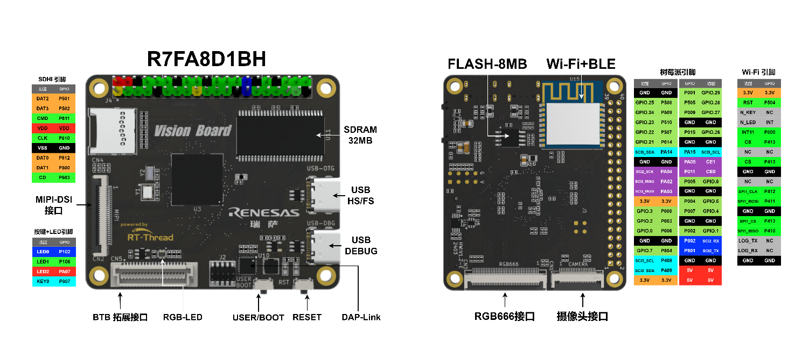
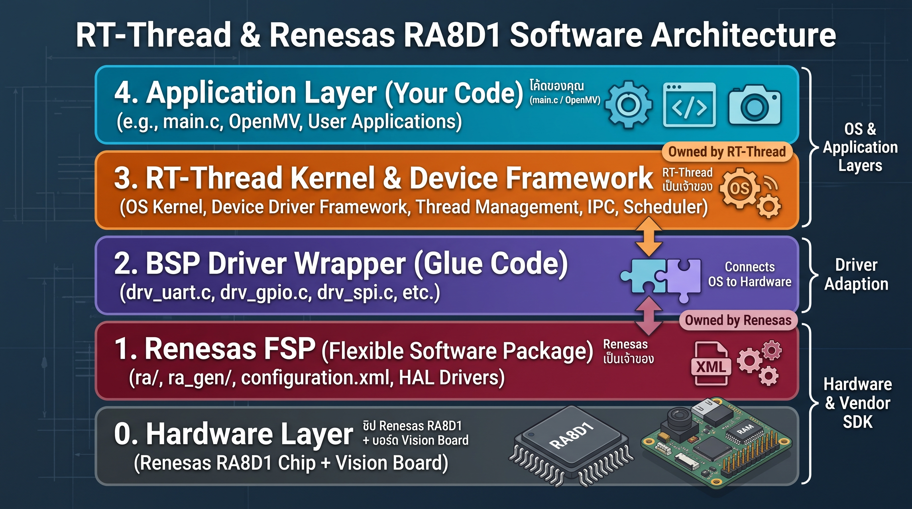
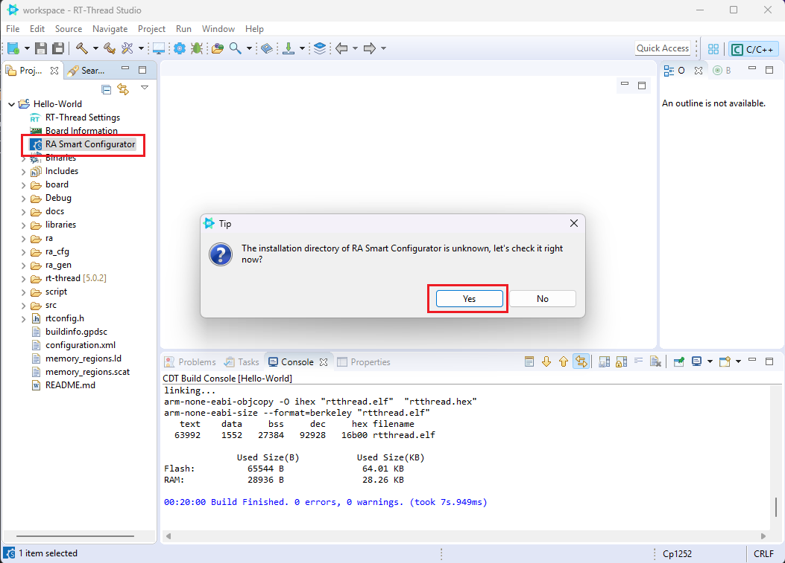
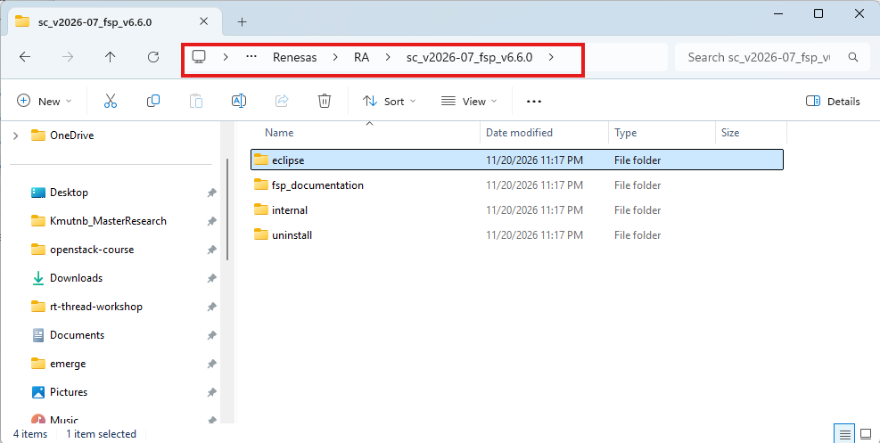
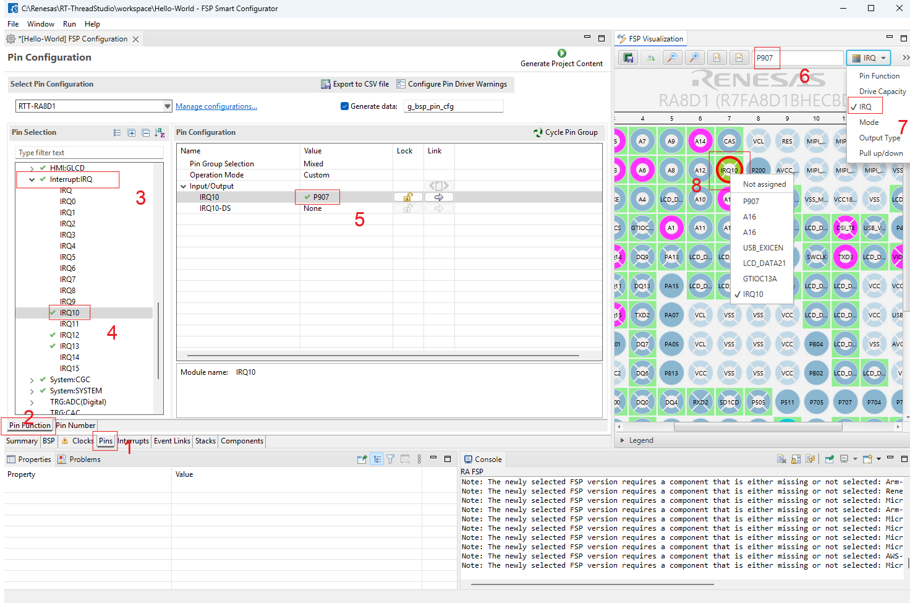
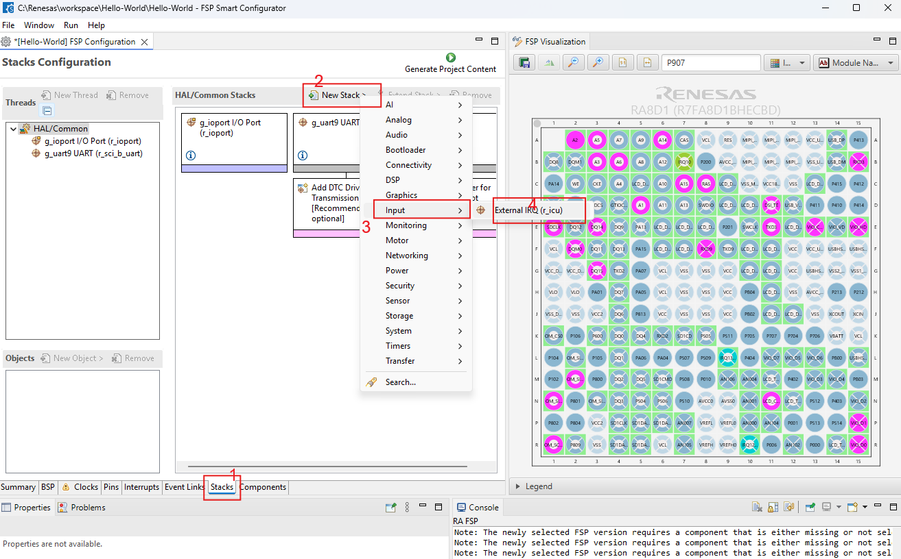
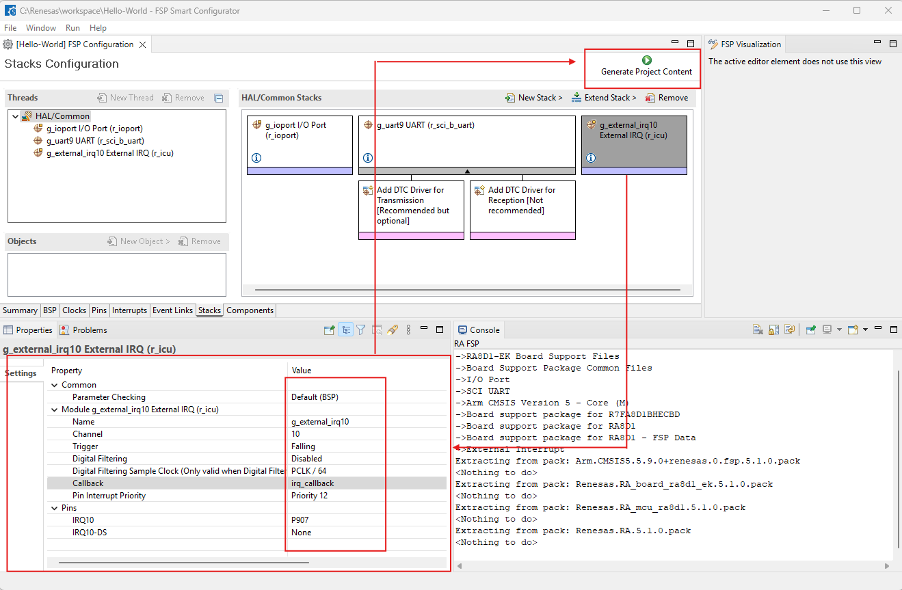
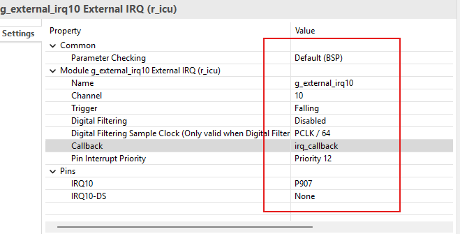
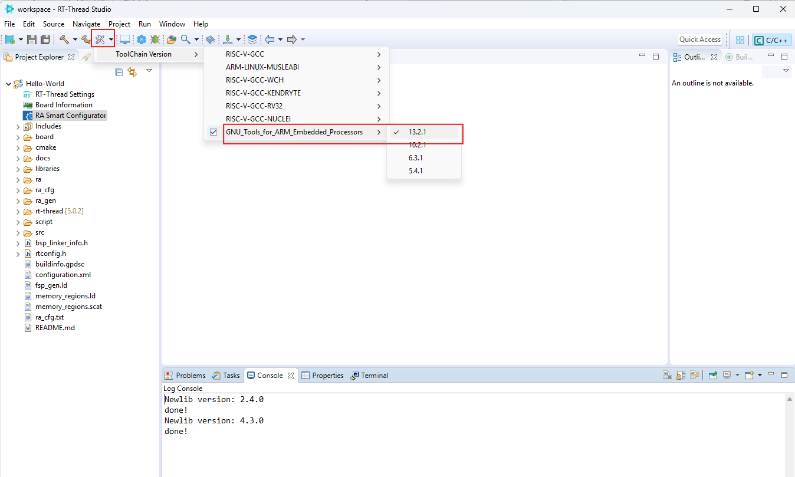
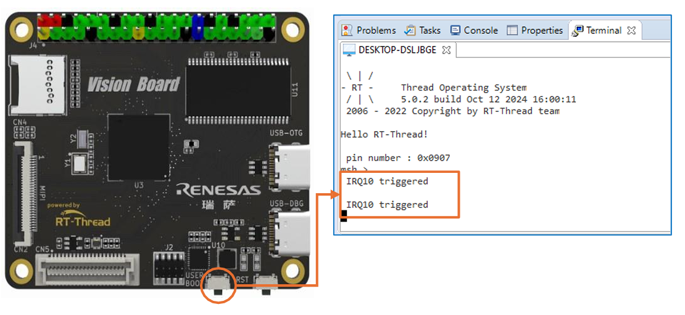

# การเข้าถึง GPIO Interrupt ของบอร์ด RA8D1 Vision Board

<span class="md-tag">Intermediate</span> <span class="md-tag">45 นาที</span> <span class="md-tag">GPIO & Interrupt</span>

{ width="600" }

> 🚀 **ก้าวสำคัญสู่การเขียนระบบ Real-Time ตัวจริง:**
> ใน Lab นี้ คุณจะได้อัปเกรดการเขียนโค้ดจากแบบ "วนลูปรอถาม" (Polling) ไปสู่ระบบ **Event-Driven (ขับเคลื่อนด้วยเหตุการณ์)** ซึ่งเป็นหัวใจหลักของระบบปฏิบัติการ RTOS ที่ทำให้อุปกรณ์ IoT, หุ่นยนต์ และระบบควบคุมอุตสาหกรรมตอบสนองต่อเหตุการณ์ภายนอกได้ในระดับเสี้ยววินาที!

## ก่อนเริ่ม Lab

- [ ] ทำ [Workshop 1](../03_workshop1/03.1_workshop1.md) ให้เสร็จก่อน (รู้วิธี Build + Flash ลงบอร์ด RA8D1)
- [ ] ติดตั้ง [FSP / RA Smart Configurator](../02_Preparation/02.2_install_fsp.md) เรียบร้อย
- [ ] Toolchain GNU ARM 13.2.1 ใช้งานได้

## เมื่อทำเสร็จ คุณจะได้

- [ ] กดปุ่ม **K1** บนบอร์ดแล้วเห็นข้อความ `"IRQ10 triggered"` เด้งขึ้นมาใน Terminal ทันทีโดยไม่ทำให้ไฟ LED กะพริบสะดุด
- [ ] เข้าใจกลไกการทำงานของ **External Interrupt (IRQ)** เทียบกับ **Polling**
- [ ] สามารถใช้ **Renesas FSP** ตั้งค่าขา Pin เป็น Interrupt และเชื่อมต่อเข้ากับ **RT-Thread Pin Device Framework** ได้อย่างถูกต้อง

---

## โครงสร้างชั้นการทำงาน (จากล่างขึ้นบน)



---

## ทำไมต้อง Interrupt?

### 1. Polling (วิธีเดิม — วนลูปถาม)
โปรแกรมต้องคอยถามบอร์ดตลอดเวลาว่า *"กดปุ่มหรือยัง? กดหรือยัง?"*
- **ข้อเสีย:** กินรอบการทำงานของ CPU (100% Busy) และหากช่วงนั้น CPU กำลังทำงานอื่นอยู่ (เช่น อ่านเซ็นเซอร์หรืออัปเดตหน้าจอ) อาจพลาดจังหวะการกดปุ่มได้

### 2. Interrupt (วิธีที่จะทำ — ขัดจังหวะเมื่อเกิดเหตุการณ์)
ฮาร์ดแวร์จะเป็นฝ่ายสะกิดบอก CPU เองทันทีที่เกิดสัญญาณเปลี่ยนแปลง *"มีคนกดปุ่มแล้ว!"*
- **ข้อดี:** ตอบสนองไวระดับไมโครวินาที, CPU ว่างไปทำงานอื่นหรือเข้าโหมดประหยัดพลังงานได้เต็มที่

---

## ขั้นตอนที่ 1: เปิด RA Smart Configurator

### เป้าหมาย
เปิดเครื่องมือตั้งค่าฮาร์ดแวร์ของ Renesas เพื่อกำหนดให้ขา **P907** (ซึ่งต่ออยู่กับปุ่มกด **K1** บนบอร์ด) ทำงานเป็นช่องรับสัญญาณขัดจังหวะภายนอกหมายเลข **IRQ10**

### ขั้นตอน

1. **Double-Click ที่เมนู RA Smart Configurator** ใน Project Explorer

   { width="500" }

2. **เลือก Folder ที่ติดตั้ง FSP** (ปกติเป็น `C:\Renesas\RA\sc_v2026-07_fsp_v6.6.0\`)

   { width="500" }

3. **รอจนหน้าต่าง RASC เปิดขึ้น**

   { width="500" }

!!! success "Checkpoint 2.1"
    ✅ RASC เปิดขึ้นและแสดง Block Diagram / Pin Configuration ของชิป RA8D1

    ❌ เปิดไม่ได้ = ตรวจสอบว่าติดตั้ง FSP/RASC ครบถ้วน หรือเลือก Path โฟลเดอร์ `eclipse` ถูกต้อง

---

## ขั้นตอนที่ 2: ตั้งค่า Pin P907 → IRQ10

### เป้าหมาย
เชื่อมขา **P907** เข้ากับวงจรรับสัญญาณ Interrupt ภายในชิป (**IRQ10**)

### ขั้นตอน

1. กดที่ Tab **Pins** → เลือกหมวด **Pin Function** (หรือค้นหา `P907` ในช่องค้นหาด้านบน)
2. หา Pin **P907** → คลิกเลือก
3. เปลี่ยนโหมดการทำงานเป็น **InterruptIRQ** → เลือก **`IRQ10`**

!!! info "IRQ10 คืออะไร?"
    **IRQ (Interrupt ReQuest)** คือ "สายด่วนขัดจังหวะ" ภายในชิป RA8D1
    
    ชิป RA8D1 มีช่อง External IRQ ทั้งหมด 16 ช่อง (`IRQ0` – `IRQ15`) โดยตามผังวงจรฮาร์ดแวร์ของชิป ขา **P907** จะถูกเดินสายภายในเชื่อมตรงกับช่อง **IRQ10** พอดี

4. ตรวจสอบที่ Tab **Pin Selection / FSP Visualization** ด้านขวา → พิมพ์ค้นหา `P907` เพื่อเช็กสถานะ

   { width="600" }

!!! success "Checkpoint 2.2"
    ✅ ด้านขวาเห็น Pin **P907** ถูกระบุสถานะเป็น `IRQ10` (ขึ้นสัญลักษณ์สีเขียวและไม่มีกากบาทสีแดง)

    ❌ ไม่เห็นหรือขึ้นสีแดง = ตรวจสอบว่าขา P907 ไม่ได้ถูกใช้งานซ้ำซ้อนกับฟังก์ชัน GPIO หรือ Peripheral อื่น

---

## ขั้นตอนที่ 3: สร้าง External IRQ Stack

### เป้าหมาย
สร้างอ็อบเจกต์ไดรเวอร์ **External IRQ (`r_icu`)** ใน FSP เพื่อให้ RT-Thread BSP (`drv_gpio.c`) สามารถดึงไปควบคุมการเกิด Interrupt ได้

### ขั้นตอน

1. กดที่ Tab **Stacks** → กด **New Stack** → เลือก **Input → External IRQ (`r_icu`)**

   { width="600" }

2. คลิกที่ Stack ที่สร้างขึ้นมา → เปิดแท็บ **Properties** ด้านล่าง → ตั้งค่า **Channel** เป็น `10` และเปลี่ยน **Trigger** จาก `Rising` เป็น **`Falling`**

!!! info "ทำไมต้องเลือก Falling Edge?"
    วงจรปุ่ม **K1** บนบอร์ดถูกออกแบบแบบ **Active-Low (Pull-up)**:
    - **ตอนยังไม่กดปุ่ม:** แรงดันที่ขา P907 จะอยู่ที่ระดับ **HIGH (3.3V)** ตลอดเวลา
    - **วินาทีที่นิ้วกดปุ่ม:** สวิตช์จะต่อขา P907 ลงกราวด์ ทำให้แรงดันตกลงจาก **HIGH → LOW (0V)**
    
    การตั้งค่า **Falling Edge (ขอบขาลง)** จึงเป็นการสั่งให้ชิปจับจังหวะ "วินาทีที่เริ่มกดปุ่ม" ได้อย่างแม่นยำ

3. กดปุ่ม **Generate Project Content** (ปุ่มสีฟ้า/เขียวด้านบน)

   { width="500" }

   ตรวจสอบการตั้งค่าให้ตรงตามภาพนี้:

   { width="500" }

!!! success "Checkpoint 2.3"
    ✅ RASC แจ้งว่า Generate สำเร็จ (หรือปิดลงอัตโนมัติ)

    ✅ ใน Project Explorer ของ RT-Thread Studio กด **Refresh (F5)** แล้วพบว่าไฟล์ในโฟลเดอร์ `ra_gen/` (เช่น `hal_data.h`) ถูกอัปเดต

    ❌ ไม่ Generate = ตรวจสอบว่ามีสัญลักษณ์ Error สีแดงค้างอยู่ในแท็บ Stacks หรือ Pins ของ RASC หรือไม่

---

## ขั้นตอนที่ 4: เลือก Toolchain และเขียนโค้ดใน `hal_entry.c`

### ขั้นตอน

1. **ตรวจสอบ Toolchain:**

   คลิกขวาที่ชื่อ Project → **Properties → C/C++ Build → Toolchain**

   เลือก **GNU Tools for ARM Embedded Processors → 13.2.1**

   { width="500" }

2. **แก้ไขไฟล์ `src/hal_entry.c`** — ลบโค้ดเดิมออก แล้วใส่โค้ดนี้แทน:

```c title="hal_entry.c — GPIO Interrupt Lab" linenums="1"
#include <rtthread.h>
#include <rtdevice.h>
#include "hal_data.h"

#define LED_PIN         BSP_IO_PORT_01_PIN_02   /* ขา LED บนบอร์ด */
#define IRQ_TEST_PIN    "p907"                  /* ชื่อขาปุ่ม K1 ในระบบ RT-Thread */

/* (1) Callback Function: ฟังก์ชันที่ถูกเรียกอัตโนมัติทันทีที่เกิด Interrupt */
void irq_callback_test(void *args)
{
    /* หมายเหตุ: ใน Lab ใช้ rt_kprintf เพื่อดูผลลัพธ์ง่ายๆ
       แต่ในงานจริงแนะนำให้ใช้ rt_sem_release() ส่งสัญญาณไปให้ Thread อื่นพิมพ์แทน */
    rt_kprintf("\n[ISR] IRQ10 triggered! (Button K1 Pressed)\n");
}

void hal_entry(void)
{
    rt_kprintf("\n=== Hello RT-Thread: GPIO Interrupt Lab ===\n");

    /* (2) แปลงชื่อ Pin ("p907") เป็นหมายเลข Pin Index ของ RT-Thread */
    rt_base_t pin = rt_pin_get(IRQ_TEST_PIN);
    rt_kprintf("K1 Pin Number : 0x%04X\n", pin);

    /* (3) ผูกฟังก์ชัน Callback เข้ากับขา Pin (โหมดตรวจจับขอบขาลง Falling Edge) */
    rt_err_t err = rt_pin_attach_irq(
        pin,
        PIN_IRQ_MODE_FALLING,
        irq_callback_test,    /* ฟังก์ชันที่จะทำงานเมื่อกดปุ่ม */
        RT_NULL               /* ไม่ส่งพารามิเตอร์เพิ่มเติม */
    );
    if (err != RT_EOK)
    {
        rt_kprintf("Error: attach irq failed! (%d)\n", err);
    }

    /* (4) เปิดสวิตช์อนุญาตให้ Interrupt ทำงาน */
    err = rt_pin_irq_enable(pin, PIN_IRQ_ENABLE);
    if (err != RT_EOK)
    {
        rt_kprintf("Error: enable irq failed! (%d)\n", err);
    }

    /* Main Loop: สั่งไฟ LED กะพริบต่อเนื่องเพื่อพิสูจน์ว่า CPU ไม่ได้รอปุ่มกด */
    while (1)
    {
        rt_pin_write(LED_PIN, PIN_HIGH);
        rt_thread_mdelay(500);
        rt_pin_write(LED_PIN, PIN_LOW);
        rt_thread_mdelay(500);
    }
}
```

### อธิบายการทำงานของโค้ดแต่ละส่วน
1. **Callback (`irq_callback_test`)** = ฟังก์ชันพิเศษที่ RT-Thread Kernel จะกระโดดเข้ามาทำทันทีที่ฮาร์ดแวร์ส่งสัญญาณ IRQ10
2. **`rt_pin_get("p907")`** = แปลงชื่อขา Pin ในรูปแบบข้อความให้เป็นรหัสตัวเลขที่ BSP ของ Renesas เข้าใจ
3. **`rt_pin_attach_irq()`** = ลงทะเบียนเงื่อนไขกับ Device Framework ว่า *"ถ้าขา p907 เกิดสัญญาณตก (Falling) ให้เรียกฟังก์ชัน `irq_callback_test`"*
4. **`rt_pin_irq_enable()`** = ปลดล็อกเปิดสวิตช์รับสัญญาณขัดจังหวะ (หากลืมบรรทัดนี้ กดปุ่มไปก็จะไม่มีอะไรเกิดขึ้น)

!!! success "Checkpoint 2.4"
    ✅ โค้ดมีครบทั้ง 3 ขั้นตอน: `rt_pin_get()` → `rt_pin_attach_irq()` → `rt_pin_irq_enable()`

    ❌ Build Error = ตรวจสอบว่ากด Generate Project Content ใน RASC แล้ว และเปิด `Enable GPIO` ใน RT-Thread Settings

---

## ขั้นตอนที่ 5: Build และ Flash ลงบอร์ด

1. **Build Project** (กดไอคอนรูปค้อน 🔨 หรือกด ++ctrl+b++)
2. **เชื่อมต่อสาย USB Type-C เข้าช่อง DAP (USB-DBG)** บนบอร์ด Vision Board
3. **Flash Download** (กดไอคอนลูกศรชี้ลง ⬇️)
4. **เปิด Serial Terminal** (ตั้งค่า Baud rate **`115200`**)

---

## ขั้นตอนที่ 6: ทดสอบการทำงานจริง

### ขั้นตอน
1. สังเกตดวงไฟ LED บนบอร์ดจะกะพริบเป็นจังหวะสม่ำเสมอ (ติด 0.5 วินาที / ดับ 0.5 วินาที)
2. ลองกดปุ่ม **K1** บนบอร์ด (ปุ่มกดขนาดเล็กบริเวณขอบบอร์ด)

   { width="400" }

3. สังเกตหน้าจอ Terminal → จะปรากฏข้อความทันทีที่กดปุ่ม:
   ```text
   === Hello RT-Thread: GPIO Interrupt Lab ===
   K1 Pin Number : 0x0907

   [ISR] IRQ10 triggered! (Button K1 Pressed)
   ```

!!! success "Checkpoint 2.5"
    ✅ Terminal แสดงข้อความ `"[ISR] IRQ10 triggered!"` ทุกครั้งที่กดปุ่ม K1

    ✅ จังหวะการกะพริบของ LED ยังคงสม่ำเสมอ ไม่เกิดอาการค้างหรือหน่วง

    💡 **ท้าทายเพิ่มเติม (Challenge):** ลองสังเกตว่าบางครั้งกดปุ่ม 1 ครั้ง ข้อความอาจเด้งขึ้นมา 2–3 บรรทัดติดกัน อาการนี้เรียกว่า **Switch Bounce (หน้าสัมผัสสวิตช์สั่น)** ซึ่งเป็นเรื่องปกติทางอิเล็กทรอนิกส์ที่วิศวกร Embedded จะแก้ด้วยเทคนิค *Software Debounce* ในขั้นถัดไป!

---

## ภาพจำลองการทำงาน: ทำไม LED ถึงไม่สะดุด?

ในระบบ RTOS การทำงานของ **Main Loop** และ **Interrupt (ISR)** ถูกแยกออกจากกันอย่างชัดเจน:

```text
Main Thread:  [LED ON] ──(delay 500ms)──▶ [LED OFF] ──(delay 500ms)──▶ ...
                             │                            ▲
                             ▼ (เกิด Interrupt)            │ (ทำเสร็จ คืนสิทธิ์)
ISR Context:         [กดปุ่ม K1] ──▶ รัน irq_callback_test()
```

ระหว่างที่ Main Thread กำลัง `rt_thread_mdelay(500)` (หลับรอเวลา) ทันทีที่นิ้วของคุณสัมผัสปุ่ม K1 ชิป RA8D1 จะหยุดพักงานปัจจุบันชั่วเสี้ยววินาที กระโดดไปทำฟังก์ชัน `irq_callback_test()` จนเสร็จ แล้วกลับมาทำงานใน Main Thread ต่ออย่างราบรื่น

---

