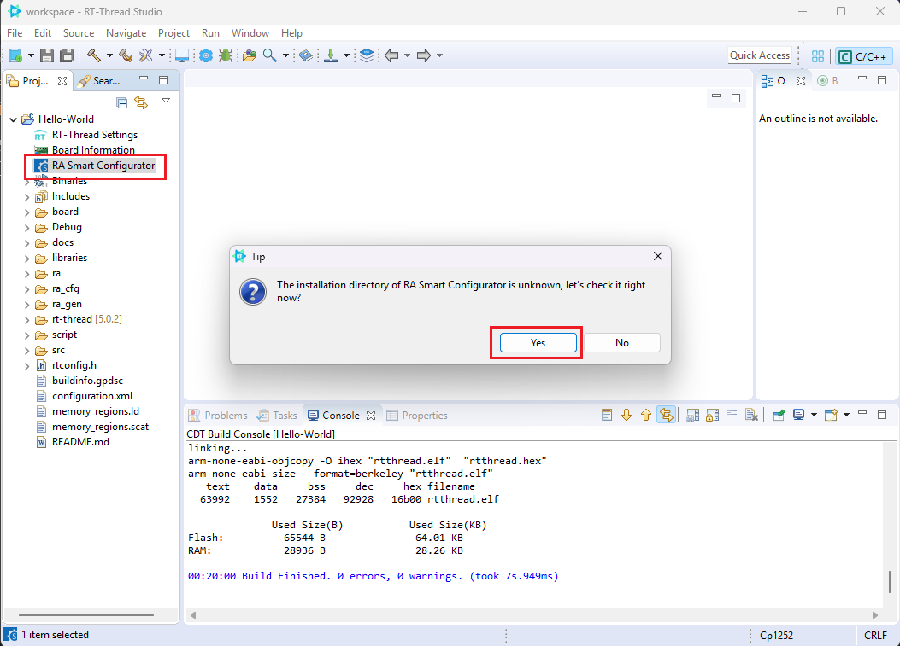
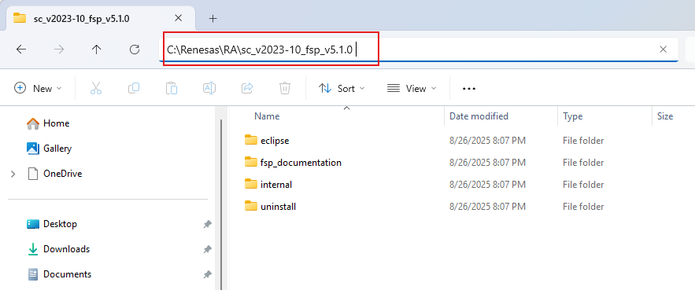
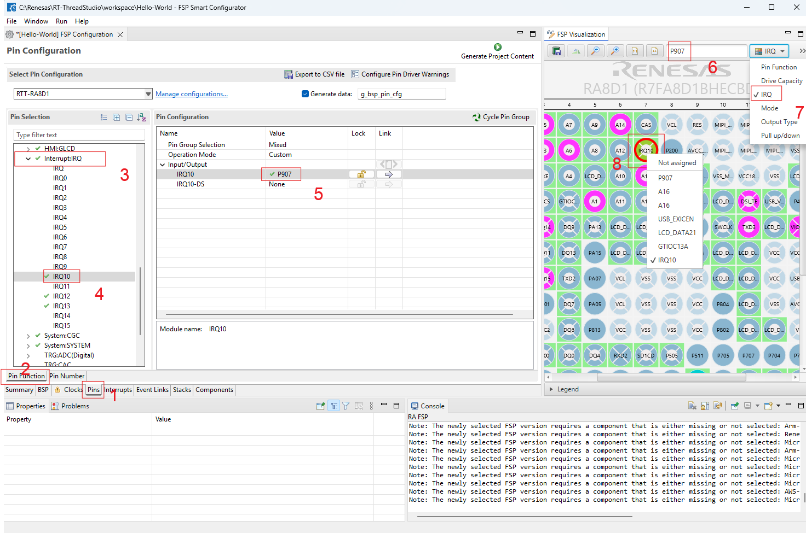
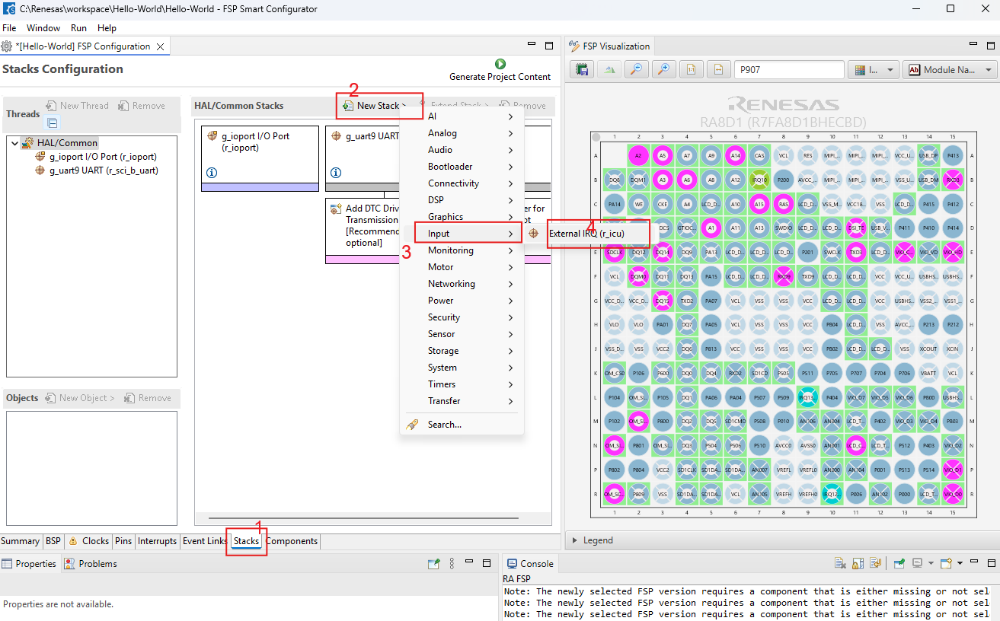
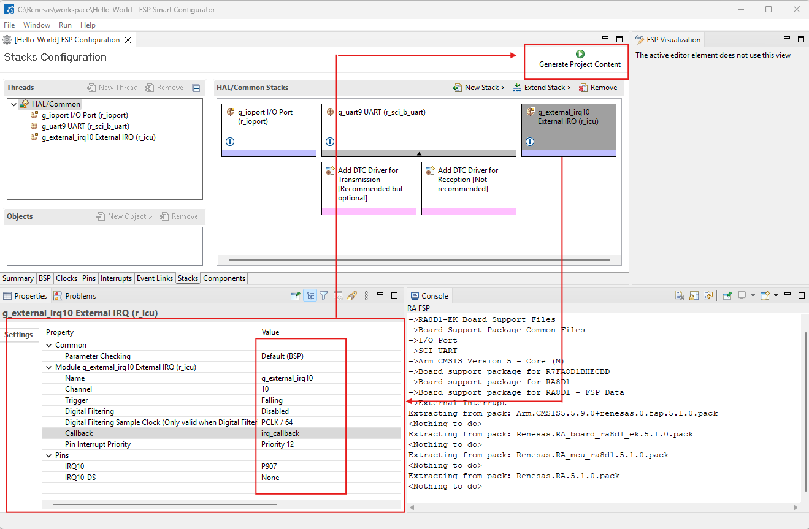
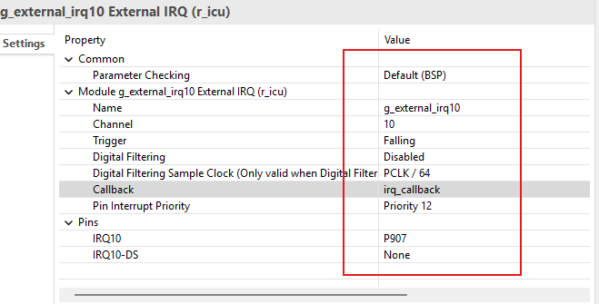
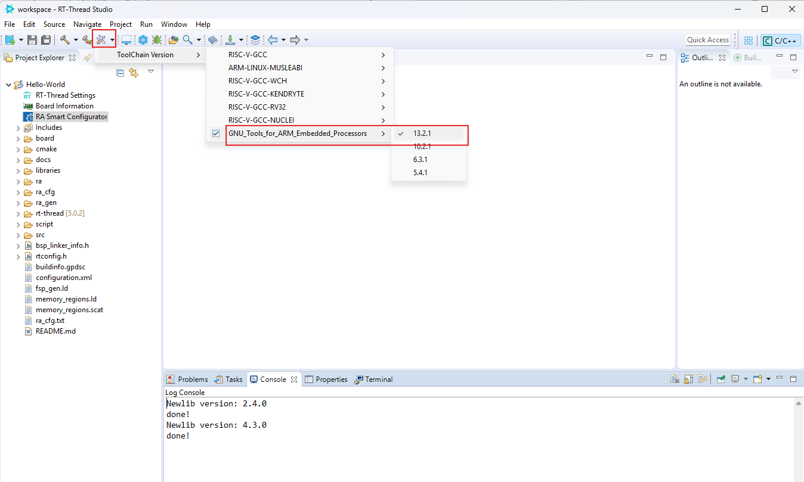
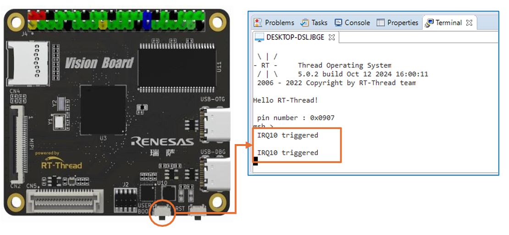

# Workshop 2: GPIO Interrupt

<span class="md-tag">Intermediate</span> <span class="md-tag">45 นาที</span>

## ก่อนเริ่ม Lab

- [ ] ทำ [Workshop 1](../03_workshop1/03.1_workshop1.md) ให้เสร็จก่อน (รู้วิธี Build + Flash)
- [ ] ติดตั้ง [FSP](../02_Preparation/02.2_install_fsp.md) เรียบร้อย
- [ ] Toolchain 13.2.1 ใช้งานได้

## เมื่อทำเสร็จ คุณจะได้

- [ ] กดปุ่ม K1 บนบอร์ดแล้วเห็นข้อความ "IRQ10 triggered" ใน Terminal
- [ ] เข้าใจว่า Interrupt แตกต่างจาก Polling อย่างไร
- [ ] ใช้ FSP (Flexible Software Package) ตั้งค่า Pin เป็น Interrupt ได้

---

## Lab 2.1: ทำไมต้อง Interrupt?

### Polling (วิธีเดิม)
โปรแกรมคอยถามบอร์ดว่า "กดยัง? กดยัง? กดยัง?" ตลอดเวลา — เปลือง CPU

### Interrupt (วิธีที่จะทำ)
บอร์ดบอกเองว่า "มีคนกดฉัน!" — CPU ไปทำอย่างอื่นรอได้

**สรุป:** Interrupt ตอบสนองไวกว่า ประหยัดพลังงาน

---

## Lab 2.2: เปิด RA Smart Configurator

### ทำอะไร
ตั้งค่า Pin P907 (ปุ่ม K1 บนบอร์ด) ให้เป็น External Interrupt หมายเลข IRQ10

### ขั้นตอน

1. **Double-Click ที่เมนู RA Smart Configurator** ใน Project Explorer

   { width="500" }

2. **เลือก Folder ที่ติดตั้ง FSP** (ปกติเป็น `C:\Renesas\RA\sc_v2023-10_fsp_v5.1.0`)

   { width="500" }

3. **รอจนหน้าต่าง RASC เปิดขึ้น**

   { width="500" }

!!! success "Checkpoint 2.1"
    ✅ RASC เปิดขึ้นและแสดง Block Diagram ของ MCU

    ❌ เปิดไม่ได้ = ตรวจสอบว่าติดตั้ง FSP แล้ว หรือเลือกผิด Path


---

## Lab 2.3: ตั้งค่า Pin P907 → IRQ10

### เป้าหมาย
ปุ่ม K1 บนบอร์ดเชื่อมกับ Pin P907 เราจะให้ Pin นี้สร้าง Interrupt เมื่อถูกกด

### ขั้นตอน

1. กดที่ Tab **Pins** → เลือก **Pin Function**
2. หา Pin **P907** ในแผนที่ → คลิกเลือก
3. เลือกฟังก์ชัน **InterruptIRQ** → **IRQ10**

!!! info "IRQ10 คืออะไร?"
    IRQ = Interrupt ReQuest คือ "บรรทัดขัดจังหวะ" หมายเลข 10

    มี IRQ0–IRQ15 ให้เลือก เราเลือก 10 เพราะเชื่อมกับ Pin P907 ได้


4. ไปที่ Tab **FSP Visualization** ด้านขวา → กรอกชื่อ `P907`

   { width="600" }

!!! success "Checkpoint 2.3"
    ✅ ด้านขวาเห็น Pin P907 ถูก mark ว่าใช้งานแล้ว

    ❌ ไม่เห็น = ย้อนกลับไปตรวจสอบว่าเลือก IRQ10 ถูกต้อง


---

## Lab 2.4: สร้าง Interrupt Stack

### ทำอะไร
บอก FSP ว่าเราจะใช้ External IRQ นี้จริง ๆ (ไม่ใช่แค่ assign pin)

### ขั้นตอน

1. กดที่ Tab **Stacks** → กด **New Stack** → เลือก **Input → External IRQ**

   { width="600" }

2. Double-Click Stack ที่สร้าง → เปลี่ยน **Trigger** จาก Rising → **Falling**

!!! info "ทำไม Falling?"
    ปุ่ม K1 เป็น Active-High (ปกติ HIGH เมื่อไม่กด) ตอนกดจะเปลี่ยนเป็น LOW

    Falling Edge = จับตอนที่สัญญาณลงจาก HIGH → LOW = ตอนกดปุ่ม


3. กด **Generate Project Content** (ปุ่มสีฟ้าด้านบน)

   { width="500" }

   ตรวจสอบว่า Config ตรงนี้:

   { width="500" }

!!! success "Checkpoint 2.4"
    ✅ RASC ปิดลง หรือแจ้งว่า Generate สำเร็จ

    ✅ ใน Project Explorer มีไฟล์ `hal_data.h` ถูกสร้าง/แก้ไข

    ❌ ไม่ Generate = ตรวจสอบว่ามี Error สีแดงใน RASC หรือไม่


---

## Lab 2.5: เลือก Toolchain และแก้โค้ด

### ขั้นตอน

1. **เลือก Toolchain:**

   คลิกขวาที่ Project → **Properties → C/C++ Build → Toolchain**

   เลือก **GNU Tools for ARM → 13.2.1**

   { width="500" }

2. **แก้ไข `src/hal_entry.c`** — ลบโค้ดเดิมออก ใส่โค้ดนี้แทน:

``` C title="hal_entry.c — Workshop 2" linenums="1"
#include <rtthread.h>
#include <rtdevice.h>
#include "hal_data.h"

#define LED_PIN    BSP_IO_PORT_01_PIN_02
#define IRQ_TEST_PIN "p907"

/* (1) Callback: ฟังก์ชันที่ถูกเรียกตอนกดปุ่ม */
void irq_callback_test(void *args) {
    rt_kprintf("\n IRQ10 triggered \n");
}

void hal_entry(void)
{
    rt_kprintf("\nHello RT-Thread!\n");

    /* (2) หา Pin number จากชื่อ */
    rt_uint32_t pin = rt_pin_get(IRQ_TEST_PIN);
    rt_kprintf("pin number : 0x%04X\n", pin);

    /* (3) ติดตั้ง Interrupt: Falling Edge = กดปุ่ม */
    rt_err_t err = rt_pin_attach_irq(
        pin,
        PIN_IRQ_MODE_FALLING,
        irq_callback_test,    /* เรียกฟังก์ชันนี้เมื่อกด */
        RT_NULL               /* ไม่ส่ง argument พิเศษ */
    );
    if (RT_EOK != err) {
        rt_kprintf("attach irq failed\n");
    }

    /* (4) เปิดใช้งาน Interrupt */
    err = rt_pin_irq_enable(pin, PIN_IRQ_ENABLE);
    if (RT_EOK != err) {
        rt_kprintf("enable irq failed\n");
    }

    while (1) {
        rt_pin_write(LED_PIN, PIN_HIGH);
        rt_thread_mdelay(500);
        rt_pin_write(LED_PIN, PIN_LOW);
        rt_thread_mdelay(500);
    }
}
```

1. **Callback** = ฟังก์ชันที่ kernel เรียกตอนเกิด Interrupt
2. `rt_pin_get()` = แปลงชื่อ Pin `"p907"` เป็นตัวเลขที่ใช้งานได้
3. `rt_pin_attach_irq()` = บอก OS ว่า "เมื่อ Pin นี้ถูกกด → เรียกฟังก์ชันนี้"
4. `rt_pin_irq_enable()` = เปิดสวิตช์ให้ Interrupt ทำงาน (ไม่เปิด = ไม่ตอบสนอง)

!!! success "Checkpoint 2.5"
    ✅ โค้ดมี `irq_callback_test()` ที่ print ข้อความ

    ✅ มี `rt_pin_attach_irq()` และ `rt_pin_irq_enable()`

    ❌ Build Error = ตรวจสอบว่า `hal_data.h` ถูก Generate จาก RASC แล้ว


---

## Lab 2.6: Build และ Flash

1. **Build Project** (กด 🔨 หรือ ++ctrl+b++)
2. **เชื่อมต่อ USB-DBG**
3. **Flash Download** (กด ⬇️)
4. **เปิด Terminal** (Baud 115200)

---

## Lab 2.7: ทดสอบ

### ทำอะไร
กดปุ่ม **K1** (ปุ่มด้านล่างบอร์ด ใกล้ ๆ LED) แล้วดู Terminal

### ขั้นตอน

1. ดู LED กะพริบปกติ
2. กดปุ่ม **K1** หนึ่งครั้ง

   { width="400" }

3. ดู Terminal → จะเห็น:
   ```
   IRQ10 triggered
   ```

!!! success "Checkpoint 2.7"
    ✅ Terminal แสดง "IRQ10 triggered" ทุกครั้งที่กด K1

    ✅ LED ยังกะพริบต่อเนื่อง (ไม่สะดุด)

    ❌ ไม่เห็นข้อความ = ตรวจสอบ Trigger เป็น Falling / Pin ถูกต้อง


---

## ทำไม LED ไม่สะดุด?

Interrupt ทำงาน **แยก** จาก main loop:

```
Main Loop:    LED ON → delay 500ms → LED OFF → delay 500ms → ...
                       ↑
Interrupt:             [กดปุ่ม K1] → หยุดชั่วคราว → เรียก callback → กลับต่อ
```

ระบบปฏิบัติการ (RTOS) จัดการให้ Interrupt ทำงานเร็ว ๆ แล้วกลับไปทำ main loop ต่อ — ไม่ต้องรอ polling

---

## สรุป: คุณทำอะไรสำเร็จแล้ว

- [x] ใช้ FSP ตั้งค่า Pin P907 เป็น External Interrupt IRQ10
- [x] ตั้งค่า Trigger เป็น Falling Edge (กด = HIGH → LOW)
- [x] เขียน Callback Function (`irq_callback_test`) ให้ print log
- [x] เปิดใช้งาน Interrupt ด้วย `rt_pin_irq_enable()`
- [x] ทดสอบกดปุ่มแล้วเห็นข้อความใน Terminal โดยไม่กระทบ LED

---

??? failure "แก้ปัญหาเบื้องต้น"
    **กดปุ่มแล้วไม่มีอะไรเกิดขึ้น**

    1. ตรวจสอบว่าเลือก Pin **P907** (ไม่ใช่ P907 คืออะไรอื่น)

    2. ตรวจสอบว่า Trigger เป็น **Falling** (ไม่ใช่ Rising)

    3. ตรวจสอบว่า `rt_pin_irq_enable(pin, PIN_IRQ_ENABLE)` อยู่ในโค้ด

    4. ลองกดปุ่มค้างไว้ 1 วินาทีแล้วปล่อย


    **"attach irq failed"**

    - Pin ไม่ถูกต้อง ลอง `rt_kprintf("pin = 0x%04X\n", pin);` ดูค่า

    - ตรวจสอบว่า RASC Generate แล้ว (มี `hal_data.h` อัปเดต)


    **Build Error หลัง Generate**

    - ตรวจสอบ Toolchain Version เป็น 13.2.1

    - Clean Project แล้ว Build ใหม่ (Project → Clean → Build)

