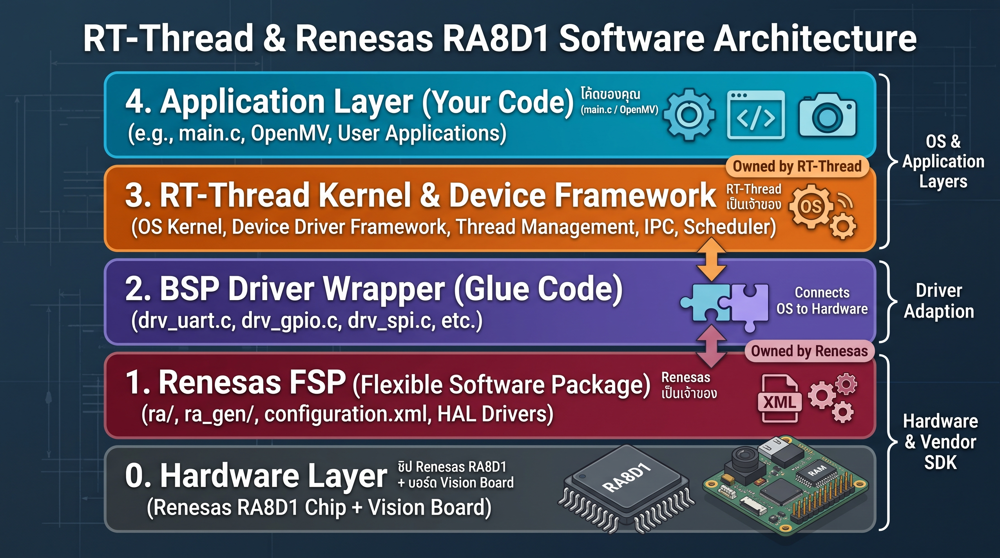
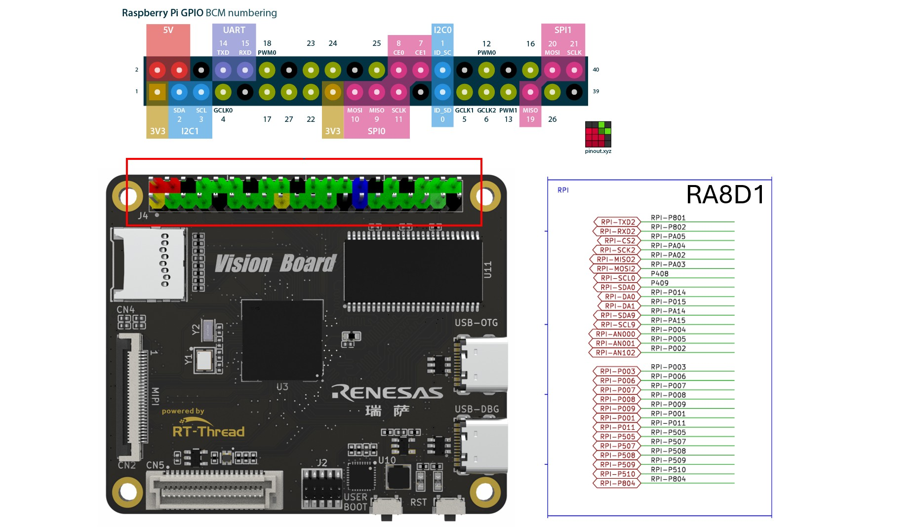
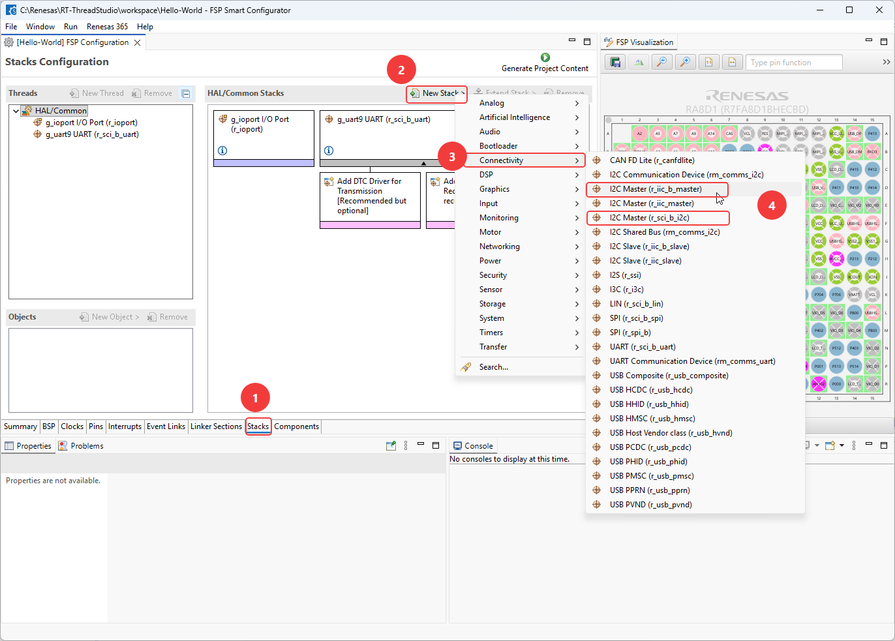
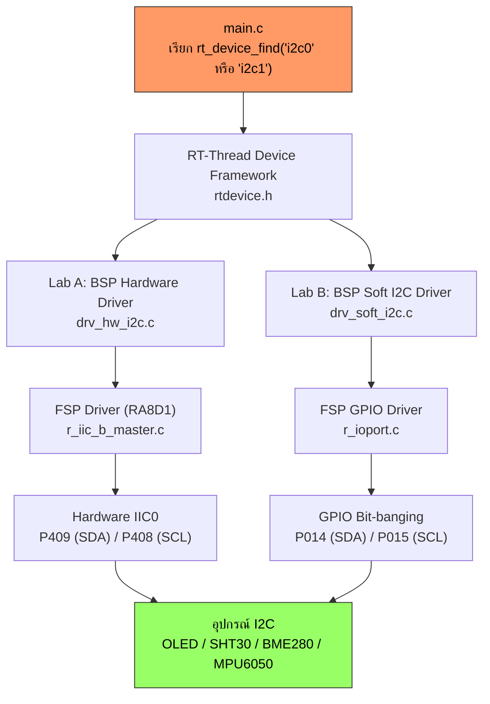

# บรรยาย
## วิธีเพิ่ม Peripheral ใหม่ (เช่น UART3 หรือ I2C) จาก RA Smart Configurator เข้าสู่ RT-Thread

<span class="md-tag">Foundation</span> <span class="md-tag">I2C</span> <span class="md-tag">Device Framework</span>

## สิ่งที่คุณจะเข้าใจหลังอ่านหน้านี้

- [ ] ตั้งค่า I2C บนชิป RA8D1 ผ่าน FSP (RA Smart Configurator)
- [ ] เขียนโค้ด `main.c` คุยกับ I2C ผ่าน RT-Thread Device API
- [ ] เข้าใจว่า `#include <rtthread.h>` กับ `#include <rtdevice.h>` ต่างกันอย่างไร
- [ ] รู้ว่า `main.c` คุยกับ OS เรื่องอะไร และคุยกับ BSP เรื่องอะไร
- [ ] ใช้ Software Package ลดงานเขียนโค้ด I2C เอง

---


## โครงสร้างชั้นการทำงาน (จากล่างขึ้นบน)



## บอร์ด RA8D1 Vision Board

บอร์ด RA8D1 Vision Board (ชิป R7FA8D1BHECBD ความเร็ว 480 MHz สถาปัตยกรรม Arm Cortex-M85) รองรับตัวควบคุมฮาร์ดแวร์ I2C (IIC) จำนวน 2 ช่อง และตัวควบคุม SCI-B I2C (Simple I2C) จำนวน 6 ช่องบนตัวไมโครคอนโทรลเลอร์ รวมถึงตัวควบคุม I3C อีก 1 ช่อง
ความสามารถด้าน I2C บนชิป (On-Chip I2C Capabilities)  
• Hardware IIC (I2C Bus Interface): มี 2 ช่อง (renesas,ra-iic) รองรับฟังก์ชันการทำงานของบัส I2C ตามมาตรฐาน NXP พร้อมบัฟเฟอร์ FIFO และสามารถปรับตั้งค่าความเร็วในการรับ-ส่งข้อมูลได้  
• SCI-B Simple I2C: มี 6 ช่อง (renesas,ra-i2c-sci-b) สามารถตั้งค่าเพื่อใช้สื่อสารแบบ I2C ผ่านพอร์ตสื่อสารอนุกรม (Serial Communications Interface) ได้  
• I3C Interface: มี 1 ช่อง (renesas,ra-i3c) รองรับฟังก์ชันการทำงานบางส่วนของ I2C และมาตรฐาน MIPI I3C
หากต้องการให้ช่วย อธิบายเพิ่มเติมเกี่ยวกับ I3C หรือ เทียบสเปกส่วนอื่นของ RA8D1 Vision Board สามารถแจ้งได้เลยครับ


## RA8D1 pinout



### 1. ขาที่ว่างสำหรับต่อ I2C บน 40-Pin Header (J4) ของ RA8D1 Vision Board

| ชุดที่ | ตำแหน่งขาบน 40-Pin Header (เทียบขา Pi) | ชื่อสัญญาณใน Schematic | ขาจริงของชิป RA8D1 | โหมดฮาร์ดแวร์ที่ตรงกับขานี้ |
| :--- | :--- | :--- | :--- | :--- |
| **ชุดที่ 1 (ตำแหน่งหลัก Pi)** | **Pin 3** (SDA)<br>**Pin 5** (SCL)<br>*(ตรงกับ I2C1 ของ Raspberry Pi)* | `RPI-SDA9`<br>`RPI-SCL9` | **`P014`** (SDA)<br>**`P015`** (SCL) | **SCI-B I2C (`r_sci_b_i2c`) Channel 9**<br>*(หรือใช้ Software I2C)* |
| **ชุดที่ 2 (แนะนำสำหรับ RT-Thread)** | **Pin 27** (ID_SD / SDA)<br>**Pin 28** (ID_SC / SCL)<br>*(ตรงกับ I2C0 ของ Raspberry Pi)* | `RPI-SDA0`<br>`RPI-SCL0` | **`P409`** (SDA)<br>**`P408`** (SCL) | **Hardware IIC (`r_iic_b_master`) Channel 0**<br>*(หรือ Software I2C)* |

> **การต่อไฟเลี้ยงบน Header J4:**
> * **VCC (3.3V):** Pin 1 หรือ Pin 17
> * **GND:** Pin 6, 9, 14, 20, 25, 30, 34 หรือ 39

---

### 2. แนวทางการเลือกระหว่าง `IIC` (`r_iic_b_master`) กับ `SCI` (`r_sci_b_i2c`)

* **แนะนำหลัก — เลือก `IIC` (`r_iic_b_master` Channel 0) ที่ Pin 27 (`P409` = SDA) และ Pin 28 (`P408` = SCL):**
  * **รองรับใน RT-Thread BSP ทันที:** ไดรเวอร์ `drv_hw_i2c.c` ของ Vision Board รองรับ `r_iic_b_master` อยู่แล้ว แค่เปิดใช้งานใน RA Smart Configurator และติ๊กเปิดใน **RT-Thread Settings** ก็สามารถใช้แพ็กเกจเซ็นเซอร์ (`sht3x`, `bme280`, `mpu6xxx`) ได้เลยโดยไม่ต้องเขียน Driver Wrapper เพิ่ม
  * **ประสิทธิภาพสูงสุด:** เป็นฮาร์ดแวร์ I2C แท้ของชิป RA8D1 มีบัฟเฟอร์ FIFO และรองรับความเร็วสูง (สูงสุด 1 Mbps)

* **ทางเลือกสำรอง — เลือก `SCI` (`r_sci_b_i2c` Channel 9) ที่ Pin 3 (`P014` = SDA) และ Pin 5 (`P015` = SCL):**
  * ใช้เฉพาะกรณีที่ต้องเสียบ **HAT / Shield มาตรฐานของ Raspberry Pi** ที่บังคับตำแหน่งขา I2C ไว้ที่ Pin 3 และ Pin 5 และไม่สามารถย้ายสายเองได้
  * *(หมายเหตุ: หากใช้ Pin 3 และ Pin 5 ใน RT-Thread การเปิดใช้ **Software I2C** บนขา `P014` / `P015` จะตั้งค่าง่ายและทำงานร่วมกับแพ็กเกจเซ็นเซอร์ได้เร็วกว่าการเขียน Wrapper ให้ `r_sci_b_i2c`)*

### Driver 

1. กรณีต่อ P409 (SDA) และ P408 (SCL) — ไม่ต้องเขียน Driver เลย

    • เพราะ P409/P408 เป็นขาของ Hardware IIC (r_iic_b_master Channel 0)  
    • ทีมพัฒนา RT-Thread ได้เขียนไฟล์ Wrapper (drv_hw_i2c.c) มารองรับ r_iic_b_master ไว้ใน BSP ของ Vision Board เรียบร้อยแล้ว  
    • หน้าที่เรา แค่เปิดใช้งานใน RA Smart Configurator -> ติ๊กเปิดใน RT-Thread Settings -> แล้วดึงแพ็กเกจเซ็นเซอร์ (sht3x, bme280, mpu6xxx) มาใช้ได้ทันที

2. กรณีต่อ P014 (SDA) และ P015 (SCL) — ขึ้นอยู่กับโหมดที่เลือก

    ขาคู่นี้เป็นขาของ SCI Channel 9 ซึ่งแบ่งเป็น 2 กรณี:
        • ถ้าจะใช้เป็น Hardware I2C (r_sci_b_i2c): ต้องเขียน Driver Wrapper เอง (หรือเรียกใช้ฟังก์ชัน FSP ของ Renesas ตรงๆ) เพราะใน BSP มาตรฐานของ RT-Thread ไม่ได้เขียนไฟล์ Wrapper (drv_hw_i2c.c) มารองรับโหมด r_sci_b_i2c ไว้ให้
        • ถ้าใช้เป็น Software I2C (Bit-banging): ไม่ต้องเขียน Driver เอง เพราะใน RT-Thread มีระบบจำลอง I2C บนขา GPIO ธรรมดา (drv_soft_i2c.c) เตรียมไว้ให้แล้ว คุณแค่ไปตั้งค่าให้ P014 และ P015 เป็นขา GPIO ธรรมดา แล้วใส่เลขขาในหน้า RT-Thread Settings ก็ใช้งานกับแพ็กเกจเซ็นเซอร์ได้เลยครับ

### สรุปสั้นๆ

• อยากได้ Hardware I2C แท้ + ไม่ต้องเขียน Driver → ย้ายไปต่อ P409 / P408 (Pin 27, 28)  
• อยากใช้ ขาเดิม P014 / P015 (Pin 3, 5) + ไม่ต้องเขียน Driver → เปิดใช้ Software I2C แทน r_sci_b_i2c ครับ


---


### การทำงานต้องทำเชื่อมกัน 2 ขั้นตอน เพื่อให้ FSP สร้างโค้ด และให้ RT-Thread BSP มองเห็นอุปกรณ์นั้น:
1. ฝั่ง Renesas (RA Smart Configurator):
	• ดับเบิลคลิกไฟล์ configuration.xml ในโปรเจกต์เพื่อเปิด RA Smart Configurator  
	• ไปที่แท็บ `Stacks -> กด New Stack > Connectivity > UART (r_sci_b_uart) (หรือ I2C)`  
	• ตั้งค่า Channel (เช่น Channel 3), ชื่อ Name (ต้องตั้งตามรูปแบบที่ BSP กำหนด เช่น g_uart3) และเลือกขา Pin (TX/RX)  
	• กดปุ่ม Generate Project Content (มุมขวาบน) เพื่ออัปเดตโค้ดลงโฟลเดอร์ ra_gen/ แล้วปิดโปรแกรม  
2. ฝั่ง RT-Thread (RT-Thread Settings / Kconfig):  
	• กลับมาที่ RT-Thread Studio -> ดับเบิลคลิก RT-Thread Settings  
	• ไปที่หมวด Hardware > On-chip Peripheral Drivers > Enable UART แล้วติ๊กเปิด Enable UART3  
	• กด Ctrl+S เพื่อบันทึก (ระบบจะไปเปิดสวิตช์ให้ไฟล์ drv_usart.c ใน BSP ดึง g_uart3 จาก ra_gen/ มาลงทะเบียนเป็นอุปกรณ์ชื่อ "uart3" ใน RT-Thread)
3. การใช้งานในโค้ด (main.c):  
	• สามารถเรียกใช้คำสั่งมาตรฐานอย่าง rt_device_find("uart3") และ rt_device_open() ได้ทันที




### ตารางเปรียบเทียบ `r_iic_b_master` กับ `r_sci_b_i2c` บน Renesas RA8D1 (Vision Board)

| หัวข้อเปรียบเทียบ | `r_iic_b_master` (I2C Bus Interface) | `r_sci_b_i2c` (Simple I2C on SCI) |
| :--- | :--- | :--- |
| **หน้าที่หลัก (Role)** | **ฮาร์ดแวร์ I2C เต็มรูปแบบ (Dedicated I2C)** สร้างมาเพื่อสื่อสาร I2C โดยเฉพาะ รองรับโปรโตคอลซับซ้อนและการส่งข้อมูลความเร็วสูง | **โหมดจำลอง I2C (Simple I2C)** เป็นฟีเจอร์เสริมของช่องสื่อสารอนุกรม (SCI/UART) เพื่อช่วยเพิ่มช่อง I2C เมื่อขาหลักไม่พอ |
| **จำนวนช่องสัญญาณบนชิป** | มี **2 ช่อง** (`Channel 0`, `Channel 1`) | มี **6 ช่อง** (`Channel 0` – `4` และ `Channel 9`) |
| **ขา Pin ที่ใช้ได้ (RA8D1)** | จำกัดเฉพาะกลุ่มขาของ **IIC_B**:<br>• **Ch 0:** `P400` (SCL0) / `P401` (SDA0) หรือ `P407` / `P408`<br>• **Ch 1:** `P512` (SCL1) / `P511` (SDA1) หรือ `P205` / `P206` | ใช้กับขาของ **SCI_B** ได้หลายจุด เช่น:<br>• **Ch 0:** **`P412` (SCL0) / `P411` (SDA0)**<br>• **Ch 1:** `P401` / `P402` หรือ `P101` / `P100`<br>• **Ch 2–4, 9:** ตามขา `SCKn` / `TXDn` ของช่องนั้นๆ |
| **รองรับขา P412 / P411?** | **ไม่ได้** (ฮาร์ดแวร์ไม่เชื่อมต่อกัน) | **ได้ (Channel 0)** ตรงกับขาที่คุณต่ออยู่ |
| **ความเร็วสูงสุด (Bitrate)** | สูงสุด **1 Mbps** (Fast-mode Plus) รวมถึง Standard (100kHz) และ Fast-mode (400kHz) | สูงสุด **400 kbps** (Fast-mode) และ Standard (100kHz) |
| **ฟีเจอร์พิเศษทางโปรโตคอล** | • รองรับ Multi-Master (มี Master หลายตัวในบัสเดียว)<br>• รองรับ Clock Stretching เต็มรูปแบบ<br>• รองรับ 10-bit Addressing และ SMBus<br>• ใช้ร่วมกับ DMAC/DTC ได้เต็มประสิทธิภาพ | • รองรับเฉพาะ **Single-Master** (มี RA8D1 เป็นตัวสั่งการตัวเดียว)<br>• รองรับเฉพาะ 7-bit Addressing<br>• เหมาะกับการต่อเซ็นเซอร์ทั่วไป 1-2 ตัว |
| **ความเข้ากันได้กับ RT-Thread BSP** | **รองรับโดยตรง** ในไฟล์ `drv_hw_i2c.c` ของ Vision Board (เปิดสวิตช์ใน RT-Thread Settings แล้วใช้แพ็กเกจเซ็นเซอร์ได้เลย) | **BSP พื้นฐานมักไม่รวมไว้** ต้องเรียกใช้ FSP API (`R_SCI_B_I2C_...`) เอง หรือเขียน Wrapper ครอบเป็น `rt_i2c_bus_device` เพิ่ม |

---

### สรุปการเลือกใช้งานสำหรับโปรเจกต์
* **ทางเลือก 1 `r_iic_b_master` เมื่อ:** ต้องการใช้แพ็กเกจเซ็นเซอร์สำเร็จรูปของ RT-Thread ทันทีโดยไม่ต้องเขียน Driver Wrapper เอง และสะดวกย้ายสายไฟเซ็นเซอร์ไปที่ขา **`P400` (SCL) / `P401` (SDA)** (หรือ `P512` / `P511` หากว่าง)
* **ทางเลือก 2 `r_sci_b_i2c` เมื่อ:** ต้องการ **คงสายไฟไว้ที่ขา `P412` / `P411` เดิม** และต้องการประสิทธิภาพระดับฮาร์ดแวร์ โดยยอมเขียนโค้ดเรียกฟังก์ชัน FSP หรือทำ Wrapper ครอบเพิ่ม


### สิ่งที่ "ยังต้องทำเหมือนกัน" ทั้ง 2 ตัวเลือก

1. ยังต้องตั้งค่าใน RA Smart Configurator (configuration.xml) เสมอ:  
	• ทั้งคู่เป็น Hardware Peripheral ของ Renesas FSP จึงต้องเปิด Stack, กำหนด Channel, ตั้งค่าขา Pin (SCL/SDA), ใส่ชื่อฟังก์ชัน Callback และกด Generate Project Content เพื่อสร้างโค้ดใน ra_gen/ ก่อนเสมอ
2. ยังต้องมีตัวต้านทาน Pull-up (4.7kΩ) ทางฮาร์ดแวร์:
	• ระบบ I2C เป็นแบบ Open-Drain ทั้งคู่ ไม่ว่าจะใช้ฮาร์ดแวร์ตัวไหน สายสัญญาณ SCL และ SDA ยังต้องมีตัวต้านทาน Pull-up ดึงขึ้นไฟ 3.3V (ซึ่งปกติโมดูลเซ็นเซอร์สำเร็จรูปอย่าง SHT30, BME280, MPU6050 มักใส่มาให้บนบอร์ดโมดูลแล้ว)
3. ยังต้องจัดการ Interrupt Callback แบบ Non-blocking:
	• ในระดับ FSP ของ Renesas ทั้ง R_IIC_B_MASTER_Write/Read และ R_SCI_B_I2C_Write/Read ทำงานแบบ Asynchronous (สั่งส่งแล้วทำงานต่อทันที) จึง ยังต้องรอรับ Event (TX_COMPLETE / RX_COMPLETE) จากฟังก์ชัน Callback ก่อนจะสั่งอ่านหรือเขียนคำสั่งถัดไป
4. ยังต้องเชื่อมเข้ากับ RT-Thread Device Framework (หากจะใช้แพ็กเกจสำเร็จรูป):
	• หากต้องการใช้แพ็กเกจเซ็นเซอร์ของ RT-Thread (เช่น sht3x, bme280, mpu6xxx) ตัว OS ยังต้องมองเห็นบัสเป็น rt_i2c_bus_device (ต่างกันแค่ r_iic_b_master มักมี Wrapper drv_hw_i2c.c เขียนไว้ให้แล้วใน BSP ส่วน r_sci_b_i2c คุณต้องเขียน Wrapper สั้นๆ ครอบเอง)
หากเมื่อสักครู่คุณกำลังจะถามถึง ประเด็นอื่น (เช่น เรื่อง RT-Thread Settings, Pin Muxing หรือโค้ดอ่านค่าเซ็นเซอร์) สามารถพิมพ์ข้อความต่อได้เลยครับ


### โครงสร้างโฟลเดอร์สำคัญภายในโปรเจกต์ RA8D1 Vision Board

```
<RA8D1_Vision_Board_Project>/
├── applications/        # โค้ดแอปพลิเคชันหลักของคุณ (main.c)
├── board/               # ไฟล์ตั้งค่าเฉพาะบอร์ด Vision Board (board.c, Kconfig, Linker Script)
├── libraries/           # ไฟล์ Wrapper ตัวเชื่อมระหว่าง Renesas FSP กับ RT-Thread
│   └── HAL_Drivers/     # (เช่น drv_usart.c, drv_gpio.c, drv_spi.c)
├── packages/            # แพ็กเกจเสริมที่ดาวน์โหลดเพิ่ม (เช่น OpenMV, LVGL, Netutils)
├── ra/                  # ไลบรารีมาตรฐาน Renesas FSP (ห้ามแก้ไขด้วยมือ)
├── ra_gen/              # โค้ดตั้งค่าขา Pin และ Peripheral ที่สร้างจาก configuration.xml
├── rt-thread/           # ซอร์สโค้ดหลักของระบบปฏิบัติการ RT-Thread (Kernel, FinSH, Device)
└── configuration.xml    # ไฟล์ตั้งค่าฮาร์ดแวร์สำหรับเปิดใน RA Smart Configurator
```

### เริ่มต้นจาก demo_


!!! info "ทำไมต้องเปิดสองที่?"
    - **FSP** = ตั้งค่ารีจิสเตอร์ฮาร์ดแวร์ชิป (Renesas)
    - **RT-Thread Settings** = บอก Kernel ว่าให้คอมไพล์ไลบรารี I2C Framework เข้ามาด้วย

---

# คู่มือ Lab: การใช้งาน I2C บนบอร์ด RA8D1 Vision Board (RT-Thread)

เอกสารนี้รวมขั้นตอนตั้งแต่การตั้งค่าฮาร์ดแวร์ใน **RA Smart Configurator (RASC)** และการเปิดสวิตช์ใน **RT-Thread Settings** ไปจนถึงการเขียนโค้ดใน `main.c` และการเรียกใช้ Software Package

---

## ภาพรวมการเลือกโหมด I2C บน 40-Pin Header (J4)

บนบอร์ด RA8D1 Vision Board มีจุดต่อ I2C ที่ว่างอยู่ 2 ชุดหลัก ซึ่งมีวิธีการตั้งค่าในระบบต่างกัน:

| รูปแบบ Lab | ชื่อ Bus ใน RT-Thread | ขาบน 40-Pin Header (J4) | ขาจริงชิป RA8D1 | โมดูลเบื้องหลัง | จุดเด่น |
| :--- | :--- | :--- | :--- | :--- | :--- |
| **Lab A: Hardware IIC** | **`"i2c0"`** | **Pin 27** (SDA)<br>**Pin 28** (SCL) | **`P409`** (SDA)<br>**`P408`** (SCL) | Renesas FSP (`r_iic_b_master`) | ฮาร์ดแวร์แท้ ความเร็วสูง (สูงสุด 1 Mbps) ใช้ FIFO ไม่กินแรง CPU |
| **Lab B: Software I2C** | **`"i2c1"`** | **Pin 3** (SDA)<br>**Pin 5** (SCL) | **`P014`** (SDA)<br>**`P015`** (SCL) | GPIO Bit-banging (`drv_soft_i2c.c`) | ตรงตำแหน่ง I2C หลักของ Raspberry Pi ตั้งค่าง่าย ไม่ต้องเปิด Stack ใน RASC |

> **การต่อไฟเลี้ยง (ใช้ร่วมกันทั้ง 2 Lab):**
> * **VCC (3.3V):** Pin 1 หรือ Pin 17
> * **GND:** Pin 6, 9, 14, 20, 25, 30, 34 หรือ 39

---

## ขั้นตอนที่ 1: ตั้งค่าฮาร์ดแวร์และเปิด Driver (เลือกทำ Lab A หรือ Lab B)

### แนวทางที่ 1 (Lab A): ตั้งค่า Hardware IIC (`"i2c0"` บนขา `P409` / `P408`)

1. **ตั้งค่าใน RA Smart Configurator (`configuration.xml`):**
   * ดับเบิลคลิกไฟล์ `configuration.xml` เพื่อเปิดโปรแกรม **RA Smart Configurator**
   * ไปที่แท็บ **Stacks** -> กด **New Stack > Connectivity > I2C Master (`r_iic_b_master`)**
   * คลิกที่กล่อง Stack ที่เพิ่มเข้ามา แล้วตั้งค่าในแท็บ **Properties** ด้านล่าง:
     * **Name:** `g_i2c0` *(ต้องตรงกับชื่อใน `drv_hw_i2c.c` ของ BSP)*
     * **Channel:** `0`
     * **Rate:** `Standard` (100kHz) หรือ `Fast-mode` (400kHz)
     * **Callback:** `i2c0_callback` *(ตรวจสอบชื่อใน `libraries/HAL_Drivers/drv_hw_i2c.c` ให้ตรงกัน)*
     * **Pins (ด้านล่างสุด):** ตรวจสอบว่า **SCL0 = `P408`** และ **SDA0 = `P409`**
   * กดปุ่ม **Generate Project Content** (มุมขวาบน) -> กลับไปที่ **RT-Thread Studio** คลิกขวาที่โปรเจกต์แล้วกด **Refresh (F5)**
2. **เปิดสวิตช์ใน RT-Thread Settings:**
   * ดับเบิลคลิกเปิด **RT-Thread Settings** -> ไปที่ **Hardware > On-chip Peripheral Drivers**
   * ติ๊กเปิด **Enable Hardware I2C** -> ติ๊กเลือก **Enable I2C0**
   * กด **Ctrl+S** เพื่อบันทึก

---

### แนวทางที่ 2 (Lab B): ตั้งค่า Software I2C (`"i2c1"` บนขา `P014` / `P015`)

1. **ตรวจสอบขา Pin ใน RA Smart Configurator (`configuration.xml`):**
   * เปิดไฟล์ `configuration.xml` -> ไปที่แท็บ **Pins**
   * ตรวจสอบขา **`P014`** และ **`P015`** ว่า **ไม่ถูกใช้งาน (Disabled)** กับ Peripheral อื่น (เช่น SCI9 หรือ Analog) เพื่อให้ RT-Thread ควบคุมเป็น GPIO ได้อิสระ
   * หากมีการแก้ไข ให้กด **Generate Project Content** แล้วกลับไป Refresh ใน RT-Thread Studio
2. **เปิดสวิตช์ใน RT-Thread Settings:**
   * เปิด **RT-Thread Settings** -> ไปที่ **Hardware > On-chip Peripheral Drivers**
   * ติ๊กเปิด **Enable I2C1** *(หรือ Soft I2C Bus ตัวที่ว่างอยู่)*
   * กำหนดหมายเลข Pin Index ของขา SCL และ SDA (อ้างอิงฟอร์แมตของ Renesas BSP):
     * **`P015` (SCL):** `0x000F` (หรือเลขฐานสิบ `15`)
     * **`P014` (SDA):** `0x000E` (หรือเลขฐานสิบ `14`)
   * กด **Ctrl+S** เพื่อบันทึก

---

### การตรวจสอบความพร้อมผ่าน FinSH Shell (ทำก่อนเขียนโค้ด)
เมื่อ Build และ Flash ลงบอร์ด RA8D1 แล้ว เปิด Serial Terminal (`115200`) แล้วพิมพ์คำสั่ง:
* `list device` → ต้องเห็นชื่อ **`i2c0`** (ถ้าทำ Lab A) หรือ **`i2c1`** (ถ้าทำ Lab B) แสดงขึ้นมา
* `i2c scan i2c0` (หรือ `i2c scan i2c1`) → หากเปิดแพ็กเกจ `i2c-tools` ไว้ จะสแกนเจอ Address ของอุปกรณ์ เช่น `0x44` (SHT30), `0x76` (BME280), `0x68` (MPU6050)

---

## ขั้นตอนที่ 2: เขียนโค้ดใน `main.c`

> ⚠️ **หมายเหตุสำคัญ:** ในโค้ดด้านล่าง ให้เปลี่ยน `#define I2C_BUS_NAME` เป็น **`"i2c0"`** (สำหรับ Lab A: Hardware IIC) หรือ **`"i2c1"`** (สำหรับ Lab B: Software I2C) ตามวงจรที่คุณต่อจริง

### 2.1 ค้นหา I2C Bus Device

```c
#include <rtthread.h>      // (1) คุยกับ OS
#include <rtdevice.h>      // (2) คุยกับ Hardware Framework

#define I2C_BUS_NAME    "i2c0"  // ใช้ "i2c0" สำหรับ HW IIC (P408/P409) หรือ "i2c1" สำหรับ Soft I2C (P014/P015)

int main(void)
{
    struct rt_i2c_bus_device *i2c_bus = RT_NULL;

    // ค้นหา I2C Bus จากชื่อ
    i2c_bus = (struct rt_i2c_bus_device *)rt_device_find(I2C_BUS_NAME);
    
    if (i2c_bus == RT_NULL)
    {
        rt_kprintf("can't find %s device!\n", I2C_BUS_NAME);
        return -RT_ERROR;
    }

    rt_kprintf("I2C Bus (%s) Initialized Successfully!\n", I2C_BUS_NAME);
    // ... โค้ดใช้งาน I2C ต่อ
    return 0;
}
```

1. `rtthread.h` = คุยกับ **RT-Thread OS** (Thread, Delay, Memory)
2. `rtdevice.h` = คุยกับ **Device Framework** (I2C, SPI, UART, GPIO)

> 💡 **ทำไมต้อง `#include` 2 ไฟล์?**
> * `rtthread.h` = พาสปอร์ตเข้าโลกของ **RTOS** (Scheduler, Thread, Timer)
> * `rtdevice.h` = พาสปอร์ตเข้าโลกของ **Hardware** (I2C Bus, UART Port, GPIO Pin)
> * ถ้าไม่ `#include` → คอมไพเลอร์ไม่รู้จัก `rt_device_find()`, `rt_i2c_bus_device`

---

### 2.2 ส่งข้อมูล (Write) ผ่าน I2C

```c
struct rt_i2c_msg msgs;
uint8_t buf[2] = {0x00, 0x55};  // Register address + Data

msgs.addr  = 0x3C;        // Slave Address (เช่น OLED)
msgs.flags = RT_I2C_WR;   // โหมดเขียน
msgs.buf   = buf;
msgs.len   = 2;

if (rt_i2c_transfer(i2c_bus, &msgs, 1) == 1) {
    rt_kprintf("I2C Write OK\n");
} else {
    rt_kprintf("I2C Write Failed!\n");
}
```

---

### 2.3 อ่านข้อมูล (Read) ผ่าน I2C

```c
struct rt_i2c_msg msgs[2];
uint8_t reg_addr = 0x75;    // ตัวอย่าง: Register WHO_AM_I ของ MPU6050
uint8_t read_data[1] = {0};

// ข้อความที่ 1: บอกอุปกรณ์ว่าจะอ่านรีจิสเตอร์ไหน
msgs[0].addr  = 0x68;       // Slave Address (เช่น MPU6050)
msgs[0].flags = RT_I2C_WR;  // เขียน register address
msgs[0].buf   = &reg_addr;
msgs[0].len   = 1;

// ข้อความที่ 2: อ่านค่ากลับมา
msgs[1].addr  = 0x68;       // Slave Address
msgs[1].flags = RT_I2C_RD;  // โหมดอ่าน
msgs[1].buf   = read_data;
msgs[1].len   = 1;

if (rt_i2c_transfer(i2c_bus, msgs, 2) == 2) {
    rt_kprintf("Read: 0x%02X\n", read_data[0]);
} else {
    rt_kprintf("I2C Read Failed!\n");
}
```

---

## `main.c` คุยกับ OS เรื่องอะไร vs คุยกับ BSP เรื่องอะไร

| คุยกับ | เรื่องที่คุย | ตัวอย่าง | API ที่ใช้ |
|--------|------------|---------|----------|
| **RT-Thread OS** | จัดการระบบ, จัดคิว, เวลา | หน่วงเวลาไม่บล็อก CPU, สร้าง Thread, จอง RAM | `rt_thread_mdelay()`, `rt_thread_create()`, `rt_malloc()` |
| **BSP (Hardware)** | ควบคุมอุปกรณ์บนบอร์ด | เปิด/ปิด LED, ส่งข้อมูล I2C, อ่าน UART | `rt_device_find()`, `rt_i2c_transfer()`, `rt_pin_write()` |

> ℹ️ **เปรียบเทียบให้เห็นภาพ:**
> * **คุยกับ OS** = คุยกับ **ผู้จัดการโรงงาน** — ขอเวลาพัก, ขอจัดสรรคน, ขอห้องประชุม
> * **คุยกับ BSP** = คุยกับ **เครื่องจักรในไลน์ผลิต** — เปิดมอเตอร์, อ่านเซ็นเซอร์, ส่งข้อมูล

---

## ขั้นตอนที่ 3: ใช้ Software Package (ทางลัด)

ถ้าอุปกรณ์ที่ต่อเป็นอุปกรณ์ยอดนิยม (เช่น OLED SSD1306, SHT30, BME280, MPU6050) **ไม่ต้องเขียน `rt_i2c_transfer()` เอง!**

### วิธีใช้ Package

1. เปิด **RT-Thread Settings → Software Packages**
2. ค้นหาชื่ออุปกรณ์ (เช่น `ssd1306`, `sht3x`, `bme280`, `mpu6xxx`)
3. กด **Add to Project** *(คลิกตั้งค่าในเมนูของ Package เพื่อระบุชื่อ Bus เป็น `"i2c0"` หรือ `"i2c1"` ให้ตรงกับ Lab ที่ต่อ)*
4. ใน `main.c` เรียกใช้ฟังก์ชันสำเร็จรูป:

```c
#include <ssd1306.h>    // Package header

int main(void)
{
    ssd1306_init();              // เรียก init จาก Package
    ssd1306_clear_screen();      // ล้างจอ
    ssd1306_show_string(0, 0, "Hello RT-Thread!", Font_7x10, White);
    ssd1306_update_screen();
    return 0;
}
```

> 💡 **ข้อดีของ Package**
> * ไม่ต้องนั่งเขียนโค้ด I2C protocol เอง
> * ไม่ต้องจำ Slave Address / Register Map
> * มีตัวอย่างให้ศึกษา

---

## สรุปสถาปัตยกรรมและ Flow การใช้งาน I2C บน RA8D1



| ขั้น | เราเขียน / ตั้งค่า | ระบบจัดการให้ |
|------|-------------------|--------------|
| 1. ตั้งค่า Pin / Stack | เลือกใน RASC (เฉพาะ Lab A) | FSP สร้าง `hal_data.h` |
| 2. เปิด I2C Driver | ติ๊กใน RT-Thread Settings | Kernel คอมไพล์ I2C Framework |
| 3. หา Bus | `rt_device_find("i2c0")` หรือ `"i2c1"` | BSP จับคู่ชื่อกับ Driver เบื้องล่าง |
| 4. ส่ง/รับข้อมูล | `rt_i2c_transfer()` | Device Framework → BSP → FSP → Hardware |
| 5. ใช้ Package (optional) | เรียก `ssd1306_init()` / `sht3x_init()` | Package ครอบ I2C protocol ไว้หมด |

---

## ตารางเปรียบเทียบ: เขียน `rt_i2c_transfer()` เอง vs ใช้ Software Package

| วิธี | ข้อดี | ข้อเสีย | เหมาะกับ |
|------|------|--------|----------|
| **เขียน `rt_i2c_transfer()` เอง** | เข้าใจลึก, ควบคุมทุก byte | ต้องอ่าน datasheet เอง, เขียนเยอะ | อุปกรณ์ที่ไม่มี Package, อยากเรียนรู้ |
| **ใช้ Software Package** | เร็ว, มีตัวอย่าง, ไม่ต้องจดจำ register | อาจไม่รองรับ feature ลึก, ต้องรออัปเดต | อุปกรณ์ยอดนิยม, ทำโปรเจกต์จริง |


## การแก้ปัญหาเบื้องต้น (Troubleshooting)

??? failure "พบปัญหาเบื้องต้น"
    **"can't find i2c0 / i2c1 device!"**
    - ตรวจสอบว่าเปิด **Enable Hardware I2C** (สำหรับ `i2c0`) หรือ **Enable Soft I2C** (สำหรับ `i2c1`) ใน **RT-Thread Settings → Hardware → On-chip Peripheral Drivers** และกด **Ctrl+S** บันทึกแล้ว
    - ตรวจสอบว่าใน **RASC** กด **Generate Project Content** แล้ว และใน RT-Thread Studio กด **Refresh (F5)** ก่อนกด **Build** ใหม่
    - ตรวจสอบชื่อ bus ในโค้ด (`"i2c0"`, `"i2c1"`) ว่าตรงกับหมายเลขที่เปิดใช้งาน (พิมพ์คำสั่ง `list device` ใน FinSH Shell เพื่อเช็กชื่อจริงที่ระบบลงทะเบียน)
    - *(เฉพาะ Lab A)* ตรวจสอบว่าชื่อ Instance ใน RASC ตั้งเป็น **`g_i2c0`** และ Callback ตั้งตรงกับไฟล์ `drv_hw_i2c.c`

    **"I2C Write / Read ไม่สำเร็จ"**
    - ตรวจสอบ **Slave Address** 7-bit ว่าตรงกับอุปกรณ์หรือไม่ (เช่น OLED `0x3C`/`0x3D`, SHT30 `0x44`/`0x45`, BME280 `0x76`/`0x77`, MPU6050 `0x68`/`0x69`)
    - ตรวจสอบ **Pull-up resistor** (4.7kΩ ดึงขึ้น 3.3V) บนสาย SDA และ SCL (I2C ต้องมี Pull-up เสมอ หากใช้โมดูลเปลือยที่ไม่มีตัวต้านทานบนบอร์ดต้องต่อเพิ่มเอง)
    - ตรวจสอบสายต่อถูก Pin และไม่สลับขา **SDA / SCL** กัน (Lab A: `P409`/`P408`, Lab B: `P014`/`P015`)
    - ตรวจสอบว่าขา Pin ที่เลือกไม่ชนกับ Peripheral อื่นในแท็บ **Pins** ของ RASC

    **"Package หาไม่เจอใน RT-Thread Settings"**
    - กดปุ่ม **Refresh** (อัปเดตดัชนีแพ็กเกจ) ที่หน้าต่าง Package Center
    - ตรวจสอบการเชื่อมต่ออินเทอร์เน็ต (ระบบต้องดึงข้อมูลแพ็กเกจจาก GitHub / Gitee)
    - ลองค้นหาด้วยคำสั้นๆ หรือดูในหมวด **`IoT - internet of things → sensors`** หรือ **`peripheral libraries and drivers`** (เช่น ค้นหาคำว่า `sht3`, `bme`, `mpu6`, `ssd1306`)


