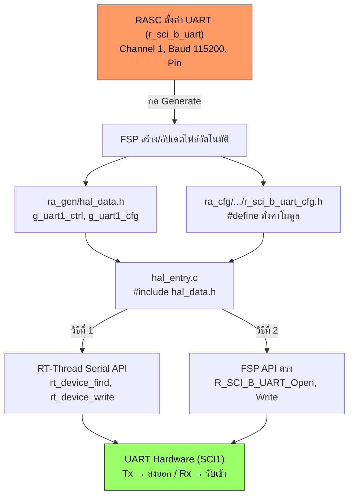

# ใช้งาน UART (Tx/Rx) บน RT-Thread

<span class="md-tag">Foundation</span> <span class="md-tag">UART</span> <span class="md-tag">Serial</span>

## สิ่งที่คุณจะเข้าใจหลังอ่านหน้านี้

- [ ] ตั้งค่า UART บนชิป **RA8D1** ผ่าน FSP (RA Smart Configurator)
- [ ] เขียนโค้ด `hal_entry.c` ส่ง/รับข้อมูลผ่าน Tx/Rx (ทั้งแบบ RT-Thread Framework และ FSP API)
- [ ] เข้าใจว่า `#include "hal_data.h"` ค้นหาไฟล์เจอได้อย่างไร
- [ ] รู้หน้าที่ของโฟลเดอร์ `ra_gen/` และ `ra_cfg/` และกฎเหล็กในการใช้งาน
- [ ] ตรวจสอบและจัดการ Include Paths ใน RT-Thread Studio ได้

---

## โครงสร้างโปรเจกต์ที่เกี่ยวข้อง

```text
Hello-World/
├── src/
│   └── hal_entry.c                 ← เขียนโค้ดแอปพลิเคชัน UART ที่นี่
├── ra_gen/
│   ├── hal_data.h                  ← ประตูเชื่อมกับ FSP (ประกาศ g_uart1_ctrl, g_uart1_cfg)
│   └── hal_data.c                  ← ตัวแปรควบคุมที่ FSP สร้างให้
├── ra_cfg/
│   └── fsp_cfg/
│       └── r_sci_b_uart_cfg.h      ← ค่าตั้งค่าคงที่ของ UART (สำหรับชิป RA8D1)
├── libraries/
│   ├── HAL_Drivers/drv_usart_v2.c  ← ตัวเชื่อม (Wrapper) ระหว่าง FSP กับ RT-Thread
│   └── ra/fsp/src/r_sci_b_uart/    ← ไดรเวอร์ UART ระดับต่ำของ Renesas
└── ...
```

---

## `hal_entry.c` เข้าถึง `ra_gen/` และ `ra_cfg/` ได้อย่างไร?

### ผ่าน `#include "hal_data.h"`

```c
#include "hal_data.h"   // ← ประตูเชื่อมกับ FSP
```

| คำสั่ง | กลไกการค้นหาของ Compiler |
| :--- | :--- |
| `#include "xxx.h"` | ค้นหาในโฟลเดอร์เดียวกับไฟล์โค้ดก่อน หากไม่เจอจะไล่ค้นตาม **Include Paths** |
| `#include <xxx.h>` | ค้นหาเฉพาะใน **Include Paths** ของระบบและคอมไพเลอร์ |

!!! info "`hal_data.h` อยู่ที่ไหน?"
    ตำแหน่งจริงของไฟล์คือ **`ra_gen/hal_data.h`**
    
    สาเหตุที่เราเขียน `#include "hal_data.h"` สั้นๆ ได้เลยโดยไม่ต้องใส่ชื่อโฟลเดอร์ข้างหน้า เพราะ RT-Thread Studio ได้ **เพิ่ม `ra_gen/` และ `ra_cfg/` เข้าไปใน Include Paths** ให้ตั้งแต่ตอนสร้างโปรเจกต์แล้ว

---

## `ra_gen/` กับ `ra_cfg/` คืออะไร?

| โฟลเดอร์ | มาจากไหน | มีอะไรอยู่ข้างใน | ทำหน้าที่อะไร |
| :--- | :--- | :--- | :--- |
| **`ra_gen/`** | FSP สร้างอัตโนมัติ | `hal_data.h`, `hal_data.c`, `pin_data.c` | รวมอ็อบเจกต์ควบคุมฮาร์ดแวร์และขา Pin ทั้งหมดที่ตั้งค่าใน RASC |
| **`ra_cfg/`** | FSP สร้างอัตโนมัติ | `r_sci_b_uart_cfg.h` และไฟล์ `*_cfg.h` อื่นๆ | เก็บค่าคงที่ `#define` สำหรับเปิด/ปิดฟีเจอร์ย่อยของโมดูล |

### เปรียบเทียบให้เห็นภาพ

- **`ra_gen/`** = **บลูพริ้นท์ (Blueprint)** — บอกว่าในระบบมีอุปกรณ์อะไรบ้าง (เช่น `g_uart1`)
- **`ra_cfg/`** = **สเปก (Specification)** — บอกว่าอุปกรณ์นั้นตั้งค่าการทำงานอย่างไร

!!! warning "กฎเหล็ก: ห้ามแก้ไขไฟล์ในสองโฟลเดอร์นี้ด้วยมือ!"
    ทั้ง `ra_gen/` และ `ra_cfg/` จะถูก **เขียนทับใหม่ทั้งหมด** ทุกครั้งที่คุณกด **Generate Project Content** ใน RA Smart Configurator หากแก้ไขด้วยมือ โค้ดที่แก้ไว้จะหายไปทันที

---

## ขั้นตอนที่ 1: ตั้งค่า UART ผ่าน FSP (RA Smart Configurator)

### 1.1 เปิด RA Smart Configurator
1. ดับเบิลคลิกไฟล์ **`configuration.xml`** (หรือเมนู RA Smart Configurator) ใน Project Explorer
2. ไปที่แท็บ **Stacks**
3. กด **New Stack** → **Connectivity → UART (`r_sci_b_uart`)** *(หมายเหตุ: ชิป RA8D1 ใช้โมดูล SCI_B)*

### 1.2 ตั้งค่า Properties ของ UART
คลิกที่กล่อง Stack ที่เพิ่มเข้ามา แล้วตั้งค่าในแท็บ **Properties** ด้านล่าง:

| หัวข้อ (Property) | ค่าที่ตั้ง | คำอธิบาย |
| :--- | :--- | :--- |
| **Name** | **`g_uart1`** | **สำคัญมาก:** ต้องตั้งชื่อให้ตรงกับหมายเลข Channel (`g_uart1` สำหรับ Ch 1) เพื่อให้ BSP มองเห็น |
| **Channel** | **`1`** (SCI1) | เลือกช่อง UART ที่ต้องการใช้งาน (ระวังอย่าให้ซ้ำกับช่อง Console/Debug หลักของบอร์ด) |
| **Baud Rate** | **`115200`** | ความเร็วในการรับ-ส่งข้อมูล (bps) |
| **Data Bits** | `8 Bits` | จำนวนบิตข้อมูล |
| **Parity** | `None` | ไม่ตรวจสอบ Parity |
| **Stop Bits** | `1 Bit` | จำนวนบิตหยุด |
| **Callback** | `user_uart_callback` | ฟังก์ชันรับเหตุการณ์ Interrupt *(ตรวจสอบชื่อใน `drv_usart_v2.c` หากใช้ร่วมกับ RT-Thread BSP)* |
| **Pins (TXD1 / RXD1)** | `P101` (TX) / `P100` (RX) | ตรวจสอบขา Pin บน Header ของบอร์ด Vision Board ให้ตรงกับสายที่ต่อจริง |

### 1.3 Generate Project Content
กดปุ่ม **Generate Project Content** (มุมขวาบน) → กลับไปที่ RT-Thread Studio คลิกขวาที่โปรเจกต์แล้วกด **Refresh (F5)**

!!! success "ผลลัพธ์ที่ได้จาก RASC"
    FSP จะสร้าง/อัปเดตตัวแปร **`g_uart1_ctrl`** และ **`g_uart1_cfg`** ลงใน `ra_gen/hal_data.h` พร้อมกำหนดค่าขา Pin ลงใน `pin_data.c`

---

## ขั้นตอนที่ 2: เปิดใช้งาน UART Driver ใน RT-Thread Settings

*(ทำขั้นตอนนี้ก่อนเขียนโค้ด เพื่อให้ RT-Thread ลงทะเบียนอุปกรณ์ชื่อ `"uart1"` เข้าสู่ระบบ)*

1. ดับเบิลคลิกเปิด **RT-Thread Settings**
2. ไปที่ **Hardware → On-chip Peripheral Drivers**
3. ติ๊กเปิด **Enable UART** → ติ๊กเลือก **Enable UART1**
4. กด **Ctrl+S** เพื่อบันทึก

!!! warning "อย่าลืมกด Save (Ctrl+S)!"
    ถ้าไม่เปิดสวิตช์ใน RT-Thread Settings ตัว Kernel จะไม่คอมไพล์ไดรเวอร์ `uart1` ทำให้คำสั่ง `rt_device_find("uart1")` คืนค่าเป็น `RT_NULL` (หาไม่เจอ)

---

## ขั้นตอนที่ 3: เขียนโค้ดใน `hal_entry.c`

คุณสามารถเลือกเขียนโค้ดได้ 2 วิธีตามความเหมาะสมของงาน:

### วิธีที่ 1: ใช้ RT-Thread Serial Device Framework (แนะนำสำหรับงานทั่วไป)

```c
#include <rtthread.h>
#include <rtdevice.h>
#include "hal_data.h"

#define SAMPLE_UART_NAME    "uart1"   /* ชื่ออุปกรณ์ UART ตาม Channel ที่เปิดใน RT-Thread Settings */

static rt_device_t serial;

void hal_entry(void)
{
    rt_kprintf("\n=== UART1 Test Start (RT-Thread Framework) ===\n");

    /* 1. ค้นหา UART Device */
    serial = rt_device_find(SAMPLE_UART_NAME);
    if (serial == RT_NULL)
    {
        rt_kprintf("Error: Find %s failed!\n", SAMPLE_UART_NAME);
        return;
    }

    /* 2. เปิดใช้งาน UART (รับข้อมูลแบบ Interrupt / Non-blocking) */
    rt_device_open(serial, RT_DEVICE_FLAG_INT_RX);

    /* 3. ส่งข้อความทักทายออกทางขา Tx */
    char *msg = "Hello from RA8D1 Vision-Board!\r\n";
    rt_device_write(serial, 0, msg, rt_strlen(msg));

    /* 4. วนลูปรอรับข้อมูลจากขา Rx แล้วส่งสะท้อนกลับ (Echo) */
    char ch;
    while (1)
    {
        if (rt_device_read(serial, -1, &ch, 1) == 1)
        {
            rt_kprintf("Received: %c (0x%02X)\n", ch, ch);
            rt_device_write(serial, 0, &ch, 1);  /* Echo กลับไปที่ Tx */
        }
        rt_thread_mdelay(10);
    }
}
```

### วิธีที่ 2: ใช้ Renesas FSP API โดยตรง (Low-Level Control)

```c
#include <rtthread.h>
#include "hal_data.h"   /* ดึงตัวแปร g_uart1_ctrl และ g_uart1_cfg จาก ra_gen */

/* Callback Function ตามชื่อที่ตั้งไว้ใน RASC */
void user_uart_callback(uart_callback_args_t *p_args)
{
    if (p_args->event == UART_EVENT_RX_CHAR)
    {
        /* จัดการข้อมูล 1 ไบต์ที่รับเข้ามาใน p_args->data */
    }
}

void hal_entry(void)
{
    /* 1. เปิดใช้งาน UART ด้วย FSP API ของ RA8D1 (SCI_B) */
    R_SCI_B_UART_Open(&g_uart1_ctrl, &g_uart1_cfg);
    
    /* 2. ส่งข้อมูลออกทางขา Tx */
    uint8_t data[] = "Hello Direct FSP API!\r\n";
    R_SCI_B_UART_Write(&g_uart1_ctrl, data, sizeof(data) - 1);
    
    while (1)
    {
        rt_thread_mdelay(1000);
    }
}
```

---

## ดูและจัดการ Include Paths ใน RT-Thread Studio

หากวันข้างหน้าคุณสร้างโฟลเดอร์เก็บ Header File (`.h`) ของตัวเองเพิ่มขึ้นมา คุณต้องแจ้งให้ Compiler รู้จักตำแหน่งโฟลเดอร์นั้นผ่าน **Include Paths**:

### วิธีที่ 1: ผ่านหน้าต่าง Paths and Symbols
1. **คลิกขวา** ที่ชื่อโปรเจกต์ → **Properties**
2. คลิก **C/C++ General → Paths and Symbols**
3. เลือกแท็บ **Includes** → เลือกภาษา **GNU C**


```text
ตัวอย่างรายการ Include Paths มาตรฐานในโปรเจกต์ RA8D1:
├── ${workspace_loc:/${ProjName}/ra_gen}              ← ทำให้ #include "hal_data.h" ทำงานได้
├── ${workspace_loc:/${ProjName}/ra_cfg/fsp_cfg}      ← ทำให้หาไฟล์ *_cfg.h เจอ
├── ${workspace_loc:/${ProjName}/src}
├── ${workspace_loc:/${ProjName}/libraries/ra/fsp/inc}
└── ...
```

### วิธีที่ 2: ผ่าน Build Settings (ดู Flag `-I` ที่ส่งให้ GCC)
1. **Properties** → **C/C++ Build → Settings**
2. แท็บ **Tool Settings** → ขยาย **Cross ARM GNU C Compiler**
3. เลือก **Includes**

```text
Include paths (-I):
-I"${workspace_loc:/${ProjName}/ra_gen}"
-I"${workspace_loc:/${ProjName}/ra_cfg/fsp_cfg}"
-I"${workspace_loc:/${ProjName}/libraries/ra/fsp/inc}"
```

---

## สรุป Flow การทำงาน UART บน RA8D1



---

## ตารางสรุป: ไฟล์ไหน ทำอะไร อยู่ที่ไหน

| ไฟล์ / โฟลเดอร์ | ตำแหน่งในโปรเจกต์ | ทำหน้าที่อะไร | ใครเป็นคนสร้าง | แก้ไขได้ไหม |
| :--- | :--- | :--- | :--- | :--- |
| `hal_entry.c` | `src/` | เขียนโค้ดแอปพลิเคชันหลัก | RT-Thread Studio | ✅ แก้ได้ |
| `hal_data.h` | `ra_gen/` | ประกาศตัวแปร FSP (`g_uart1_ctrl`, etc.) | RASC Generate | ❌ ห้ามแก้มือ |
| `hal_data.c` | `ra_gen/` | กำหนดค่าเริ่มต้นของ Peripheral FSP | RASC Generate | ❌ ห้ามแก้มือ |
| `r_sci_b_uart_cfg.h` | `ra_cfg/fsp_cfg/` | เก็บค่าคงที่ `#define` ตั้งค่า UART | RASC Generate | ❌ ห้ามแก้มือ |
| `r_sci_b_uart.c` | `libraries/ra/fsp/src/` | ไดรเวอร์ UART ระดับฮาร์ดแวร์ของชิป | Renesas | ❌ ห้ามแก้ |


## ตารางสรุป: วิธีที่ 1 (RT-Thread Serial) vs วิธีที่ 2 (FSP API)

| คุณสมบัติ | วิธีที่ 1: RT-Thread Serial Framework | วิธีที่ 2: Renesas FSP API ตรง |
| :--- | :--- | :--- |
| **ความง่ายในการเขียน** | ⭐⭐⭐ ง่าย (API มาตรฐานเดียวกันทุกบอร์ด) | ⭐⭐ ปานกลาง (ต้องจัดการ State/Callback เอง) |
| **การจัดการ Buffer** | ✅ มี Ring Buffer รับข้อมูลเบื้องหลังให้พร้อม | ❌ ต้องสร้าง Array Buffer และนับ Pointer เอง |
| **ใช้กับ FinSH Shell / Console** | ✅ รองรับโดยตรง | ❌ ไม่รองรับ |
| **ใช้ร่วมกับ Software Packages** | ✅ สะดวก (เช่น AT Device, Modbus, GPS) | ⚠️ ต้องเขียนตัวแปลงเชื่อมเอง |
| **ความเร็วและการควบคุมระดับลึก** | ⭐⭐ เพียงพอสำหรับงานสื่อสารทั่วไป | ⭐⭐⭐ ควบคุม Hardware Register และ DMA ได้สูงสุด |
| **เหมาะกับงานแบบไหน** | โปรเจกต์ IoT ทั่วไป, คุยกับโมดูล WiFi/LoRa/GPS | งานสื่อสารความเร็วสูงพิเศษ หรือโปรโตคอลเฉพาะทาง |

---

??? failure "แก้ปัญหาเบื้องต้น (Troubleshooting)"
    **`rt_device_find("uart1")` คืนค่าเป็น NULL (หาไม่เจอ)**
    - ตรวจสอบว่าใน **RT-Thread Settings → Hardware → On-chip Peripheral Drivers** ได้ติ๊กเปิด **Enable UART1** และกด **Ctrl+S** บันทึกแล้ว
    - ตรวจสอบใน RASC ว่าตั้งชื่อ Stack Name เป็น **`g_uart1`** (ตัวพิมพ์เล็กทั้งหมดและตรงกับเลข Channel) และกด **Generate Project Content** แล้ว

    **ส่งข้อมูลออกไปแล้วฝั่งรับไม่ได้รับ หรือได้รับเป็นภาษาต่างดาว**
    - **เช็กการไขว้สาย (Cross-connection):** ขา **TX** ของบอร์ด RA8D1 ต้องต่อเข้ากับขา **RX** ของอุปกรณ์ปลายทาง (USB-to-TTL) และขา **RX** ต่อเข้ากับ **TX** (ห้ามต่อ TX-TX)
    - **เช็กกราวด์ร่วม (Common GND):** ต้องต่อสาย **GND** เชื่อมระหว่างบอร์ด RA8D1 กับอุปกรณ์ปลายทางเสมอ
    - **เช็ก Baud Rate:** ตรวจสอบว่าตั้งค่าความเร็ว (เช่น `115200`) ตรงกันทั้งใน RASC และโปรแกรม Terminal ฝั่งคอมพิวเตอร์
