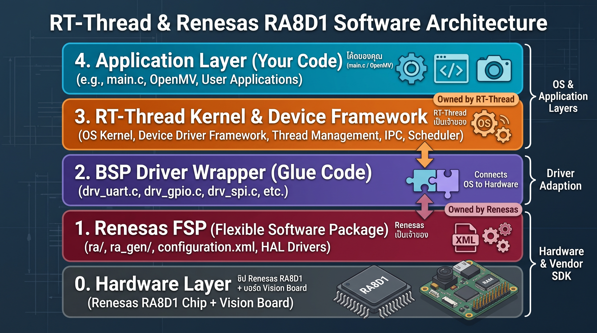

# I2C Sensor Lab (ตอนที่ 2: การอ่านค่าอุณหภูมิ)

<span class="md-tag">For ESP32 Users</span> <span class="md-tag">I2C</span> <span class="md-tag">Sensor</span>

## สำหรับใคร

- [ ] เคยใช้ ESP32/Arduino กับ I2C Sensor มาก่อน
- [ ] มีเซ็นเซอร์ I2C (เช่น SHT30, BME280, MPU6050)
- [ ] อยากนำมาใช้กับ Vision-Board บน RT-Thread

---

## เปรียบเทียบ: Arduino vs RT-Thread

| คำสั่ง (Arduino) | คำสั่ง (RT-Thread) | คำอธิบาย |
| :--- | :--- | :--- |
| `Wire.begin()` | `rt_device_find("i2c0")` | ค้นหาและเตรียมใช้งาน I2C Bus |
| `Wire.beginTransmission(addr)` | `rt_i2c_transfer()` พร้อม `RT_I2C_WR` | ส่งข้อมูล / คำสั่งไปยังเซ็นเซอร์ |
| `Wire.requestFrom(addr, len)` | `rt_i2c_transfer()` พร้อม `RT_I2C_RD` | ร้องขอและอ่านข้อมูลกลับมา |
| `Wire.write(data)` | ใส่ข้อมูลใน `rt_i2c_msg.buf` | เตรียมข้อมูลสำหรับเขียน |
| `Wire.read()` | อ่านข้อมูลจาก `rt_i2c_msg.buf` | ดึงข้อมูลที่อ่านได้มาประมวลผล |
| `delay(1000)` | `rt_thread_mdelay(1000)` | หน่วงเวลาแบบคืน CPU ให้ Thread อื่น (RTOS-safe) |

!!! info "ความต่างสำคัญ"
    Arduino `Wire` library ครอบ I2C ไว้ทั้งหมด
    RT-Thread ใช้ **Device Framework** → ต้องค้นหาชื่อ Bus Device (`rt_device_find`) ให้เจอก่อน จึงจะสั่ง `rt_i2c_transfer` ได้

---

## ทบทวน Architecture



## การต่อสาย I2C Sensor (SDA, SCL) บน RA8D1 Vision Board

เซ็นเซอร์ที่รองรับ: **SHT30** (แนะนำสำหรับ Lab นี้) หรือ **BME280** หรือ **MPU6050**

เลือกต่อสายเข้ากับ **40-Pin Header (J4)** ของบอร์ด Vision Board ตามรูปแบบที่ต้องการ (แนะนำแบบที่ 1 สำหรับ Hardware IIC):

| รูปแบบการต่อ | ชื่อ Bus | ขา SCL | ขา SDA | ไฟเลี้ยง (VCC) | กราวด์ (GND) |
| :--- | :--- | :--- | :--- | :--- | :--- |
| **แบบที่ 1: Hardware IIC (แนะนำ)** | **`"i2c0"`** | **P408** (Pin 28) | **P409** (Pin 27) | **3.3V** (Pin 1) | **GND** (Pin 6) |
| **แบบที่ 2: Software I2C (ขา Pi)** | **`"i2c1"`** | **P015** (Pin 5) | **P014** (Pin 3) | **3.3V** (Pin 1) | **GND** (Pin 6) |

!!! warning "ระวังแรงดันและตำแหน่งขา"
    - Vision-Board ใช้ระดับแรงดัน **3.3V** เท่านั้น ห้ามต่อไฟเลี้ยงหรือสัญญาณ 5V โดยตรง → อาจทำให้ชิป RA8D1 เสียหาย
    - ขา `P412/P411` บนชิป RA8D1 ไม่รองรับ Hardware IIC (`r_iic_b_master`) จึงต้องใช้คู่ขา **`P408/P409`** (สำหรับ HW IIC) หรือ **`P015/P014`** (สำหรับ Soft I2C) แทน

---

## Lab: อ่านค่าอุณหภูมิจาก SHT30 ด้วย RT-Thread

*(ตัวอย่างด้านล่างนี้ใช้การต่อสาย **แบบที่ 1: Hardware IIC `"i2c0"`** บนขา `P408 / P409`)*

### ขั้นตอน 1: ตั้งค่า Hardware I2C ใน RASC (`configuration.xml`)

1. ดับเบิลคลิกเปิดไฟล์ `configuration.xml` ด้วย **RA Smart Configurator**
2. ไปที่แท็บ **Stacks** → กด **New Stack → Connectivity → I2C Master (`r_iic_b_master`)**
3. ตั้งค่าในแท็บ **Properties** ด้านล่าง:
   - **Name:** `g_i2c0` *(ต้องตรงกับชื่อใน `drv_hw_i2c.c` ของ BSP)*
   - **Channel:** `0`
   - **Callback:** `i2c0_callback`
   - **Pins:** ตรวจสอบว่า **SCL0 = `P408`** และ **SDA0 = `P409`**
4. กดปุ่ม **Generate Project Content** → กลับไปที่ RT-Thread Studio กด **Refresh (F5)**

### ขั้นตอน 2: เปิด I2C Driver ใน RT-Thread Settings

1. ดับเบิลคลิกเปิด **RT-Thread Settings** → ไปที่ **Hardware → On-chip Peripheral Drivers**
2. ติ๊กเปิด **Enable Hardware I2C** → ติ๊กเลือก **Enable I2C0**
3. กด **Ctrl+S** เพื่อบันทึก

### ขั้นตอน 3: เขียน Code ใน `hal_entry.c` (หรือ `applications/main.c`)

```c
#include <rtthread.h>
#include <rtdevice.h>

#define SENSOR_I2C_BUS  "i2c0"  // ใช้ "i2c0" สำหรับ HW IIC (P408/P409) หรือ "i2c1" สำหรับ Soft I2C
#define SENSOR_ADDR     0x44    // SHT30 7-bit Address (ใน RT-Thread ไม่ต้องเลื่อนบิต << 1)

static struct rt_i2c_bus_device *i2c_bus;

// สำหรับ SHT30: อ่านค่าอุณหภูมิและความชื้น
static rt_err_t sht30_read_temp(float *temp, float *humi)
{
    struct rt_i2c_msg msgs[2];
    rt_uint8_t cmd[2] = {0x2C, 0x06};  // Command: High repeatability measurement
    rt_uint8_t buf[6];                  // 6 bytes response (Temp MSB, LSB, CRC, Humi MSB, LSB, CRC)

    // Step 1: ส่งคำสั่งเริ่มวัดค่า
    msgs[0].addr   = SENSOR_ADDR;
    msgs[0].flags  = RT_I2C_WR;
    msgs[0].len    = 2;
    msgs[0].buf    = cmd;

    if (rt_i2c_transfer(i2c_bus, &msgs[0], 1) != 1) {
        return -RT_ERROR;
    }

    rt_thread_mdelay(20);  // รอเซ็นเซอร์ประมวลผลการวัด (~15ms)

    // Step 2: อ่านข้อมูล 6 ไบต์กลับมา
    msgs[1].addr   = SENSOR_ADDR;
    msgs[1].flags  = RT_I2C_RD;
    msgs[1].len    = 6;
    msgs[1].buf    = buf;

    if (rt_i2c_transfer(i2c_bus, &msgs[1], 1) != 1) {
        return -RT_ERROR;
    }

    // แปลงค่า Raw Data → อุณหภูมิ (°C) และความชื้น (%RH)
    rt_uint16_t t_raw = (buf[0] << 8) | buf[1];
    rt_uint16_t h_raw = (buf[3] << 8) | buf[4];

    *temp = -45.0f + 175.0f * ((float)t_raw / 65535.0f);
    *humi = 100.0f * ((float)h_raw / 65535.0f);

    return RT_EOK;
}

void hal_entry(void)
{
    float temperature = 0.0f;
    float humidity = 0.0f;

    // 1. ค้นหา I2C Bus
    i2c_bus = (struct rt_i2c_bus_device *)rt_device_find(SENSOR_I2C_BUS);
    if (i2c_bus == RT_NULL) {
        rt_kprintf("I2C bus (%s) not found!\n", SENSOR_I2C_BUS);
        return;
    }

    rt_kprintf("=== I2C Sensor Lab (SHT30 on %s) ===\n", SENSOR_I2C_BUS);

    // 2. วนลูปอ่านค่าทุกๆ 2 วินาที
    while (1) {
        if (sht30_read_temp(&temperature, &humidity) == RT_EOK) {
            rt_kprintf("Temperature: %.2f C, Humidity: %.2f %%\n", temperature, humidity);
        } else {
            rt_kprintf("Sensor read failed!\n");
        }
        rt_thread_mdelay(2000);
    }
}
```

### ตัวอย่าง Output (บน Serial Terminal 115200 bps)

```text
=== I2C Sensor Lab (SHT30 on i2c0) ===
Temperature: 25.34 C, Humidity: 58.12 %
Temperature: 25.41 C, Humidity: 58.05 %
Temperature: 25.38 C, Humidity: 58.10 %
```

---

## ใช้ Software Package แทน? (ทางลัดสำหรับโปรเจกต์จริง)

ถ้าเซ็นเซอร์ที่ใช้เป็นรุ่นยอดนิยม มีนักพัฒนาเขียน Package เตรียมไว้ให้แล้ว:

1. เปิด **RT-Thread Settings → Software Packages**
2. ค้นหาชื่อเซ็นเซอร์ เช่น `sht3x` หรือ `bme280` หรือ `mpu6xxx`
3. กด **Add to Project** แล้วกด **Ctrl+S** เพื่อดาวน์โหลดแพ็กเกจเข้าโปรเจกต์
4. เรียกใช้งานในโค้ดได้ทันทีโดยไม่ต้องเขียน `rt_i2c_transfer()` เอง:

```c
#include <rtthread.h>
#include <sht3x.h>

void hal_entry(void)
{
    sht3x_device_t dev;
    
    // เริ่มต้นใช้งาน SHT30 บนบัส "i2c0" ที่ Address 0x44
    dev = sht3x_init("i2c0", 0x44);
    if (dev == RT_NULL) {
        rt_kprintf("SHT30 init failed!\n");
        return;
    }

    while (1) {
        if (sht3x_read_temp_humi(dev) == RT_EOK) {
            rt_kprintf("Temp: %.2f C, Humi: %.2f %%\n", dev->temperature, dev->humidity);
        }
        rt_thread_mdelay(2000);
    }
}
```

!!! tip "ตรวจสอบแพ็กเกจเพิ่มเติม"
    สามารถค้นหารายชื่อแพ็กเกจเซ็นเซอร์ทั้งหมดได้ที่ [RT-Thread Packages](https://packages.rt-thread.org/)

---

## สรุป: ESP32 Arduino → RT-Thread

| แนวคิด | Arduino | RT-Thread |
| :--- | :--- | :--- |
| **เริ่ม I2C** | `Wire.begin()` | `rt_device_find("i2c0")` |
| **Address** | 7-bit (`0x44`) | 7-bit (`0x44`) *ห้ามเลื่อนบิต `<< 1`* |
| **ส่ง/รับข้อมูล** | `Wire.write()` / `Wire.read()` | `rt_i2c_transfer()` |
| **หน่วงเวลา** | `delay()` (busy-wait) | `rt_thread_mdelay()` (yield คืน CPU) |
| **Library หลัก** | `#include <Wire.h>` | `#include <rtdevice.h>` |
| **Package เสริม** | Arduino Libraries | RT-Thread Software Packages |

---

??? failure "แก้ปัญหาเบื้องต้น (Troubleshooting)"
    **"I2C bus not found"**
    - ตรวจสอบใน **RASC** ว่าเพิ่ม Stack `I2C Master (r_iic_b_master)` ตั้งชื่อ `g_i2c0` และกด **Generate Project Content** แล้ว
    - ตรวจสอบใน **RT-Thread Settings** ว่าเปิด **Enable Hardware I2C → Enable I2C0** และกด **Ctrl+S** บันทึกแล้ว
    - พิมพ์คำสั่ง `list device` ใน FinSH Shell เพื่อดูว่ามีชื่อ `i2c0` ปรากฏอยู่จริงหรือไม่

    **"Sensor read failed"**
    - **เช็ก Address:** ต้องใส่แบบ 7-bit ตรงๆ เช่น `0x44` (SHT30), `0x76` (BME280), `0x68` (MPU6050) **ห้ามใส่ `(0x44 << 1)`**
    - **เช็ก Pull-up resistor:** สาย SDA และ SCL ต้องมีตัวต้านทาน Pull-up 4.7kΩ ดึงขึ้นไฟ 3.3V (โมดูลเซ็นเซอร์สำเร็จรูปมักมีมาให้แล้ว แต่ถ้าต่อชิปเปลือยต้องใส่เพิ่ม)
    - **เช็กสายสัญญาณ:** ตรวจสอบว่าไม่สลับขา **SDA (`P409`)** กับ **SCL (`P408`)**

    **"ค่าอุณหภูมิผิดปกติ หรือพิมพ์ %.2f ไม่ออก"**
    - หาก Serial Terminal แสดงค่าเป็น `%f` หรือว่างเปล่า ให้เปิดใช้งานการพิมพ์เลขทศนิยม (Float) ใน `rt_kprintf` ที่ **RT-Thread Settings → Kernel → Enable libc / rt_kprintf float support** (หรือแปลงเป็นจำนวนเต็ม `int temp_int = (int)(temperature * 100);` ก่อนพิมพ์)
