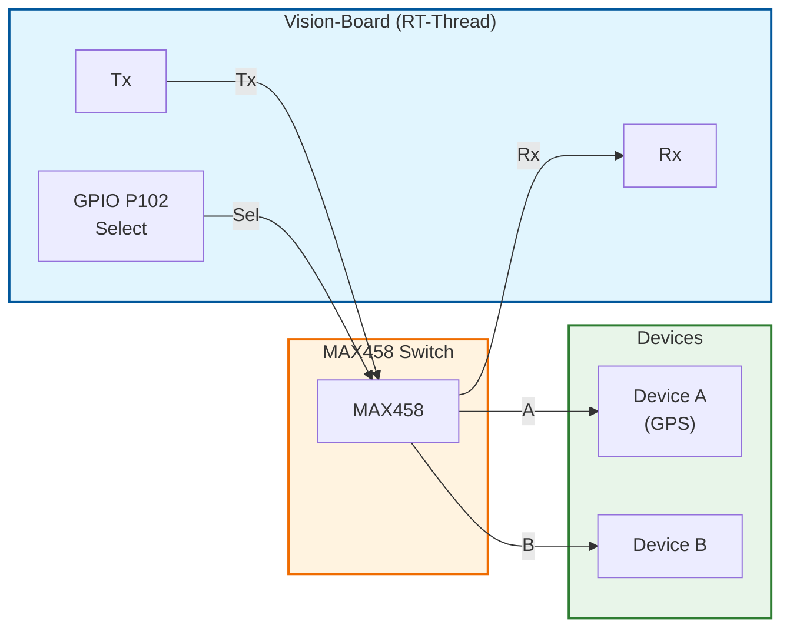

# UART Communication: Tx/Rx ไปยัง MAX458 A/B

<span class="md-tag">UART</span> <span class="md-tag">MAX458</span> <span class="md-tag">Communication</span>

## MAX458 คืออะไร

**MAX458** = Analog/Digital Multiplexer/Demultiplexer IC

- ใช้สลับสัญญาณระหว่างช่อง A และ B
- ควบคุมด้วยสัญญาณดิจิตอลจาก MCU

```text
MCU ---[UART]---> MAX458 ---Sensor A
                       |
                       +--Sensor B
                       
Select Pin: เลือกว่าจะต่อ A หรือ B
```

!!! info "ในบอร์ด Vision"
    MAX458 อาจถูกใช้สลับระหว่าง:
    - Channel A: Internal Camera
    - Channel B: External Sensor หรือ Debug

---

## การต่อวงจร

### Vision-Board → MAX458

| Vision-Board | MAX458 | Function |
|-------------|--------|----------|
| P101 (Tx) | A or B | ส่งข้อมูล |
| P100 (Rx) | A or B | รับข้อมูล |
| P102 (GPIO) | SELECT | เลือก A=0, B=1 |

### MAX458 → อุปกรณ์

```text
MAX458
├── COM (Common)  ← ต่อกับ MCU UART
├── A     ← ต่อ Device A
├── B     ← ต่อ Device B
└── SELECT ← ควบคุมด้วย GPIO
```

!!! warning "LEVEL SHIFTING"
    MAX458 ทำงานที่ 5V หรือ 3.3V?
    - Vision-Board เป็น 3.3V
    - ตรวจสอบ Datasheet MAX458 ว่ารองรับ 3.3V หรือไม่
    - ถ้า MAX458 เป็น 5V → ต้องใช้ Level Shifter

---

## Lab: สื่อสาร UART ผ่าน MAX458

### สมมติฐาน

- UART1 ใช้สื่อสารกับ MAX458
- GPIO P102 ควบคุม SELECT
- Device A: GPS Module
- Device B: อุปกรณ์อื่น

### ขั้นตอน

1. **ตั้งค่า UART ใน RASC**

2. **ตั้งค่า GPIO P102 เป็น Output**

3. **เขียน Code**

```c
#include <rtthread.h>
#include <rtdevice.h>

#define UART_NAME       "uart1"
#define SELECT_PIN      "P102"
#define SELECT_A        0
#define SELECT_B        1

static rt_device_t uart_dev;
static rt_uint32_t select_pin;

// เลือก Channel A หรือ B
static void select_channel(int ch)
{
    rt_pin_write(select_pin, ch == 0 ? PIN_LOW : PIN_HIGH);
    rt_thread_mdelay(10);  // รอ MAX458 สลับ
}

// ส่งข้อมูลผ่าน UART
static void uart_send(const char *data)
{
    rt_device_write(uart_dev, 0, data, rt_strlen(data));
}

// รับข้อมูลจาก UART
static int uart_recv(char *buf, int len, int timeout_ms)
{
    return rt_device_read(uart_dev, 0, buf, len);
}

void hal_entry(void)
{
    select_pin = rt_pin_get(SELECT_PIN);
    rt_pin_mode(select_pin, PIN_MODE_OUTPUT);

    uart_dev = rt_device_find(UART_NAME);
    if (!uart_dev) {
        rt_kprintf("UART not found!\n");
        return;
    }
    rt_device_open(uart_dev, RT_DEVICE_FLAG_INT_RX | RT_DEVICE_FLAG_INT_TX);

    rt_kprintf("=== MAX458 UART Lab ===\n");

    while (1) {
        // --- อ่านจาก Channel A (GPS) ---
        select_channel(SELECT_A);
        rt_thread_mdelay(100);

        uart_send("AT\r\n");  // คำสั่งเช็ค GPS
        rt_thread_mdelay(500);

        char rx_buf[128];
        int n = uart_recv(rx_buf, sizeof(rx_buf), 1000);
        if (n > 0) {
            rx_buf[n] = '\0';
            rt_kprintf("[A] Received: %s\n", rx_buf);
        } else {
            rt_kprintf("[A] No data\n");
        }

        rt_thread_mdelay(2000);

        // --- สลับไป Channel B ---
        select_channel(SELECT_B);
        rt_thread_mdelay(100);

        uart_send("HELLO_B\r\n");
        rt_thread_mdelay(500);

        n = uart_recv(rx_buf, sizeof(rx_buf), 1000);
        if (n > 0) {
            rx_buf[n] = '\0';
            rt_kprintf("[B] Received: %s\n", rx_buf);
        } else {
            rt_kprintf("[B] No data\n");
        }

        rt_thread_mdelay(2000);
    }
}
```

---

## สรุป Flow



---

??? failure "แก้ปัญหาเบื้องต้น"
    **"ไม่ได้ข้อมูลเลย"**
    - ตรวจสอบ SELECT Pin ว่า Logic Level ถูกต้อง
    - ตรวจสอบว่า MAX458 ได้รับ VCC/GND พอ

    **"ข้อมูลผิดเพี้ยน"**
    - ตรวจสอบ Baud Rate ตรงกัน
    - ตรวจสอบว่าไม่มี noise จากสายยาวเกินไป

    **"MAX458 ร้อน"**
    - อาจต่อ VCC ผิดขา
    - อาจมีสายชนขา VCC-GND
