# ทดสอบ GPIO และ Interrupt จากภายนอก

<span class="md-tag">Intermediate</span> <span class="md-tag">45 นาที</span>

## วัตถุประสงค์

- [x] สร้าง Interrupt เมื่อมีการกดปุ่ม K1
- [x] ใช้ RA Smart Configurator กำหนดค่า Pin
- [x] เข้าใจโหมด Trigger Falling Edge

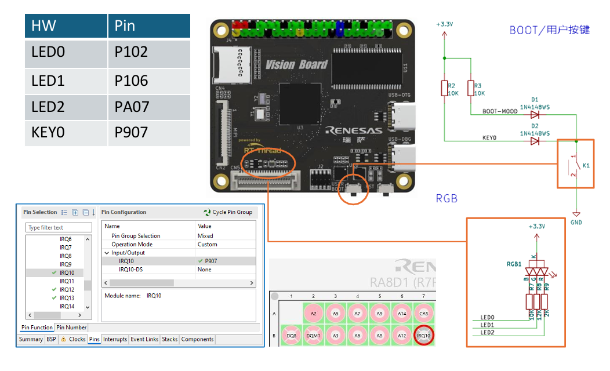{ width="600" }

---

## RT-Thread GPIO คืออะไร

RT-Thread GPIO คือระบบการจัดการและควบคุมขาพอร์ตอินพุต/เอาต์พุตทั่วไป (General Purpose Input/Output) บนไมโครคอนโทรลเลอร์ เป็นส่วนหนึ่งของ Hardware Driver ใน RT-Thread

**เป้าหมาย:** ทำให้การควบคุมฮาร์ดแวร์ระดับล่างเป็นไปอย่างเป็นมาตรฐานและง่ายขึ้น

### สิ่งที่ RT-Thread GPIO สามารถตั้งค่าได้

| # | ฟังก์ชัน | รายละเอียด |
|---|---------|-----------|
| 1 | Pin Mode | Input, Output, Pull-up, Pull-down, Open-drain |
| 2 | Read | อ่านสถานะลอจิก (0 หรือ 1) |
| 3 | Write | ตั้งค่าสถานะลอจิก (0 หรือ 1) |
| 4 | Interrupt | Rising Edge, Falling Edge, Both Edge |

---

## ขั้นตอนที่ 1: เปิด RA Smart Configurator

1. Double-Click ที่เมนู **RA Smart Configurator** (ต้องติดตั้ง FSP ก่อน)

   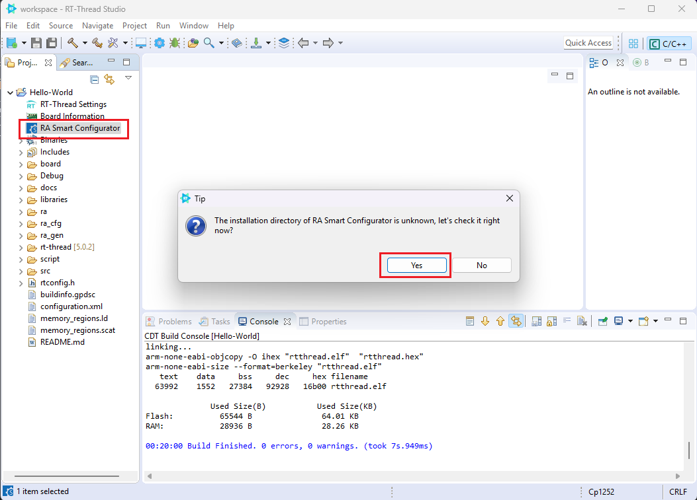{ width="500" }

2. เลือก Folder `C:\Renesas\RA\sc_v2023-10_fsp_v5.1.0`

   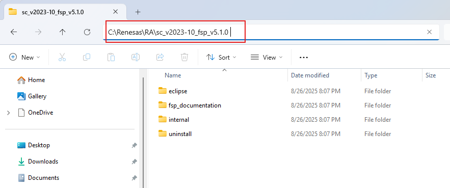{ width="500" }

3. เลือก Folder ที่ติดตั้ง → เข้าสู่ Renesas Smart Configurator

   { width="500" }

4. รอจนกระทั้งแสดงผลหน้าหลัก

---

## ขั้นตอนที่ 2: Config Pin P907 → IRQ10

!!! note "เป้าหมาย"
    ใช้ RASC ตั้งค่า Pin P907 ให้ทำหน้าที่เป็น Interrupt IRQ10

1. กดที่ Tab **Pins** (ตำแหน่ง 1)
2. เลือก Tab **Pin Function**
3. เลือก **InterruptIRQ**
4. เลือก **IRQ10**
5. ผูก IRQ10 กับ Pin **P907**
6. ไปที่ Tab **FSP Visualization** ด้านขวา กรอกชื่อ `P907`
7. เลือกดู Pin Function เพื่อ Verify

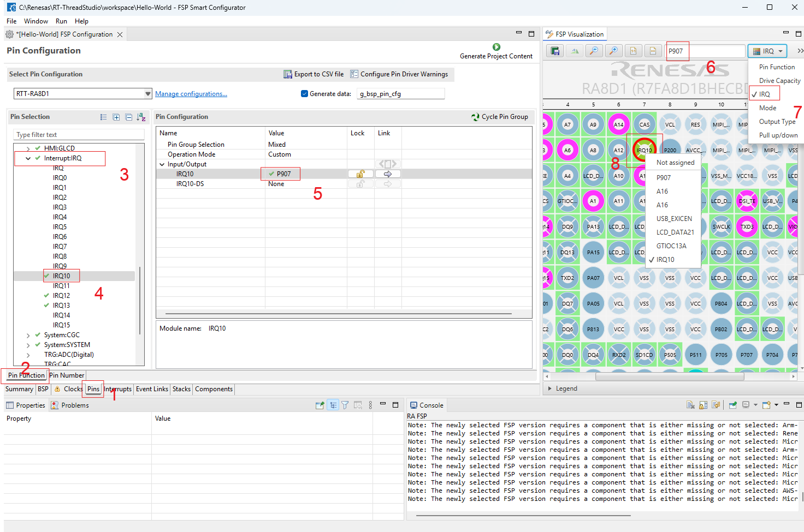{ width="600" }

---

## ขั้นตอนที่ 3: สร้าง New Stack

1. กดที่ Tab **Stacks**
2. เลือก Tab **New Stack**
3. เลือกเมนู **Input → External IRQ**
4. เลือก **IRQ10**
5. ผูกกับ Pin **P907**
6. ไปที่ Tab **FSP Visualization** กรอกชื่อ `P907`
7. เลือกดู Pin Function เพื่อ Verify

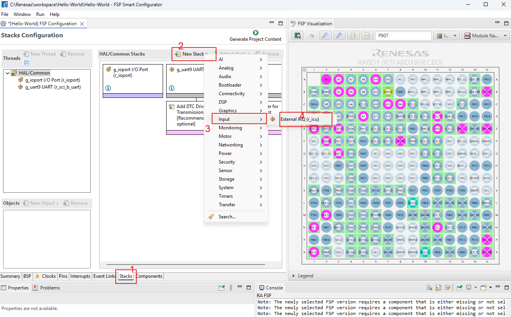{ width="600" }

8. Double Click New Stack → เปลี่ยน Trigger จาก **Rising** เป็น **Falling**
9. กด **Generate Project Content**

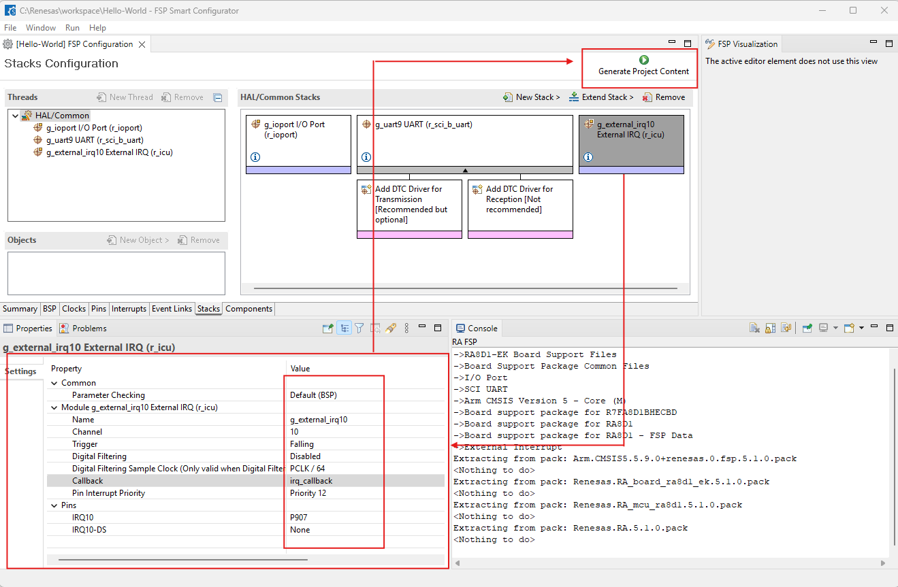{ width="500" }

ย้ำให้ตั้งค่าให้ตรงตามนี้:

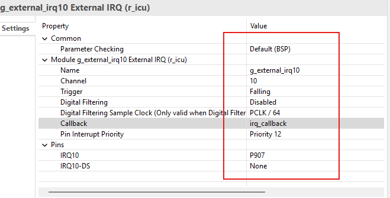{ width="500" }

---

## ขั้นตอนที่ 4: Build Project

1. เลือก **Toolchain Version → GNU Tools for ARM → 13.2.1**

   !!! note "Location ของ Toolchain"
       `C:\Renesas\RT-ThreadStudio\repo\Extract\ToolChain_Support_Packages\ARM\GNU_Tools_for_ARM_Embedded_Processors\13.2.1`

   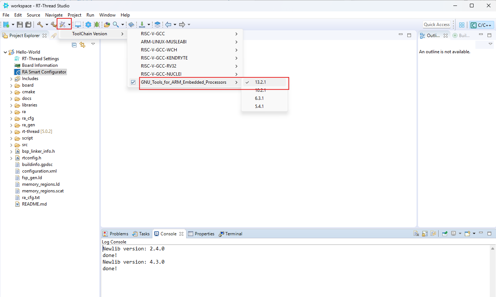{ width="500" }

2. แก้ไข Source code หลัก `hal_entry.c` (อยู่ในโฟลเดอร์ `/ex_01`)

``` C title="hal_entry.c — Workshop 2" linenums="1"
/*
 * Copyright (c) 2006-2023, RT-Thread Development Team
 */

#include <rtthread.h>
#include <rtdevice.h>
#include "hal_data.h"

#define LED_PIN    BSP_IO_PORT_01_PIN_02 /* Onboard LED pins */
#define IRQ_TEST_PIN "p907"

void irq_callback_test(void *args) {
    rt_kprintf("\n IRQ10 triggered \n");  // (1)!
}

void hal_entry(void)
{
    rt_kprintf("\nHello RT-Thread!\n");
    rt_uint32_t pin = rt_pin_get(IRQ_TEST_PIN);             // (2)!
    rt_kprintf("\n pin number : 0x%04X \n", pin);
    rt_err_t err = rt_pin_attach_irq(
        pin,
        PIN_IRQ_MODE_FALLING,                              // (3)!
        irq_callback_test,
        RT_NULL
    );
    if (RT_EOK != err) {
        rt_kprintf("\n attach irq failed. \n");
    }
    err = rt_pin_irq_enable(pin, PIN_IRQ_ENABLE);           // (4)!
    if (RT_EOK != err) {
        rt_kprintf("\n enable irq failed. \n");
    }

    while (1) {
        rt_pin_write(LED_PIN, PIN_HIGH);
        rt_thread_mdelay(500);
        rt_pin_write(LED_PIN, PIN_LOW);
        rt_thread_mdelay(500);
    }
}
```

1. Callback ที่จะถูกเรียกเมื่อเกิด Interrupt
2. ดึงหมายเลข Pin จากชื่อ `"p907"`
3. ตั้งค่า Interrupt แบบ Falling Edge (กดปุ่ม = ขอบลง)
4. เปิดใช้งาน Interrupt

3. Copy ไปแทนที่ `hal_entry.c` เดิม

   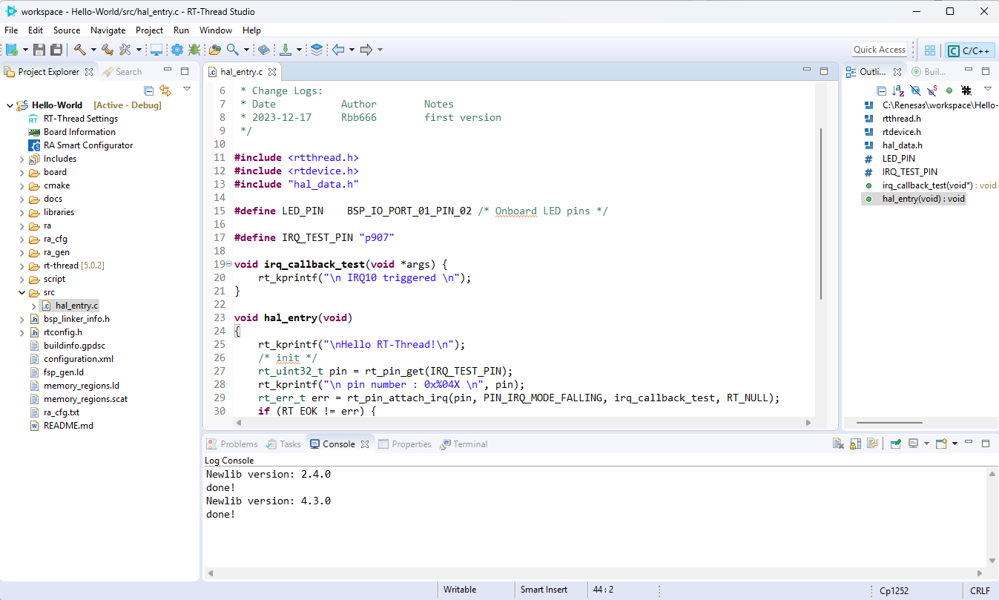{ width="500" }

4. **Build Project**
5. เชื่อมต่อ USB-DBG ของ Board กับ Computer
6. กดปุ่ม **Flash Download**
7. เปิด **Terminal** เชื่อมต่อ Serial Monitor

---

## ทดสอบ Interrupt

กดปุ่ม **K1** บนบอร์ด

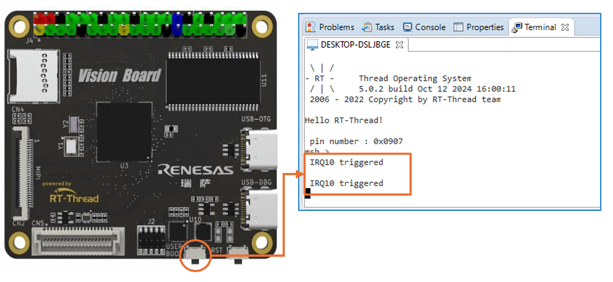{ width="400" }

**Screen Test:**

{ width="500" }

---

## สรุปผลลัพธ์

- [x] ตั้งค่า Pin P907 เป็น External Interrupt IRQ10
- [x] ตั้งค่า Trigger เป็น Falling Edge
- [x] เขียน Callback Function สำหรับ Interrupt
- [x] ทดสอบกดปุ่มแล้วเห็นข้อความใน Terminal

---

??? failure "พบปัญหา? (Troubleshooting)"
    **Error: No response when pressing K1**
    - ตรวจสอบว่าเลือก Pin **P907** ตรงกับ K1 บนบอร์ด
    - ตรวจสอบว่าตั้ง Trigger เป็น **Falling** ไม่ใช่ Rising
    - ตรวจสอบว่า IRQ10 ถูก Enable แล้ว

    **Error: Upload failed**
    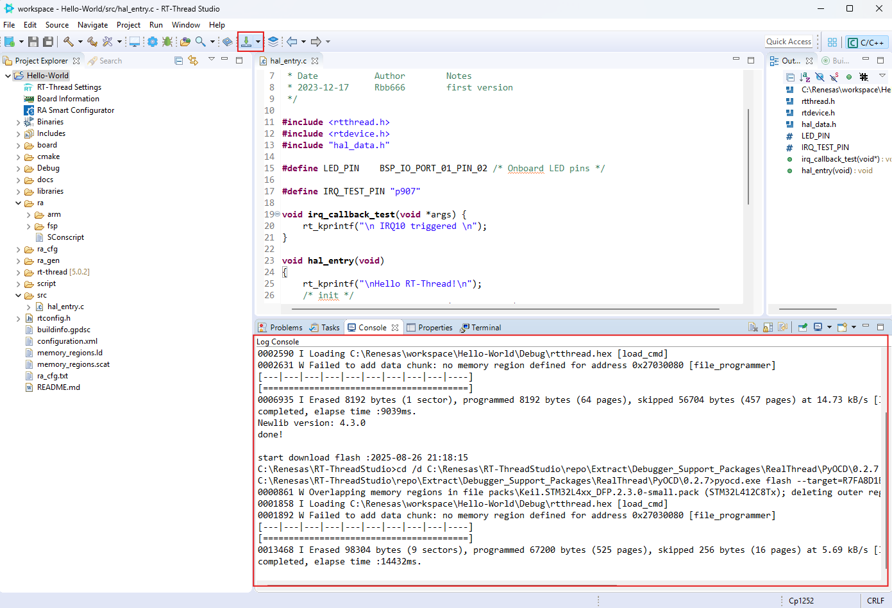{ width="400" }
    - ตรวจสอบ Device Manager ว่าเจอ ART-Link CMSIS-DAP
    - เปลี่ยน USB Port หรือสาย USB

    **Error: Toolchain version mismatch**
    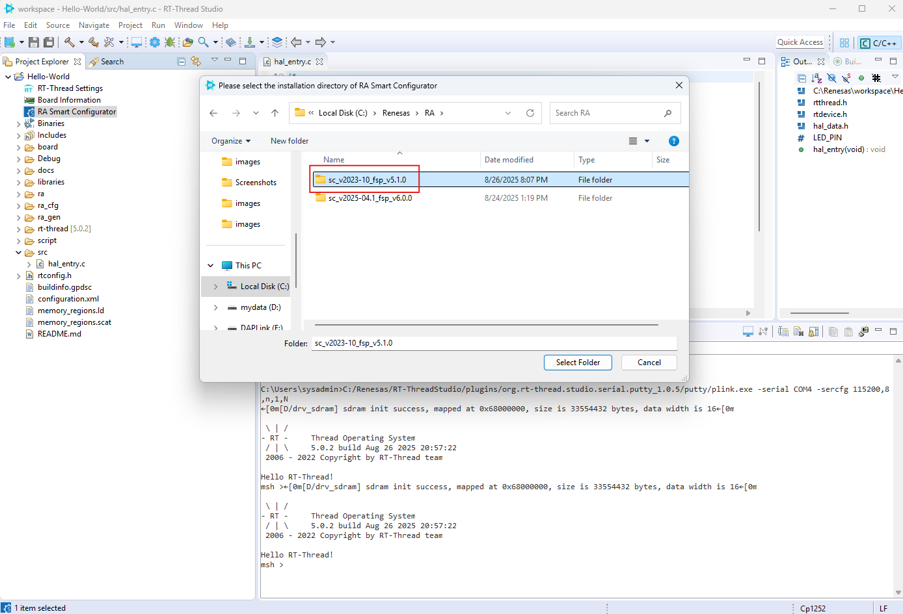{ width="400" }
    - ไปที่ Project → Properties → Toolchain → เลือก **13.2.1**

    **Error: GCC version not found**
    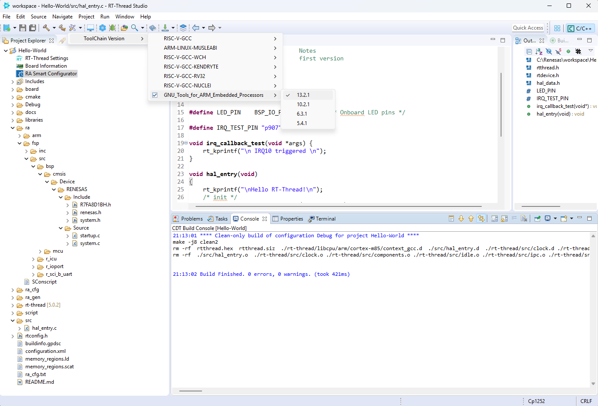{ width="400" }
    - ติดตั้ง Toolchain ผ่าน SDK Manager ให้เรียบร้อย
