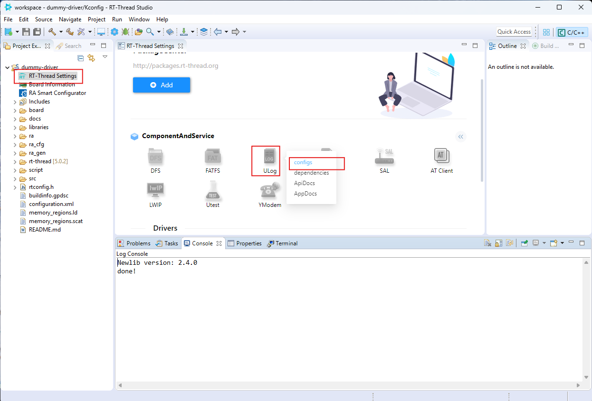
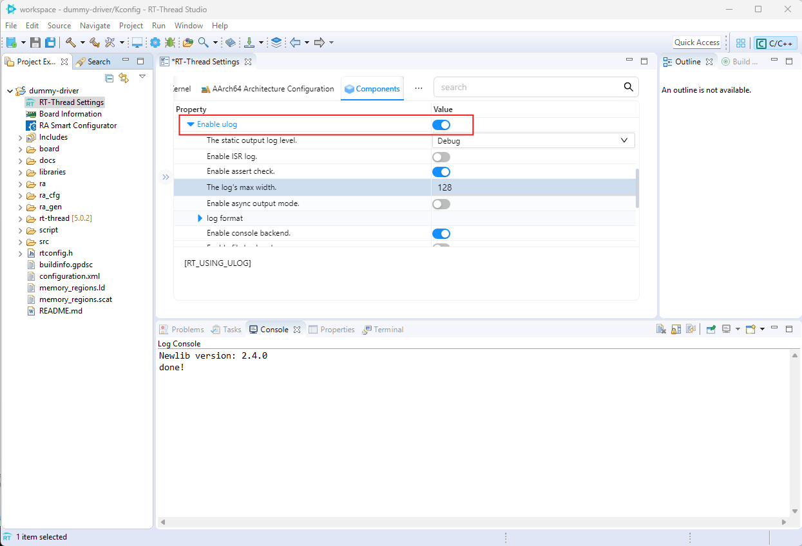
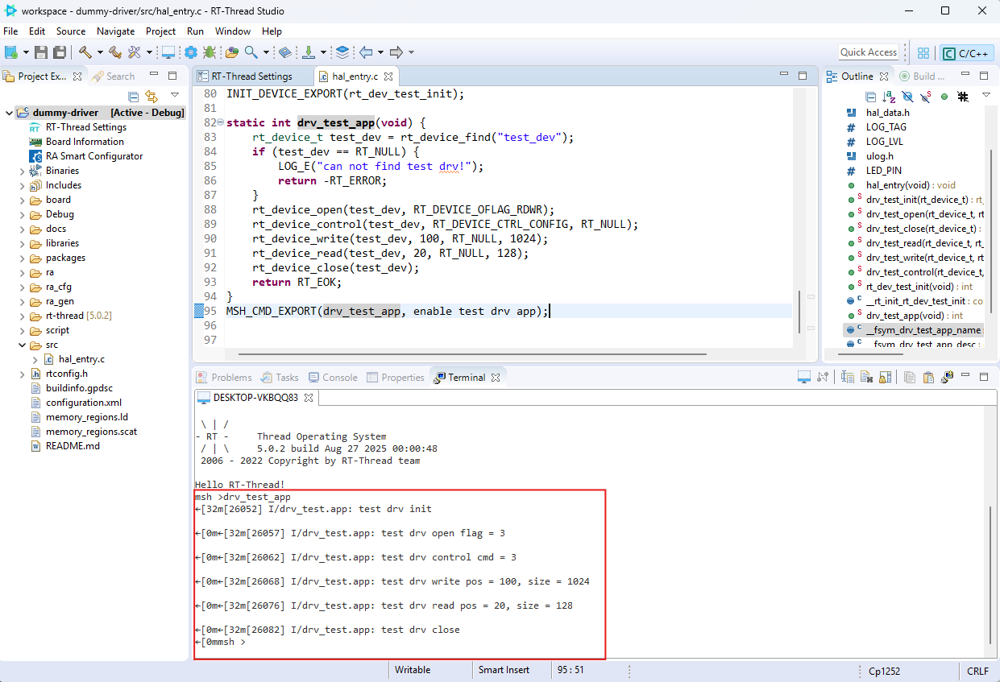
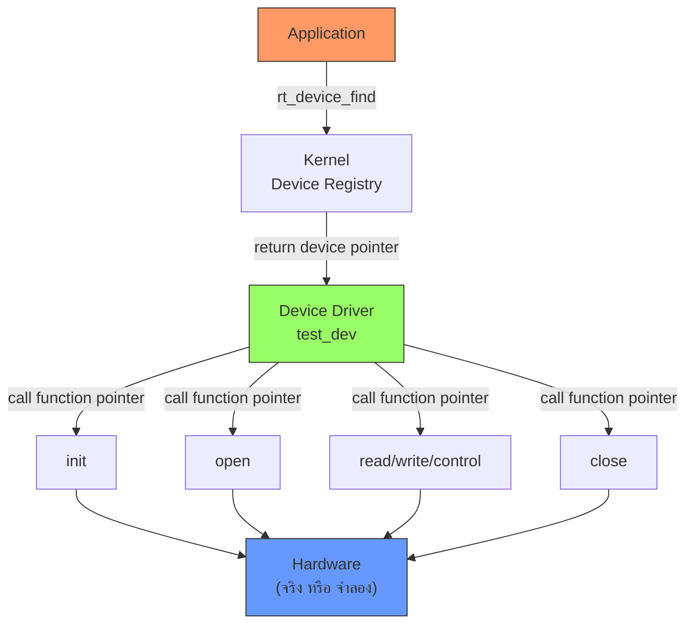

# Dummy Device Driver

<span class="md-tag">Intermediate</span> <span class="md-tag">40 นาที</span>

## วัตถุประสงค์

- [x] เข้าใจ RT-Thread Device Framework — ระบบปฏิบัติการมอง hardware อย่างไร
- [x] สร้าง Driver ที่มี Operations: init, open, read, write, control, close
- [x] ลงทะเบียน Device เข้ากับ RT-Thread kernel
- [x] เรียกใช้ Driver ผ่าน Application API และ MSH Shell

---

## ทำไมต้อง Dummy Driver?

Workshop 1-2 คุณใช้ `rt_pin_write()` ควบคุม LED โดยตรง — นั่นคือการเขียนค่าถึง GPIO register

แต่ในระบบปฏิบัติการจริง ไม่ควรให้ application ยุ่งกับ hardware โดยตรง แต่ควรผ่าน ** abstraction layer** คือ **Device Driver**

| Layer | หน้าที่ | ตัวอย่าง |
|---|---|---|
| Application | เรียกใช้งานผ่าน API มาตรฐาน | `rt_device_read()`, `rt_device_write()` |
| Device Driver | แปลง API เป็นการควบคุม hardware จริง | GPIO driver, UART driver, WiFi driver |
| Hardware | Register/Peripheral จริง | LED Pin, UART Port, WiFi Module |

**Dummy Driver** = driver ที่ไม่ต้องต่อ hardware จริง แต่มี structure ครบถ้วน เพื่อให้เข้าใจ framework ก่อนไปใช้ driver จริง (WiFi RW007, OpenMV, etc.)

---

## ขั้นตอนที่ 1: สร้าง Project และเปิด Ulog

1. สร้าง Project ใหม่ชื่อ `dummy-driver`
2. เปิด **RT-Thread Settings**

   { width="500" }

3. ในส่วน **Component → Service** เลือก **Ulog** → กด **Configs**

   { width="500" }

   !!! info "Ulog คืออะไร?"
       Ulog เป็นระบบ log ของ RT-Thread แทนที่ `rt_kprintf()` ธรรมดา รองรับ level (DBG/INFO/WARN/ERROR) และ tag เพื่อกรอง log ได้ง่าย

---

## ขั้นตอนที่ 2: เขียน Dummy Driver

Copy Code ต่อไปนี้ใส่ใน `src/hal_entry.c` แทนที่ Code เดิม

``` C title="hal_entry.c — Workshop 3: Dummy Driver" linenums="1"
#include <rtthread.h>     // (1)
#include <rtdevice.h>     // (2)
#include "hal_data.h"

#define LOG_TAG "drv_test.app"
#define LOG_LVL LOG_LVL_DBG
#include <ulog.h>         // (3)

#define LED_PIN BSP_IO_PORT_01_PIN_02

void hal_entry(void) {     // (4)
    rt_kprintf("\nHello RT-Thread!\n");
    while (1) {
        rt_pin_write(LED_PIN, PIN_HIGH);
        rt_thread_mdelay(500);
        rt_pin_write(LED_PIN, PIN_LOW);
        rt_thread_mdelay(500);
    }
}

// ========== Device Operations ==========

static rt_err_t drv_test_init(rt_device_t dev) {
    LOG_I("test drv init\n");          // (5)
    return RT_EOK;
}

static rt_err_t drv_test_open(rt_device_t dev, rt_uint16_t oflag) {
    LOG_I("test drv open flag = %d\n", oflag);
    return RT_EOK;
}

static rt_err_t drv_test_close(rt_device_t dev) {
    LOG_I("test drv close");
    return RT_EOK;
}

static rt_ssize_t drv_test_read(rt_device_t dev, rt_off_t pos,
                                void *buffer, rt_size_t size) {
    LOG_I("test drv read pos = %d, size = %d\n", pos, size);
    return size;
}

static rt_ssize_t drv_test_write(rt_device_t dev, rt_off_t pos,
                                 const void *buffer, rt_size_t size) {
    LOG_I("test drv write pos = %d, size = %d\n", pos, size);
    return size;
}

static rt_err_t drv_test_control(rt_device_t dev, int cmd, void *args) {
    LOG_I("test drv control cmd = %d\n", cmd);
    return RT_EOK;
}
```

1. หัวใจของ RT-Thread OS
2. Device framework header — มี `rt_device_t`, `rt_device_create()`, `rt_device_register()`
3. Ulog: ระบบ log แบบมี tag และ level
4. `hal_entry()` ยังคงกะพริบ LED เป็น background task
5. `LOG_I()` = Info level log จะแสดงใน console พร้อม `[I/drv_test.app]` tag

---

### สร้างและลงทะเบียน Device

``` C title="hal_entry.c — ต่อ" linenums="45"
// ========== Device Registration ==========

static int rt_dev_test_init(void) {
    rt_device_t test_dev = rt_device_create(RT_Device_Class_Char, 0);  // (1)
    if (!test_dev) {
        LOG_E("test_dev create failed");
        return -RT_ERROR;
    }

    // ผูก function pointers
    test_dev->init    = drv_test_init;   // (2)
    test_dev->open    = drv_test_open;
    test_dev->close   = drv_test_close;
    test_dev->read    = drv_test_read;
    test_dev->write   = drv_test_write;
    test_dev->control = drv_test_control;

    // ลงทะเบียนเข้าสู่ kernel ด้วยชื่อ "test_dev"
    if (rt_device_register(test_dev, "test_dev", RT_DEVICE_FLAG_RDWR) != RT_EOK) {
        LOG_E("test_dev register failed!");
        return -RT_ERROR;
    }

    LOG_I("test_dev registered successfully");
    return RT_EOK;
}
INIT_DEVICE_EXPORT(rt_dev_test_init);  // (3)
```

1. สร้าง device ประเภท Character device (เหมือนไฟล์ /dev/ ใน Linux)
2. ผูก (bind) function ที่จะถูกเรียกเมื่อ application ใช้งาน
3. `INIT_DEVICE_EXPORT()` = บอก RT-Thread ให้เรียก auto-init ตอน boot

---

### Application ทดสอบ Driver

``` C title="hal_entry.c — ต่อ" linenums="67"
// ========== Test Application ==========

static int drv_test_app(void) {
    rt_device_t test_dev = rt_device_find("test_dev");   // (1)
    if (test_dev == RT_NULL) {
        LOG_E("can not find test drv!");
        return -RT_ERROR;
    }

    rt_device_open(test_dev, RT_DEVICE_OFLAG_RDWR);       // (2)
    rt_device_control(test_dev, RT_DEVICE_CTRL_CONFIG, RT_NULL); // (3)
    rt_device_write(test_dev, 100, RT_NULL, 1024);      // (4)
    rt_device_read(test_dev, 20, RT_NULL, 128);         // (5)
    rt_device_close(test_dev);                            // (6)

    return RT_EOK;
}
MSH_CMD_EXPORT(drv_test_app, enable test drv app);      // (7)
```

1. **Find**: ค้นหา device จากชื่อที่ลงทะเบียน — ได้ pointer มาใช้
2. **Open**: เปิด device โหมด Read+Write
3. **Control**: ส่งคำสั่ง configuration ไปยัง driver
4. **Write**: เขียนข้อมูล 1024 bytes ที่ตำแหน่ง offset 100
5. **Read**: อ่านข้อมูล 128 bytes ที่ตำแหน่ง offset 20
6. **Close**: ปิด device เมื่อใช้เสร็จ
7. **MSH Export**: ลงทะเบียนเป็น shell command ชื่อ `drv_test_app`

---

## ขั้นตอนที่ 3: Build และ Flash

1. **Build Project** (แนะนำ Clean ก่อน)
2. **Flash Download** ไปยัง Board
3. เปิด **Serial Terminal**

---

## ขั้นตอนที่ 4: ทดสอบผ่าน MSH Shell

พิมพ์คำสั่งใน Terminal:

```bash
msh>drv_test_app
[I/drv_test.app] test drv open flag = 3
[I/drv_test.app] test drv control cmd = 0
[I/drv_test.app] test drv write pos = 100, size = 1024
[I/drv_test.app] test drv read pos = 20, size = 128
[I/drv_test.app] test drv close
```

ผลลัพธ์ที่ได้เห็น **init → open → control → write → read → close** ทำงานครบทุก step

{ width="600" }

---

## ทดสอบคำสั่ง MSH พื้นฐาน

```bash
msh>list_device
msh>ps
msh>free
msh>help
```

ดูว่า `test_dev` ถูกลงทะเบียนในระบบหรือไม่:

```bash
msh>list_device
device           type         ref count
--------         ---------- ----------
test_dev         Character  1         # ← นี่คือ Dummy Driver ของเรา!
```

!!! tip "ดูคำสั่ง MSH เพิ่มเติม"
    [→ MSH Shell Commands Cheat Sheet](./msh.md)

---

## Device Operation Flow



---

## สรุปผลลัพธ์

- [x] เข้าใจ RT-Thread Device Framework (init/open/read/write/control/close)
- [x] สร้าง Dummy Driver และลงทะเบียนเข้ากับ kernel
- [x] Application หา device ด้วย `rt_device_find()` และเรียกใช้งาน
- [x] Export เป็น MSH command ได้
- [x] เห็น log ผ่าน Ulog แบบมี tag และ level

---

## สิ่งนี้เชื่อมต่อกับ Workshop ถัดไปอย่างไร

| Workshop | Driver จริง | ความสัมพันธ์ |
|---|---|---|
| **Workshop 4** | WiFi RW007 | WiFi ก็เป็น `rt_device_t` ที่มี read/write = ส่ง packet |
| **Workshop 6** | OpenMV | Camera = character device ที่ read ได้ frame buffer |
| **Workshop 8** | Face Detection | ผลลัพธ์จาก AI model ถูกส่งผ่าน device interface |

**ทุก hardware ใน RT-Thread ล้วนเป็น device** — Dummy Driver คือกุญแจสำคัญให้เข้าใจ pattern นี้

---

??? failure "พบปัญหา? (Troubleshooting)"
    **Error: `test_dev` not found**
    - ตรวจสอบว่า `INIT_DEVICE_EXPORT(rt_dev_test_init);` อยู่ในไฟล์
    - ตรวจสอบว่า Ulog ถูกเปิดใน RT-Thread Settings

    **Error: `drv_test_app` command not found in msh**
    - ตรวจสอบว่า `MSH_CMD_EXPORT(drv_test_app, ...)` อยู่ในไฟล์
    - ลอง `list_device` ดูว่า `test_dev` ถูก register หรือไม่

    **No log output**
    - ตรวจสอบว่า Ulog level ตั้งค่าเป็น `LOG_LVL_DBG` ใน `rtconfig.h`
    - ตรวจสอบ RT-Thread Settings → Ulog → เปิด console backend
