# Workshop 4: WiFi RW007

<span class="md-tag">Intermediate</span> <span class="md-tag">45 นาที</span> <span class="md-tag">Wi-Fi & Network</span>

> 🌐 **ก้าวสู่โลก IoT เต็มตัว:**
> ใน Workshop นี้ คุณจะได้ปลุกพลังการเชื่อมต่อไร้สายของบอร์ด **RA8D1 Vision Board** ผ่านโมดูล **RW007** และใช้งาน **RT-Thread WLAN Framework** เพื่อสแกนและเชื่อมต่อ Wi-Fi ผ่านคำสั่ง Shell โดยไม่ต้องเขียนโค้ด Network Stack ระดับล่างเองแม้แต่บรรทัดเดียว!

## ก่อนเริ่ม Lab

- [ ] ทำ [Workshop 1](../03_workshop1/03.1_workshop1.md) ให้เสร็จ (รู้วิธี Build + Flash ลงบอร์ด)
- [ ] มี Wi-Fi Access Point (หรือ Hotspot มือถือ) คลื่นความถี่ **2.4 GHz** *(โมดูล RW007 ไม่รองรับ 5 GHz)*
- [ ] ทราบชื่อ **SSID** และ **Password** ของ Wi-Fi

## เมื่อทำเสร็จ คุณจะได้

- [ ] สร้างโปรเจกต์จากเทมเพลต `vision_board_wifi` ได้
- [ ] เข้าใจการเชื่อมต่อระดับฮาร์ดแวร์ระหว่างชิป RA8D1 กับโมดูล **RW007** ผ่าน **SPI Bus**
- [ ] ตรวจสอบการตั้งค่าแพ็กเกจ `rw007` และ SPI ใน **RA Smart Configurator**
- [ ] สแกนหาสัญญาณ Wi-Fi (`wifi scan`), เชื่อมต่อ (`wifi join`) และทดสอบออกอินเทอร์เน็ต (`ping`) ผ่าน Terminal ได้สำเร็จ

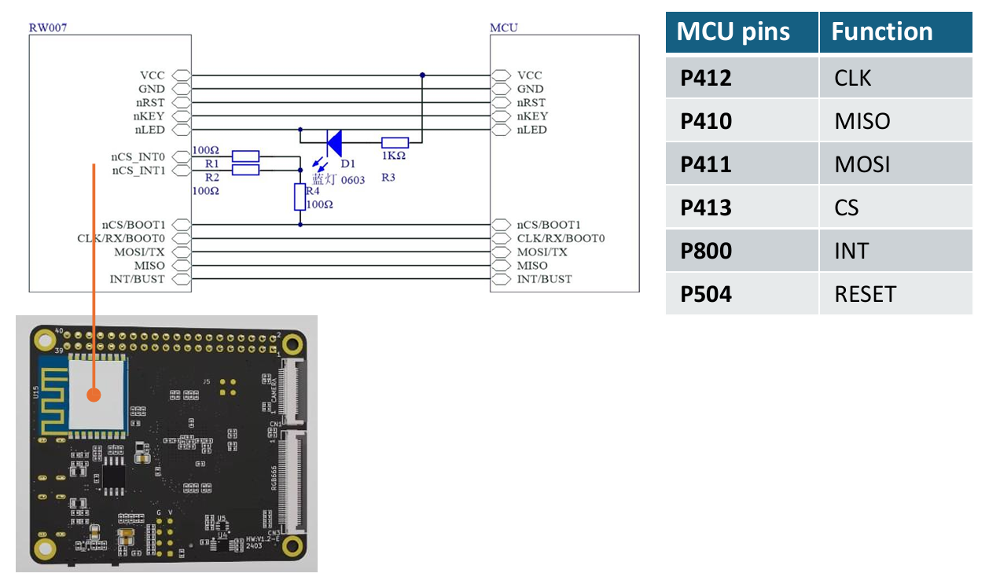{ width="500" }

---

## ทำความเข้าใจ: RW007 คืออะไร และต่อกับ RA8D1 อย่างไร?

**RW007** คือโมดูล Wi-Fi + BLE ความเร็วสูงที่ติดตั้งมาให้บนบอร์ด Vision Board โดยสื่อสารกับชิป RA8D1 ผ่านบัส **SPI ความเร็วสูง** ร่วมกับขาควบคุมอีก 2 ขา (รวมสายไฟเลี้ยง VCC/GND เป็นทั้งหมด **8 ขา**):

| ขาบนชิป RA8D1 | หน้าที่การทำงาน (Function) | รายละเอียด |
| :--- | :--- | :--- |
| **`P412`** | **CLK** (SPI Clock) | สัญญาณนาฬิกาซิงโครไนซ์ข้อมูล SPI |
| **`P410`** | **MISO** (Master In Slave Out) | รับข้อมูลจากโมดูล RW007 เข้าสู่ RA8D1 |
| **`P411`** | **MOSI** (Master Out Slave In) | ส่งข้อมูลจาก RA8D1 ไปยังโมดูล RW007 |
| **`P413`** | **CS** (Chip Select) | ขาเลือกเปิดใช้งานชิป RW007 |
| **`P800`** | **INT** (Interrupt) | แจ้งเตือน RA8D1 ทันทีเมื่อมีแพ็กเก็ต Wi-Fi ส่งเข้ามา |
| **`P504`** | **RESET** (Hardware Reset) | ใช้สั่งรีเซ็ตโมดูล RW007 ตอนเริ่มต้นระบบ |

!!! info "เกร็ดความรู้ฮาร์ดแวร์ (Pin Conflict)"
    สังเกตว่าขา **`P410`, `P411`, `P412`, `P413`** ถูกใช้งานโดยโมดูล **Wi-Fi RW007** บนบอร์ดอยู่แล้ว ดังนั้นในโปรเจกต์ที่เปิดใช้งาน Wi-Fi คุณจึง **ห้ามนำขาเหล่านี้ไปต่อกับเซ็นเซอร์ I2C หรืออุปกรณ์ภายนอกอื่น** เพื่อป้องกันสัญญาณชนกัน!

---

## Lab 4.1: สร้างโปรเจกต์ WiFi

### เป้าหมาย
สร้างโปรเจกต์ต้นแบบจากเทมเพลต `vision_board_wifi` ซึ่งทีมพัฒนา RT-Thread ได้จัดเตรียมโครงสร้างโฟลเดอร์ `applications/main.c` และไฟล์เชื่อมต่อ BSP มาให้พร้อมใช้งาน

### ขั้นตอน

1. ไปที่เมนู **File → New → RT-Thread Project**

2. ตั้งค่าโปรเจกต์ดังนี้:
   - **Project Name:** `vision_board_wifi`
   - **Type:** เลือก **Example** (โปรเจกต์ตัวอย่าง)
   - **Example:** เลือก **`vision_board_wifi`**

   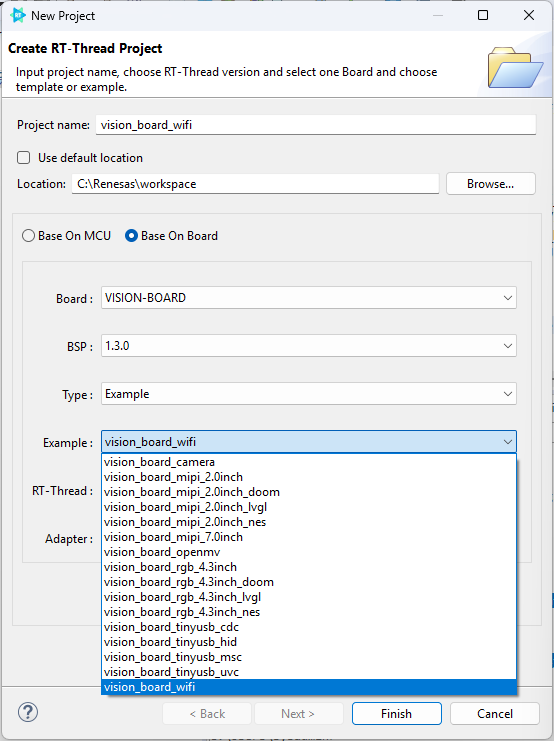{ width="500" }
   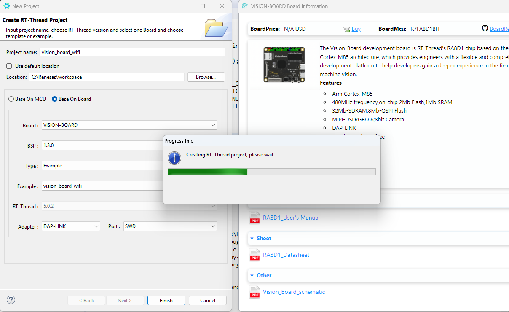{ width="500" }

3. กด **Finish** และรอให้ IDE สร้างโปรเจกต์จนเสร็จ

!!! success "Checkpoint 4.1"
    ✅ หน้าต่าง Project Explorer แสดงโปรเจกต์ `vision_board_wifi` พร้อมโฟลเดอร์ `applications/` และ `packages/`
    ❌ ไม่เห็นตัวเลือก `vision_board_wifi` = ตรวจสอบใน **SDK Manager** ว่าได้ติดตั้งแพ็กเกจ BSP ของ **RA8D1-Vision-Board** เวอร์ชันล่าสุดแล้ว

---

## Lab 4.2: ตรวจสอบและเปิดใช้งานแพ็กเกจ RW007

### เป้าหมาย
ตรวจสอบการตั้งค่าของ Software Package **`rw007`** ในหน้าต่าง **RT-Thread Settings**

### ขั้นตอน

1. ดับเบิลคลิกเปิด **RT-Thread Settings** (ไอคอนรูปเฟืองใน Project Explorer)

2. ตรวจสอบแพ็กเกจ **rw007** ในหมวด Software Packages → ต้องอยู่ในสถานะเปิดใช้งาน (สีเขียว)

   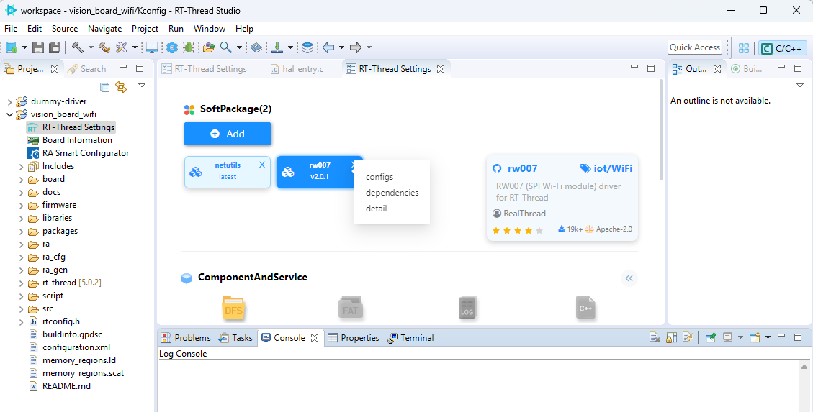{ width="500" }

3. คลิกขวาที่กล่อง **rw007** (หรือดูในแถบ Properties ด้านล่าง) เพื่อตรวจสอบพารามิเตอร์:
   - **Interface:** `SPI`
   - **SPI Bus Name:** `spi0` (หรือตามที่ BSP กำหนด)
   - **CS / INT / RESET Pin:** ตรงกับขา `P413`, `P800`, `P504` ของบอร์ด

   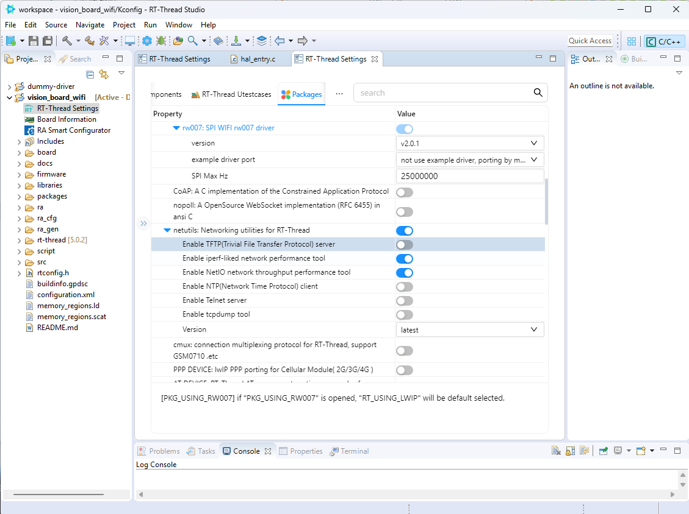{ width="500" }

!!! info "rw007 ตั้งค่าอะไรให้เราบ้าง?"
    แพ็กเกจ `rw007` จะทำหน้าที่เป็นตัวกลางเชื่อมต่อระหว่างบัส **SPI** เข้ากับ **RT-Thread WLAN Device Framework** ทำให้เราสามารถใช้คำสั่งมาตรฐานอย่าง `wifi scan`, `wifi join` และ `ping` รวมถึงใช้ไลบรารี Socket / MQTT ได้ทันที

4. หากมีการแก้ไขค่า ให้กด **Ctrl+S (Save)** → RT-Thread Studio จะอัปเดตการตั้งค่าและดาวน์โหลดแพ็กเกจให้อัตโนมัติ

!!! success "Checkpoint 4.2"
    ✅ ใน Project Explorer มีโฟลเดอร์ `packages/rw007-v2.x.x/` ปรากฏอยู่
    ✅ ไม่มีข้อความ Error สีแดงในหน้าต่าง Console ตอนบันทึก

---

## Lab 4.3: ตรวจสอบการตั้งค่า SPI ผ่าน RA Smart Configurator

### เป้าหมาย
เข้าไปดูเบื้องหลังการตั้งค่าขา Pin และ SPI Stack ใน **RA Smart Configurator (RASC)** เพื่อทำความเข้าใจว่าฮาร์ดแวร์ถูกเปิดใช้งานอย่างไร

### ขั้นตอน

1. **Double-Click** ที่ไฟล์ **`configuration.xml`** (หรือเมนู RA Smart Configurator) ใน Project Explorer

   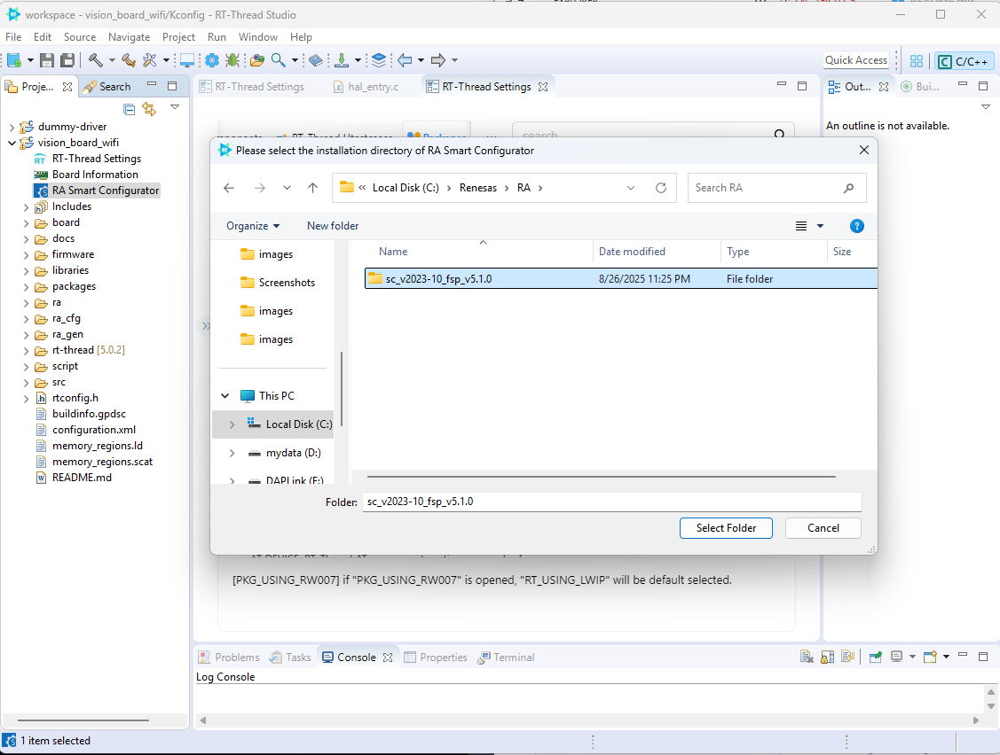{ width="500" }

2. ไปที่แท็บ **Stacks** → ตรวจสอบโมดูล **SPI** ที่เชื่อมต่อกับขา `P410`, `P411`, `P412`

   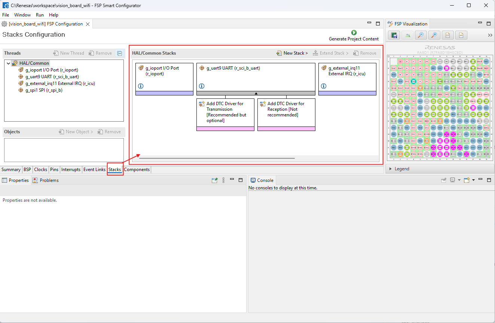{ width="500" }

3. กดปุ่ม **Generate Project Content** (มุมขวาบน) *(หากไม่ได้แก้ไขค่าใดๆ สามารถปิด RASC กลับสู่ IDE ได้เลย)*

!!! success "Checkpoint 4.3"
    ✅ RASC Generate สำเร็จไม่มีเครื่องหมายกากบาทสีแดง
    ✅ `ra_gen/hal_data.h` มีการตั้งค่า SPI Pins ถูกต้อง

---

## Lab 4.4: Build และ Flash ลงบอร์ด

### ขั้นตอน

1. **Build Project** (กดไอคอนรูปค้อน 🔨 หรือกด ++ctrl+b++)

   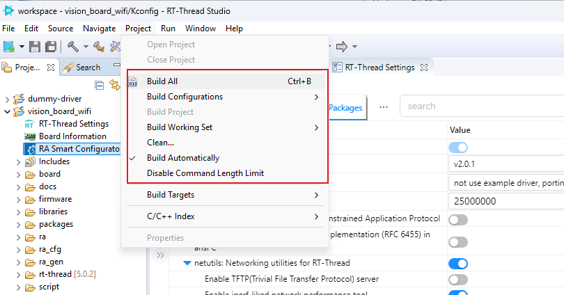{ width="500" }

   รอจนกระบวนการคอมไพล์เสร็จสมบูรณ์ (ขึ้น `0 errors`)

   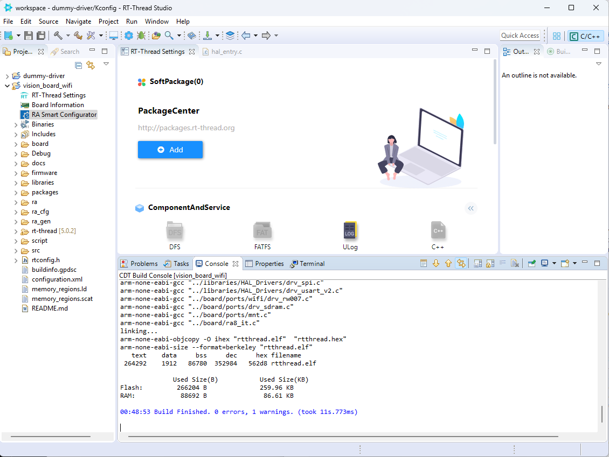{ width="500" }

2. เสียบสาย USB เข้าช่อง **DAP (USB-DBG)** บนบอร์ด แล้วกด **Flash Download** (ไอคอนลูกศรชี้ลง ⬇️)

   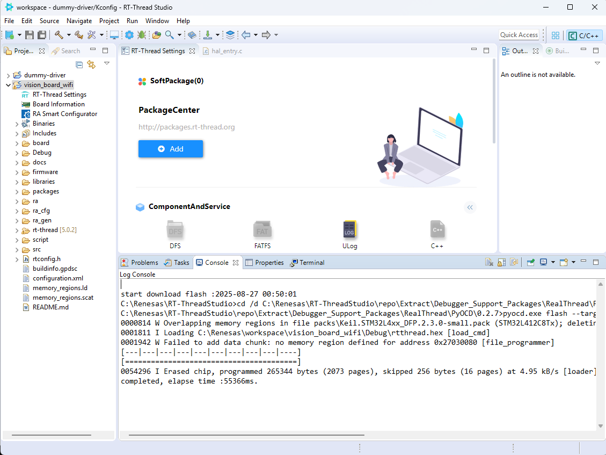{ width="500" }

!!! success "Checkpoint 4.4"
    ✅ Build Success (0 errors)
    ✅ Flash Download สำเร็จและบอร์ดรีเซ็ตเริ่มต้นทำงานใหม่

---

## Lab 4.5: ทดสอบเชื่อมต่อ WiFi ผ่าน FinSH Terminal

### ขั้นตอน

1. เปิด **Serial Terminal** (ตั้งค่า Baud rate **`115200`**)

   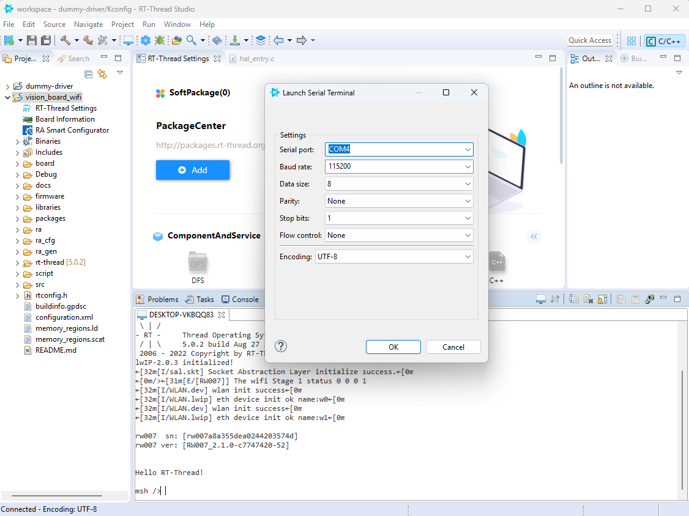{ width="500" }

2. รอจนบอร์ดบูตและเริ่มต้นโมดูล RW007 เสร็จ จะเห็น Prompt ของ MSH Shell:
   ```text
   msh />
   ```

3. **สแกนหาสัญญาณ Wi-Fi** รอบตัว *(สังเกตว่าคำสั่ง `wifi` และ `scan` มีเว้นวรรคคั่นกลาง)*:
   ```bash
   msh /> wifi scan
   ```

   !!! success "ผลลัพธ์ที่ควรเห็น"
       ```text
       SSID                                   MAC            security    rssi chn Mbps
       ------------------------------- -----------------  -------------- ---- --- ----
       MyHomeWiFi                      ab:cd:ef:12:34:56  WPA2_AES_PSK   -45    6  144
       Office-Guest                    11:22:33:44:55:66  OPEN           -62   11   72
       ```
       ✅ มองเห็นรายชื่อ Wi-Fi คลื่น 2.4 GHz รอบตัวพร้อมค่าความแรงสัญญาณ (RSSI)

4. **เชื่อมต่อเข้ากับ Wi-Fi** (เปลี่ยน `MyHomeWiFi` และ `MyPassword` เป็นชื่อและรหัสผ่านของคุณ):
   ```bash
   msh /> wifi join MyHomeWiFi MyPassword
   ```

   !!! success "ผลลัพธ์"
       ```text
       [I/WLAN.mgnt] wifi connect success ssid:MyHomeWiFi
       [I/WLAN.lwip] Got IP address : 192.168.1.123
       ```
       ✅ ได้รับหมายเลข **IP Address** จาก Router = เชื่อมต่อ Wi-Fi สำเร็จ!

5. **ตรวจสอบค่าเครือข่ายและทดสอบออกอินเทอร์เน็ต:**
   ```bash
   msh /> ifconfig
   msh /> ping rt-thread.io
   ```

   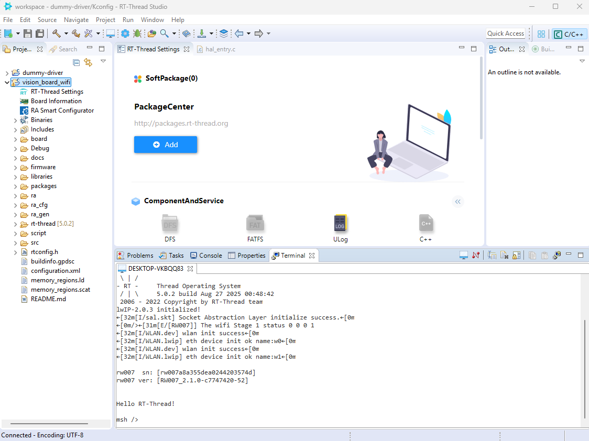{ width="500" }

!!! success "Checkpoint 4.5"
    ✅ `wifi scan` มองเห็นรายชื่อ Wi-Fi รอบตัว
    ✅ `wifi join` เชื่อมต่อสำเร็จและได้รับ IP Address
    ✅ `ifconfig` แสดงสถานะ `UP LINK_UP` และ `ping` ได้รับการตอบกลับ

---

## สรุป: ทักษะที่คุณทำสำเร็จใน Workshop 4

- [x] สร้างโปรเจกต์ `vision_board_wifi` จากเทมเพลตมาตรฐานของ RT-Thread
- [x] เข้าใจการเชื่อมต่อบัส **SPI** และขาควบคุมของโมดูล **RW007** บนบอร์ด RA8D1
- [x] ตรวจสอบแพ็กเกจ `rw007` และการตั้งค่าฮาร์ดแวร์ใน RASC
- [x] สแกน เชื่อมต่อ Wi-Fi และทดสอบเครือข่ายผ่าน FinSH Console (`wifi scan`, `wifi join`, `ifconfig`, `ping`)

---

## เตรียมตัวสู่ Workshop 5: IoT Cloud & MQTT

เมื่อบอร์ด RA8D1 Vision Board เชื่อมต่อ Wi-Fi และออกอินเทอร์เน็ตได้แล้ว ใน **Workshop 5** เราจะติดตั้งแพ็กเกจ **`pahomqtt`** เพื่อส่งข้อมูลค่าอุณหภูมิและความชื้นที่อ่านได้จากเซ็นเซอร์ขึ้นไปยัง **EMQX MQTT Broker** แบบ Real-time!

---

??? failure "แก้ปัญหาเบื้องต้น (Troubleshooting)"
    **พิมพ์ `wifiscan` หรือ `wifijoin` แล้วขึ้น `command not found`**
    - ใน RT-Thread WLAN Framework รุ่นปัจจุบัน ต้องพิมพ์เว้นวรรคระหว่างคำสั่งหลักและคำสั่งย่อย คือ **`wifi scan`** และ **`wifi join <SSID> <Password>`** (สามารถพิมพ์ `wifi help` เพื่อดูคำสั่งย่อยทั้งหมดได้)

    **"rw007 not found" หรือโมดูลไม่ตอบสนองตอนบูต**
    - ตรวจสอบใน **RT-Thread Settings** ว่าเปิดใช้งานแพ็กเกจ `rw007` และตั้งค่า SPI Bus ตรงกับ `spi0` ของบอร์ด
    - ลองกดปุ่ม **Reset** บนบอร์ด Vision Board 1 ครั้งหลัง Flash เฟิร์มแวร์เสร็จ เพื่อให้โมดูล RW007 รีสตาร์ทพร้อมกับชิป RA8D1

    **"wifi scan ไม่เห็นชื่อ Wi-Fi ของตัวเอง"**
    - **เช็กคลื่นความถี่:** โมดูล RW007 รองรับเฉพาะ **Wi-Fi 2.4 GHz** เท่านั้น หาก Router หรือ Hotspot มือถือปล่อยคลื่น **5 GHz** บอร์ดจะมองไม่เห็น (ให้เปิดโหมด *Maximize Compatibility* หรือตั้งค่าเป็น 2.4 GHz บนมือถือ)
    - **เช็กเสาอากาศ (Antenna):** ตรวจสอบว่าสายอากาศ Wi-Fi บนบอร์ด Vision Board เสียบแน่นดีแล้ว

    **"wifi join แล้วค้าง หรือไม่ได้รับ IP Address"**
    - ตรวจสอบชื่อ **SSID** และ **Password** (ตัวพิมพ์เล็ก-ใหญ่ต้องตรงเป๊ะ และไม่ควรมีเว้นวรรคในชื่อ Wi-Fi หากมีให้ครอบด้วยเครื่องหมายคำพูด `"My WiFi"`)
    - หลีกเลี่ยงการใช้ Wi-Fi สาธารณะที่ต้องล็อกอินผ่านหน้าเว็บ (Captive Portal)
