# Workshop 4: WiFi RW007

<span class="md-tag">Intermediate</span> <span class="md-tag">45 นาที</span>

## ก่อนเริ่ม Lab

- [ ] ทำ [Workshop 1](../03_workshop1/03.1_workshop1.md) ให้เสร็จ (รู้วิธี Build + Flash)
- [ ] มี WiFi Access Point แบบ **2.4 GHz** (ไม่ใช่ 5 GHz)
- [ ] รู้ SSID และ Password ของ WiFi

## เมื่อทำเสร็จ คุณจะได้

- [ ] สร้างโปรเจกต์ `vision_board_wifi` ได้
- [ ] อัปโหลด `rw007` Package เสร็จ
- [ ] เห็น WiFi Scan ผ่าน Terminal
- [ ] เชื่อมต่อ WiFi สำเร็จ (`wifijoin`)

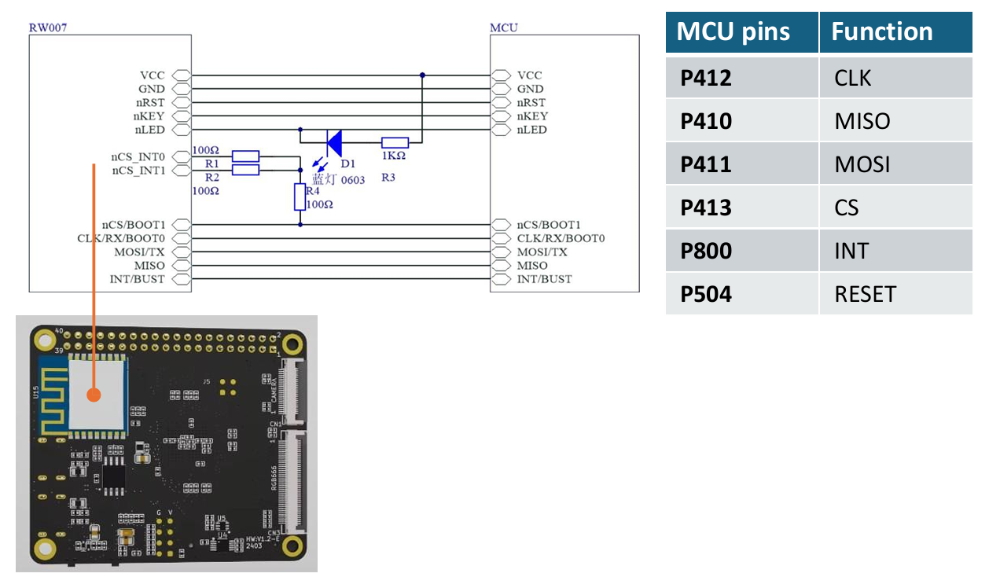{ width="500" }

---

## ทำความเข้าใจ: RW007 คืออะไร

**RW007** = โมดูล Wi-Fi + BLE ความเร็วสูงที่ติดมากับบอร์ด Vision-Board

- เชื่อมต่อผ่าน **SPI Bus** (CLK, MISO, MOSI, CS)
- ใช้ขาเพิ่มอีก 2 ขา: INT + RESET
- ทั้งหมด **8 ขา** (รวมพลังงาน)

| MCU Pin | Function |
|---------|----------|
| P412 | CLK (นาฬิกา) |
| P410 | MISO (ขาข้อมูลเข้า) |
| P411 | MOSI (ขาข้อมูลออก) |
| P413 | CS (เลือกอุปกรณ์) |
| P800 | INT (แจ้งเตือน Interrupt) |
| P504 | RESET (รีเซ็ต) |

---

## Lab 4.1: สร้างโปรเจกต์ WiFi

### ทำอะไร
สร้างโปรเจกต์จากเทมเพลต `vision_board_wifi`

### ขั้นตอน

1. **File → New → RT-Thread Project**

2. เลือก:
   - Project Name: `vision_board_wifi`
   - Type: **Example**
   - ตัวอย่าง: **`vision_board_wifi`**

   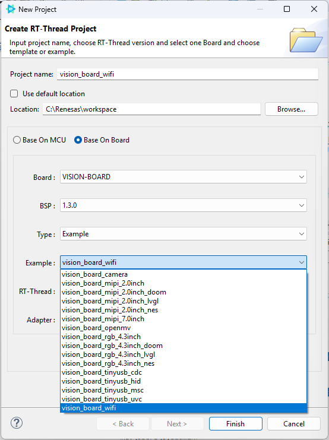{ width="500" }
   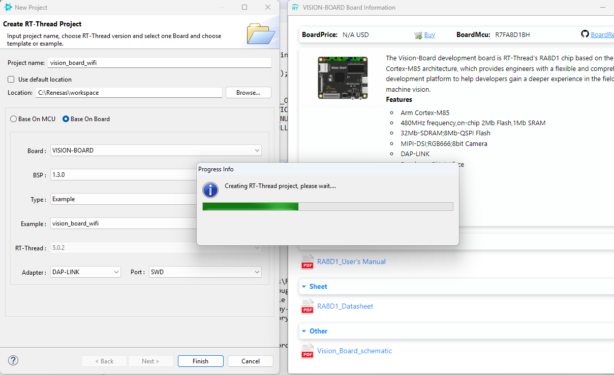{ width="500" }

3. กด **Finish**

   !!! success "Checkpoint 4.1"
       ✅ Project Explorer แสดง `vision_board_wifi` พร้อม `applications/` และ `packages/rw007/`
       ❌ ไม่เห็น = ตรวจสอบว่าติดตั้ง BSP Vision-Board แล้ว

---

## Lab 4.2: เปิดใช้งาน RW007

### ทำอะไร
เปิด Software Package `rw007` และตั้งค่า WiFi

### ขั้นตอน

1. เปิด **RT-Thread Settings** (icon เฟือง)

2. หา **rw007** ใน Software Packages → เปิดใช้งาน

   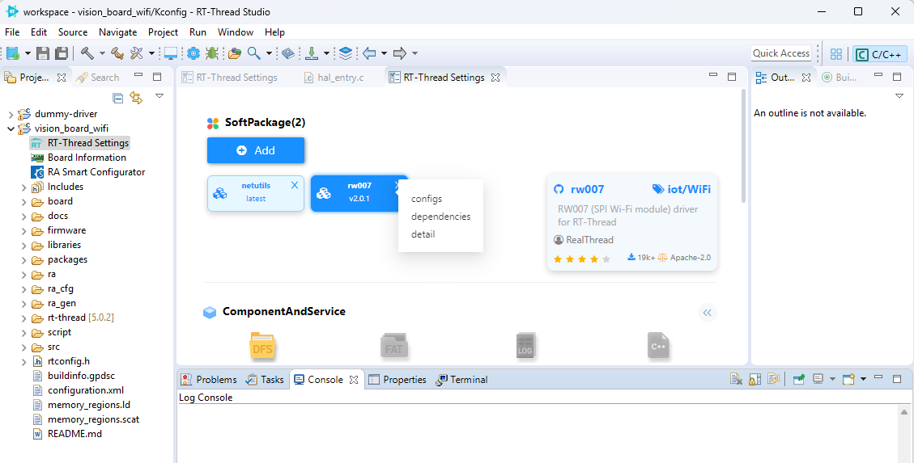{ width="500" }

3. ตั้งค่า rw007:
   - เลือก Interface: **SPI**
   - ตรวจสอบ SPI Bus ตรงกับบอร์ด

   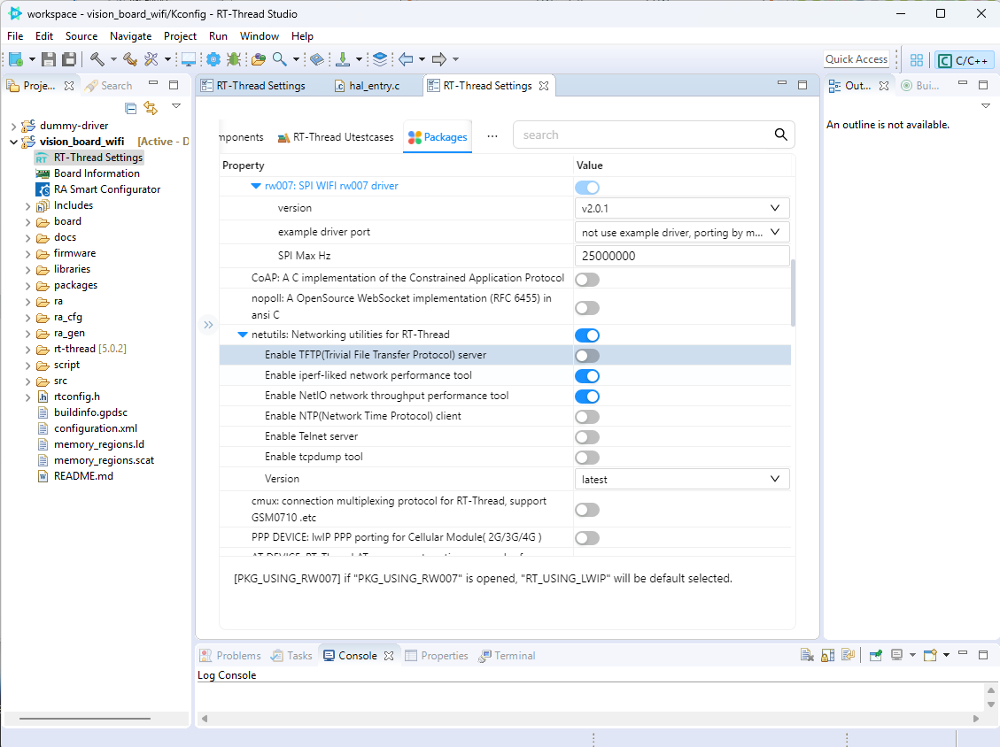{ width="500" }

   !!! info "rw007 ตั้งค่าอะไรได้บ้าง?"
       - SPI Bus ที่ใช้เชื่อมต่อ
       - CS Pin, INT Pin, RESET Pin
       - โหมด WiFi (STA/AP)

4. กด **Save** → RT-Thread Studio จะดาวน์โหลดและติดตั้ง Package

   !!! success "Checkpoint 4.2"
       ✅ ใน Project Explorer เห็นโฟลเดอร์ `packages/rw007-v2.1.0/`
       ✅ ไม่มี Error ตอน Download

---

## Lab 4.3: ตั้งค่าฮาร์ดแวร์ผ่าน RA Smart Configurator

### ทำอะไร
ตรวจสอบ/ตั้งค่า SPI Pins ให้ตรงกับบอร์ด

### ขั้นตอน

1. **Double-click** ที่ **RA Smart Configurator**

   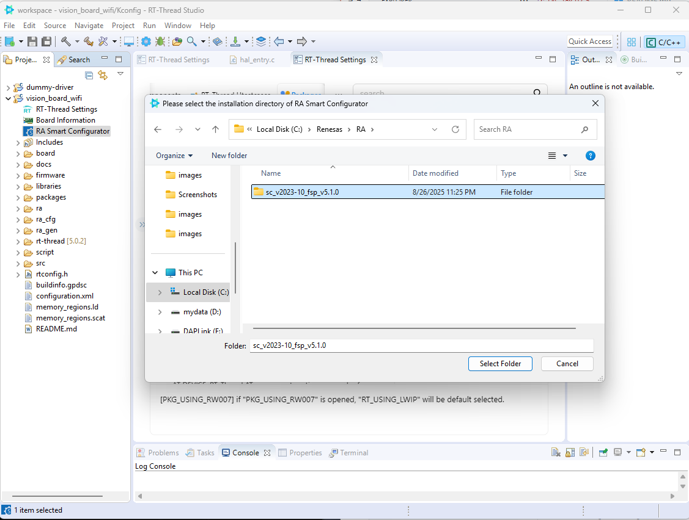{ width="500" }

2. ตรวจสอบ SPI Configuration ในหน้า Stacks

   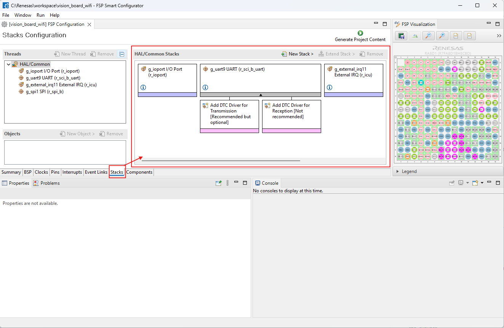{ width="500" }

3. กด **Generate Project Content**

   !!! success "Checkpoint 4.3"
       ✅ RASC Generate สำเร็จไม่มี Error
       ✅ `ra_gen/hal_data.h` มีการตั้งค่า SPI Pins ถูกต้อง

---

## Lab 4.4: Build และ Flash

### ขั้นตอน

1. **Build Project** (กด 🔨 หรือ ++ctrl+b++)

   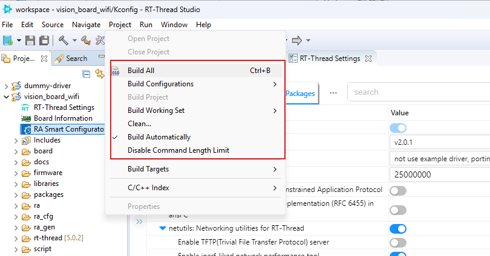{ width="500" }

   รอ Build เสร็จ

   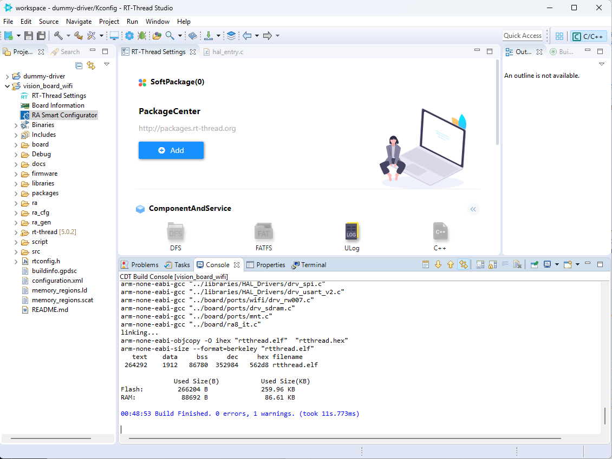{ width="500" }

2. **Flash Download** (กด ⬇️)

   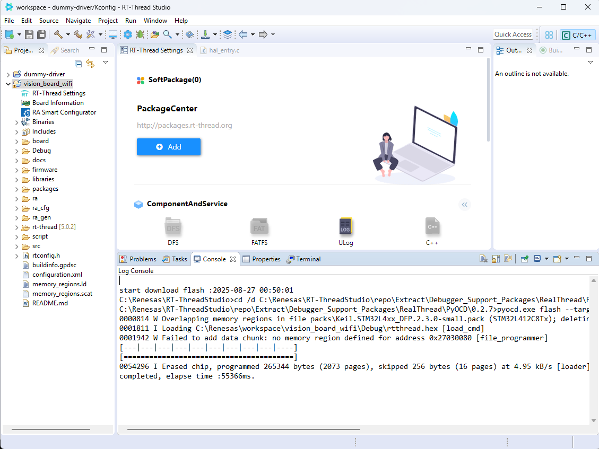{ width="500" }

   !!! success "Checkpoint 4.4"
       ✅ Build Success (0 errors)
       ✅ Flash Download สำเร็จ

---

## Lab 4.5: ทดสอบ WiFi ผ่าน Terminal

### ขั้นตอน

1. เปิด **Serial Terminal** (Baud 115200)

   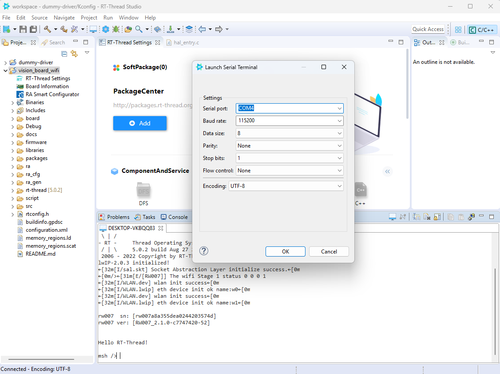{ width="500" }

2. รอจนบูตเสร็จ จะเห็น prompt:
   ```
   msh>
   ```

3. **สแกนหา WiFi** รอบ ๆ:
   ```bash
   msh>wifiscan
   ```

   !!! success "ผลลัพธ์ที่ควรเห็น"
       ```
       SSID             MAC                Security    RSSI
       MyHomeWiFi       AB:CD:EF:12:34:56  WPA2        -45
       Office-Guest     11:22:33:44:55:66  OPEN        -62
       ```
       ✅ เห็น WiFi รอบตัว

4. **เชื่อมต่อ WiFi**:
   ```bash
   msh>wifijoin MyHomeWiFi MyPassword
   ```

   !!! success "ผลลัพธ์"
       ```
       Joining MyHomeWiFi...
       Got IP: 192.168.1.123
       ```
       ✅ ได้ IP Address = เชื่อมต่อสำเร็จ!

5. **ตรวจสอบสถานะ**:
   ```bash
   msh>ifconfig
   ```

   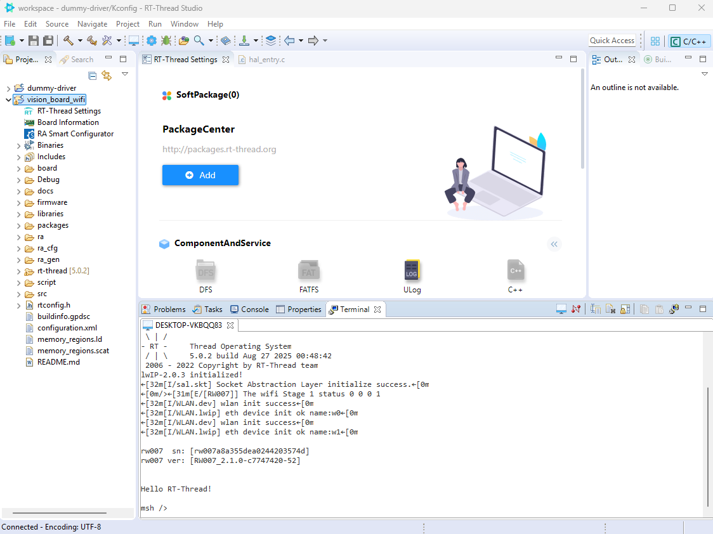{ width="500" }

   !!! success "Checkpoint 4.5"
       ✅ `wifiscan` เห็น WiFi รอบตัว
       ✅ `wifijoin` ได้ IP Address
       ✅ `ifconfig` แสดง IP ที่ได้รับ

---

## สรุป: คุณทำอะไรสำเร็จแล้ว

- [x] สร้างโปรเจกต์ WiFi จากเทมเพลต
- [x] ติดตั้งและตั้งค่า `rw007` Package
- [x] ตั้งค่า SPI Pins ผ่าน RA Smart Configurator
- [x] Build และ Flash สำเร็จ
- [x] Scan WiFi และเชื่อมต่อได้

---

## เตรียมไป Workshop 5

หลังจาก Workshop 4 จะต่อ **MQTT** (Workshop 5) โดยใช้ WiFi ที่เชื่อมต่ออยู่นี้ส่งข้อมูลไปยัง **EMQX Broker**

---

??? failure "แก้ปัญหาเบื้องต้น"
    **"rw007 not found"**
    - ตรวจสอบว่าเปิดใช้งาน `rw007` ใน RT-Thread Settings
    - ตรวจสอบว่าตั้งค่า SPI Bus ถูกต้อง

    **"wifiscan ไม่เห็น WiFi"**
    - ตรวจสอบว่า Antenna เสียบถูกต้อง (บางบอร์ดต้องต่อ External Antenna)
    - ตรวจสอบว่าไม่ได้อยู่ใกล้ตู้เหล็กหนา

    **"wifijoin แล้วไม่ได้ IP"**
    - ตรวจสอบว่า WiFi เป็น **2.4 GHz** (RW007 ไม่รองรับ 5 GHz)
    - ตรวจสอบ SSID/Password ถูกต้อง
    - ลองใช้ WiFi ที่ไม่มี Captive Portal

    **"Build Error: rw007 package missing"**
    - ไปที่ RT-Thread Settings → Packages → กด Refresh
    - ตรวจสอบการเชื่อมต่ออินเทอร์เน็ต (ดาวน์โหลด Package)
