# Workshop 5: IoT Programming (MQTT & JSON)

<span class="md-tag">Advanced</span> <span class="md-tag">60 นาที</span> <span class="md-tag">MQTT</span> <span class="md-tag">EMQX</span>

> 🚀 **ก้าวสู่ระบบ IoT Cloud เต็มรูปแบบ:**
> ใน Workshop นี้ คุณจะได้นำความสามารถด้าน Wi-Fi จากบทที่แล้วมาเชื่อมต่อกับ **EMQX MQTT Broker** พร้อมแพ็กข้อมูลให้อยู่ในรูปแบบมาตรฐานสากลอย่าง **JSON (`cJSON`)** เพื่อส่งค่าจากบอร์ด **RA8D1 Vision Board** ขึ้นสู่ระบบ Cloud แบบ Real-time และรับคำสั่งจาก Cloud กลับมาควบคุมบอร์ดได้สองทาง!

## วัตถุประสงค์

- [x] เข้าใจความแตกต่างของโปรโตคอล IoT: **REST API** และ **MQTT**
- [x] ติดตั้งและจัดการแพ็กเกจ **`pahomqtt`** และ **`cJSON`** ใน RT-Thread Settings
- [x] เขียนโค้ดเชื่อมต่อ Wi-Fi STA และสื่อสารกับ **EMQX Broker** (Publish / Subscribe)
- [x] สร้างและส่งข้อมูลรูปแบบ JSON แบบ Real-time

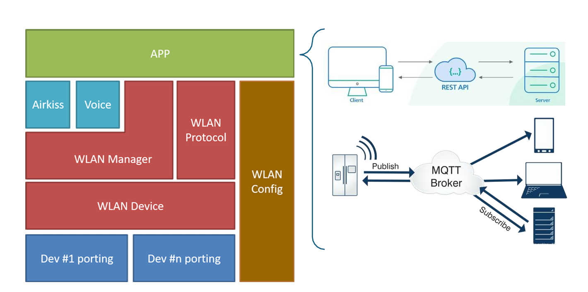{ width="600" }

---

## อินเทอร์เน็ตของสรรพสิ่ง (IoT Protocols)

**โปรโตคอล IoT** คือชุดมาตรฐานที่กำหนดกฎเกณฑ์การแลกเปลี่ยนข้อมูลระหว่างอุปกรณ์ฮาร์ดแวร์และเซิร์ฟเวอร์ โดย 2 โปรโตคอลที่ได้รับความนิยมสูงสุดมีลักษณะต่างกันดังนี้:

=== "REST API (HTTP)"
    **REST API** หรือ **RESTful API** คืออินเทอร์เฟซที่ทำงานบนโปรโตคอล **HTTP** แบบร้องขอ-ตอบกลับ (Request/Response)

    - ทำงานแบบไร้สถานะ (**Stateless**)
    - HTTP Methods มาตรฐาน (ตรงกับหลัก **CRUD**):
        - **GET** – ดึงข้อมูล
        - **POST** – สร้างข้อมูลใหม่
        - **PUT** – แทนที่ข้อมูลทั้งหมด
        - **PATCH** – อัปเดตข้อมูลบางส่วน
        - **DELETE** – ลบข้อมูล
    - Response มักส่งกลับมาเป็น **JSON** หรือ **Plain Text**
    - **ข้อจำกัดบน MCU:** Header ของ HTTP มีขนาดใหญ่ กินแบนด์วิดท์ และเซิร์ฟเวอร์สั่งงานบอร์ดย้อนกลับได้ยาก

=== "MQTT (แนะนำสำหรับ IoT)"
    **MQTT (Message Queuing Telemetry Transport)** ออกแบบมาเพื่ออุปกรณ์ IoT โดยเฉพาะ ทำงานได้ดีแม้ในเครือข่ายที่ **ความหน่วงสูง (High Latency)** และ **แบนด์วิดท์ต่ำ**

    - ทำงานบน **TCP/IP** (มีความน่าเชื่อถือสูง เลือกได้ 3 ระดับ QoS 0, 1, 2)
    - ใช้สถาปัตยกรรมแบบ **Publish / Subscribe** (ผู้ส่งกับผู้รับไม่ต้องรู้จัก IP ของกันและกัน)
    - Header ขนาดเล็กมาก (เริ่มต้นเพียง **2 ไบต์**) ประหยัดพลังงานและ RAM
    - รองรับการสื่อสารสองทางทั้ง **Device-to-Cloud** และ **Cloud-to-Device**
    - มีตัวกลางจัดส่งข้อความเรียกว่า **MQTT Broker** (เช่น EMQX)

---

## Workshop IoT: เชื่อมต่อ MQTT กับ EMQX Broker

### ขั้นตอนที่ 1: สร้าง Project

สร้าง Project ใหม่ใน RT-Thread Studio ชื่อ `iot-workshop1` (อ้างอิงจากเทมเพลต Wi-Fi ของ Vision Board)

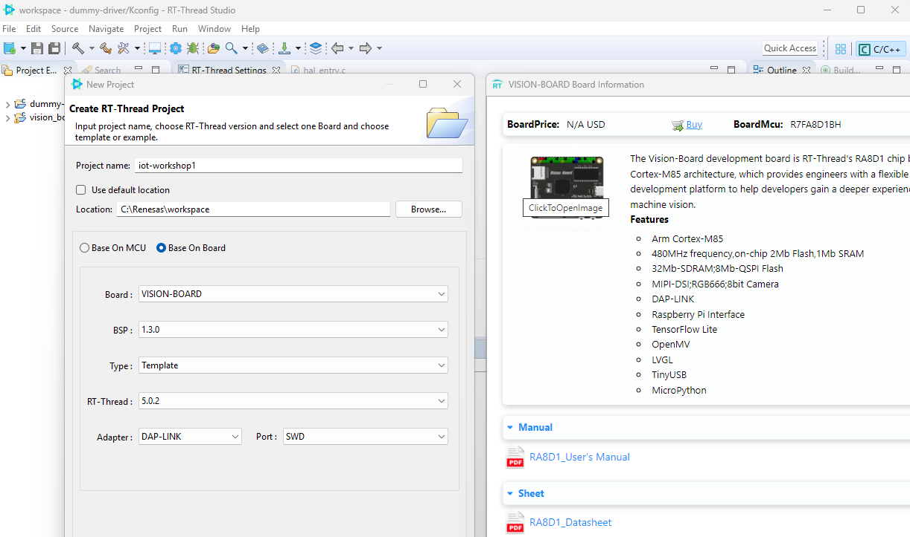{ width="500" }

---

### ขั้นตอนที่ 2: ติดตั้ง Packages (`pahomqtt` และ `cJSON`)

1. เปิด **RT-Thread Settings → Software Package**

   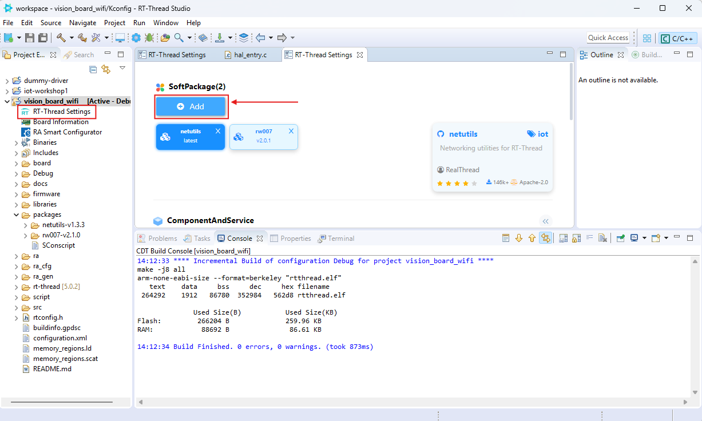{ width="500" }

2. ค้นหาและติ๊กติดตั้ง **`pahomqtt`** (ไลบรารี MQTT Client) และ **`cJSON`** (ไลบรารีจัดการข้อมูล JSON)

   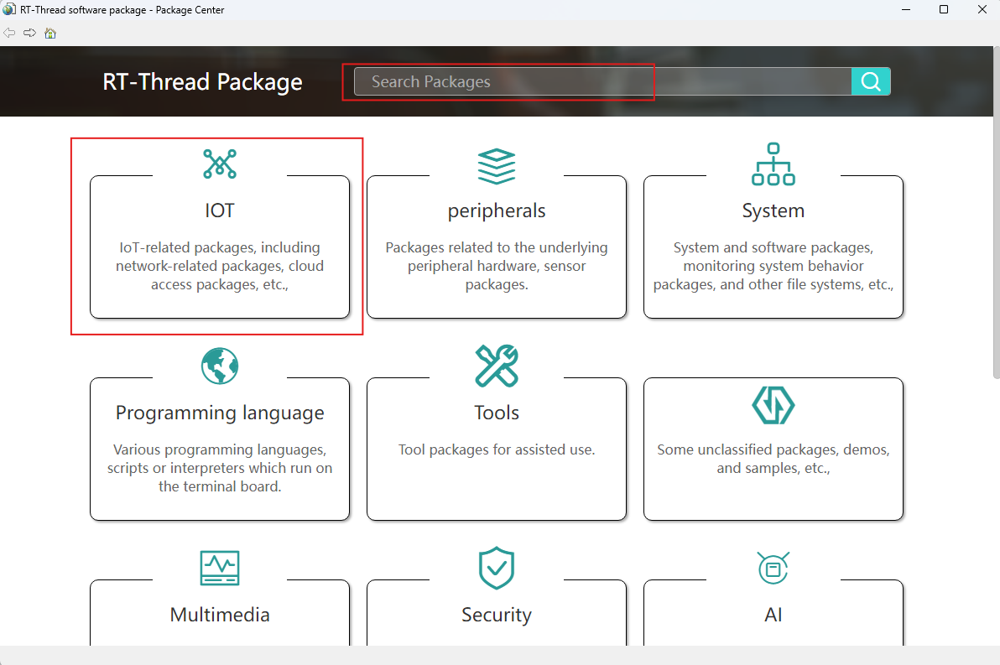{ width="500" }
   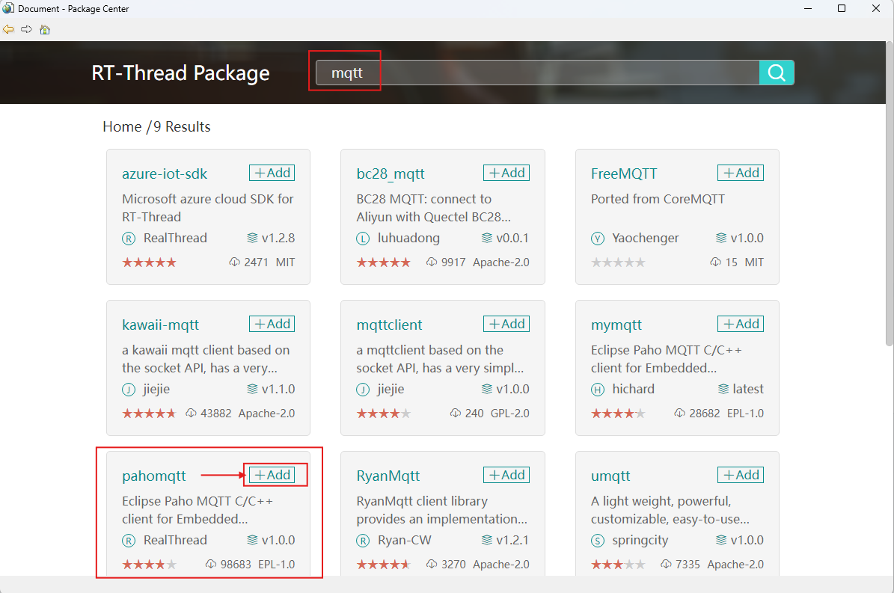{ width="500" }
   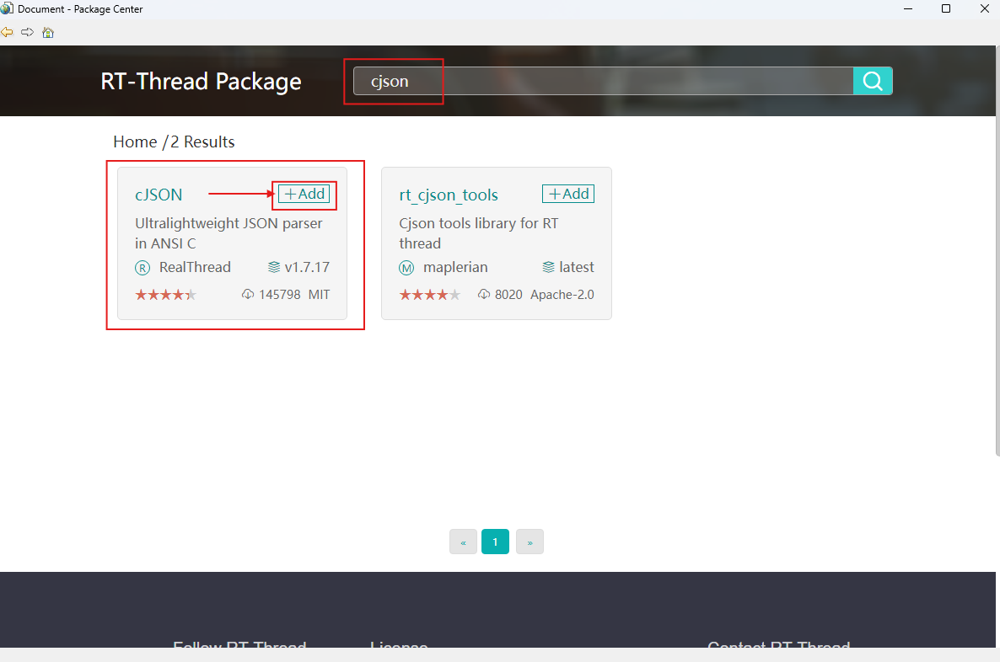{ width="500" }

3. กดปิด Tab **RT-Thread Settings** (หรือกด ++ctrl+s++) เพื่อบันทึก → ระบบจะทำการ **Download → Update Project → Precompile** ให้อัตโนมัติ

   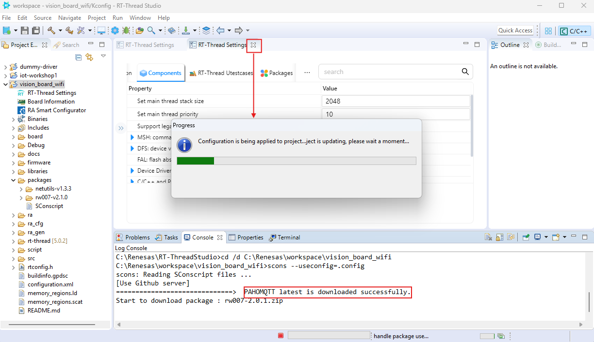{ width="500" }

4. หลังอัปเดตเรียบร้อย ให้ขยายโฟลเดอร์ `packages/` ใน Project Explorer เพื่อตรวจสอบว่าแพ็กเกจถูกโหลดเข้ามาครบถ้วน

   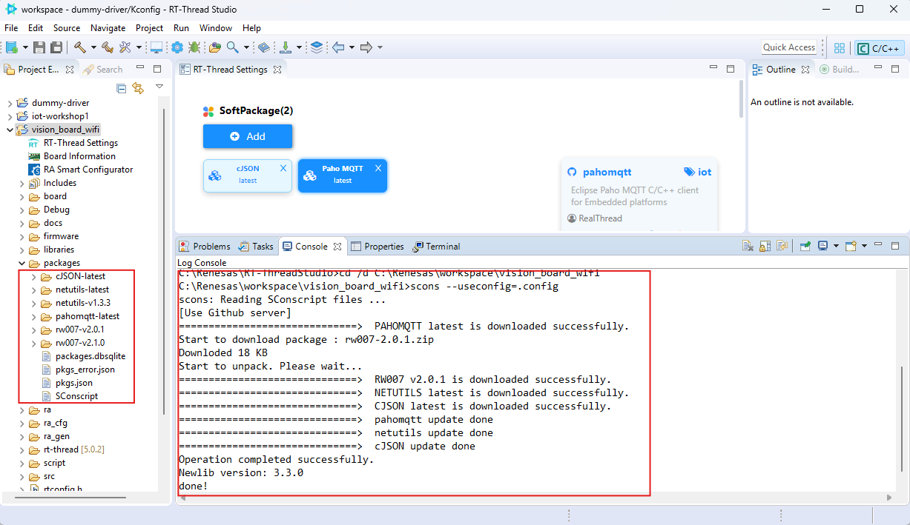{ width="500" }

---

### ขั้นตอนที่ 3: แก้ไข Package ซ้ำซ้อนก่อน Build

ลองกด **Compile → Build All** หากพบ Error เกี่ยวกับแพ็กเกจซ้ำซ้อน (`multiple definition`) ให้แก้ไขตามขั้นตอนนี้:

1. ลบโฟลเดอร์ `rw007-v2.0.1` ที่ซ้ำซ้อนออก 1 โฟลเดอร์

   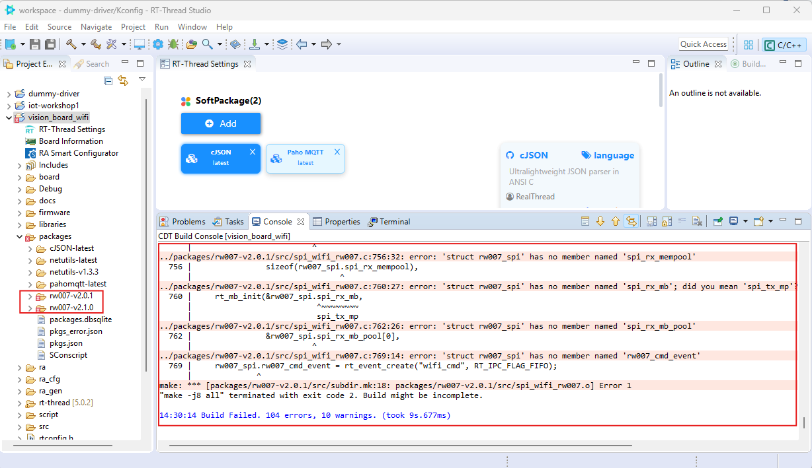{ width="500" }

2. ลบ `netutils` ออก (หากชนกับไลบรารีเครือข่ายที่มีอยู่แล้ว) แล้วกด Build ใหม่

   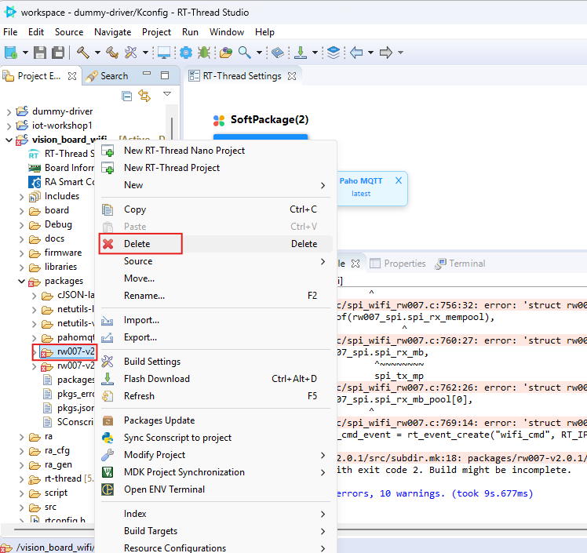{ width="500" }
   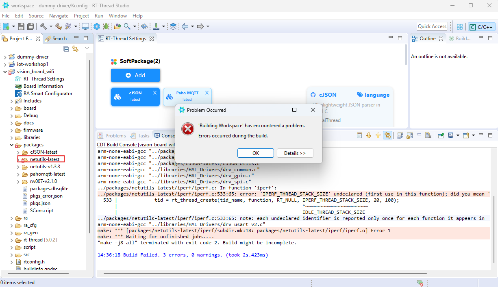{ width="500" }
   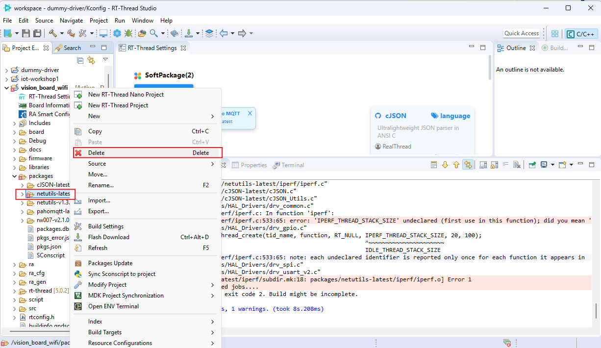{ width="500" }

!!! info "ทำไมถึงต้องลบ `rw007-v2.0.1` และ `netutils` ออก?"
    เนื่องจากเทมเพลตโปรเจกต์ต้นแบบมีซอร์สโค้ดของ `rw007` และเครื่องมือเครือข่ายฝังมาให้ในโฟลเดอร์ระบบอยู่แล้ว เมื่อเรากดบันทึกใน RT-Thread Settings ระบบจะดาวน์โหลดแพ็กเกจเวอร์ชันใหม่มาลงใน `packages/` ซ้ำอีกชุด ทำให้ตัว Linker แจ้ง Error ว่ามีฟังก์ชันชื่อซ้ำกัน การลบตัวที่ซ้ำออกจะช่วยให้คอมไพล์ผ่านทันที

3. หลังกด Build อีกรอบควรผ่านสมบูรณ์ (`0 errors`)

   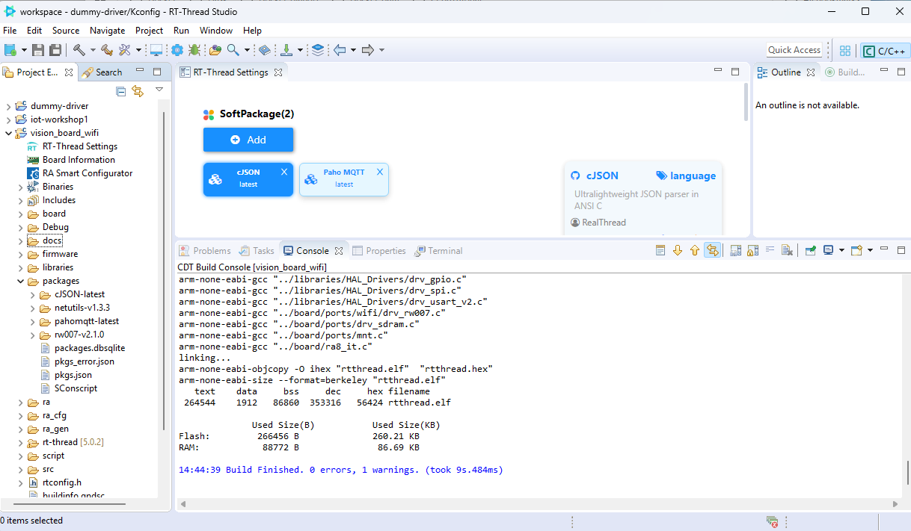{ width="500" }

---

### ขั้นตอนที่ 4: เขียน Code ใน `hal_entry.c`

นำโค้ดต้นแบบจาก `hal_entry_02.c` ในโฟลเดอร์ `/ex_03` (หรือคัดลอกโค้ดฉบับปรับปรุงด้านล่างนี้) มาแทนที่ใน `src/hal_entry.c`:

```c title="hal_entry.c — Workshop 5 (MQTT + cJSON)" linenums="1"
/*
 * Copyright (c) 2006-2023, RT-Thread Development Team
 */

#include <rtthread.h>
#include <rtdevice.h>
#include "hal_data.h"

#include <wlan_mgnt.h>
#include <wlan_prot.h>
#include <wlan_cfg.h>

#include <paho_mqtt.h>
#include <cJSON.h>

#define LED_PIN         BSP_IO_PORT_01_PIN_02   /* Onboard LED Pin */

#define WIFI_SSID       "<WIFI_SSID>"
#define WIFI_PASSWD     "<WIFI_PASSWD>"

#define MQTT_BROKER     "tcp://broker.emqx.io:1883"
#define MQTT_CLIENT_ID  "<MQTT_CLIENT_ID>"      /* ตั้งชื่อให้ไม่ซ้ำใคร เช่น ra8d1_student_01 */
#define MQTT_PUB_TOPIC  "<MQTT_PUB_TOPIC>"      /* เช่น vision/ra8d1/telemetry */
#define MQTT_SUB_TOPIC  "<MQTT_SUB_TOPIC>"      /* เช่น vision/ra8d1/command */

static MQTTClient mqttClient;
static volatile bool wifiConnected = false;

/* Callback เมื่อเชื่อมต่อ Wi-Fi และได้รับ IP Address เรียบร้อย */
void wifi_event_handler(int event, struct rt_wlan_buff *buff, void *parameter)
{
    wifiConnected = true;
}

/* Callback เมื่อมีข้อความส่งมาจาก Topic ที่เรา Subscribe ไว้ */
static void mqtt_msg_cb(MQTTClient *client, MessageData *msg_data)
{
    char topic_txt[256] = {0};
    char payload_txt[256] = {0};

    /* คัดลอกชื่อ Topic และ Payload ตามความยาวจริง (ป้องกัน Buffer Overflow) */
    size_t topic_len = msg_data->topicName->lenstring.len;
    if (topic_len >= sizeof(topic_txt)) topic_len = sizeof(topic_txt) - 1;
    rt_memcpy(topic_txt, msg_data->topicName->lenstring.data, topic_len);

    size_t payload_len = msg_data->message->payloadlen;
    if (payload_len >= sizeof(payload_txt)) payload_len = sizeof(payload_txt) - 1;
    rt_memcpy(payload_txt, msg_data->message->payload, payload_len);

    rt_kprintf("\n[MQTT RX] Topic: %s | Msg: %s\n", topic_txt, payload_txt);
}

static void mqtt_connect_cb(MQTTClient *client)
{
    rt_kprintf("\n[MQTT] Connected to Broker!\n");
}

static void mqtt_online_cb(MQTTClient *client)
{
    rt_kprintf("[MQTT] Device Online!\n");
    client->isconnected = true;
}

static void mqtt_offline_cb(MQTTClient *client)
{
    rt_kprintf("[MQTT] Device Offline!\n");
    client->isconnected = false;
}

void hal_entry(void)
{
    rt_kprintf("\n=== Hello RT-Thread: IoT MQTT Workshop ===\n");

    /* 1. เริ่มต้น Wi-Fi STA Mode และเชื่อมต่อ Access Point */ // (1)!
    rt_wlan_set_mode(RT_WLAN_DEVICE_STA_NAME, RT_WLAN_STATION);
    rt_wlan_register_event_handler(RT_WLAN_EVT_READY, wifi_event_handler, RT_NULL);
    rt_wlan_connect(WIFI_SSID, WIFI_PASSWD);

    rt_kprintf("Waiting for WiFi IP: ");
    while (!wifiConnected)
    {
        rt_kprintf(".");
        rt_thread_mdelay(500);
    }
    rt_kprintf("\nWiFi Connected!\n");

    /* 2. ตั้งค่าการเชื่อมต่อ MQTT Broker และ Callbacks */ // (2)!
    mqttClient.uri = MQTT_BROKER;

    MQTTPacket_connectData mqttCfg = MQTTPacket_connectData_initializer;
    mqttCfg.clientID.cstring = MQTT_CLIENT_ID;
    mqttCfg.keepAliveInterval = 30;
    mqttCfg.cleansession = 1;
    mqttCfg.username.cstring = RT_NULL;
    mqttCfg.password.cstring = RT_NULL;
    rt_memcpy(&mqttClient.condata, &mqttCfg, sizeof(mqttCfg));

    mqttClient.buf_size = 256;
    mqttClient.buf = rt_calloc(1, mqttClient.buf_size);
    mqttClient.readbuf_size = 256;
    mqttClient.readbuf = rt_calloc(1, mqttClient.readbuf_size);

    mqttClient.connect_callback = mqtt_connect_cb;
    mqttClient.online_callback = mqtt_online_cb;
    mqttClient.offline_callback = mqtt_offline_cb;
    mqttClient.defaultMessageHandler = mqtt_msg_cb;

    mqttClient.isconnected = false;
    paho_mqtt_start(&mqttClient);

    while (!mqttClient.isconnected)
    {
        rt_thread_mdelay(500);
    }

    /* 3. สมัครรับข้อมูล (Subscribe) จาก Topic คำสั่ง */
    paho_mqtt_subscribe(&mqttClient, QOS1, MQTT_SUB_TOPIC, mqtt_msg_cb);

    /* 4. วนลูปสร้างข้อมูล JSON และส่ง (Publish) ขึ้น Broker ทุก 2 วินาที */
    int counter = 0;
    while (1)
    {
        rt_pin_write(LED_PIN, PIN_HIGH);
        rt_thread_mdelay(1000);
        rt_pin_write(LED_PIN, PIN_LOW);
        rt_thread_mdelay(1000);

        /* สร้าง JSON Object ด้วย cJSON */
        cJSON *root = cJSON_CreateObject();
        cJSON_AddStringToObject(root, "board", "RA8D1-Vision");
        cJSON_AddNumberToObject(root, "count", ++counter);
        char *json_str = cJSON_PrintUnformatted(root);

        if (json_str != RT_NULL)
        {
            paho_mqtt_publish(&mqttClient, QOS1, MQTT_PUB_TOPIC, json_str);
            rt_kprintf("[MQTT TX] Published: %s\n", json_str);
            cJSON_free(json_str); /* คืนหน่วยความจำ String เสมอ (ป้องกัน Memory Leak) */
        }
        cJSON_Delete(root);       /* คืนหน่วยความจำ cJSON Object เสมอ */
    }
}
```
1. เริ่มต้น Wi-Fi STA mode เชื่อมต่อกับ Access Point และรอจนได้รับ IP Address
2. ตั้งค่า MQTT Broker, จอง Buffer และผูกฟังก์ชัน Callback สำหรับรับ-ส่งข้อความ

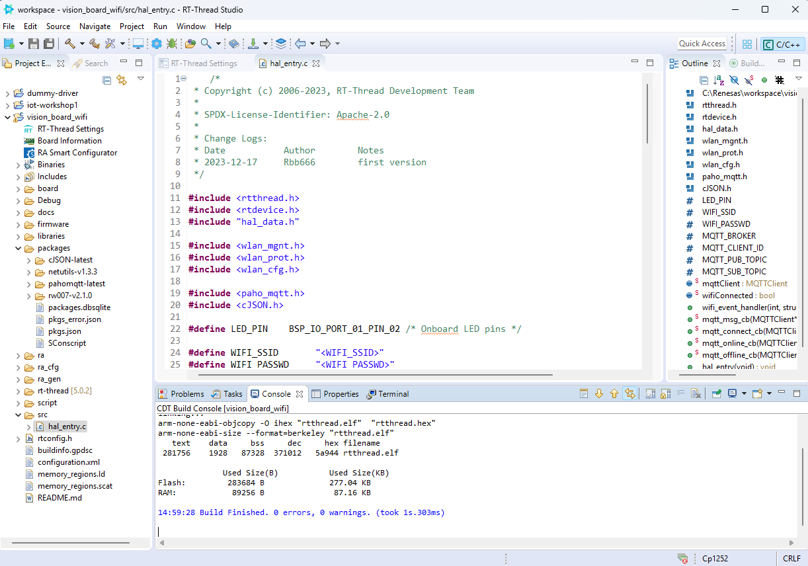{ width="500" }

---

### ขั้นตอนที่ 5: ตั้งค่า Config (Wi-Fi และ MQTT)

!!! info "ยังไม่มีเครื่องมือทดสอบ MQTT หรือ EMQX Account?"
    [ไปดูวิธีตั้งค่าและใช้ MQTTX / EMQX Cloud ที่นี่ → EMQX Setup Guide](./07.2_mqwx.md)

แก้ไขค่าคงที่ด้านบนของไฟล์ `hal_entry.c` ให้ตรงกับเครือข่ายของคุณ:

```c
#define WIFI_SSID       "ชื่อ Wi-Fi 2.4GHz ของคุณ"
#define WIFI_PASSWD     "รหัสผ่าน Wi-Fi"
#define MQTT_BROKER     "tcp://broker.emqx.io:1883"
#define MQTT_CLIENT_ID  "ra8d1_vision_user01"       /* ต้องตั้งไม่ซ้ำกับเพื่อนในห้อง! */
#define MQTT_PUB_TOPIC  "aic/vision/user01/data"
#define MQTT_SUB_TOPIC  "aic/vision/user01/cmd"
```

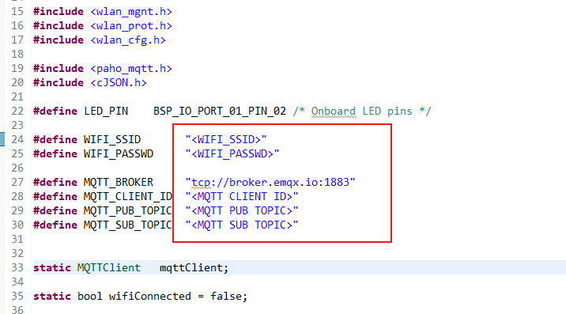{ width="500" }

!!! warning "ข้อควรระวังสำคัญ"
    - **Wi-Fi คลื่น 2.4 GHz เท่านั้น:** โมดูล RW007 ไม่รองรับ Wi-Fi 5 GHz
    - **ห้ามตั้ง `MQTT_CLIENT_ID` ซ้ำกัน:** บน Public Broker (`broker.emqx.io`) หากมีอุปกรณ์ 2 ตัวใช้ Client ID เดียวกัน Broker จะตัดการเชื่อมต่อตัวเก่าทิ้งทันที ทำให้เกิดอาการหลุดแล้วต่อใหม่วนไปเรื่อยๆ

---

### ขั้นตอนที่ 6: Build และทดสอบรับ-ส่งข้อมูลจริง

1. กด **Build All** และ **Flash Download** ลงบอร์ด RA8D1

   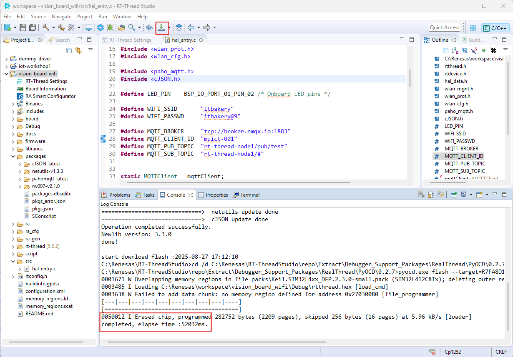{ width="500" }

2. เปิด **Serial Terminal** (`115200`) และเปิดโปรแกรม **MQTTX** (หรือ EMQX WebSocket Client) บนคอมพิวเตอร์ เพื่อ Subscribe รอดูข้อความที่บอร์ดส่งขึ้นมา

   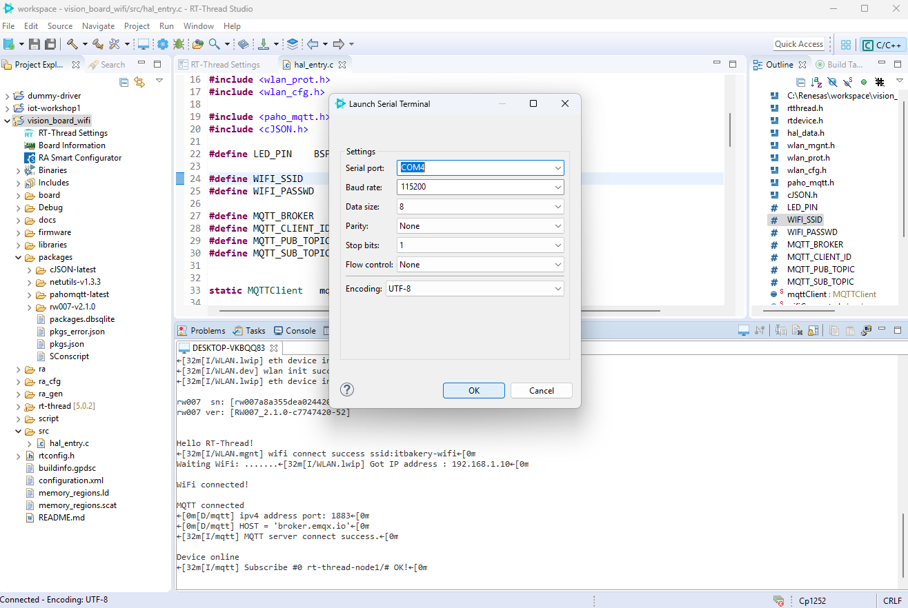{ width="500" }

**Diagram การสื่อสารสองทาง (Publish & Subscribe):**

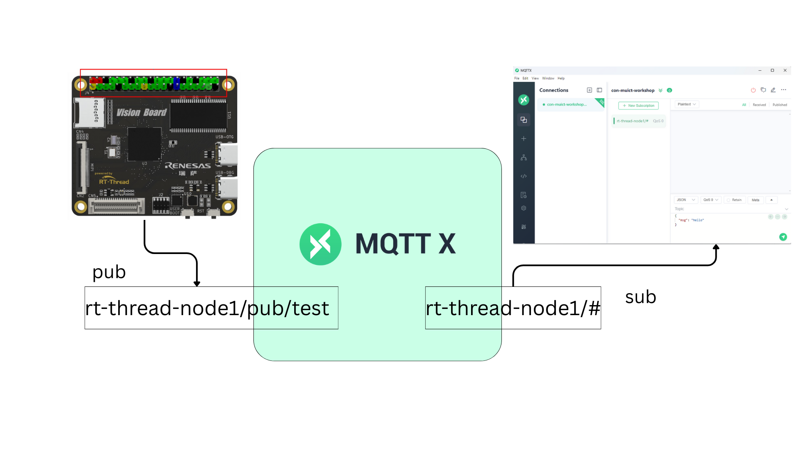{ width="600" }

**ตัวอย่างผลลัพธ์บนหน้าจอ Terminal:**

```text
=== Hello RT-Thread: IoT MQTT Workshop ===
Waiting for WiFi IP: ....
WiFi Connected!

[MQTT] Connected to Broker!
[MQTT] Device Online!
[MQTT TX] Published: {"board":"RA8D1-Vision","count":1}
[MQTT TX] Published: {"board":"RA8D1-Vision","count":2}
[MQTT RX] Topic: aic/vision/user01/cmd | Msg: LED_ON
```

---

## สรุปผลลัพธ์ความสำเร็จ

- [x] ติดตั้งและจัดการแพ็กเกจ **`pahomqtt`** และ **`cJSON`** ร่วมกับโปรเจกต์ได้
- [x] เขียนโค้ดเชื่อมต่อ Wi-Fi STA อัตโนมัติตั้งแต่บูตเครื่อง
- [x] แพ็กข้อมูลเป็น JSON ด้วย `cJSON` (พร้อมคืนหน่วยความจำ `cJSON_Delete` / `cJSON_free` อย่างถูกวิธี)
- [x] ส่งข้อมูล (**Publish**) และรับคำสั่ง (**Subscribe**) ผ่าน EMQX Broker แบบ Real-time

---

??? failure "พบปัญหา? (Troubleshooting)"
    **Error: MQTT connection failed หรือหลุดบ่อย (Offline/Online สลับกัน)**
    - **เช็ก `MQTT_CLIENT_ID`:** เปลี่ยนชื่อ Client ID ให้มีเอกลักษณ์เฉพาะตัว (เช่น เติมเลขสุ่มต่อท้าย) เพื่อไม่ให้ชนกับคนอื่นบน `broker.emqx.io`
    - **เช็ก Wi-Fi:** ตรวจสอบว่าเป็นคลื่น **2.4 GHz** และใส่ SSID/Password ถูกต้อง
    - **เช็ก Broker URL:** ต้องขึ้นต้นด้วย `tcp://` เช่น `tcp://broker.emqx.io:1883`

    **บอร์ดค้างหรือรีเซ็ตเองหลังจาก Publish ไปสักพัก (Memory Leak)**
    - ตรวจสอบว่าในลูป `while(1)` มีการเรียก **`cJSON_free(json_str)`** และ **`cJSON_Delete(root)`** ครบทั้ง 2 บรรทัดทุกครั้งที่สร้าง JSON เสร็จแล้ว (หากลืม หน่วยความจำ Heap ของบอร์ดจะเต็มภายในไม่กี่นาที)

    **Error: Package not found ตอนติดตั้ง `pahomqtt` หรือ `cJSON`**
    - เปิด **RT-Thread Settings → Software Packages → กดปุ่ม Refresh** เพื่ออัปเดตดัชนีแพ็กเกจจากอินเทอร์เน็ต

    **Fix MQTT Connect จากรุ่นก่อน:**
    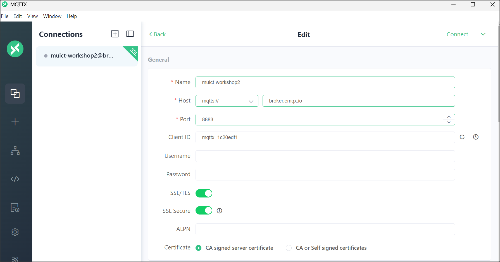{ width="400" }
    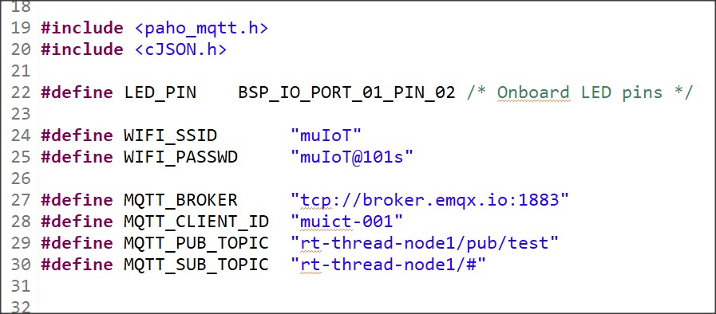{ width="400" }
