# IoT Programming

<span class="md-tag">Advanced</span> <span class="md-tag">60 นาที</span>

## วัตถุประสงค์

- [x] เข้าใจโปรโตคอล IoT: REST API และ MQTT
- [x] ติดตั้ง Package pahoMQTT และ cJSON
- [x] เชื่อมต่อ WiFi และ MQTT Broker
- [x] ส่งข้อมูลแบบ Real-time

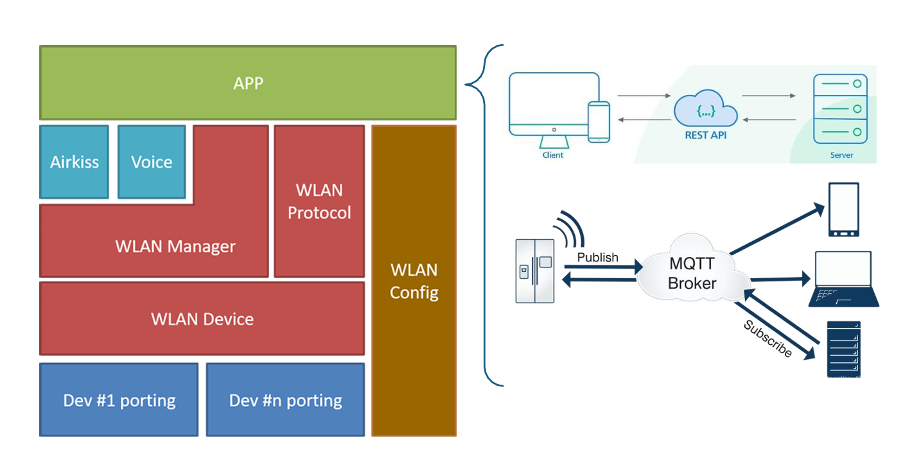{ width="600" }

---

## อินเทอร์เน็ตของสรรพสิ่ง (IoT)

**โปรโตคอล IoT** คือชุดของกฎและมาตรฐานที่กำหนดการแลกเปลี่ยนข้อมูลระหว่างอุปกรณ์

โปรโตคอลที่ได้รับความนิยมมากที่สุด ได้แก่ **REST API** และ **MQTT**

=== "REST API"
    **REST API** หรือ **RESTful API** คืออินเทอร์เฟซที่ช่วยให้ซอฟต์แวร์สื่อสารกันได้

    - ใช้โปรโตคอล **HTTP** แบบไร้สถานะ (stateless)
    - HTTP Methods มาตรฐาน:
        - **GET** – ดึงข้อมูล
        - **POST** – สร้างข้อมูล
        - **PUT** – แทนที่ข้อมูล
        - **PATCH** – อัปเดตข้อมูลบางส่วน
        - **DELETE** – ลบข้อมูล
    - ตรงกับการทำงานแบบ **CRUD**
    - Response มักเป็น **JSON** หรือ **plain text**

=== "MQTT"
    **MQTT** เป็นโปรโตคอลสำหรับอุปกรณ์ IoT ที่มี **ความหน่วงสูง** และ **แบนด์วิดท์ต่ำ**

    - ทำงานบน **TCP**
    - โมเดล **Publish/Subscribe**
    - เหมาะสำหรับอุปกรณ์ที่ใช้ **โค้ดขนาดเล็ก**
    - รองรับ **device-to-cloud** และ **cloud-to-device**
    - หัวใจสำคัญคือ **MQTT Broker**

---

## Workshop IoT: MQTT with EMQX

### ขั้นตอนที่ 1: สร้าง Project

สร้าง Project ชื่อ `iot-workshop1`

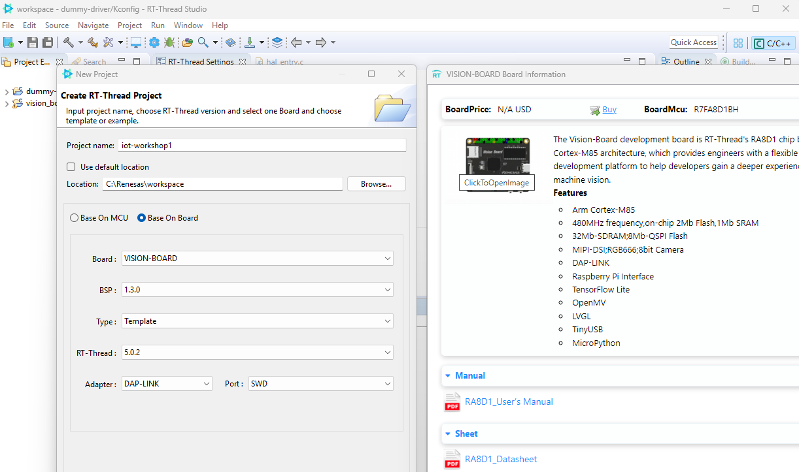{ width="500" }

### ขั้นตอนที่ 2: ติดตั้ง Packages

1. เปิด **RT-Thread Settings → Software Package**

   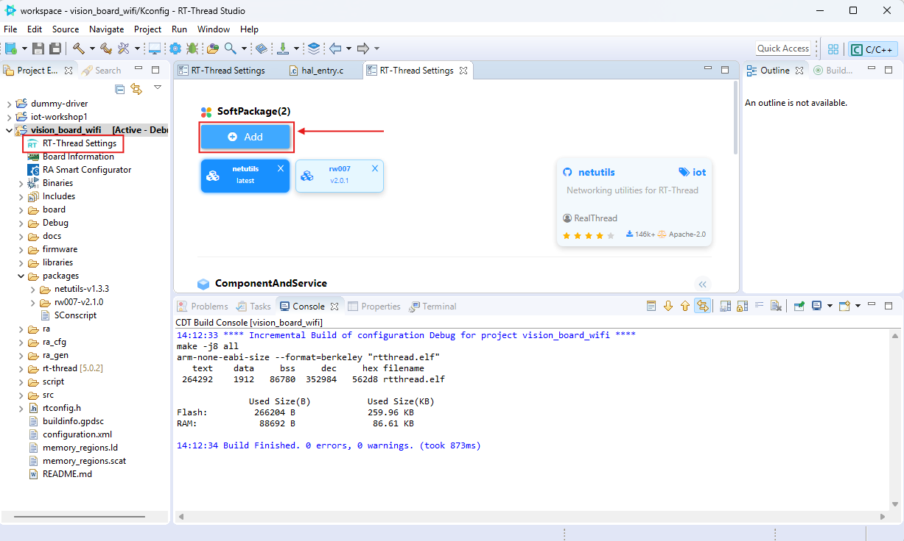{ width="500" }

2. ค้นหาและติดตั้ง `pahomqtt` และ `cJSON`

   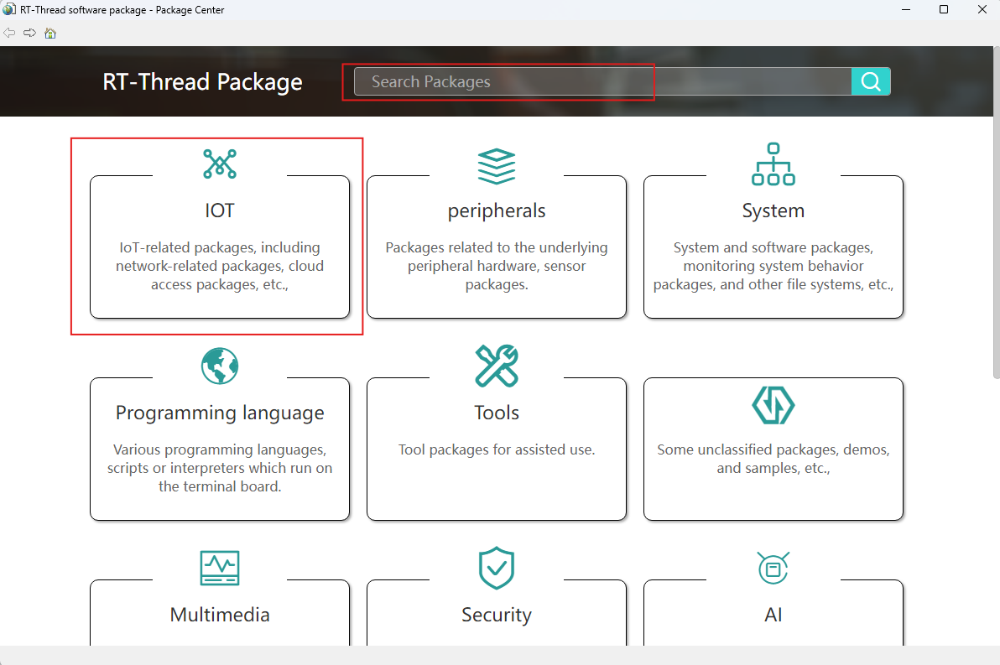{ width="500" }
   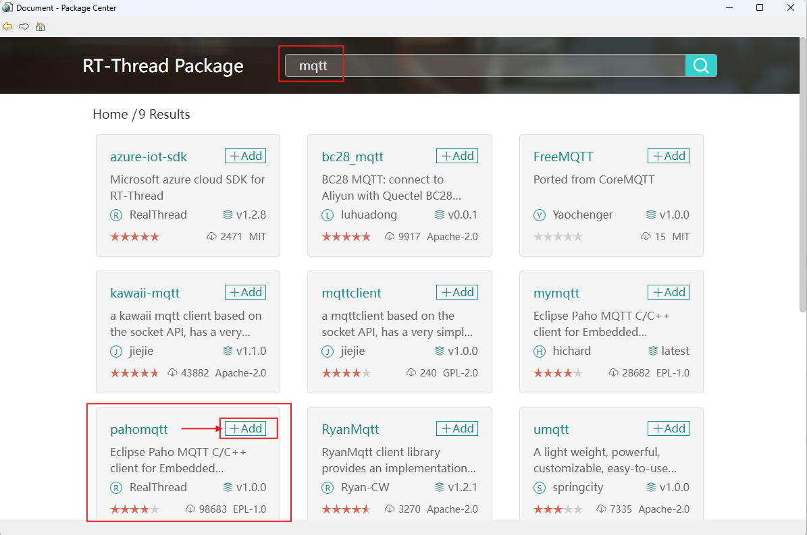{ width="500" }
   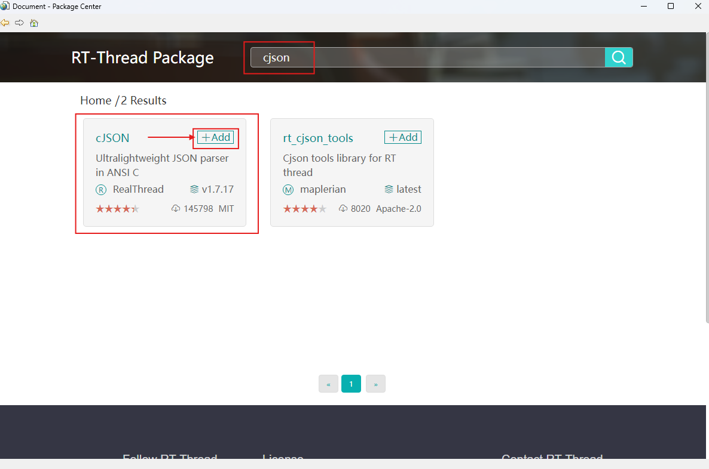{ width="500" }

3. กดปิด Tab เพื่อ Save → RT-Thread IDE จะทำการ Download → Update Project → Precompile

   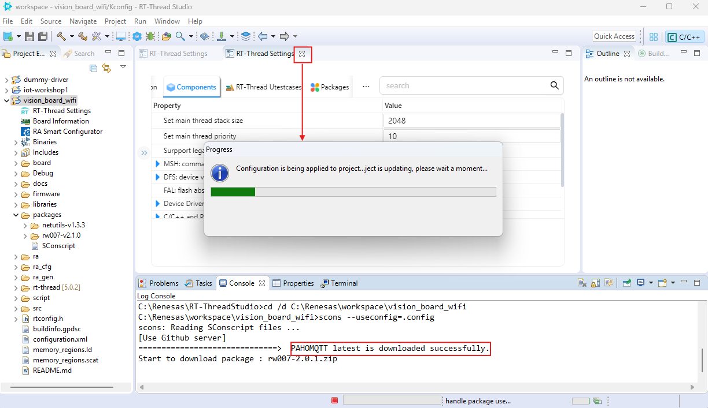{ width="500" }

4. หลัง Update เรียบร้อยเปิด Folder Package ตรวจสอบ

   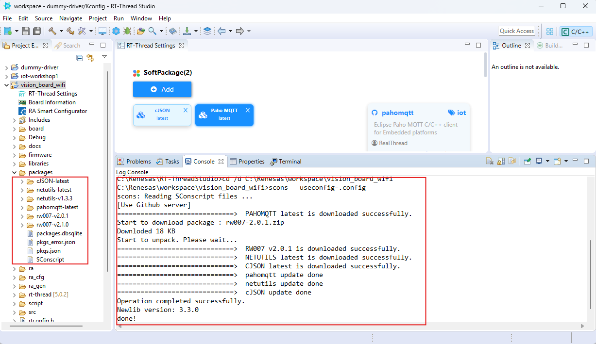{ width="500" }

### ขั้นตอนที่ 3: แก้ไข Errors

ลอง **Compile → Build All** หากพบ Error ให้แก้ไขดังนี้

1. ลบ folder `rw007-v2.0.1` ออก 1 folder

   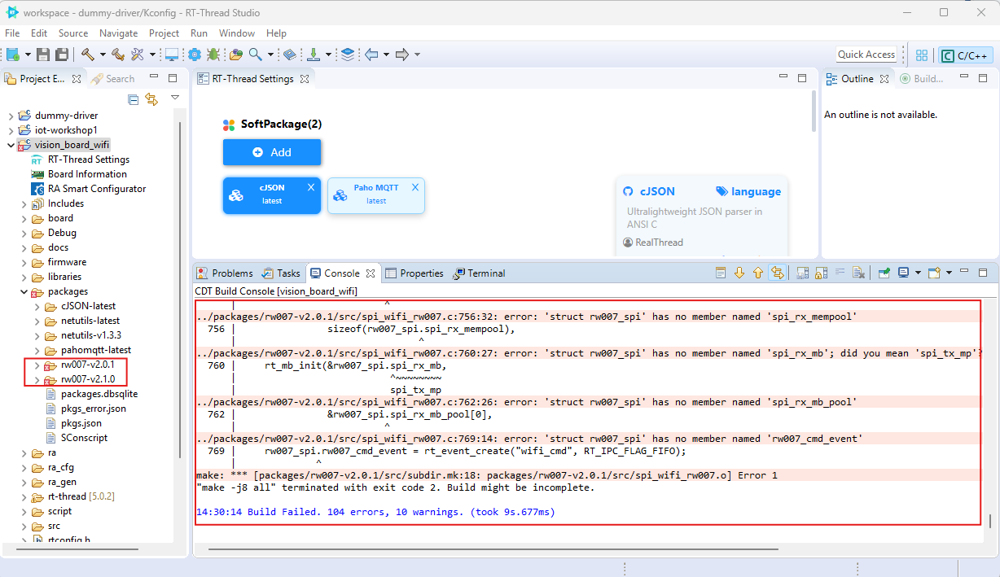{ width="500" }

2. ลบ `netutils` ออกแล้ว Build ใหม่

   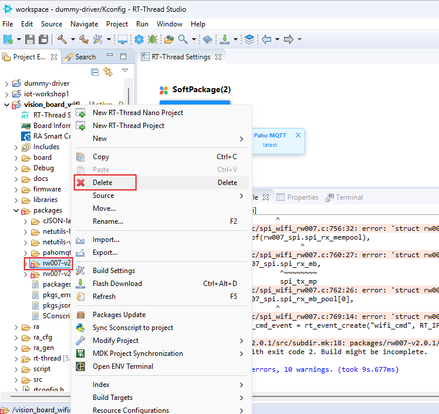{ width="500" }
   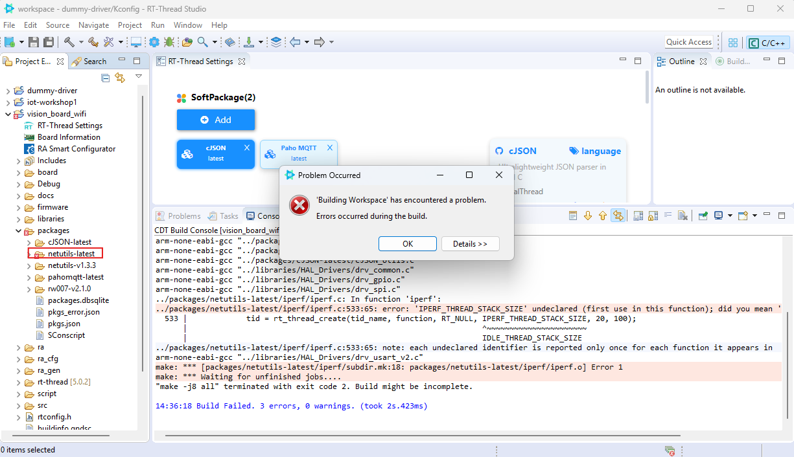{ width="500" }
   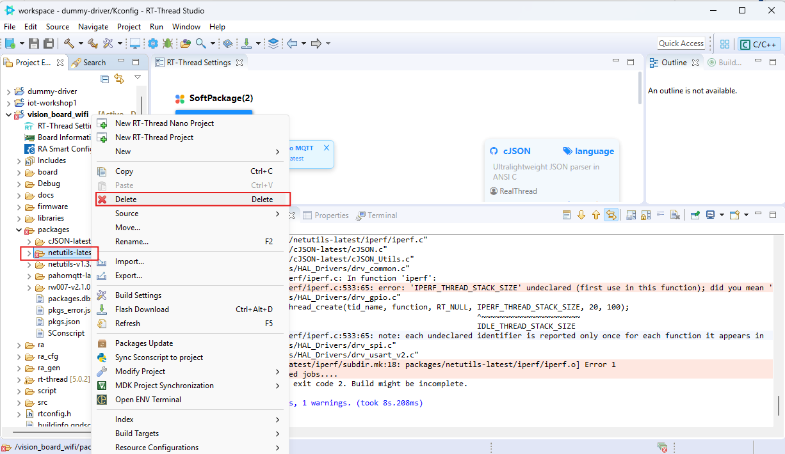{ width="500" }

3. หลัง Build อีกรอบควรสำเร็จ

   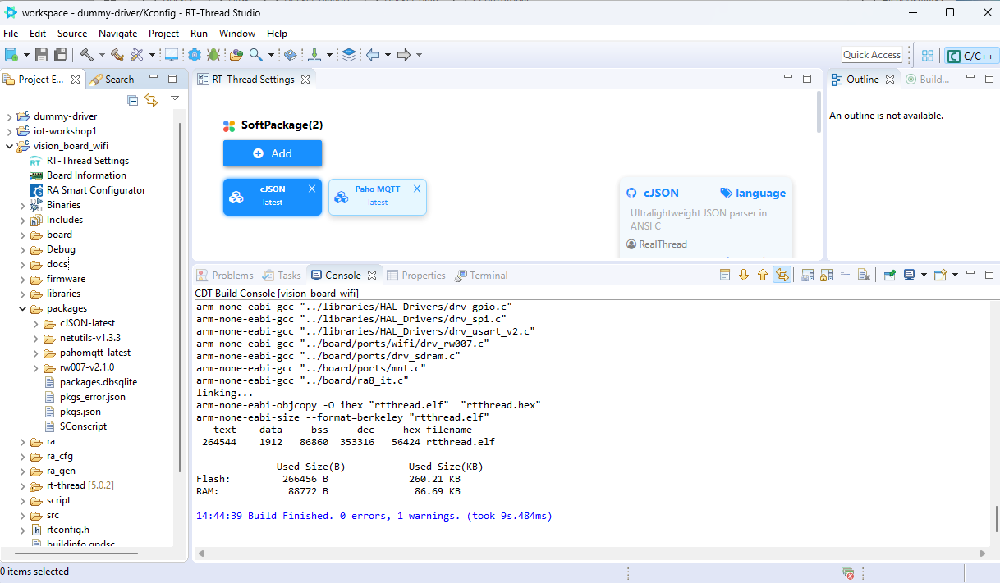{ width="500" }

### ขั้นตอนที่ 4: เขียน Code

Copy Code จาก `hal_entry_02.c` ใน folder `/ex_03` มาแทนที่ `hal_entry.c`

``` C title="hal_entry_02.c — Workshop 5" linenums="1"
/*
 * Copyright (c) 2006-2023, RT-Thread Development Team
 */

#include <rtthread.h>
#include <rtdevice.h>
#include "hal_data.h"

#include <wlan_mgnt.h>
#include <wlan_prot.h>
#include <wlan_cfg.h>

#include <paho_mqtt.h>
#include <cJSON.h>

#define LED_PIN    BSP_IO_PORT_01_PIN_02 /* Onboard LED pins */

#define WIFI_SSID       "<WIFI_SSID>"
#define WIFI_PASSWD     "<WIFI_PASSWD>"

#define MQTT_BROKER     "tcp://broker.emqx.io:1883"
#define MQTT_CLIENT_ID  "<MQTT CLIENT ID>"
#define MQTT_PUB_TOPIC  "<MQTT PUB TOPIC>"
#define MQTT_SUB_TOPIC  "<MQTT SUB TOPIC>"

static MQTTClient   mqttClient;
static bool wifiConnected = false;

void wifi_event_handler(int event, struct rt_wlan_buff *buff, void *parameter) {
    wifiConnected = true;
}

static void mqtt_msg_cb(MQTTClient *client, MessageData *msg_data) {
    char topic_txt[256];
    char payload_txt[256];
    memcpy(topic_txt, msg_data->topicName->lenstring.data,
           strlen(msg_data->topicName->lenstring.data));
    topic_txt[msg_data->topicName->lenstring.len] = 0;
    memcpy(payload_txt, msg_data->message->payload,
           strlen((char*)msg_data->message->payload));
    payload_txt[msg_data->message->payloadlen] = 0;
    rt_kprintf("Got msg %s from %s\n", payload_txt, topic_txt);
}

static void mqtt_connect_cb(MQTTClient *client) {
    rt_kprintf("\nMQTT connected\n");
}

static void mqtt_online_cb(MQTTClient *client) {
    rt_kprintf("\nDevice online\n");
    client->isconnected = true;
}

static void mqtt_offline_cb(MQTTClient *client) {
    rt_kprintf("\nDevice offline\n");
}

void hal_entry(void)
{
    rt_kprintf("\nHello RT-Thread!\n");

    // WiFi // (1)!
    rt_wlan_set_mode(RT_WLAN_DEVICE_STA_NAME, RT_WLAN_STATION);
    rt_wlan_register_event_handler(RT_WLAN_EVT_READY, wifi_event_handler, RT_NULL);
    rt_wlan_connect(WIFI_SSID, WIFI_PASSWD);
    rt_kprintf("Waiting WiFi: ");
    while(!wifiConnected) {
        rt_kprintf(".");
        rt_thread_mdelay(500);
    }
    rt_kprintf("\nWiFi connected!\n");

    // MQTT // (2)!
    mqttClient.uri = MQTT_BROKER;

    MQTTPacket_connectData mqttCfg = MQTTPacket_connectData_initializer;
    mqttCfg.clientID.cstring = MQTT_CLIENT_ID;
    mqttCfg.keepAliveInterval = 30;
    mqttCfg.cleansession = 1;
    mqttCfg.username.cstring = RT_NULL;
    mqttCfg.password.cstring = RT_NULL;
    memcpy(&mqttClient.condata, &mqttCfg, sizeof(mqttCfg));

    mqttClient.buf_size = 128;
    mqttClient.buf = rt_calloc(1, mqttClient.buf_size);
    mqttClient.readbuf_size = 128;
    mqttClient.readbuf = rt_calloc(1, mqttClient.readbuf_size);

    mqttClient.connect_callback = mqtt_connect_cb;
    mqttClient.online_callback = mqtt_online_cb;
    mqttClient.offline_callback = mqtt_offline_cb;
    mqttClient.defaultMessageHandler = mqtt_msg_cb;

    mqttClient.isconnected = false;
    paho_mqtt_start(&mqttClient);
    while(!mqttClient.isconnected) {
        rt_thread_mdelay(500);
    }
    paho_mqtt_subscribe(&mqttClient, QOS1, MQTT_SUB_TOPIC, mqtt_msg_cb);

    while (1) {
        rt_pin_write(LED_PIN, PIN_HIGH);
        rt_thread_mdelay(500);
        rt_pin_write(LED_PIN, PIN_LOW);
        rt_thread_mdelay(500);
        paho_mqtt_publish(&mqttClient, QOS1, MQTT_PUB_TOPIC, "hello");
        rt_kprintf("\nMQTT published\n");
    }
}
```

1. เริ่มต้น WiFi STA mode เชื่อมต่อกับ Access Point
2. ตั้งค่า MQTT Broker และ Callback functions

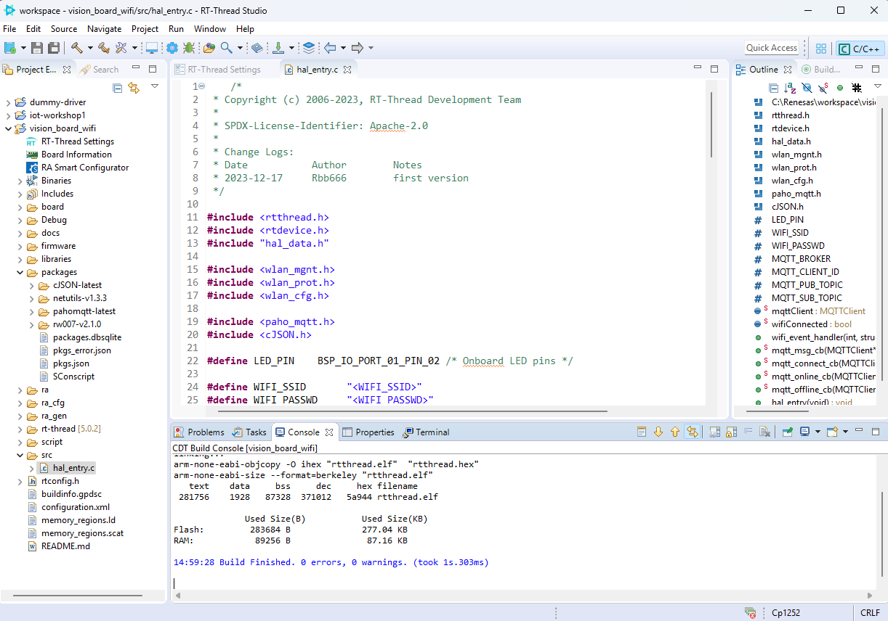{ width="500" }

### ขั้นตอนที่ 5: ตั้งค่า Config

!!! info "ยังไม่มี EMQX Account?"
    [ไปตั้งค่าที่นี่ → EMQX Setup Guide](./mqwx.md)

แก้ไขค่าใน Code:

```c
#define WIFI_SSID       "<WIFI_SSID>"
#define WIFI_PASSWD     "<WIFI_PASSWD>"
#define MQTT_BROKER     "tcp://broker.emqx.io:1883"
#define MQTT_CLIENT_ID  "<CLIENT_ID>"
#define MQTT_PUB_TOPIC  "<PUB_TOPIC>"
#define MQTT_SUB_TOPIC  "<SUB_TOPIC>"
```

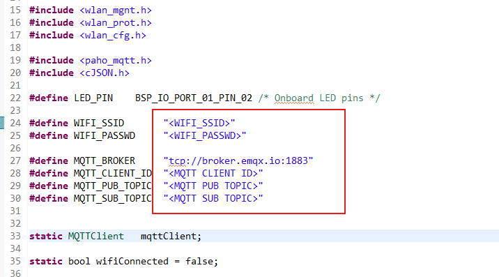{ width="500" }

!!! warning "ระวัง"
    WiFi ต้องเป็น **2.4 GHz** ไม่ใช่ 5 GHz

### ขั้นตอนที่ 6: Build และทดสอบ

1. **Build All** และ **Flash Download**

   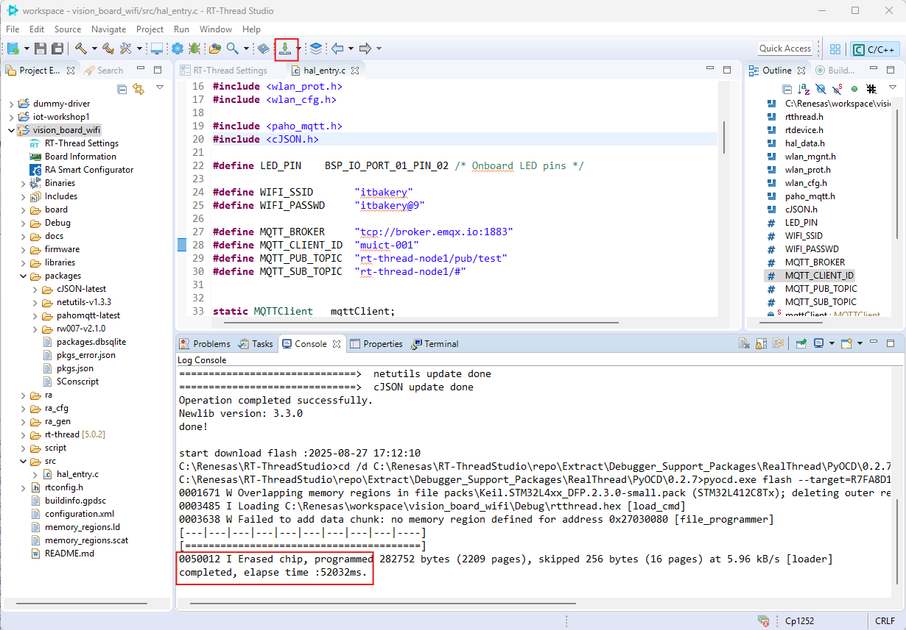{ width="500" }

2. เปิด **Terminal** ดูผลลัพธ์

   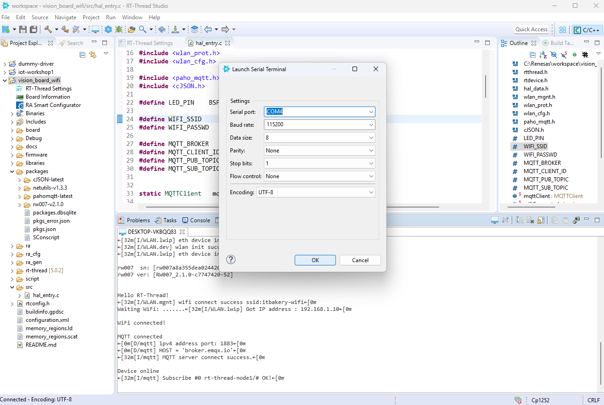{ width="500" }

Diagram การสื่อสาร:

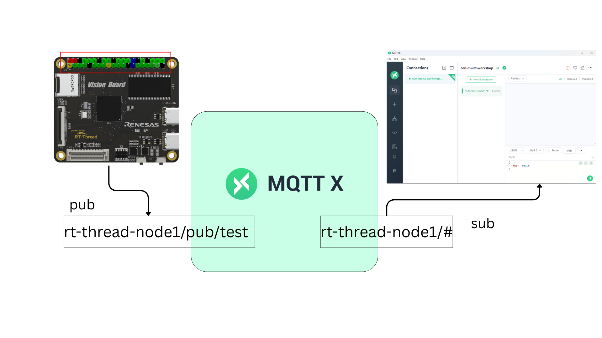{ width="600" }

**Screen ผลลัพธ์:**

---

## สรุปผลลัพธ์

- [x] ติดตั้ง Package MQTT และ JSON
- [x] เชื่อมต่อ WiFi STA สำเร็จ
- [x] Publish/Subscribe ผ่าน EMQX Broker
- [x] เห็นข้อมูลแบบ Real-time ใน Terminal

---

??? failure "พบปัญหา? (Troubleshooting)"
    **Error: MQTT connection failed**
    - ตรวจสอบ WiFi ว่าเป็น 2.4 GHz
    - ตรวจสอบ SSID/Password ว่าถูกต้อง
    - ตรวจสอบ Broker URL `tcp://broker.emqx.io:1883`

    **Error: Package not found**
    - เปิด RT-Thread Settings → กด Refresh Package Index

    **Fix MQTT Connect จากรุ่นก่อน:**
    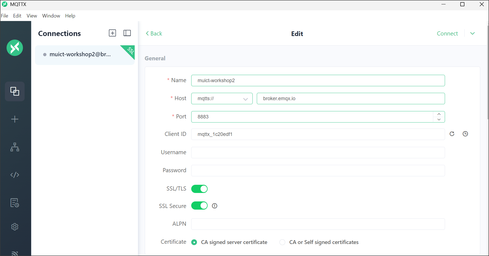{ width="400" }
    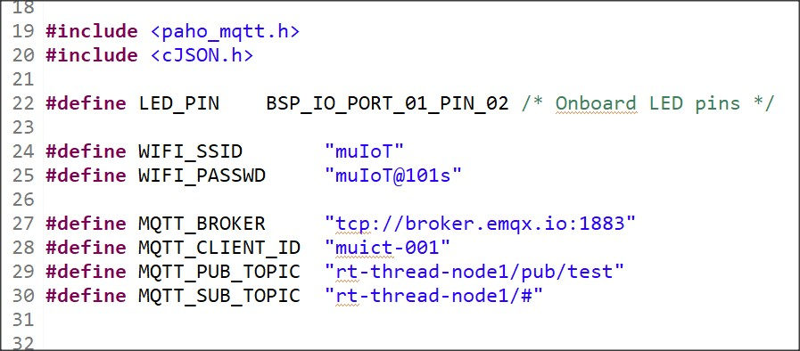{ width="400" }
