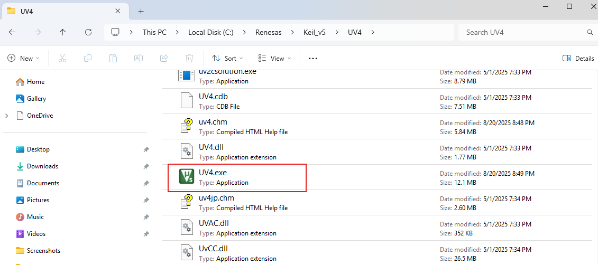
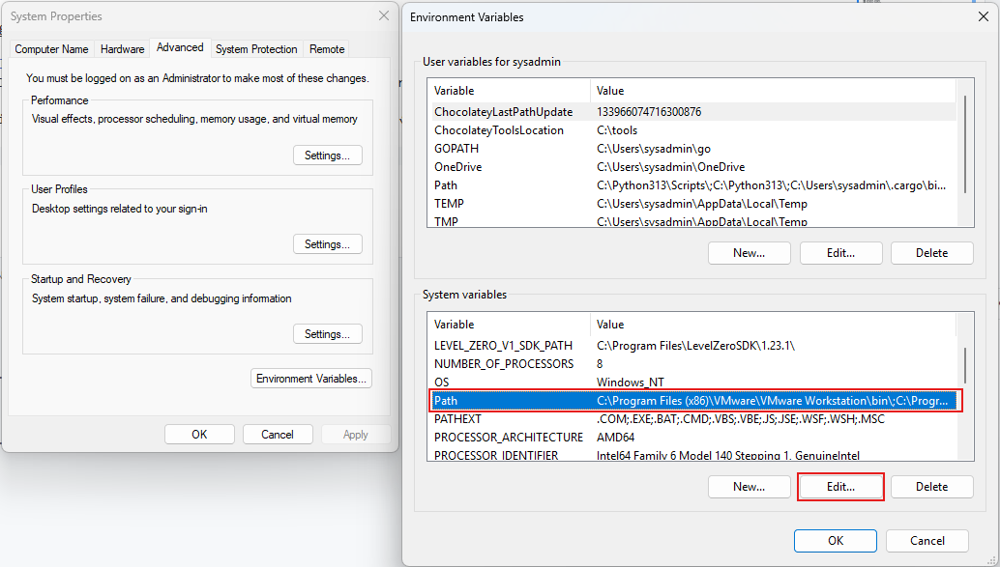
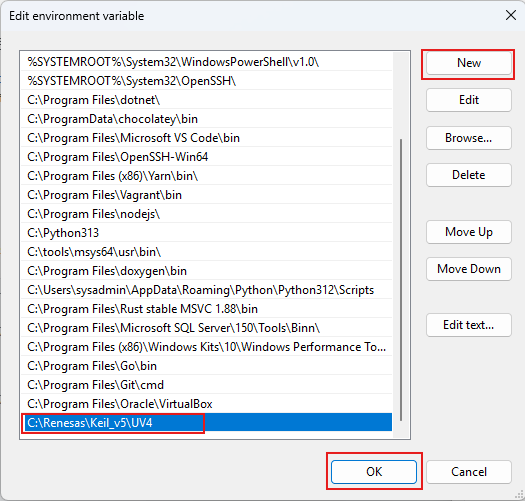
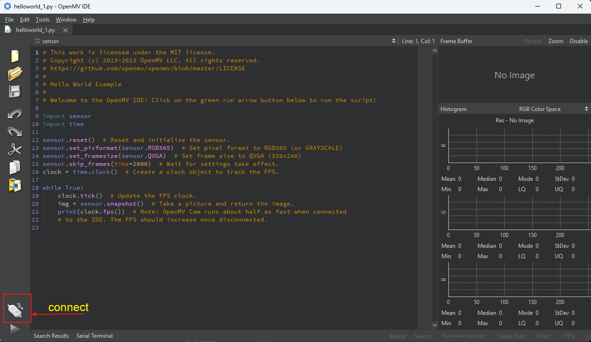

# Workshop 6: OpenMV

<span class="md-tag">Advanced</span> <span class="md-tag">60 นาที</span>

## ก่อนเริ่ม Lab

- [ ] ติดตั้ง [Keil MDK](../02_Preparation/02.4_install_OpenMV.md) เรียบร้อย
- [ ] ติดตั้ง [Git](../02_Preparation/02.3_install_env_tool.md) เรียบร้อย
- [ ] มีบอร์ด Vision พร้อมสาย USB-DBG และ USB-OTG

## เมื่อทำเสร็จ คุณจะได้

- [ ] Build OpenMV Firmware ลงบอร์ด RA8D1 ได้
- [ ] ใช้ OpenMV IDE เชื่อมต่อกล้องได้
- [ ] รัน Python Script ให้กล้องตรวจจับวัตถุได้

---

## OpenMV คืออะไร

**OpenMV** = แพลตฟอร์ม Computer Vision สำหรับ Microcontroller

- เขียนโค้ดด้วย **MicroPython**
- ใช้กล้องบนบอร์ด Vision-Board (หรือต่อกล้องภายนอก)
- รองรับ: ตรวจจับใบหน้า, สี, QR Code, อ่านตัวเลข, Machine Learning

```text
┌─────────────────────────┐
│    OpenMV IDE (PC)      │
│  - เขียน Python Script   │
│  - ดูภาพ Real-time        │
└───────────┬─────────────┘
            │ USB
┌───────────▼─────────────┐
│   Vision-Board (RA8D1)  │
│  - OpenMV Firmware        │
│  - Camera Module          │
│  - Python Runtime         │
└─────────────────────────┘
```

---

## Lab 6.1: Clone OpenMV Project

### ขั้นตอน

1. เปิด **Git Bash** หรือ **CMD**

2. Clone project ไปที่ `C:\Renesas`:

   ```bash
   cd C:\Renesas
   git clone https://github.com/RT-Thread-Studio/sdk-bsp-ra8d1-vision-board.git
   ```

   !!! success "Checkpoint 6.1"
       ✅ มีโฟลเดอร์ `C:\Renesas\sdk-bsp-ra8d1-vision-board\projects\vision_board_openmv`

---

## Lab 6.2: ตรวจสอบ Environment

### ขั้นตอน

1. ตรวจสอบว่า **Keil MDK** ติดตั้งที่ `C:\Renesas\Keil_v5\UV4\UV4.exe`

   { width="500" }

2. เพิ่ม UV4 ไปยัง **Windows Environment Path**:

   - ค้นหา "env" ใน Windows Search
   - เลือก **Environment Variables**
   - เพิ่ม `C:\Renesas\Keil_v5\UV4` ใน PATH

   { width="500" }
   { width="500 "}

   !!! success "Checkpoint 6.2"
       ✅ พิมพ์ `uv4` ใน Command Prompt แล้วเปิด Keil ได้

---

## Lab 6.3: Build OpenMV Firmware

### ขั้นตอน

1. เปิด Project ใน RT-Thread Studio:

   ```
   File → Import → Existing Projects into Workspace
   เลือก: C:\Renesas\sdk-bsp-ra8d1-vision-board\projects\vision_board_openmv
   ```

2. Build Project กด 🔨

   !!! success "Checkpoint 6.3"
       ✅ Build Success (อาจใช้เวลา 2-5 นาที)

---

## Lab 6.4: Flash Firmware และเชื่อมต่อ OpenMV IDE

### ขั้นตอน

1. **Flash** firmware ลงบอร์ด (ใช้ USB-DBG)

2. **เสียบสาย USB-OTG** เข้ากับคอมพิวเตอร์

   !!! warning "สำคัญ"
       USB-OTG ใช้สำหรับ OpenMV IDE (ส่งภาพ)
       USB-DBG ใช้สำหรับดีบักและ Flash

3. เปิด **OpenMV IDE**

4. กดปุ่ม **Connect** (มุมซ้ายล่าง)

   { width="500" }

   !!! success "Checkpoint 6.4"
       ✅ OpenMV IDE เชื่อมต่อกับกล้องได้
       ✅ เห็นภาพ Real-time ในหน้าต่าง IDE

---

## Lab 6.5: รัน Script ตัวอย่าง

### ขั้นตอน

1. สร้างไฟล์ใหม่ใน OpenMV IDE: `main.py`

2. เขียนโค้ดตัวอย่าง (Blink LED):

   ```python title="main.py" linenums="1"
   import time
   from pyb import LED
   
   red = LED(1)
   green = LED(2)
   blue = LED(3)
   
   while True:
       for led in [red, green, blue]:
           led.on()
           time.sleep_ms(500)
           led.off()
   ```

3. กด **Run Script** (ปุ่ม Play)

   !!! success "Checkpoint 6.5"
       ✅ LED กระพริบสลับสีแดง → เขียว → น้ำเงิน
       ✅ ภาพจากกล้องแสดงใน IDE

---

## Lab 6.6: ตรวจจับวัตถุพื้นฐาน

### ขั้นตอน

ลองเปลี่ยน script เป็นการตรวจจับสี/รูปร่าง:

```python title="detect_color.py" linenums="1"
import sensor
import image
import time

sensor.reset()
sensor.set_pixformat(sensor.RGB565)
sensor.set_framesize(sensor.QVGA)
sensor.skip_frames(time=2000)

while True:
    img = sensor.snapshot()
    # ตรวจจับสีแดง
    for blob in img.find_blobs([(30, 100, 15, 127, 15, 127)]):
        img.draw_rectangle(blob.rect())
        img.draw_cross(blob.cx(), blob.cy())
```

!!! tip "ทดลองด้วยตัวเอง"
    เปลี่ยนค่าสีใน `find_blobs` แล้ววัตถุอื่น ๆ ที่มีในห้อง

---

## สรุป: คุณทำอะไรสำเร็จแล้ว

- [x] Build OpenMV Firmware สำหรับ RA8D1
- [x] Flash และเชื่อมต่อกับ OpenMV IDE
- [x] รัน Python Script ให้กล้องทำงานได้
- [x] ตรวจจับวัตถุพื้นฐานด้วย Computer Vision

---

## เตรียมไป Workshop 8

Workshop 8 จะใช้ **TensorFlow Lite** บน OpenMV เพื่อ **ตรวจจับใบหน้า** (Face Detection)

---

??? failure "แก้ปัญหาเบื้องต้น"
    **"OpenMV IDE หา Camera ไม่เจอ"**
    - ตรวจสอบว่าเสียบสาย **USB-OTG** (ไม่ใช่ USB-DBG)
    - ลองกด Reset บนบอร์ดแล้ว Connect ใหม่

    **"Build Error: หา Keil ไม่เจอ"**
    - ตรวจสอบว่าเพิ่ม `C:\Renesas\Keil_v5\UV4` ใน Environment PATH
    - รีสตาร์ท RT-Thread Studio

    **"ภาพใน IDE เป็นสีดำ"**
    - ตรวจสอบว่า Camera Module เสียบแน่น
    - ลองเปลี่ยนสาย USB-OTG
