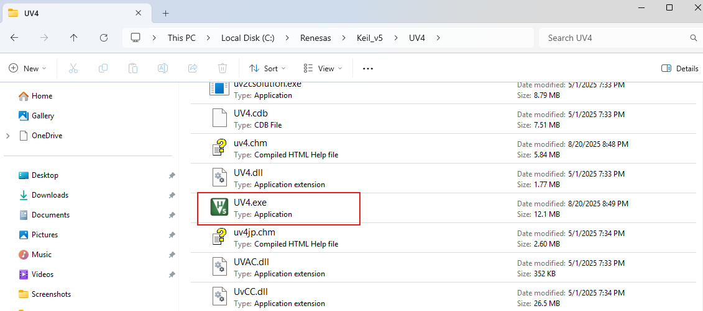
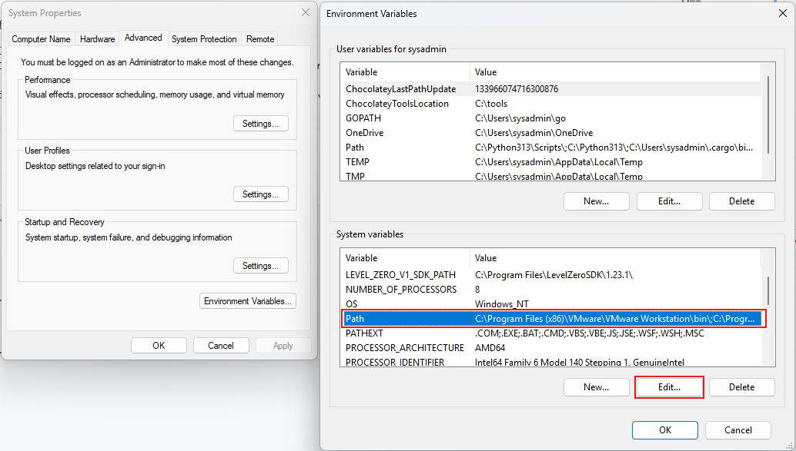
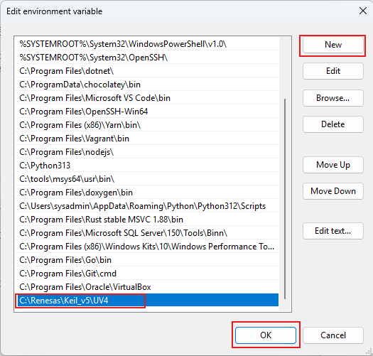
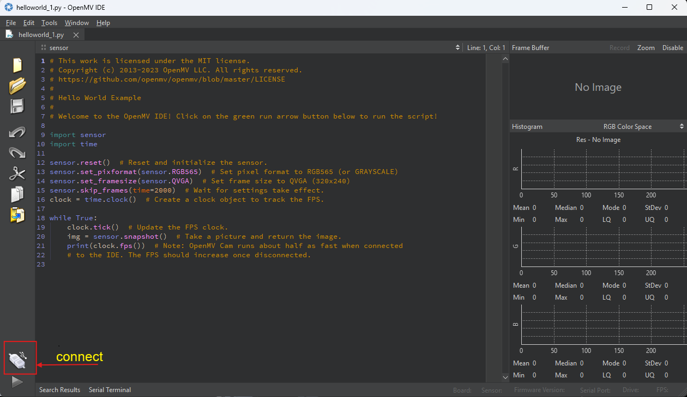

# Workshop 6: OpenMV & Computer Vision

<span class="md-tag">Advanced</span> <span class="md-tag">60 นาที</span> <span class="md-tag">OpenMV</span> <span class="md-tag">MicroPython</span>

> 👁️ **ปลุกพลังการมองเห็นให้ไมโครคอนโทรลเลอร์:**
> บอร์ด **RA8D1 Vision Board** มาพร้อมกล้องความละเอียดสูง (OV5640) และชิป **ARM Cortex-M85 (480 MHz)** ที่มีชุดคำสั่งเร่งความเร็วการประมวลผลภาพ ใน Workshop นี้ คุณจะได้เปลี่ยนบอร์ดให้กลายเป็นกล้องอัจฉริยะ **OpenMV** ที่เขียนโค้ดควบคุมด้วย **MicroPython** เพื่อตรวจจับสีและวัตถุแบบ Real-time!

## ก่อนเริ่ม Lab

- [ ] ติดตั้ง [Keil MDK (MDK-ARM)](../02_Preparation/02.4_install_OpenMV.md) เรียบร้อย
- [ ] ติดตั้ง [Git](../02_Preparation/02.3_install_env_tool.md) และโปรแกรม **OpenMV IDE** เรียบร้อย
- [ ] มีบอร์ด RA8D1 Vision Board พร้อมโมดูลกล้อง และสาย USB Type-C **จำนวน 2 เส้น** (สำหรับช่อง `USB-DBG` และ `USB-OTG`)

## เมื่อทำเสร็จ คุณจะได้

- [ ] เตรียมสภาพแวดล้อมและ Build เฟิร์มแวร์ **OpenMV** ลงบอร์ด RA8D1 ได้สำเร็จ
- [ ] เชื่อมต่อบอร์ดเข้ากับ **OpenMV IDE** ผ่านพอร์ต **USB-OTG** และดูภาพสด (Frame Buffer) ได้
- [ ] เขียนสคริปต์ **MicroPython** ควบคุมฮาร์ดแวร์บนบอร์ด (LED) และตรวจจับวัตถุตามสี (Color Blob Detection) ได้

---

## OpenMV คืออะไร และทำงานร่วมกับ RA8D1 อย่างไร?

**OpenMV** คือแพลตฟอร์ม **Machine Vision** สำหรับไมโครคอนโทรลเลอร์ ที่รัน **MicroPython Runtime** อยู่บนระบบปฏิบัติการ **RT-Thread** ทำให้คุณเขียนโค้ดภาษา Python สั้นๆ เพื่อสั่งงานอัลกอริทึมประมวลผลภาพที่เขียนด้วยภาษา C ความเร็วสูงเบื้องหลังได้ทันที

- รองรับการตรวจจับสี (Color Tracking), ตรวจจับใบหน้า (Face Detection), อ่าน QR Code / Barcode, และรันโมเดล **TensorFlow Lite (Edge AI)**

```mermaid
flowchart TD
    subgraph PC ["OpenMV IDE (บนคอมพิวเตอร์)"]
        P["<div align='left'>• เขียนและส่งโค้ด MicroPython<br>• แสดงภาพสด (Frame Buffer) & Histogram<br>• เครื่องมือหาค่าสี Threshold Editor</div>"]
    end

    P <-->|สาย USB-OTG (High-Speed Data)| B

    subgraph BOARD ["Vision Board (Renesas RA8D1 @ 480 MHz)"]
        B["<div align='left'>• RT-Thread OS + OpenMV Firmware<br>• กล้อง OV5640 (รับภาพเข้า SDRAM)<br>• MicroPython Interpreter</div>"]
    end

    style PC fill:#e1f5fe,stroke:#01579b,stroke-width:2px,color:#000
    style BOARD fill:#e8f5e9,stroke:#2e7d32,stroke-width:2px,color:#000
```

---

## Lab 6.1: Clone โปรเจกต์ OpenMV จาก GitHub

### ขั้นตอน

1. เปิด **Git Bash** หรือ **Command Prompt (CMD)**

2. สร้าง/เข้าไปที่โฟลเดอร์ `C:\Renesas` แล้ว Clone Repository ของ Vision Board:

   ```bash
   cd C:\Renesas
   git clone https://github.com/RT-Thread-Studio/sdk-bsp-ra8d1-vision-board.git
   ```

3. *(สำคัญ)* เข้าไปในโฟลเดอร์โปรเจกต์ `projects\vision_board_openmv` แล้วรันไฟล์ **`mklinks.bat`** (ดับเบิลคลิก) เพื่อสร้างทางลัดเชื่อมไปยังโฟลเดอร์ `rt-thread` และ `libraries`

   !!! success "Checkpoint 6.1"
       ✅ มีโฟลเดอร์ `C:\Renesas\sdk-bsp-ra8d1-vision-board\projects\vision_board_openmv`
       ✅ ภายในโฟลเดอร์มี `rt-thread` และ `libraries` ปรากฏขึ้นหลังรัน `mklinks.bat`

---

## Lab 6.2: ตรวจสอบ Environment (Keil MDK PATH)

!!! info "ทำไมโปรเจกต์ OpenMV ถึงต้องใช้ Keil MDK (`UV4`)?"
    เนื่องจากเฟิร์มแวร์ OpenMV มีขนาดใหญ่และมีการเรียกใช้ไลบรารีประมวลผลภาพ/DSP เฉพาะทางของ ARM และ Renesas ตัวสคริปต์ Build ของโปรเจกต์นี้จึงถูกตั้งค่าให้เรียกใช้คอมไพเลอร์ **ARM Compiler ของ Keil MDK** ทำงานอยู่เบื้องหลัง RT-Thread Studio

### ขั้นตอน

1. ตรวจสอบตำแหน่งที่ติดตั้ง **Keil MDK** ว่ามีไฟล์ `UV4.exe` อยู่จริง (ปกติอยู่ที่ `C:\Renesas\Keil_v5\UV4\UV4.exe` หรือ `C:\Keil_v5\UV4\UV4.exe`)

   { width="500" }

2. เพิ่มโฟลเดอร์ `UV4` เข้าไปใน **Windows Environment Variables (PATH)**:
   - พิมพ์ค้นหา `"env"` ในช่อง Windows Search → เลือก **Edit the system environment variables**
   - กดปุ่ม **Environment Variables...** → เลือกตัวแปร **Path** → กด **Edit** → **New**
   - เพิ่มเส้นทาง `C:\Renesas\Keil_v5\UV4` (ให้ตรงกับเครื่องของคุณ) แล้วกด OK ทั้งหมด

   { width="500" }
   { width="500" }

   !!! success "Checkpoint 6.2"
       ✅ เปิดหน้าต่าง **Command Prompt (CMD)** ขึ้นมาใหม่ แล้วพิมพ์คำสั่ง `uv4` โปรแกรม Keil µVision ต้องเปิดขึ้นมาได้ทันที

---

## Lab 6.3: Import และ Build OpenMV Firmware

### ขั้นตอน

1. เปิด **RT-Thread Studio** → ไปที่เมนู:

   ```text
   File → Import → Existing Projects into Workspace
   เลือก Root directory: C:\Renesas\sdk-bsp-ra8d1-vision-board\projects\vision_board_openmv
   ```
   *(หมายเหตุ: หรืออีกวิธีหนึ่ง สามารถดับเบิลคลิกเปิดไฟล์ `project.uvprojx` ใน Keil MDK แล้วกด Build โดยตรงได้เช่นกัน)*

2. คลิกขวาที่ชื่อโปรเจกต์ → กด **Build Project** (ไอคอนรูปค้อน 🔨)

   !!! success "Checkpoint 6.3"
       ✅ Build สำเร็จ (`0 errors` — เนื่องจากไฟล์ซอร์สโค้ด OpenMV มีจำนวนมาก อาจใช้เวลาคอมไพล์ประมาณ 2–5 นาที)

---

## Lab 6.4: Flash Firmware และเชื่อมต่อ OpenMV IDE

### ขั้นตอน

1. **Flash เฟิร์มแวร์ลงบอร์ด:** เสียบสาย USB เข้าช่อง **USB-DBG (DAP)** แล้วกดปุ่ม **Flash Download** (⬇️) ใน RT-Thread Studio (หรือ Keil) จนเสร็จสิ้น

2. **เชื่อมต่อสาย USB-OTG:** เสียบสาย USB อีกเส้นเข้าที่พอร์ต **USB-OTG** บนบอร์ด Vision Board เพื่อเชื่อมต่อกับคอมพิวเตอร์

   !!! warning "แยกหน้าที่ของพอร์ต USB 2 ช่องให้ชัดเจน!"
       - **USB-DBG (DAP):** ใช้สำหรับ **Flash เฟิร์มแวร์** และดู Log ผ่าน Serial Terminal
       - **USB-OTG:** ใช้สำหรับ **เชื่อมต่อกับ OpenMV IDE** เพื่อส่งสคริปต์ Python และสตรีมภาพวิดีโอความเร็วสูง

3. เปิดโปรแกรม **OpenMV IDE** บนคอมพิวเตอร์

4. กดปุ่ม **Connect** (ไอคอนรูปปลั๊กสีเขียวที่มุมซ้ายล่างของ OpenMV IDE)

   { width="500" }

   !!! success "Checkpoint 6.4"
       ✅ ปุ่ม Connect เปลี่ยนเป็นสีแดง (สถานะเชื่อมต่อแล้ว) และแสดงรุ่นบอร์ดด้านล่างขวา
       ✅ มองเห็นภาพวิดีโอ Real-time จากกล้องปรากฏขึ้นในหน้าต่าง Frame Buffer ด้านขวาบน

---

## Lab 6.5: รัน Script ตัวอย่างควบคุมฮาร์ดแวร์ (Blink LED)

### ขั้นตอน

1. ใน **OpenMV IDE** สร้างไฟล์ใหม่ (`File → New File`) หรือแก้ไขโค้ดในหน้าต่าง Editor

2. เขียนโค้ด MicroPython ควบคุมไฟ RGB LED บนบอร์ด:

   ```python title="main.py — ทดสอบควบคุม LED ด้วย MicroPython" linenums="1"
   import time
   from pyb import LED

   red = LED(1)
   green = LED(2)
   blue = LED(3)

   while True:
       for led in [red, green, blue]:
           led.on()
           time.sleep_ms(500)
           led.off()
   ```

3. กดปุ่ม **Start (Play สีเขียว)** ที่มุมซ้ายล่างเพื่อส่งสคริปต์ไปรันบนบอร์ดทันที

   !!! success "Checkpoint 6.5"
       ✅ ไฟ LED บนบอร์ดกะพริบสลับสี แดง → เขียว → น้ำเงิน อย่างต่อเนื่อง
       ✅ สามารถกดปุ่ม Stop (สีแดง) เพื่อหยุดสคริปต์และแก้ไขโค้ดใหม่ได้ทันทีโดยไม่ต้อง Build C ใหม่!

---

## Lab 6.6: ตรวจจับวัตถุตามสี (Color Blob Detection)

### ขั้นตอน

ลองเปลี่ยนโค้ดใน OpenMV IDE เป็นสคริปต์ตรวจจับวัตถุสีแดง (`find_blobs`) และวาดกรอบสี่เหลี่ยมล้อมรอบวัตถุ:

```python title="detect_color.py — ตรวจจับวัตถุสีแดงแบบ Real-time" linenums="1"
import sensor
import image
import time

sensor.reset()                         # รีเซ็ตและเริ่มต้นการทำงานของเซ็นเซอร์กล้อง
sensor.set_pixformat(sensor.RGB565)    # ตั้งค่ารูปแบบสีเป็น RGB565 (16-bit)
sensor.set_framesize(sensor.QVGA)      # ตั้งค่าความละเอียด 320x240 พิกเซล
sensor.skip_frames(time=2000)          # รอให้กล้องปรับแสง White Balance / Gain อัตโนมัติ 2 วินาที

# ช่วงค่าสีแดงในระบบ LAB Color Space: (L_min, L_max, A_min, A_max, B_min, B_max)
red_threshold = (30, 100, 15, 127, 15, 127)

while True:
    img = sensor.snapshot()            # ถ่ายภาพ 1 เฟรมเข้าหน่วยความจำ

    # ค้นหากลุ่มก้อนสี (Blobs) ที่ตรงกับเงื่อนไขสีแดง
    for blob in img.find_blobs([red_threshold], pixels_threshold=100, area_threshold=100):
        img.draw_rectangle(blob.rect(), color=(0, 255, 0), thickness=2) # วาดกรอบสีเขียวรอบวัตถุ
        img.draw_cross(blob.cx(), blob.cy(), color=(0, 255, 0))         # วาดกากบาทตรงจุดกึ่งกลาง
        print("Found Object at X:", blob.cx(), "Y:", blob.cy())
```

!!! tip "ทดลองด้วยตัวเอง: วิธีหาค่าสีของวัตถุอื่นๆ ในห้อง"
    ค่าสีใน `find_blobs` ใช้ระบบสี **LAB** (ไม่ใช่ RGB) คุณสามารถหาค่าสีของวัตถุสีเขียว น้ำเงิน หรือสีเหลืองได้ง่ายๆ โดยไม่ต้องเดาตัวเลข:
    1. นำวัตถุมาวางหน้ากล้องใน OpenMV IDE
    2. ไปที่เมนูด้านบน: **Tools → Machine Vision → Threshold Editor → Frame Buffer**
    3. เลื่อนแถบสไลเดอร์จนตัววัตถุกลายเป็นสีขาวล้วนและพื้นหลังเป็นสีดำ แล้วก๊อปปี้ค่า **LAB Threshold** ด้านล่างมาวางแทนที่ `red_threshold` ในโค้ดได้เลย!

---

## สรุป: ทักษะที่คุณทำสำเร็จใน Workshop 6

- [x] เตรียม Environment และ Build เฟิร์มแวร์ **OpenMV** สำหรับชิป RA8D1 สำเร็จ
- [x] Flash เฟิร์มแวร์และเชื่อมต่อกล้องเข้ากับ **OpenMV IDE** ผ่านพอร์ต **USB-OTG**
- [x] เขียนและรันสคริปต์ **MicroPython** สั่งงานฮาร์ดแวร์บนบอร์ดได้โดยไม่ต้องคอมไพล์ C ใหม่
- [x] ประยุกต์ใช้ฟังก์ชัน `find_blobs()` ตรวจจับตำแหน่งวัตถุตามสีแบบ Real-time

---

## เตรียมตัวสู่ Workshop ถัดไป: Edge AI & Face Detection

หลังจากกล้องทำงานร่วมกับ OpenMV ได้สมบูรณ์แล้ว ใน Workshop ถัดไปเราจะนำโมเดล **TensorFlow Lite (Edge AI)** มาโหลดรันบนชิป **Cortex-M85** ของ Vision Board เพื่อทำระบบ **ตรวจจับใบหน้า (Face Detection)** และจำแนกภาพอัจฉริยะ!

---

??? failure "แก้ปัญหาเบื้องต้น (Troubleshooting)"
    **"OpenMV IDE แจ้งว่า No OpenMV Cams found (หากล้องไม่เจอ)"**
    - **เช็กสาย USB:** ตรวจสอบว่าเสียบสายเข้าที่ช่อง **USB-OTG** (ไม่ใช่ช่อง USB-DBG) และสาย USB รองรับการส่งข้อมูล (ไม่ใช่สายชาร์จอย่างเดียว)
    - **รีเซ็ตบอร์ด:** ลองกดปุ่ม **Reset** บนบอร์ด Vision Board 1 ครั้ง แล้วรอประมาณ 3 วินาทีก่อนกดปุ่ม Connect ใน OpenMV IDE

    **"Build Error: หา Keil (`UV4`) ไม่เจอ"**
    - ตรวจสอบว่าเพิ่มโฟลเดอร์ `UV4` (เช่น `C:\Renesas\Keil_v5\UV4`) ลงใน **Windows Environment PATH** เรียบร้อยแล้ว
    - ปิดแล้วเปิดโปรแกรม RT-Thread Studio ใหม่ เพื่อให้โปรแกรมโหลดค่า PATH ล่าสุดที่เพิ่งตั้งค่า
    - "เชื่อมต่อ OpenMV IDE ได้แล้ว แต่ภาพในหน้าต่างเป็นสีดำหรือขึ้น Error กล้อง"
    - ถอดสายไฟออกจากบอร์ด แล้วตรวจสอบว่า สายแพรของโมดูลกล้อง (OV5640) เสียบเข้ากับซ็อกเก็ตบนบอร์ดแน่นสนิทและตรงล็อก
    - ลองเปลี่ยนช่องเสียบ USB บนคอมพิวเตอร์ (แนะนำให้เสียบตรงเข้าพอร์ตของเมนบอร์ด แทนการเสียบผ่าน USB Hub)