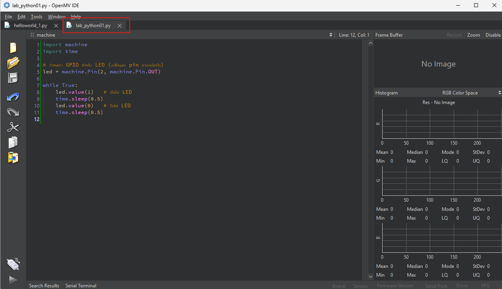

# Workshop 7: MicroPython บน OpenMV

<span class="md-tag">Intermediate</span> <span class="md-tag">30 นาที</span> <span class="md-tag">MicroPython</span> <span class="md-tag">GPIO & ADC</span>

> 🐍 **เขียนโค้ดควบคุมฮาร์ดแวร์โดยไม่ต้องรอคอมไพล์:**
> ใน Workshop 6 คุณได้ใช้ OpenMV จัดการกล้องไปแล้ว ใน Workshop นี้ คุณจะได้เรียนรู้วิธีใช้ **MicroPython** บนบอร์ด **RA8D1 Vision Board** เพื่อสั่งงานขา **GPIO (ไฟ LED, ปุ่มกด)** และอ่านค่าเซ็นเซอร์ **Analog (ADC)** ด้วยภาษา Python เพียงไม่กี่บรรทัด!

## ก่อนเริ่ม Lab

- [ ] ทำ [Workshop 6](../08_workshop6/08.1_workshop6.md) เสร็จแล้ว (Flash เฟิร์มแวร์ OpenMV และติดตั้ง OpenMV IDE เรียบร้อย)
- [ ] เสียบสาย **USB-OTG** และเชื่อมต่อ **OpenMV IDE** กับบอร์ดได้

## เมื่อทำเสร็จ คุณจะได้

- [ ] เข้าใจความแตกต่างระหว่าง Python บนคอมพิวเตอร์ กับ **MicroPython** บนไมโครคอนโทรลเลอร์
- [ ] ควบคุม **LED** และอ่านค่าสถานะ **ปุ่มกด (Digital Input)** ด้วยโมดูล `pyb` และ `machine.Pin`
- [ ] อ่านค่าแรงดันไฟฟ้าจากเซ็นเซอร์ **Analog (ADC)** และแปลงเป็นค่าโวลต์ (`0–3.3V`) ได้

---

## MicroPython คืออะไร?

**MicroPython** คือภาษา **Python 3** ที่ถูกย่อขนาดและปรับแต่งให้ทำงานบนไมโครคอนโทรลเลอร์ (MCU) โดยตรง โดยในเฟิร์มแวร์ OpenMV ของบอร์ด Vision Board ตัว MicroPython จะรันเป็น Thread หนึ่งอยู่บนระบบปฏิบัติการ **RT-Thread**

| Python บน PC | MicroPython บน OpenMV (RA8D1) |
| :--- | :--- |
| รันบนระบบปฏิบัติการขนาดใหญ่ (Windows / Linux / macOS) | รันอยู่บนเฟิร์มแวร์ของไมโครคอนโทรลเลอร์โดยตรง |
| ติดตั้ง Library เสริมได้ไม่จำกัด (`pip install`) | มีโมดูลเฉพาะทางสำหรับฮาร์ดแวร์ฝังมาให้พร้อม (`machine`, `pyb`, `sensor`, `image`) |
| หน่วยความจำ RAM ระดับ Gigabyte | บริหารจัดการ RAM อย่างประหยัดในระดับ Megabyte |

!!! info "กลไกการทำงานระหว่าง OpenMV IDE กับบอร์ด"
    เมื่อคุณกดปุ่ม **Start (Play)** ใน OpenMV IDE ตัวโปรแกรมบนคอมพิวเตอร์จะส่งสคริปต์ Python ผ่านสาย **USB-OTG** ไปให้ **MicroPython Interpreter** บนชิป RA8D1 ประมวลผลแบบ Real-time แล้วส่งข้อความ `print()` และภาพวิดีโอกลับมาแสดงที่หน้าจอคอมพิวเตอร์ทันที

---

## Lab 7.1: ควบคุมไฟ RGB LED ด้วยโมดูล `pyb`

### ขั้นตอน

1. เปิดโปรแกรม **OpenMV IDE** และกด **Connect** (มุมซ้ายล่าง)

2. สร้างไฟล์ใหม่ชื่อ `lab_python01.py` (`File → New File`)

   { width="500" }

3. พิมพ์โค้ดควบคุมไฟ RGB LED บนบอร์ด:

   ```python title="lab_python01.py" linenums="1"
   import time
   from pyb import LED

   # กำหนดอ็อบเจกต์ LED ทั้ง 3 สีบนบอร์ด Vision Board
   red   = LED(1)
   green = LED(2)
   blue  = LED(3)

   print("Start RGB LED Blinking...")

   while True:
       for led in [red, green, blue]:
           led.on()
           time.sleep_ms(500)
           led.off()
       time.sleep_ms(500)
   ```

4. กดปุ่ม **Start (ปุ่ม Play สีเขียว)** ด้านล่างซ้าย

   !!! success "Checkpoint 7.1"
       ✅ ไฟ LED บนบอร์ดกะพริบสลับสี แดง → เขียว → น้ำเงิน อย่างต่อเนื่อง
       ✅ หน้าต่าง **Serial Terminal** ด้านล่างของ OpenMV IDE แสดงข้อความ `"Start RGB LED Blinking..."`

---

## Lab 7.2: อ่านค่าปุ่มกด K1 (Digital Input) ด้วย `machine.Pin`

### ขั้นตอน

1. สร้างไฟล์ใหม่ `lab_python02.py` แล้วพิมพ์โค้ดอ่านค่าปุ่มกด **K1 (`P907`)** เพื่อควบคุม **User LED (`P102`)**:

   ```python title="lab_python02.py" linenums="1"
   from machine import Pin
   import time

   # ขา P907 = ปุ่มกด K1 บนบอร์ด (วงจร Active-Low เปิด Pull-up ภายใน)
   button = Pin("P907", Pin.IN, Pin.PULL_UP)

   # ขา P102 = User LED บนบอร์ด Vision Board
   led = Pin("P102", Pin.OUT)

   print("Press Button K1 to turn on LED...")

   while True:
       if button.value() == 0:   # กดปุ่ม = 0 (LOW)
           led.on()
           print("Button K1 pressed!")
       else:                     # ปล่อยปุ่ม = 1 (HIGH)
           led.off()
       time.sleep_ms(100)        # หน่วงเวลา 100ms ลดการอ่านซ้ำ (Debounce อย่างง่าย)
   ```

2. กดปุ่ม **Start (Play)**

3. ลองกดปุ่ม **K1** บนบอร์ด Vision Board ค้างไว้แล้วปล่อย

   !!! success "Checkpoint 7.2"
       ✅ กดปุ่ม K1 → ไฟ LED ติดสว่าง และ Terminal แสดงข้อความ `"Button K1 pressed!"`
       ✅ ปล่อยปุ่ม K1 → ไฟ LED ดับลง

---

## Lab 7.3: อ่านค่าเซ็นเซอร์ Analog (ADC)

### ขั้นตอน

1. *(ถ้ามีอุปกรณ์เสริม)* ต่อตัวต้านทานปรับค่าได้ (Potentiometer) หรือเซ็นเซอร์ Analog เข้าที่ขา **`P014`** (Pin 3 บน 40-Pin Header J4) โดยใช้ไฟเลี้ยง **3.3V** และ **GND**

2. สร้างไฟล์ใหม่ `sensor_adc.py` แล้วเขียนโค้ดอ่านค่า ADC แบบ 16-bit (`0 – 65535`):

   ```python title="sensor_adc.py" linenums="1"
   from machine import ADC, Pin
   import time

   # กำหนดขา P014 (AN007) เป็นช่องรับสัญญาณ Analog
   adc = ADC(Pin("P014"))

   while True:
       raw_val = adc.read_u16()                    # อ่านค่าดิบ 16-bit (0 - 65535)
       voltage = (raw_val / 65535.0) * 3.3         # แปลงเป็นแรงดันไฟฟ้า (0.00 - 3.30 V)
       print("ADC Raw: {:5d} | Voltage: {:.2f} V".format(raw_val, voltage))
       time.sleep_ms(500)
   ```

   !!! warning "ระวังแรงดันไฟเข้าขา Analog!"
       ขา ADC ของชิป RA8D1 รองรับแรงดันสูงสุด **3.3V** เท่านั้น ห้ามป้อนสัญญาณ 5V เข้าขา `P014` เด็ดขาด เพราะจะทำให้วงจร Analog ภายในชิปเสียหายถาวร

3. กดปุ่ม **Start (Play)** แล้วสังเกตค่าใน Terminal

   !!! success "Checkpoint 7.3"
       ✅ หน้าต่าง Terminal แสดงค่า `ADC Raw` และค่าแรงดัน `Voltage` อัปเดตทุกๆ 0.5 วินาที
       ✅ หากหมุนปรับค่า Potentiometer ค่าแรงดันจะเปลี่ยนตามระหว่าง `0.00 V` ถึง `3.30 V`

---

## สรุป: เทียบคำสั่ง Arduino (ESP32) vs MicroPython (OpenMV)

| การทำงาน | Arduino (C++) | MicroPython (OpenMV) |
| :--- | :--- | :--- |
| **ภาษาที่ใช้เขียน** | C / C++ | Python 3 |
| **การเพิ่ม Library** | ดาวน์โหลดผ่าน Library Manager | ฝังมาพร้อมใน OpenMV Firmware (`pyb`, `machine`, `sensor`) |
| **การอัปโหลดโค้ด** | ต้องกด Compile ใหม่ทุกครั้งที่แก้โค้ด | กด **Play** แล้วรัน Script ได้ทันทีในเสี้ยววินาที |
| **ตั้งค่าขา Output / Input** | `pinMode(pin, OUTPUT)` | `led = Pin("P102", Pin.OUT)` |
| **สั่งเปิด / ปิดขา Digital** | `digitalWrite(pin, HIGH)` | `led.on()` หรือ `led.value(1)` |
| **อ่านค่า Digital** | `digitalRead(pin)` | `button.value()` |
| **อ่านค่า Analog (ADC)** | `analogRead(pin)` | `adc.read_u16()` (ค่า `0–65535`) |
| **หน่วงเวลา** | `delay(1000)` | `time.sleep_ms(1000)` |

---

## สรุป: ทักษะที่คุณทำสำเร็จใน Workshop 7

- [x] เขียนและรันสคริปต์ **MicroPython** บนบอร์ด RA8D1 ผ่าน OpenMV IDE ได้อย่างคล่องแคล่ว
- [x] ควบคุม RGB LED บนบอร์ดด้วย `pyb.LED` และ `machine.Pin`
- [x] อ่านค่าปุ่มกด (Digital Input) พร้อมเปิดใช้งานตัวต้านทาน `Pin.PULL_UP` ภายในชิป
- [x] อ่านค่าแรงดันไฟฟ้าจากช่อง Analog ด้วย `machine.ADC` และแปลงหน่วยเป็นโวลต์ได้

---

## เตรียมตัวสู่ Workshop 8: Edge AI & Face Detection

ใน **Workshop 8** คุณจะได้นำพื้นฐาน Python และกล้อง OpenMV จากบทนี้ มาผสานเข้ากับโมเดล **TensorFlow Lite (Edge AI)** เพื่อสั่งให้บอร์ด Vision Board **ตรวจจับใบหน้า (Face Detection)** และจำแนกวัตถุอัจฉริยะบนตัวชิปได้โดยไม่ต้องพึ่งอินเทอร์เน็ต!

---

??? failure "แก้ปัญหาเบื้องต้น (Troubleshooting)"
    **"Script รันแล้ว Error: `ValueError: Pin(...) doesn't exist` (หาชื่อ Pin ไม่เจอ)"**
    - ตรวจสอบการสะกดชื่อ Pin ให้ตรงกับฟอร์แมตของเฟิร์มแวร์ (ลองสลับตัวพิมพ์ใหญ่-เล็ก เช่น `"P907"` หรือ `"p907"`, `"P102"` หรือ `"p102"`)
    - ตรวจสอบจากแผนผัง 40-Pin Header (J4) ของบอร์ด Vision Board ว่าขาที่เลือกเป็นขา GPIO/ADC ที่เปิดใช้งานไว้ในเฟิร์มแวร์ OpenMV

    **"Error: `'ADC' object has no attribute 'read'`"**
    - ใน MicroPython รุ่นใหม่ (รวมถึง OpenMV บน RA8D1) ให้ใช้คำสั่ง **`adc.read_u16()`** แทน `adc.read()`

    **"กดปุ่ม K1 แล้ว LED ไม่ติด"**
    - ตรวจสอบว่าตั้งค่าขา LED เป็น **`Pin("P102", Pin.OUT)`** (ไม่ใช่ `P101` หรือ `Pin.IN`)
    - ตรวจสอบว่าตั้งค่าปุ่มกดเป็น **`Pin("P907", Pin.IN, Pin.PULL_UP)`** เพราะปุ่ม K1 ต้องการตัวต้านทาน Pull-up เพื่อให้สถานะปกติเป็น `1` (HIGH)
