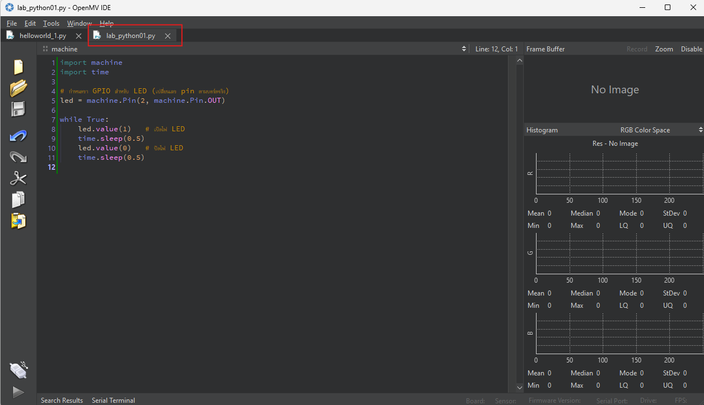

# Workshop 7: MicroPython บน OpenMV

<span class="md-tag">Intermediate</span> <span class="md-tag">30 นาที</span>

## ก่อนเริ่ม Lab

- [ ] ทำ [Workshop 6](../08_workshop6/workshop6.md) เสร็จแล้ว (OpenMV IDE พร้อมใช้)
- [ ] OpenMV IDE เชื่อมต่อกับบอร์ดได้

## เมื่อทำเสร็จ คุณจะได้

- [ ] เข้าใจ MicroPython บน OpenMV
- [ ] ควบคุม GPIO, LED, Button ด้วย Python
- [ ] อ่านค่าเซ็นเซอร์แบบง่าย ๆ

---

## MicroPython คืออะไร

**MicroPython** = Python 3 สำหรับ Microcontroller

| Python บน PC | MicroPython บน OpenMV |
|-------------|---------------------|
| รันบน OS | รันบน Firmware โดยตรง |
| มี Library ครบ | มีเฉพาะที่จำเป็น |
| จอง RAM ไม่จำกัด | จอง RAM จำกัด |

!!! info "OpenMV vs MicroPython"
    OpenMV IDE รัน **MicroPython Script** บน Vision-Board
    สคริปต์ถูกส่งจาก PC → รันบนบอร์ด → ส่งภาพกลับมา PC

---

## Lab 7.1: Blink LED ด้วย Python

### ขั้นตอน

1. เปิด **OpenMV IDE**

2. สร้างไฟล์ใหม่ชื่อ `lab_python01.py`

   { width="500" }

3. เขียนโค้ด:

   ```python title="lab_python01.py" linenums="1"
   import time
   from pyb import LED
   
   red = LED(1)
   green = LED(2)
   blue = LED(3)
   
   while True:
       for led in [red, green, blue]:
           led.on()
           time.sleep_ms(1000)
           led.off()
       time.sleep_ms(1000)
   ```

4. กด **Connect** → กด **Run**

   !!! success "Checkpoint 7.1"
       ✅ LED กระพริบสีแดง → เขียว → น้ำเงิน
       ✅ Terminal ใน IDE แสดงข้อความ Debug (ถ้ามี `print`)

---

## Lab 7.2: อ่านค่าปุ่มกด (Button Input)

### ขั้นตอน

1. เขียนโค้ดใหม่ `lab_python02.py`:

   ```python title="lab_python02.py" linenums="1"
   from machine import Pin
   import time
   
   # ขา P907 = ปุ่ม K1
   button = Pin("P907", Pin.IN, Pin.PULL_UP)
   led = Pin("P101", Pin.OUT)
   
   while True:
       if button.value() == 0:  # กดปุ่ม = LOW (Pull-up)
           led.on()
           print("Button pressed!")
       else:
           led.off()
       time.sleep_ms(100)
   ```

2. กด **Run**

3. กดปุ่ม **K1** บนบอร์ด

   !!! success "Checkpoint 7.2"
       ✅ กด K1 → LED ติด
       ✅ ปล่อย K1 → LED ดับ
       ✅ Terminal แสดง "Button pressed!"

---

## Lab 7.3: อ่านค่า Sensor (Analog)

### ขั้นตอน

1. เขียนโค้ดอ่านค่าแรงดันไฟฟ้า:

   ```python title="sensor_adc.py" linenums="1"
   from machine import ADC, Pin
   import time
   
   adc = ADC(Pin("P014"))  # ขา ADC ตัวอย่าง
   
   while True:
       val = adc.read()
       print("ADC Value:", val)
       time.sleep_ms(500)
   ```

2. กด **Run**

   !!! success "Checkpoint 7.3"
       ✅ Terminal แสดงค่า ADC เปลี่ยนไปเรื่อย ๆ
       ✅ ลองหมุน Potentiometer (ถ้ามี) → ค่าเปลี่ยน

---

## สรุป: MicroPython vs Arduino-style

| คุณสมบัติ | Arduino (ESP32) | MicroPython (OpenMV) |
|----------|----------------|---------------------|
| ภาษา | C++ | Python |
| ติดตั้ง Library | ลงผ่าน Arduino IDE | มีมาให้ใน Firmware |
| แก้ไขโค้ด | คอมไพล์ใหม่ทุกครั้ง | รัน Script ทันที |
| Debug | Serial Monitor | Terminal ใน IDE |

!!! tip "สำหรับคนมีพื้นฐาน ESP32"
    ถ้าคุณเคยใช้ `digitalWrite()`, `analogRead()` บน Arduino:
    - `digitalWrite(pin, HIGH)` → `pin.on()` หรือ `pin.value(1)`
    - `analogRead(pin)` → `adc.read()`
    - `delay(1000)` → `time.sleep_ms(1000)`

---

## สรุป: คุณทำอะไรสำเร็จแล้ว

- [x] รัน MicroPython Script บน OpenMV
- [x] ควบคุม LED ด้วย Python
- [x] อ่านค่าปุ่มกด (Digital Input)
- [x] อ่านค่า Sensor (Analog Input)

---

## เตรียมไป Workshop 8

Workshop 8 จะใช้ **TensorFlow Lite** บน OpenMV เพื่อ **ตรวจจับใบหน้าอัตโนมัติ**

---

??? failure "แก้ปัญหาเบื้องต้น"
    **"Script รันแล้ว Error: Pin not found"**
    - ตรวจสอบชื่อ Pin ว่าตรงกับบอร์ด Vision-Board (เช่น `"P907"`, `"P101"`)
    - ดู Pin Map ในบอร์ด Vision-Board

    **"LED ไม่ติด"**
    - ตรวจสอบว่าใช้ `Pin.OUT` (Output) ไม่ใช่ `Pin.IN`
