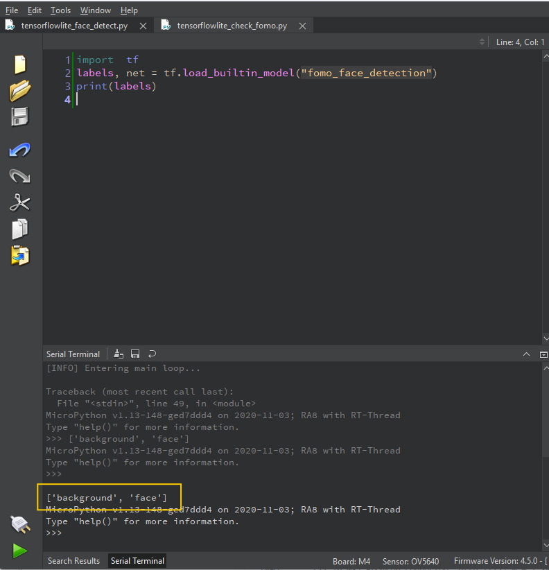
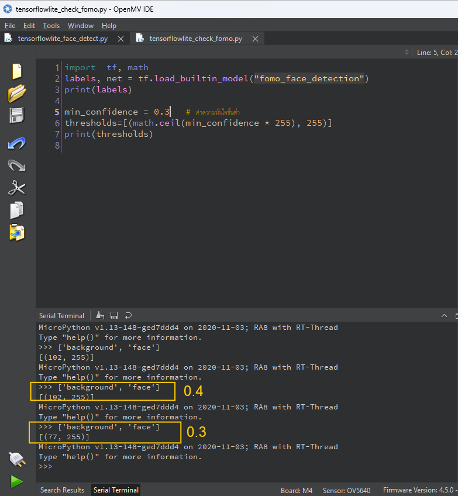

# Workshop 8: Edge AI — Face Detection

<span class="md-tag">Advanced</span> <span class="md-tag">Edge AI</span> <span class="md-tag">TensorFlow Lite</span> <span class="md-tag">60 นาที</span>

> 🤖 **ก้าวสู่โลก Edge AI (Artificial Intelligence on Microcontroller):**
> ใน Workshop นี้ คุณจะได้ปลุกพลังการประมวลผล AI ของชิป **Renesas RA8D1 (ARM Cortex-M85 ความเร็ว 480 MHz)** โดยรันโมเดล **TensorFlow Lite** เพื่อ **ตรวจจับใบหน้า (Face Detection)** แบบ Real-time บนตัวบอร์ดโดยตรง **ไม่ต้องใช้อินเทอร์เน็ต ไม่ต้องพึ่ง Cloud** และทำงานเสร็จในระดับเสี้ยววินาที!

## ก่อนเริ่ม Lab

- [ ] ทำ [Workshop 7](../09_workshop7/09.1_workshop7.md) เสร็จแล้ว (เข้าใจพื้นฐาน MicroPython บน OpenMV)
- [ ] โปรแกรม **OpenMV IDE** เชื่อมต่อกับบอร์ดผ่านสาย **USB-OTG** ได้เรียบร้อย
- [ ] บอร์ด Vision Board พร้อมโมดูลกล้อง OV5640

## เมื่อทำเสร็จ คุณจะได้

- [ ] เข้าใจหลักการทำงานของ **TensorFlow Lite for Microcontrollers** และสถาปัตยกรรม **FOMO**
- [ ] โหลดโมเดล `fomo_face_detection` ที่ฝังอยู่ในเฟิร์มแวร์ OpenMV มาใช้งานได้
- [ ] เข้าใจและปรับจูนค่า **Confidence Threshold** (สเกล `0–255`) เพื่อลดความผิดพลาดในการตรวจจับ
- [ ] สร้างระบบตรวจจับใบหน้าแบบ Real-time พร้อมวาดกรอบ แสดงค่าความมั่นใจ และสั่งไฟ LED ตอบสนองเมื่อเจอใบหน้า

---

## TensorFlow Lite บน Microcontroller ทำงานอย่างไร?

**TensorFlow Lite for Microcontrollers (TFLM)** คือเฟรมเวิร์ก AI ขนาดจิ๋วที่ออกแบบมาให้รันโมเดล Deep Learning บนชิปที่มี RAM จำกัด

- โมเดลจะผ่านกระบวนการ **Quantization (INT8)** เพื่อลดขนาดตัวเลขจากทศนิยม 32-bit ให้เหลือจำนวนเต็ม 8-bit ทำให้ขนาดไฟล์เล็กลง 4 เท่าและประมวลผลเร็วขึ้นมากบนชุดคำสั่ง **Arm Helium (MVE)** ของชิป RA8D1
- ในเฟิร์มแวร์ OpenMV ของบอร์ด Vision Board ได้ฝังโมเดลสำเร็จรูปชื่อ **`fomo_face_detection`** มาให้พร้อมใช้งานทันที

!!! info "FOMO คืออะไร?"
    **FOMO (Faster Objects, More Objects)** เป็นสถาปัตยกรรม Object Detection ที่คิดค้นโดยทีม Edge Impulse เพื่อทำงานบนไมโครคอนโทรลเลอร์โดยเฉพาะ (เร็วกว่า MobileNet-SSD แบบเดิมถึง 30 เท่า!)
    - **หลักการทำงาน:** แบ่งภาพออกเป็นตาราง (Grid) และค้นหา **จุดศูนย์กลาง (Centroid)** ของวัตถุแต่ละชิ้น
    - **Input:** ภาพสี RGB ขนาด `240×240` พิกเซล (หรือ `96×96` / `160×160`)
    - **Output:** ตำแหน่งพื้นที่ใบหน้า (`d.rect()`) พร้อมค่าความมั่นใจ (`d.output()`)

---

## Lab 8.1: โหลดโมเดล FOMO และตรวจสอบ Class Labels

### ขั้นตอน

1. เปิด **OpenMV IDE** → กด **Connect** (มุมซ้ายล่าง)

2. สร้างไฟล์ใหม่: `test_fomo.py` (`File → New File`)

3. เขียนโค้ดโหลดโมเดลจากหน่วยความจำ Flash ของเฟิร์มแวร์:

   ```python title="test_fomo.py" linenums="1"
   import tf

   # โหลดโมเดลตรวจจับใบหน้าที่ฝังมากับเฟิร์มแวร์ OpenMV
   labels, net = tf.load_builtin_model("fomo_face_detection")
   print("Model Labels:", labels)
   ```

4. กดปุ่ม **Start (Play)**

   !!! success "Checkpoint 8.1"
       ✅ Terminal แสดง: `Model Labels: ['background', 'face']`
       ✅ โมเดลรู้จัก 2 คลาส: Index `0` คือ `background` (พื้นหลัง) และ Index `1` คือ `face` (ใบหน้า)

   { width="500" }

---

## Lab 8.2: ทำความเข้าใจและทดสอบค่า Confidence Threshold

### ทำอะไร
โมเดลจะส่งค่าความมั่นใจออกมาเป็นตัวเลขในช่วง `0.0 – 1.0` แต่ฟังก์ชัน `net.detect()` ของ OpenMV รับค่าเป็นตัวเลข 8-bit (`0 – 255`) เราจึงต้องแปลงค่าเปอร์เซ็นต์ความมั่นใจขั้นต่ำ (เช่น `0.4` หรือ 40%) ให้เป็นช่วง `(min, 255)` เพื่อกรองสิ่งที่ไม่ใช่ใบหน้า (**False Positive**) ออกไป

### ขั้นตอน

1. สร้างไฟล์ `threshold_test.py` แล้วพิมพ์โค้ด:

   ```python title="threshold_test.py" linenums="1"
   import tf, math

   labels, net = tf.load_builtin_model("fomo_face_detection")
   print("Labels:", labels)

   min_confidence = 0.4  # กำหนดความมั่นใจขั้นต่ำ 40%
   thresholds = [(math.ceil(min_confidence * 255), 255)]
   print("FOMO Threshold (0-255):", thresholds)
   ```

2. กดปุ่ม **Start (Play)**

   !!! success "Checkpoint 8.2"
       ✅ เข้าใจว่า FOMO ใช้สเกล `0–255` (ไม่ใช่ `0.0–1.0`)
       ✅ คำนวณ `0.4 × 255 = 102` → ได้ค่า Threshold เป็น `[(102, 255)]`

   !!! tip "เทคนิคการปรับจูนค่า `min_confidence`"
       - **ตั้งสูงเกินไป (เช่น `0.7 – 0.8`):** ระบบจะเข้มงวดมาก อาจตรวจจับใบหน้าไม่ติดหากแสงน้อยหรือเอียงหน้าเล็กน้อย
       - **ตั้งต่ำเกินไป (เช่น `0.1 – 0.2`):** ระบบจะไวเกินไป อาจมองเห็นสิ่งของหรือเงาเป็นใบหน้า (**False Positive** เยอะ)
       - **ค่าแนะนำเริ่มต้น:** เริ่มทดสอบที่ **`0.3` (≈ 77)** หรือ **`0.4` (≈ 102)** แล้วค่อยปรับตามสภาพแสงจริง

   { width="500" }

---

## Lab 8.3: ตรวจจับใบหน้าแบบ Real-time พร้อมควบคุมฮาร์ดแวร์

### ขั้นตอน

1. สร้างไฟล์ใหม่ชื่อ `face_detect.py`

2. เขียนโค้ดถ่ายภาพ ตัดขอบภาพเป็นสี่เหลี่ยมจัตุรัส `240×240` พิกเซล รันโมเดล FOMO วาดกรอบล้อมใบหน้า และสั่งไฟ LED สีเขียวติดเมื่อพบใบหน้า:

   ```python title="face_detect.py" linenums="1"
   import sensor, time, math, tf, image
   from pyb import LED

   # 1. ตั้งค่ากล้องให้เหมาะกับโมเดล FOMO (240x240 RGB565)
   sensor.reset()
   sensor.set_vflip(True)                  # กลับภาพแนวตั้ง (ปรับ True/False ตามการวางกล้องจริง)
   sensor.set_pixformat(sensor.RGB565)     # ภาพสี 16-bit
   sensor.set_framesize(sensor.QVGA)       # ความละเอียด 320x240
   sensor.set_windowing((240, 240))        # ครอปภาพตรงกลางให้เป็นจัตุรัส 240x240
   sensor.skip_frames(time=2000)           # รอ 2 วินาทีให้กล้องปรับแสงอัตโนมัติ

   # 2. โหลดโมเดล FOMO Face Detection และตั้งค่า Threshold
   labels, net = tf.load_builtin_model("fomo_face_detection")
   min_confidence = 0.35
   thresholds = [(math.ceil(min_confidence * 255), 255)]

   # สีสำหรับวาดกรอบ (Index 0 = แดง, Index 1 = เขียว)
   colors = [(255, 0, 0), (0, 255, 0)]
   green_led = LED(2)

   clock = time.clock()
   while True:
       clock.tick()
       img = sensor.snapshot()             # ถ่ายภาพ 1 เฟรม
       face_found = False

       # 3. รันการตรวจจับวัตถุด้วยโมเดล FOMO
       for i, detection_list in enumerate(net.detect(img, thresholds=thresholds)):
           if i == 0:                      # ข้ามคลาส 0 (background)
               continue
           if len(detection_list) == 0:    # หากไม่พบใบหน้าในเฟรมนี้
               continue

           face_found = True
           for d in detection_list:
               # วาดกรอบสี่เหลี่ยมล้อมรอบใบหน้า
               img.draw_rectangle(d.rect(), color=colors[i % len(colors)], thickness=2)
               # แสดงชื่อคลาสพร้อมเปอร์เซ็นต์ความมั่นใจเหนือกรอบ
               conf_pct = int(d.output() * 100)
               text = "%s %d%%" % (labels[i], conf_pct)
               img.draw_string(d.x(), d.y() - 12, text, color=colors[i % len(colors)], scale=1)

       # 4. ควบคุมฮาร์ดแวร์: เปิดไฟ LED สีเขียวเมื่อพบใบหน้า
       if face_found:
           green_led.on()
       else:
           green_led.off()

       print("FPS: %.1f" % clock.fps())
   ```

3. กดปุ่ม **Start (Play)**

4. หันกล้องเข้าหาใบหน้าของคุณ (ระยะห่างประมาณ 30–80 เซนติเมตร)

   !!! success "Checkpoint 8.3"
       ✅ เห็นกรอบสี่เหลี่ยมสีเขียวพร้อมข้อความ `face XX%` ล้อมรอบใบหน้าในหน้าต่าง Frame Buffer
       ✅ ไฟ LED สีเขียวบนบอร์ดติดสว่างทันทีเมื่อกล้องมองเห็นใบหน้า และดับลงเมื่อหันกล้องออก
       ✅ Terminal แสดงค่าความเร็ว **FPS (Frames Per Second)** สูงกว่า 10–20 FPS บนชิป RA8D1

   { width="500" }

---

## สรุป: ทักษะที่คุณทำสำเร็จใน Workshop 8

- [x] เข้าใจหลักการ **Quantized TensorFlow Lite** และสถาปัตยกรรม **FOMO** บนไมโครคอนโทรลเลอร์
- [x] โหลดและรันโมเดล `fomo_face_detection` บนชิป **RA8D1 Cortex-M85** ได้สำเร็จ
- [x] แปลงและปรับจูนค่า **Confidence Threshold** (สเกล `0–255`) ได้อย่างเหมาะสม
- [x] สร้างระบบ **Edge AI** ที่ตรวจจับใบหน้าพร้อมสั่งงานฮาร์ดแวร์ (LED) ตอบสนองแบบ Real-time

---

## เตรียมตัวสู่ Workshop 9: Custom AI Model ด้วย Edge Impulse

โมเดล `fomo_face_detection` ที่ใช้ในบทนี้เป็นโมเดลสำเร็จรูปที่ตรวจจับได้เฉพาะใบหน้า ใน **Workshop 9** คุณจะได้ใช้แพลตฟอร์ม **Edge Impulse** เพื่อ **เก็บภาพถ่ายจริงจากกล้อง Vision Board และ Train โมเดล AI ของคุณเอง** (เช่น ตรวจจับอุปกรณ์, สัญลักษณ์มือ หรือคัดแยกสินค้า) แล้วนำมาอัปโหลดรันบนบอร์ด!

---

??? failure "แก้ปัญหาเบื้องต้น (Troubleshooting)"
    **"Error: `OSError: Builtin model not found` (โหลดโมเดลไม่ได้)"**
    - ตรวจสอบว่าได้ Flash เฟิร์มแวร์ OpenMV เวอร์ชันของ **RA8D1 Vision Board** (ซึ่งคอมไพล์รวมโมเดล `fomo_face_detection` ไว้ใน Flash แล้ว)
    - อัปเดตโปรแกรม **OpenMV IDE** บนคอมพิวเตอร์ให้เป็นเวอร์ชันล่าสุด

    **"ไม่ตรวจจับใบหน้าเลย (ไม่มีกรอบขึ้น)"**
    - **เช็กทิศทางภาพ:** หากภาพในหน้าต่าง IDE กลับหัว ให้เปลี่ยน `sensor.set_vflip(True)` เป็น `False` (หรือเพิ่ม `sensor.set_hmirror(True)`)
    - **ลดค่า Threshold:** ลองปรับ `min_confidence` จาก `0.35` ลงมาที่ `0.20`
    - **เช็กแสงสว่างและระยะห่าง:** ให้ใบหน้าอยู่ในกรอบ `240×240` ตรงกลางภาพ มีแสงสว่างเพียงพอ และไม่เอียงหน้ามากเกินไป

    **"ตรวจจับผิดพลาดเยอะ (False Positive — จับสิ่งของเป็นใบหน้า)"**
    - เพิ่มค่า `min_confidence` ขึ้นเป็น `0.50` หรือ `0.60`
    - ลองปิดการปรับแสงอัตโนมัติหลังจากกล้องปรับแสงเริ่มต้นเสร็จแล้วด้วยการเพิ่ม `sensor.set_auto_gain(False)` และ `sensor.set_auto_whitebal(False)` หลังบรรทัด `sensor.skip_frames()`
