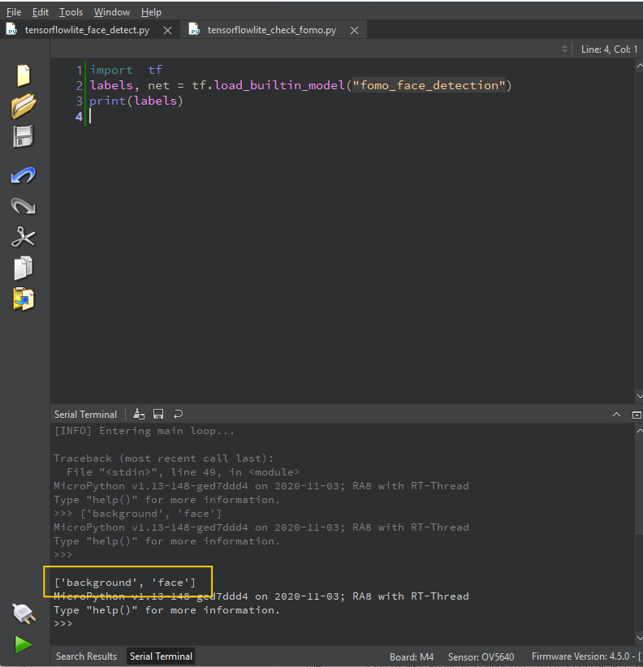
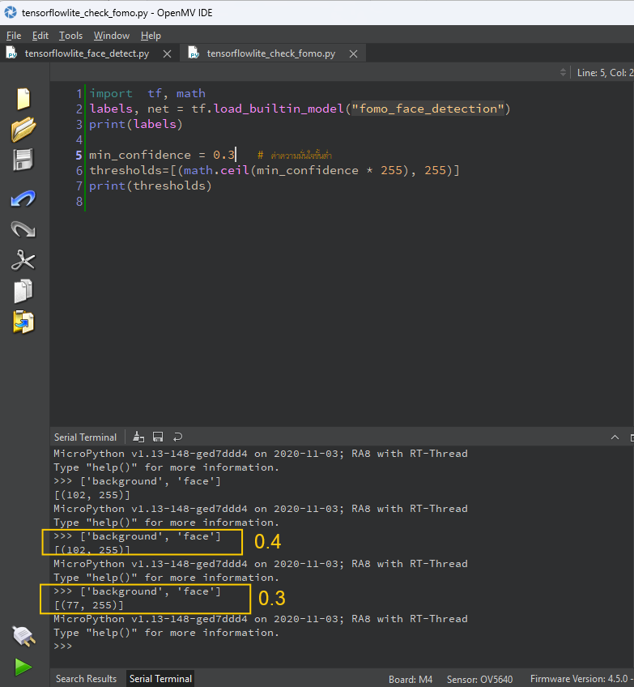

# Workshop 8: Face Detection

<span class="md-tag">Advanced</span> <span class="md-tag">AI</span> <span class="md-tag">60 นาที</span>

## ก่อนเริ่ม Lab

- [ ] ทำ [Workshop 7](../09_workshop7/workshop7.md) เสร็จแล้ว (MicroPython พื้นฐาน)
- [ ] OpenMV IDE พร้อมใช้งาน
- [ ] บอร์ด Vision Board พร้อมกล้อง

## เมื่อทำเสร็จ คุณจะได้

- [ ] โหลดโมเดล FOMO Face Detection บน OpenMV
- [ ] ตรวจจับใบหน้าแบบ Real-time
- [ ] ปรับค่า Confidence Threshold

---

## TensorFlow Lite บน Microcontroller?

**TensorFlow Lite** = เวอร์ชันเล็กของ TensorFlow สำหรับอุปกรณ์ที่มีทรัพยากรจำกัด

- โมเดลถูก **Quantize** (ลดความละเอียดตัวเลข) เพื่อให้รันบน MCU ได้
- OpenMV มีโมเดล **FOMO Face Detection** ติดมาให้แล้ว

!!! info "FOMO คืออะไร?"
    **FOMO** = Faster Objects, More Objects
    - โมเดลตรวจจับวัตถุขนาดเล็ก รันเร็วบน MCU
    - Input: 240×240 RGB
    - Output: Bounding boxes ที่ล้อมหน้า + ค่าความมั่นใจ

---

## Lab 8.1: โหลดโมเดลและตรวจสอบ

### ขั้นตอน

1. เปิด **OpenMV IDE** → เชื่อมต่อกล้อง

2. สร้างไฟล์ใหม่: `test_fomo.py`

3. เขียนโค้ดโหลดโมเดล:

   ```python title="test_fomo.py" linenums="1"
   import tf
   
   labels, net = tf.load_builtin_model("fomo_face_detection")
   print(labels)
   ```

4. กด **Run**

   !!! success "Checkpoint 8.1"
       ✅ Terminal แสดง: `['background', 'face']`
       ✅ มี 2 class: `background` และ `face`

   { width="500" }

---

## Lab 8.2: ตรวจสอบค่า Threshold

### ทำอะไร
ปรับค่าความมั่นใจขั้นต่ำ เพื่อกรอง false positive

### ขั้นตอน

1. เขียนโค้ด:

   ```python title="threshold_test.py" linenums="1"
   import tf, math
   
   labels, net = tf.load_builtin_model("fomo_face_detection")
   print(labels)
   
   min_confidence = 0.4  # ค่าขั้นต่ำ 40%
   thresholds = [(math.ceil(min_confidence * 255), 255)]
   print("Threshold:", thresholds)
   ```

2. กด **Run**

   !!! success "Checkpoint 8.2"
       ✅ รู้ว่า FOMO ใช้ scale 0-255 (ไม่ใช่ 0.0-1.0)
       ✅ `0.4 × 255 = 102` → threshold เป็น `(102, 255)`

   !!! tip "ปรับค่า"
       - Threshold สูงเกินไป → ไม่ detect หน้า (กลัว false positive)
       - Threshold ต่ำเกินไป → จับทุกอย่างเป็นหน้า (false positive เยอะ)
       - ลองเริ่มที่ `0.3` (≈77) แล้วค่อยปรับ

   { width="500 "}

---

## Lab 8.3: รันตรวจจับใบหน้าแบบ Real-time

### ขั้นตอน

1. สร้างไฟล์: `face_detect.py`

2. เขียนโค้ด:

   ```python title="face_detect.py" linenums="1"
   import sensor, time, math, tf, image
   
   # ตั้งค่ากล้อง
   sensor.reset()
   sensor.set_vflip(True)
   sensor.set_pixformat(sensor.RGB565)
   sensor.set_framesize(sensor.QVGA)
   sensor.set_windowing((240, 240))
   sensor.skip_frames(time=2000)
   
   # โหลดโมเดล
   labels, net = tf.load_builtin_model("fomo_face_detection")
   
   min_confidence = 0.3
   thresholds = [(math.ceil(min_confidence * 255), 255)]
   
   # สีวาดกรอบ
   colors = [(255, 0, 0), (0, 255, 0)]
   
   clock = time.clock()
   while True:
       clock.tick()
       img = sensor.snapshot()
       
       for i, detection_list in enumerate(net.detect(img, thresholds=thresholds)):
           if i == 0:  # background → ข้าม
               continue
           
           if len(detection_list) == 0:
               continue
           
           for d in detection_list:
               # วาดกรอบสี่เหลี่ยมรอบใบหน้า
               img.draw_rectangle(d.rect(), color=colors[i % len(colors)])
               img.draw_string(d.x(), d.y(), labels[i], color=colors[i % len(colors)])
       
       print("FPS:", clock.fps())
   ```

3. กด **Run**

4. เอาหน้าเข้าใกล้กล้อง

   !!! success "Checkpoint 8.3"
       ✅ เห็นกรอบสี่เหลี่ยมวาดรอบใบหน้า
       ✅ Terminal แสดง FPS (Frames Per Second)
       ✅ FPS > 5 = ใช้งานได้

   { width="500" }

---

## สรุป: คุณทำอะไรสำเร็จแล้ว

- [x] โหลดโมเดล FOMO Face Detection จาก OpenMV
- [x] เข้าใจค่า Confidence Threshold
- [x] ตรวจจับใบหน้าแบบ Real-time บนบอร์ด RA8D1
- [x] วาด Bounding Box รอบใบหน้า

---

## เตรียมไป Workshop 9

Workshop 9 จะใช้ **Edge Impulse** เพื่อ **Train โมเดลเอง** ด้วยข้อมูลที่เราถ่ายเอง

---

??? failure "แก้ปัญหาเบื้องต้น"
    **"โมเดลหาไม่เจอ / load ไม่ได้"**
    - ตรวจสอบ Vision-Board Firmware เป็นเวอร์ชันล่าสุด
    - ตรวจสอบ OpenMV IDE เป็นเวอร์ชันล่าสุด

    **"ไม่ detect หน้าเลย"**
    - ลด threshold จาก `0.4` เป็น `0.2`
    - ตรวจสอบว่าแสงสว่างพอ
    - หันหน้าตรงกล้อง (ไม่เอียงมาก)

    **"FPS ต่ำมาก"**
    - ลด `framesize` เล็กลง (เช่น `QQVGA`)
    - ใช้ Window ที่เล็กกว่า (เช่น `(120, 120)`)

    **"False Positive เยอะ"**
    - เพิ่ม threshold เป็น `0.5` หรือ `0.6`
    - ลองเพิ่มการตั้งค่า `sensor.set_auto_gain(False)`
