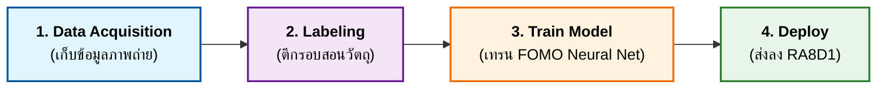
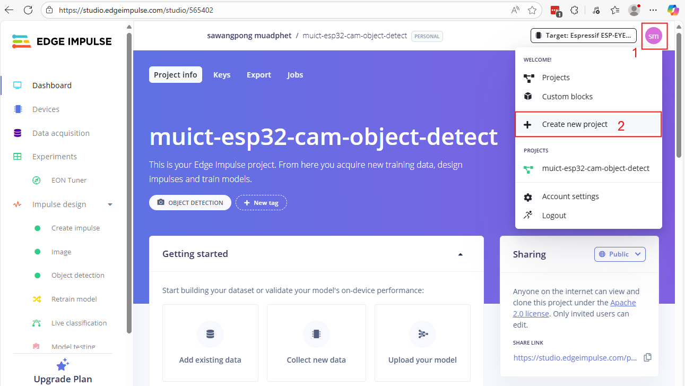
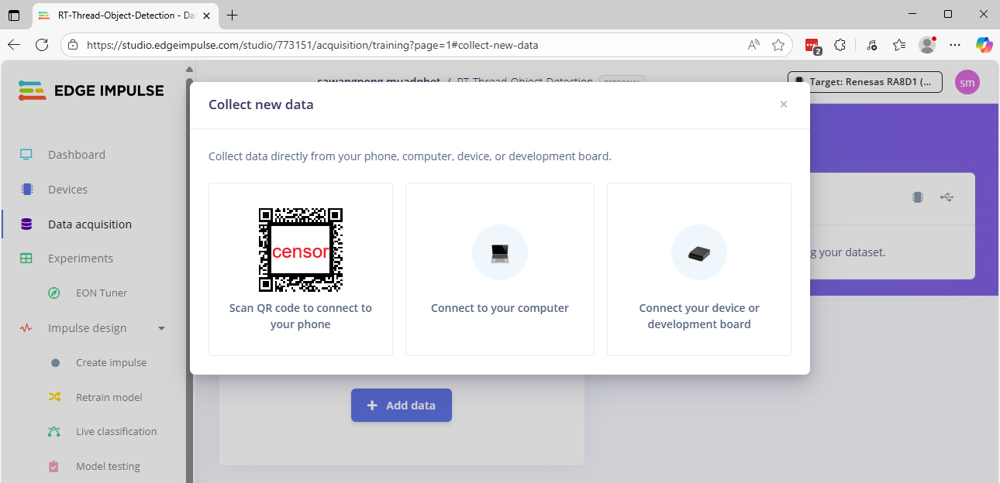
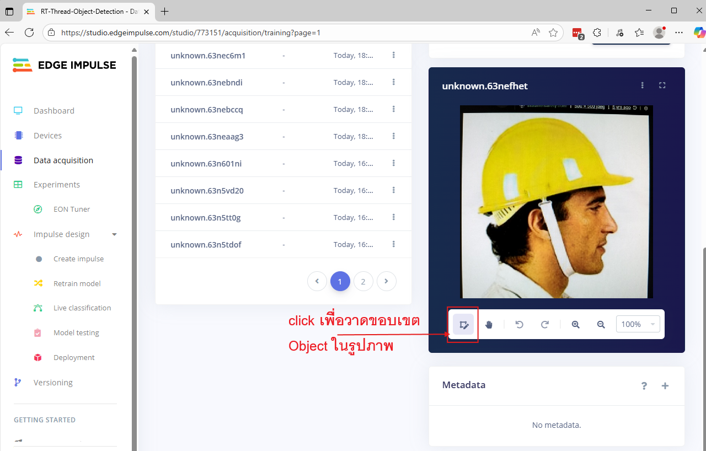
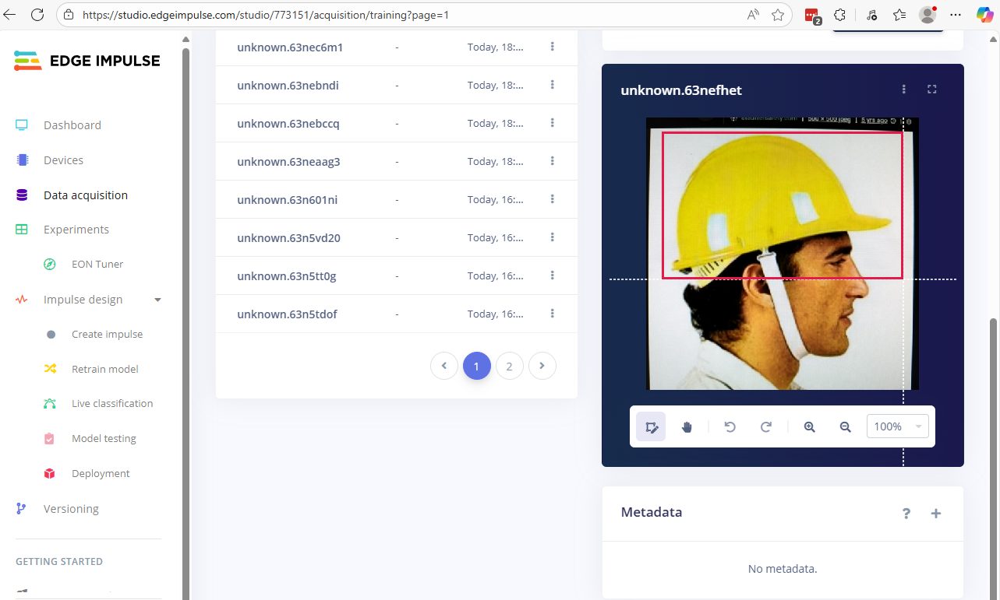
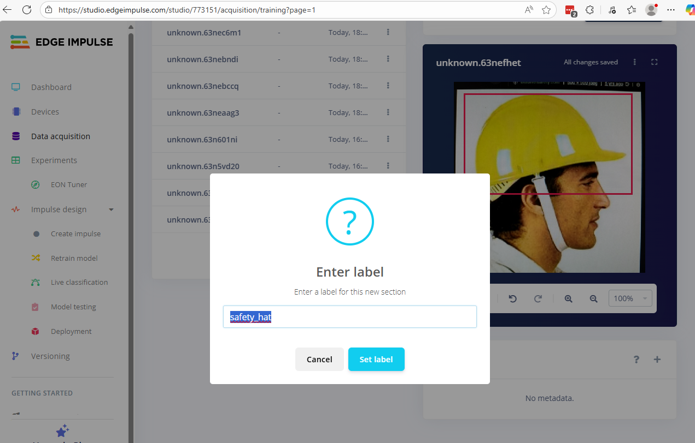

# Workshop 9: Edge Impulse (Custom TinyML)

<span class="md-tag">Advanced</span> <span class="md-tag">Machine Learning</span> <span class="md-tag">TinyML</span> <span class="md-tag">90 นาที</span>

> 🧠 **ก้าวสู่การเป็นนักพัฒนา Edge AI เต็มตัว:**
> ใน Workshop 8 คุณได้ลองใช้โมเดลตรวจจับใบหน้าสำเร็จรูปไปแล้ว ใน Workshop สุดท้ายนี้ คุณจะได้สร้าง **"โมเดล AI ของคุณเองตั้งแต่ศูนย์"** ด้วยแพลตฟอร์ม **Edge Impulse** ตั้งแต่การเก็บภาพถ่ายจริง การตีกรอบสอน AI (Labeling) การ Train โมเดล FOMO บน Cloud ไปจนถึงการ Deploy ลงรันบนชิป **RA8D1 Vision Board**!

## ก่อนเริ่ม Lab

- [ ] ทำ [Workshop 8](../10_workshop8/10.1_workshop8.md) เสร็จแล้ว (เข้าใจการทำงานของ OpenMV และ FOMO)
- [ ] มีโทรศัพท์มือถือพร้อมอินเทอร์เน็ต (สำหรับสแกน QR Code ถ่ายรูปเก็บข้อมูล)
- [ ] สมัครบัญชี **Edge Impulse** (ฟรี) ที่ [edgeimpulse.com](https://edgeimpulse.com/)

## เมื่อทำเสร็จ คุณจะได้

- [ ] สร้าง Project และออกแบบ AI Pipeline บน **Edge Impulse**
- [ ] เก็บข้อมูลภาพถ่ายจากมือถือและจัดแบ่งชุดข้อมูล Train / Test
- [ ] ตีกรอบ **Labeling (Bounding Box)** และ Train โมเดล **FOMO** ได้สำเร็จ
- [ ] Export โมเดลและ Deploy ลงไปรันตรวจจับวัตถุจริงบนบอร์ด **RA8D1 Vision Board**

---

## Edge Impulse คืออะไร?

**Edge Impulse** คือแพลตฟอร์ม **MLOps สำหรับ Edge AI** ชั้นนำของโลก ที่ช่วยลดความซับซ้อนในการสร้างโมเดล Machine Learning สำหรับไมโครคอนโทรลเลอร์ ให้จบครบในที่เดียว:



| ขั้นตอน | หน้าที่การทำงาน |
| :--- | :--- |
| **Data Acquisition** | เก็บชุดข้อมูลภาพ (Dataset) จากมือถือหรือกล้องบอร์ด โดยแบ่งเป็น Training (80%) และ Testing (20%) |
| **Labeling** | วาดกรอบสี่เหลี่ยม (Bounding Box) ระบุตำแหน่งและชื่อคลาสของวัตถุในภาพ |
| **Impulse Design & Training** | ออกแบบการย่อขนาดภาพ (DSP) และเทรนโมเดล **FOMO** ที่บีบอัดขนาด (Quantized INT8) สำหรับ MCU |
| **Deployment** | แปลงโมเดลเป็นไฟล์ `.tflite` เพื่อนำไปรันบน OpenMV (หรือ C++ Library สำหรับ RT-Thread) |

---

## Lab 9.1: สร้าง Project บน Edge Impulse

### ขั้นตอน

1. เปิดเบราว์เซอร์ไปที่ [edgeimpulse.com](https://edgeimpulse.com/) → ล็อกอินเข้าสู่ระบบ

2. กดปุ่ม **+ Create new project**

3. ตั้งชื่อโปรเจกต์: `RT-Thread-Object-Detection` (เลือกประเภทเป็น Developer / Free)

   { width="500" }

4. เลือกประเภทโปรเจกต์เป็น **Images → Detect multiple objects (Bounding boxes)** และเลือก Target Device เป็น **Renesas RA8D1 (Cortex-M85 480MHz)**

   !!! success "Checkpoint 9.1"
       ✅ สร้าง Project สำเร็จและเข้าสู่หน้า **Dashboard** ของโปรเจกต์

---

## Lab 9.2: เก็บข้อมูลภาพถ่าย (Data Acquisition)

### ขั้นตอน (ใช้สมาร์ทโฟนเชื่อมต่อกับ Edge Impulse)

1. ในหน้า Dashboard ของ Edge Impulse → เลือกเมนู **Data acquisition** ทางด้านซ้าย

2. เชื่อมต่อโทรศัพท์มือถือเป็นกล้องเก็บข้อมูล:
   - กดปุ่ม **Connect a device** (หรือไอคอนรูปมือถือ/QR Code)
   - เลือก **Use your mobile phone** → สแกน **QR Code** ด้วยกล้องมือถือ
   - เปิดลิงก์ในเบราว์เซอร์มือถือ และกดอนุญาต (**Allow**) ให้เข้าถึงกล้อง

   { width="500" }

3. เริ่มถ่ายรูปวัตถุเป้าหมาย (ตัวอย่างเช่น หมวกนิรภัย `safety_hat` หรือวัตถุที่เตรียมไว้):
   - **ถ่ายให้หลากหลาย:** เปลี่ยนมุมมอง ระยะใกล้-ไกล ฉากหลัง และสภาพแสง
   - **ถ่ายภาพพื้นหลังเปล่า (Negative Samples):** ถ่ายฉากหลังที่ไม่มีวัตถุอยู่ด้วยประมาณ 10–15 รูป เพื่อลดการทายมั่ว (False Positive)
   - ระบบจะแบ่งภาพเข้าชุด **Training (~80%)** และ **Testing (~20%)** ให้อัตโนมัติ

   !!! success "Checkpoint 9.2"
       ✅ มีรูปภาพอย่างน้อย **40–50 รูปต่อ 1 Class** (ยิ่งเยอะและหลากหลาย โมเดลยิ่งแม่นยำ)
       ✅ มองเห็นรายการรูปภาพทั้งหมดในหน้า **Data acquisition**

---

## Lab 9.3: ตีกรอบระบุตำแหน่งวัตถุ (Labeling)

### ขั้นตอน

1. ไปที่แท็บ **Labeling queue** (ด้านบนของหน้า Data acquisition)

2. ลากเมาส์วาดกรอบสี่เหลี่ยม (**Bounding Box**) ล้อมรอบตัววัตถุให้พอดี

   { width="500" }
   { width="500" }

3. พิมพ์ชื่อ **Label** (เช่น `safety_hat` หรือ `safety_glove`) แล้วกด **Save labels**

   { width="500" }

4. ทำซ้ำจนครบทุกรูปในคิว (หากรูปไหนเป็นฉากหลังเปล่า ไม่มีวัตถุ ให้กด **Save labels** ข้ามไปได้เลย)

   !!! success "Checkpoint 9.3"
       ✅ ทุกรูปใน **Labeling queue** ถูกจัดการจนเหลือ `0 items left`
       ✅ มีการติดป้ายชื่อ Class ถูกต้องสม่ำเสมอทุกรูป

---

## Lab 9.4: ออกแบบ Impulse และ Train โมเดล FOMO

### ขั้นตอน

1. ไปที่เมนู **Impulse design → Create impulse** (ด้านซ้าย):
   - **Image data:** ตั้งขนาดภาพเป็น **`96 × 96`** พิกเซล (Resize mode: *Fit shortest axis*)
   - **Processing block:** กด Add → เลือก **Image**
   - **Learning block:** กด Add → เลือก **Object Detection (Images)**
   - กดปุ่ม **Save Impulse**

2. ไปที่เมนู **Impulse design → Image**:
   - เลือก Color depth เป็น **RGB** → กด **Save parameters**
   - กดปุ่ม **Generate features** (รอประมาณ 1 นาที จนระบบสกัดคุณลักษณะของภาพเสร็จสิ้น)

3. ไปที่เมนู **Impulse design → Object detection**:
   - **Number of training cycles:** ตั้งเป็น `40` – `60`
   - **Learning rate:** `0.005` (หรือ `0.015` สำหรับ FOMO)
   - **Neural network architecture:** กดเลือกโมเดล **FOMO (Faster Objects, More Objects) MobileNetV2 0.35**
   - กดปุ่ม **Start training** และรอจนเทรนเสร็จ

   !!! success "Checkpoint 9.4"
       ✅ การเทรนเสร็จสมบูรณ์และแสดงตาราง **Confusion Matrix**
       ✅ ค่า **F1 Score / Accuracy > 75%** (หากต่ำกว่านี้ ให้ลองเพิ่มจำนวนรอบ Training cycles หรือเพิ่มรูปภาพ)

---

## Lab 9.5: ทดสอบโมเดลกับชุดข้อมูลทดสอบ (Model Testing)

### ขั้นตอน

1. ไปที่เมนู **Model testing** (ด้านซ้าย)

2. กดปุ่ม **Classify all** เพื่อให้โมเดลลองทำนายรูปภาพในชุด **Testing (20%)** ที่ไม่เคยเห็นมาก่อนตอนเทรน

3. ตรวจสอบผลลัพธ์ความแม่นยำรายรูป (สีเขียว = ทายถูกตำแหน่งและคลาส)

   !!! success "Checkpoint 9.5"
       ✅ โมเดลสามารถตรวจจับวัตถุในรูปชุดทดสอบได้ถูกต้องเกิน 75–80%

---

## Lab 9.6: Deploy โมเดลลงบอร์ด RA8D1 Vision Board

### ขั้นตอน

1. ไปที่เมนู **Deployment** (ด้านซ้าย)

2. ในช่องค้นหา Deployment option ให้เลือก **`OpenMV library`** *(สำหรับการนำไปรันด้วยสคริปต์ MicroPython ใน OpenMV IDE)*
   *(หมายเหตุ: หากต้องการนำไปเขียนรวมกับภาษา C ใน RT-Thread Studio สามารถเลือก **C++ library** ได้)*

3. เลือกการปรับแต่งโมเดลเป็น **Quantized (int8)** แล้วกดปุ่ม **Build**

4. ดาวน์โหลดไฟล์ `.zip` ลงเครื่องคอมพิวเตอร์และแตกไฟล์ออกมา คุณจะได้ไฟล์สำคัญ 3 ไฟล์:
   - **`trained.tflite`** (ไฟล์สมอง AI ที่ผ่านการบีบอัดแล้ว)
   - **`labels.txt`** (ไฟล์รายชื่อคลาสทั้งหมด)
   - **`ei_object_detection.py`** (สคริปต์ตัวอย่างสำหรับ OpenMV)

5. **นำไฟล์โมเดลใส่ลงบอร์ด Vision Board:**
   - เสียบสาย **USB-OTG** เข้าคอมพิวเตอร์ คอมพิวเตอร์จะมองเห็น **USB Drive (Flash Drive / SD Card)** ของบอร์ด OpenMV
   - คัดลอกไฟล์ **`trained.tflite`** และ **`labels.txt`** ไปวางไว้ในไดรฟ์ของบอร์ด
   - กดปุ่ม **Reset** บนบอร์ด 1 ครั้งเพื่อให้ระบบไฟล์อัปเดต

6. เปิด **OpenMV IDE** → กด **Connect** → นำโค้ดนี้ไปรันเพื่อทดสอบโมเดล FOMO ของคุณเอง:

   ```python title="custom_fomo_detection.py" linenums="1"
   import sensor, image, time, tf, math

   # 1. ตั้งค่ากล้องให้ตรงกับขนาดที่ Train ใน Edge Impulse (96x96 RGB565)
   sensor.reset()
   sensor.set_vflip(True)                  # ปรับ True/False หากภาพกลับหัว
   sensor.set_pixformat(sensor.RGB565)
   sensor.set_framesize(sensor.QVGA)       # 320x240
   sensor.set_windowing((96, 96))          # ครอปภาพให้ตรงกับ Input 96x96 ของโมเดล
   sensor.skip_frames(time=2000)

   # 2. โหลดโมเดลที่ Train เองจากหน่วยความจำบอร์ด
   net = tf.load("trained.tflite", load_to_fb=True)
   labels = [line.rstrip('\n') for line in open("labels.txt")]

   min_confidence = 0.5
   thresholds = [(math.ceil(min_confidence * 255), 255)]
   colors = [(255, 0, 0), (0, 255, 0), (0, 0, 255), (255, 255, 0)]

   clock = time.clock()
   while True:
       clock.tick()
       img = sensor.snapshot()

       # 3. สั่งตรวจจับวัตถุด้วยโมเดล FOMO
       for i, detection_list in enumerate(net.detect(img, thresholds=thresholds)):
           if i == 0:                      # ข้ามคลาส 0 (background)
               continue
           if len(detection_list) == 0:
               continue

           for d in detection_list:
               # วาดกรอบและแสดงชื่อวัตถุที่ตรวจพบ
               img.draw_rectangle(d.rect(), color=colors[i % len(colors)], thickness=2)
               conf = int(d.output() * 100)
               img.draw_string(d.x(), d.y() - 10, "%s %d%%" % (labels[i], conf), color=colors[i % len(colors)])
               print("Detected: %s (%d%%) at (%d, %d)" % (labels[i], conf, d.cx(), d.cy()))
   ```

   !!! success "Checkpoint 9.6"
       ✅ โมเดลโหลดสำเร็จโดยไม่มี Error Memory
       ✅ เมื่อนำวัตถุเป้าหมายมาส่องหน้ากล้อง จะมีกรอบสีวาดล้อมรอบพร้อมแสดงชื่อ Class และเปอร์เซ็นต์ความมั่นใจ!

---

## สรุป: คุณทำอะไรสำเร็จแล้วตลอดทั้งคอร์ส!

- [x] สร้าง Project และออกแบบ Pipeline บน **Edge Impulse**
- [x] เก็บข้อมูลภาพถ่ายจริงและทำ **Bounding Box Labeling**
- [x] Train โมเดล **FOMO Object Detection (INT8)** สำหรับไมโครคอนโทรลเลอร์
- [x] Deploy โมเดลลงบอร์ด **RA8D1 Vision Board** และเขียนโค้ด MicroPython ตรวจจับวัตถุแบบ Real-time

---

## ก้าวต่อไปหลังจบ Workshop 9 (Capstone Project Ideas)

ตอนนี้คุณมีทักษะครบทั้ง **3 เสาหลักของ Embedded IoT & Edge AI** บนบอร์ด RA8D1 Vision Board แล้ว สามารถนำมาประกอบร่างเป็นโปรเจกต์จริงได้ทันที:

1. Smart Safety Camera: ใช้โมเดลตรวจจับหมวกนิรภัย (Workshop 9) + ส่งแจ้งเตือนพร้อมภาพหรือ JSON ขึ้น Cloud ผ่าน Wi-Fi MQTT (Workshop 4–5)
2. Smart Environment & Vision: อ่านค่าอุณหภูมิ/ความชื้นจากเซ็นเซอร์ I2C (Workshop 2–3) ผสานกับการนับจำนวนคนในห้องด้วยกล้อง AI

??? failure "แก้ปัญหาเบื้องต้น (Troubleshooting)"
    "Training Accuracy / F1 Score ต่ำ (ต่ำกว่า 60%)"
    - เพิ่มจำนวนและคุณภาพรูปภาพ: ควรมีอย่างน้อย 50 รูปขึ้นไปต่อ 1 Class และถ่ายให้ครบทุกมุมมอง แสงสว่าง และระยะห่างที่คาดว่าจะใช้งานจริง
    - เช็กกรอบ Bounding Box: วาดกรอบให้ชิดขอบวัตถุพอดี ไม่กว้างกินพื้นที่ว่างมากเกินไป
    - "Error: OSError: [Errno 2] ENOENT หรือหาไฟล์ trained.tflite ไม่เจอ"
    - ตรวจสอบว่าก๊อปปี้ไฟล์ trained.tflite และ labels.txt ไปวางไว้ที่หน้าแรกสุด (Root Directory) ของไดรฟ์ USB บอร์ด OpenMV (ไม่ใช่ซ่อนอยู่ในโฟลเดอร์ย่อย)
    - สำคัญ: หลังก๊อปปี้ไฟล์ลงไดรฟ์ผ่าน Windows Explorer เสร็จแล้ว ให้กด Eject Drive หรือกดปุ่ม Reset บนบอร์ด 1 ครั้ง เพื่อให้เฟิร์มแวร์มองเห็นไฟล์ใหม่
    - "Error: MemoryError: Out of normal MicroPython Heap Memory"
    - โมเดลมีขนาดใหญ่เกินไป ให้กลับไปที่หน้า Impulse Design ใน Edge Impulse แล้วลดขนาดภาพ Input จาก 160×160 ลงมาเป็น 96×96 และเลือกสถาปัตยกรรม FOMO MobileNetV2 0.35 (หรือ 0.1) แล้ว Build ใหม่อีกครั้ง