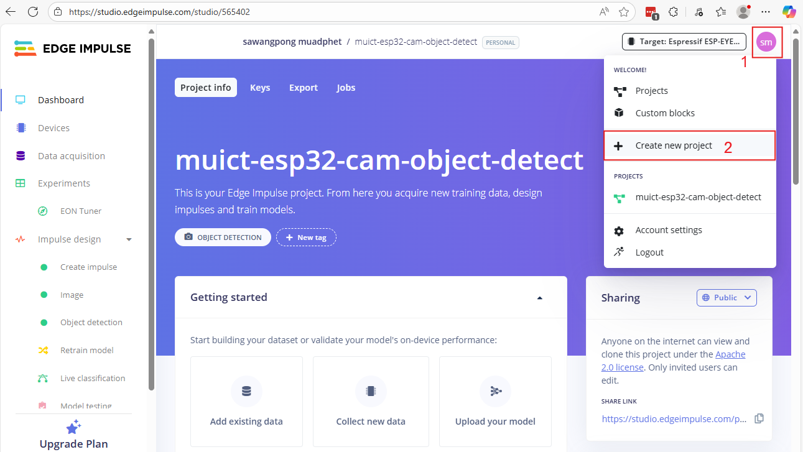
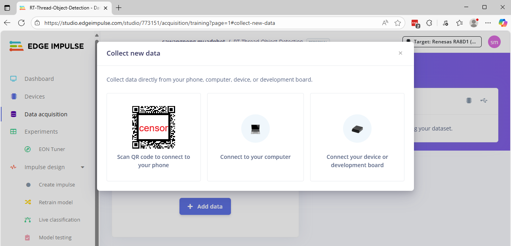
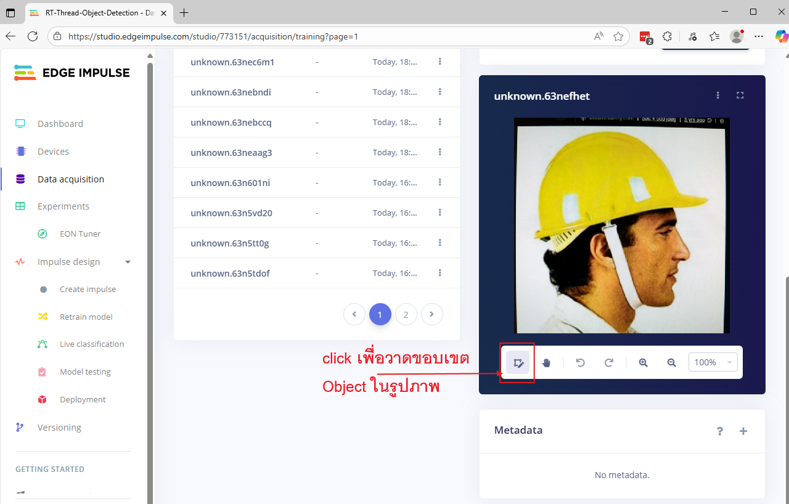
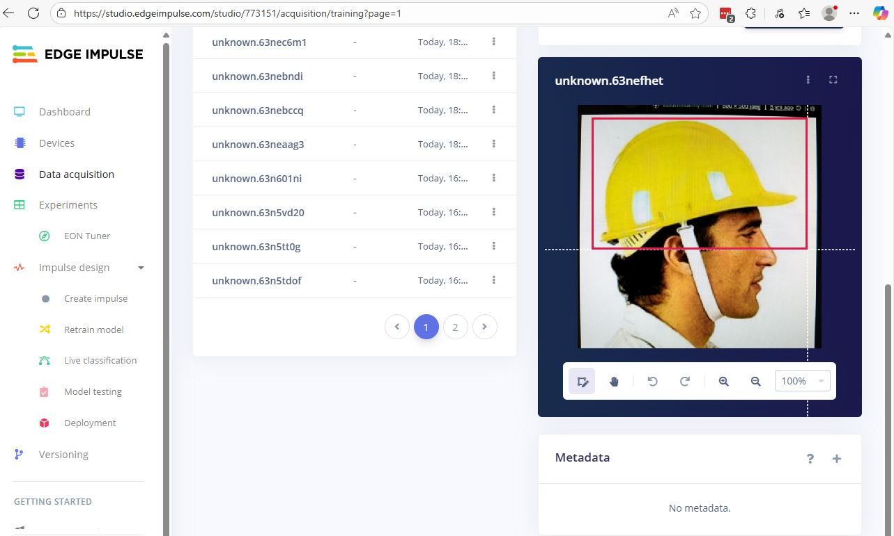
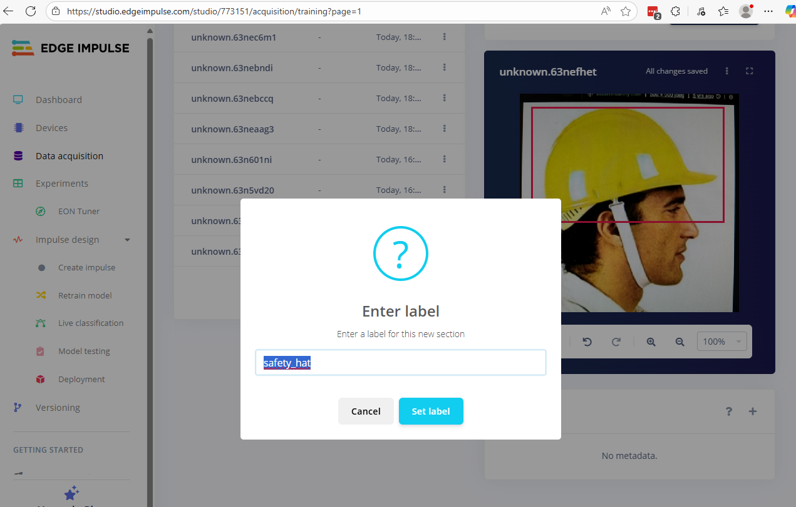

# Workshop 9: Edge Impulse

<span class="md-tag">Advanced</span> <span class="md-tag">Machine Learning</span> <span class="md-tag">90 นาที</span>

## ก่อนเริ่ม Lab

- [ ] ทำ [Workshop 8](../10_workshop8/workshop8.md) เสร็จแล้ว (เข้าใจ Face Detection)
- [ ] มีโทรศัพท์มือถือ (สำหรับถ่ายรูปเก็บข้อมูล)
- [ ] มี Computer Vision พื้นฐาน (รู้ว่า Object Detection คืออะไร)
- [ ] สมัครบัญชี Edge Impulse (ฟรี) ที่ [edgeimpulse.com](https://edgeimpulse.com/)

## เมื่อทำเสร็จ คุณจะได้

- [ ] สร้าง Project บน Edge Impulse
- [ ] เก็บข้อมูลภาพด้วยมือถือ
- [ ] Label วัตถุและ Train โมเดล
- [ ] Deploy โมเดลบน Vision-Board

---

## Edge Impulse คืออะไร

**Edge Impulse** = แพลตฟอร์มสร้างโมเดล AI สำหรับอุปกรณ์ IoT/Edge

```text
┌─────────────┐     ┌─────────────┐     ┌─────────────┐
│  เก็บข้อมูล  │ ──▶ │  Train      │ ──▶ │  Deploy     │
│  (รูปภาพ)   │     │  (ML Model) │     │  (เชิงโค้ด) │
└─────────────┘     └─────────────┘     └─────────────┘
```

| ขั้น | ทำอะไร |
|------|--------|
| Data Acquisition | ถ่ายรูป/อัปโหลดข้อมูล |
| Labeling | วาดกรอบรอบวัตถุ |
| Training | เทรนด้วย Neural Network |
| Deployment | ส่งโมเดลลงอุปกรณ์ |

---

## Lab 9.1: สร้าง Project บน Edge Impulse

### ขั้นตอน

1. ไปที่ [edgeimpulse.com](https://edgeimpulse.com/) → ล็อกอิน

2. กด **Create new project**

3. ตั้งชื่อ: `RT-Thread-Object-Detection`

   { width="500" }

4. เลือก Target Device: **Renesas RA8D1 (Cortex-M85 480MHz)**

   !!! success "Checkpoint 9.1"
       ✅ Project สร้างสำเร็จ
       ✅ เห็น Dashboard ของ Project

---

## Lab 9.2: เก็บข้อมูล (Data Acquisition)

### วิธีที่ 1: ใช้มือถือถ่ายรูป

1. ใน Edge Impulse → เลือก **Data Acquisition** (เมนูซ้าย)

2. เชื่อมต่อโทรศัพท์:
   - กด **Connect to Device**
   - สแกน QR Code ด้วยมือถือ
   - เปิดเบราว์เซอร์ → อนุญาตใช้กล้อง

   { width="500" }

3. ถ่ายรูปวัตถุที่ต้องการ:
   - ถ่ายหลายมุม หลายแสง
   - ถ่ายรูปเปล่า (ไม่มีวัตถุ) → class `background`
   - ถ่ายรูปที่มีวัตถุ → class `safety_hat`

   !!! success "Checkpoint 9.2"
       ✅ มีรูปภาพอย่างน้อย 50 รูปต่อ class
       ✅ แต่ละรูปแสดงใน Edge Impulse Dashboard

---

## Lab 9.3: Label วัตถุ (Labeling)

### ขั้นตอน

1. กดที่รูปภาพที่ต้องการ Label

2. เลือกเครื่องมือ **Bounding Box**

   { width="500" }

3. วาดสี่เหลี่ยมรอบวัตถุ

   { width="500" }

4. เลือก Label (เช่น `safety_hat`)

   { width="500" }

5. ทำซ้ำทุกรูป

   !!! success "Checkpoint 9.3"
       ✅ ทุกรูปที่มีวัตถุถูก label แล้ว
       ✅ มี class เช่น `safety_hat`, `safety_glove`, `background`

---

## Lab 9.4: Train โมเดล

### ขั้นตอน

1. ไปที่ **Impulse Design** → เลือก:
   - Image Data
   - Object Detection (Images)

2. กด **Save Impulse**

3. ไปที่ **Image** → **Generate Features**
   - Edge Impulse จะสร้าง features จากรูปภาพ

4. ไปที่ **Object Detection** → **Start Training**
   - เลือก Model: FOMO
   - Training cycles: 30-50
   - Learning rate: 0.005

   !!! success "Checkpoint 9.4"
       ✅ Training สำเร็จ
       ✅ เห็น Confusion Matrix
       ✅ Accuracy > 70% = ใช้ได้

---

## Lab 9.5: ทดสอบโมเดล (Model Testing)

### ขั้นตอน

1. ไปที่ **Model Testing**

2. อัปโหลดรูปใหม่ที่ไม่ได้ใช้ Train → ลอง Classify

3. ดูผลลัพธ์ว่าโมเดล detect ถูกไหม

   !!! success "Checkpoint 9.5"
       ✅ รูปใหม่ถูก detect ถูก class
       ✅ Precision / Recall สูงพอ

---

## Lab 9.6: Deploy ลง Vision-Board

### ขั้นตอน

1. ไปที่ **Deployment**

2. เลือก **C++ Library** → สำหรับ RA8D1

3. กด **Build**

4. ดาวน์โหลดไฟล์ `.zip`

5. แตกไฟล์ → นำโมเดลไปใส่ใน OpenMV Project:
   - ไฟล์ `.tflite` ไปไว้ในโปรเจกต์
   - ไฟล์ `labels.txt` ไว้อ่านชื่อ class

6. แก้โค้ด MicroPython ให้โหลดโมเดลใหม่:

   ```python title="custom_model.py" linenums="1"
   import sensor, image, time, tf
   
   sensor.reset()
   sensor.set_pixformat(sensor.RGB565)
   sensor.set_framesize(sensor.QVGA)
   sensor.skip_frames(time=2000)
   
   # โหลดโมเดลที่ Train เอง
   labels, net = tf.load("model.trained")
   
   while True:
       img = sensor.snapshot()
       for d in net.classify(img):
           print("Detected:", labels[d.class_id()])
           img.draw_string(10, 10, labels[d.class_id()])
   ```

   !!! success "Checkpoint 9.6"
       ✅ โมเดลรันบน Vision-Board ได้
       ✅ ตรวจจับวัตถุที่ Train เองได้

---

## สรุป: คุณทำอะไรสำเร็จแล้ว

- [x] สร้าง Project บน Edge Impulse
- [x] เก็บข้อมูลภาพด้วยมือถือ
- [x] Label วัตถุ (Bounding Box)
- [x] Train โมเดล Machine Learning
- [x] Deploy โมเดลลง Vision-Board

---

## เตรียมไป Workshop ต่อไป

หลัง Workshop 9 คุณมีพื้นฐาน **End-to-End AI Pipeline**:
- เก็บข้อมูล → Train → Deploy → รันบน Hardware
- สามารถนำไปต่อยอดสร้างโปรเจกต์ AI ได้เอง

---

??? failure "แก้ปัญหาเบื้องต้น"
    **"Training Accuracy ต่ำ"**
    - เพิ่มจำนวนรูป (อย่างน้อย 50 รูปต่อ class)
    - ใช้รูปหลากหลาย (มุม แสง ระยะ)
    - ลดจำนวน class ถ้ามากเกินไป

    **"Detect ผิด class"**
    - ตรวจสอบ Label ว่าถูกต้อง
    - ตรวจสอบว่า class มีลักษณะคล้ายกันเกินไป

    **"Deploy แล้วโมเดลไม่ทำงาน"**
    - ตรวจสอบว่าไฟล์ `.tflite` อยู่ในโปรเจกต์
    - ตรวจสอบชื่อไฟล์และ path
    - ตรวจสอบว่า Memory บนบอร์ดพอ
