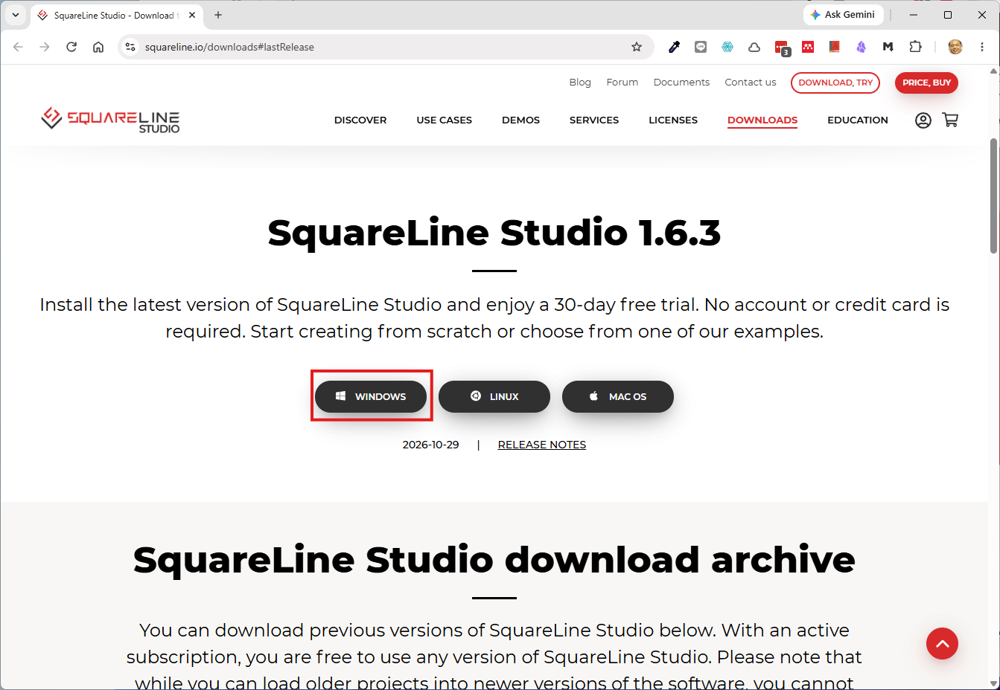
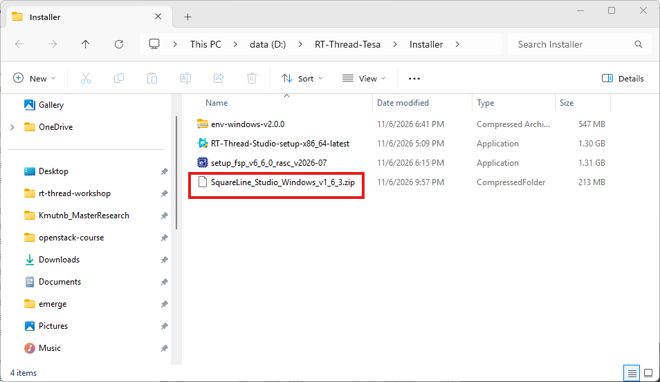
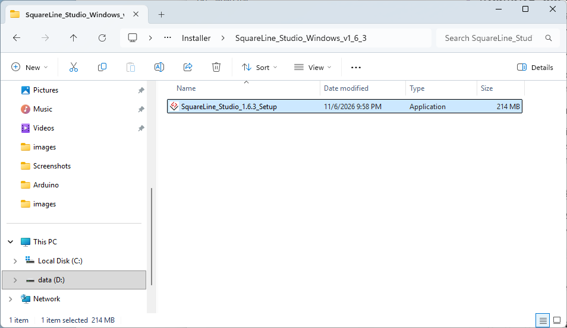
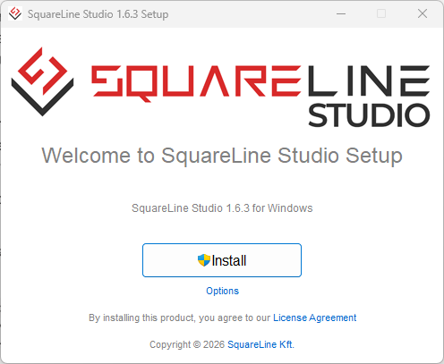
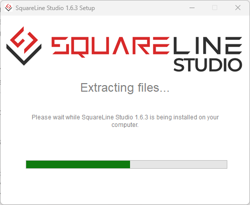
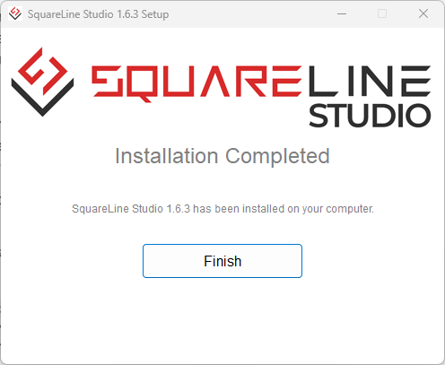
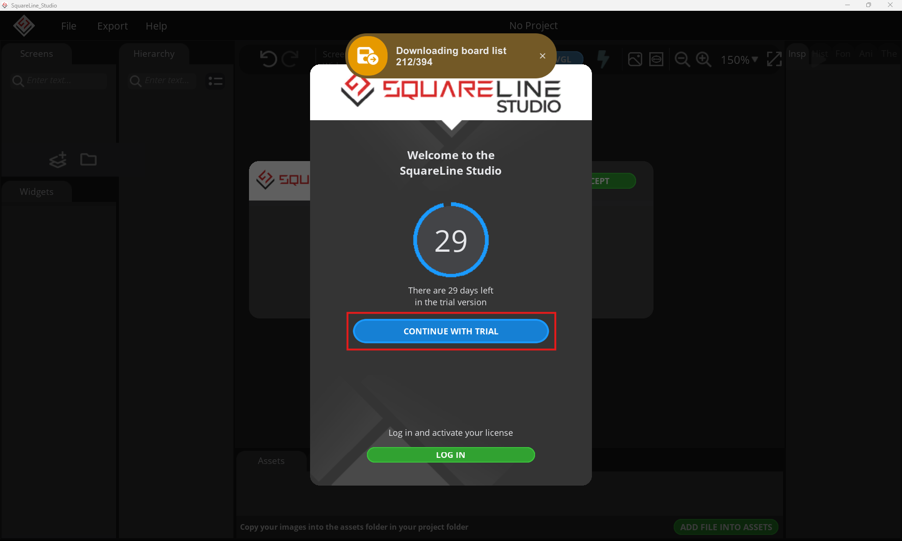
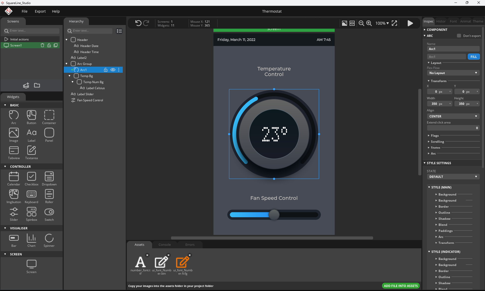
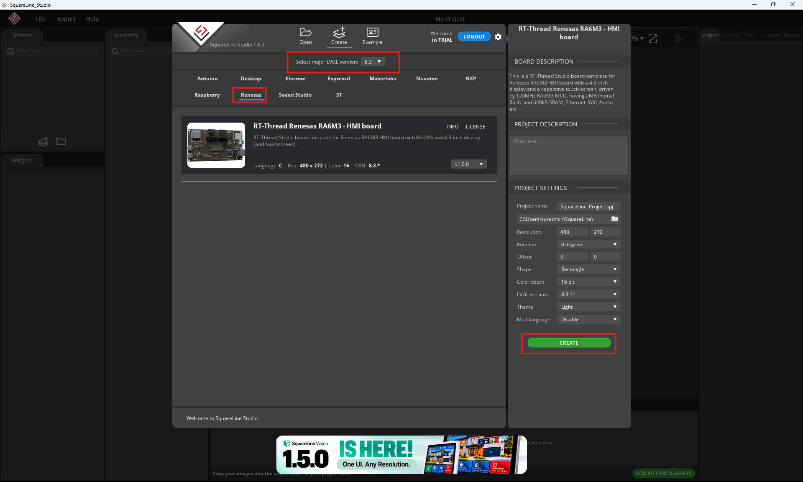
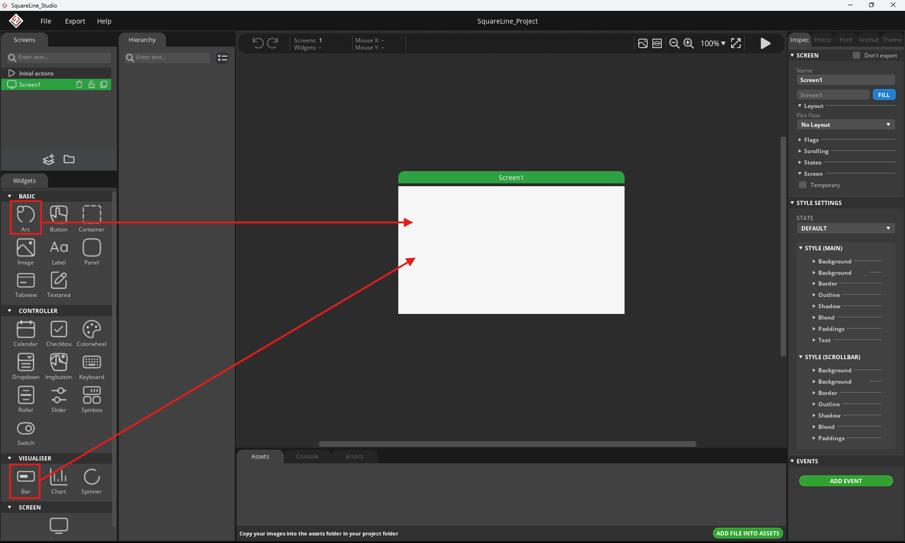

## ติดตั้ง Squareline

แอปพลิเคชันแนะนำสำหรับวาดหน้าจอ (LVGL GUI Editors)  สำหรับการออกแบบหน้าจอแสดงผล (GUI Layout) แบบลากวาง (Drag-and-drop) โดยไม่ต้องเขียนโค้ดวาดรูปเองทีละบรรทัด เพื่อนำมาแสดงผลบนบอร์ดฝังตัว (เช่น บอร์ด Vision-Board ที่ใช้งานร่วมกับ RT-Thread และไลบรารี LVGL) เราจะมีซอฟต์แวร์ช่วยออกแบบที่เรียกว่า GUI Builder SquareLine Studio (นิยมใช้กันมากที่สุดในปัจจุบัน)
- จุดเด่น: เป็นโปรแกรมออกแบบ UI ระดับมืออาชีพที่มีหน้าตาสวยงาม ใช้งานง่ายแบบลากวาง มี Widget สำเร็จรูปเพียบ (เช่น กราฟ, ปุ่ม, ข้อความ, รูปภาพ)
- การใช้งาน: ออกแบบเสร็จสามารถกด Export เป็นโค้ดภาษา C (LVGL) ออกมาได้ทันที มีเวอร์ชันให้ใช้งานฟรีสำหรับโปรเจกต์ส่วนตัว (Personal / Hobbyist)
- Download [https://squareline.io/downloads#lastRelease](https://squareline.io/downloads#lastRelease)
{ width="600" }

- แตก Zip file และ run 
{ width="600" }
{ width="600" }
{ width="600" }
{ width="600" }
{ width="600" }

- Start programe
{ width="600" }
{ width="600" }


การนำไฟล์ UI จาก **SquareLine Studio** มาใส่ลงในโปรเจกต์ RT-Thread ของบอร์ด **Vision-Board (Renesas RA8D1)** เพื่อแสดงผลบนหน้าจอ (แบบไม่ต้องใช้ทัชสกรีน) มีขั้นตอนการทำระบบตั้งแต่ต้นจนจบดังนี้ครับ:

---

### ขั้นตอนที่ 1: ออกแบบหน้าจอและ Export โค้ดจาก SquareLine Studio

1. **สร้างโปรเจกต์ใหม่ใน SquareLine Studio:**
* เปิดโปรแกรม เลือกเป็น **LVGL v8.3** (เนื่องจากเวอร์ชันนี้เสถียรและนิยมใช้กับ RT-Thread มากที่สุด)
* ตั้งค่าความละเอียดหน้าจอ (Resolution) ให้ตรงกับสเปกหน้าจอของคุณ (เช่น 480x272 หรือตามขนาดหน้าจอจริงที่ต่อกับบอร์ด)
{ width="600" }

2. **ออกแบบ UI:**
* ลากวาง Widget ต่างๆ เช่น Labels (ข้อความแสดงอุณหภูมิ ความชื้น), Bar หรือ Arc (แสดงสถานะ), หรือ Panel ตามต้องการ
{ width="600" }

3. **ตั้งค่า Export Settings:**
* ไปที่เมนู **Project Settings**
* กำหนด **Export UI Files** ไปยังโฟลเดอร์ที่คุณต้องการ (แนะนำให้สร้างโฟลเดอร์ชื่อ `ui` เตรียมไว้)


4. **กด Export:**
* กดปุ่ม **Export UI Files** โปรแกรมจะสร้างโฟลเดอร์ `ui` ซึ่งข้างในจะมีไฟล์ภาษา C และ Header เช่น `ui.c`, `ui.h` และโฟลเดอร์รูปภาพ/ฟอนต์ (ถ้ามี)


---

### ขั้นตอนที่ 2: นำไฟล์ UI เข้าสู่โปรเจกต์ RT-Thread Studio

1. **คัดลอกไฟล์:**
* นำโฟลเดอร์ `ui` ที่ได้จากการ Export ไปวางไว้ในโปรเจกต์ RT-Thread ของคุณ (มักจะวางไว้ในโฟลเดอร์หลักของโปรเจกต์ เช่น ร่วมกับโฟลเดอร์ `src` และ `inc`)


2. **เพิ่มไฟล์เข้าไปใน Build Path (RT-Thread Studio):**
* เปิดโปรแกรม RT-Thread Studio คลิกขวาที่โปรเจกต์ เลือก **Refresh** เพื่อให้โฟลเดอร์ `ui` ปรากฏขึ้นมา
* ดึงไฟล์ `.c` ทั้งหมดในโฟลเดอร์ `ui` ให้เข้าไปอยู่ในระบบ Build ของโปรเจกต์ (หรือตรวจสอบในไฟล์ `SConscript` / CMakeLists.txt แล้วแต่รูปแบบโปรเจกต์ของคุณว่าได้รวมไฟล์ `.c` เหล่านี้เข้ามาคอมไพเลอร์หรือยัง)


3. **เปิดใช้งาน LVGL Package:**
* ดับเบิลคลิกเปิดไฟล์ **`RT-Thread Settings`** ในโปรเจกต์
* ไปที่หัวข้อ **Software Packages** ➔ มองหาหมวด GUI ➔ เปิดใช้งานแพ็กเกจ **LVGL** (ตั้งค่าเวอร์ชันให้ตรงกับที่ Export มา เช่น v8.3.x)
* เปิดใช้งานไดรเวอร์สำหรับเชื่อมต่อจอภาพของบอร์ด Renesas RA (เช่น หมวด Low-level display driver ของบอร์ด Vision-Board)


---

### ขั้นตอนที่ 3: แก้ไขโค้ดใน `hal_entry.c` เพื่อเรียกใช้งาน UI

เปิดไฟล์ `src/hal_entry.c` ของคุณขึ้นมา แล้วทำการเรียกใช้งานฟังก์ชันเริ่มต้นของ UI ที่ export ออกมา ดังตัวอย่างโครงสร้างนี้ครับ:

```c
#include <rtthread.h>
#include <rtdevice.h>
#include "hal_data.h"
#include <lvgl.h>
#include "ui.h" // เรียกใช้งาน Header จาก SquareLine

void hal_entry(void)
{
    rt_kprintf("\nInitializing Display and LVGL UI...\n");

    /* 1. ระบบ RT-Thread และ LVGL จะทำการ initialize หน้าจอและ LCD Driver อัตโนมัติ 
          ตามการตั้งค่าใน FSP และ RT-Thread Settings */
    
    /* 2. เรียกฟังก์ชันสร้าง UI ที่มาจาก SquareLine Studio */
    ui_init();

    while (1)
    {
        /* 3. วนลูปประมวลผล LVGL Task Handler เป็นระยะ (เช่น ทุกๆ 5ms) */
        lv_timer_handler();
        rt_thread_mdelay(5);
    }
}

```

* **วิธีตรวจสอบความสำเร็จ (Verification):** หลังจากคอมไพล์และแฟลชโค้ดลงบอร์ด Vision-Board สำเร็จ หน้าจอแสดงผลจะต้องปรากฏภาพ Widget, ข้อความ หรือดีไซน์ที่คุณลากวางไว้จาก SquareLine Studio ขึ้นมาแสดงผลทันทีโดยไม่มีอาการจอขาวหรือจอดำ

---

### ขั้นตอนที่ 4: เชื่อมโยงข้อมูลจริง (เช่น ค่าเซนเซอร์ / รีเลย์) สู่หน้าจอ

เนื่องจากหน้าจอของคุณไม่มีทัชสกรีน หน้าที่หลักคือการแสดงผล (Dashboard) คุณสามารถดึงตัวแปร Widget ที่ SquareLine สร้างไว้มาอัปเดตค่าได้ตลอดเวลา เช่น:

* ใน SquareLine ถ้าคุณสร้าง Label ชื่อว่า `uic_temperature_label`
* ในโค้ด C คุณสามารถอัปเดตค่าข้อความได้โดยใช้คำสั่ง:
```c
// สมมติมีฟังก์ชันอัปเดตค่า
char buf[32];
rt_snprintf(buf, sizeof(buf), "Temp: %.1f C", current_temperature);
lv_label_set_text(ui_temperature_label, buf);

```


* นำโค้ดอัปเดตนี้ไปแทรกไว้ใน **MQTT Thread** หรือ **Sensor Thread** ที่เราคุยกันก่อนหน้านี้ เพื่อให้พอมีข้อมูลใหม่เข้ามา หน้าจอจะอัปเดตตามแบบเรียลไทม์ทันทีครับ!