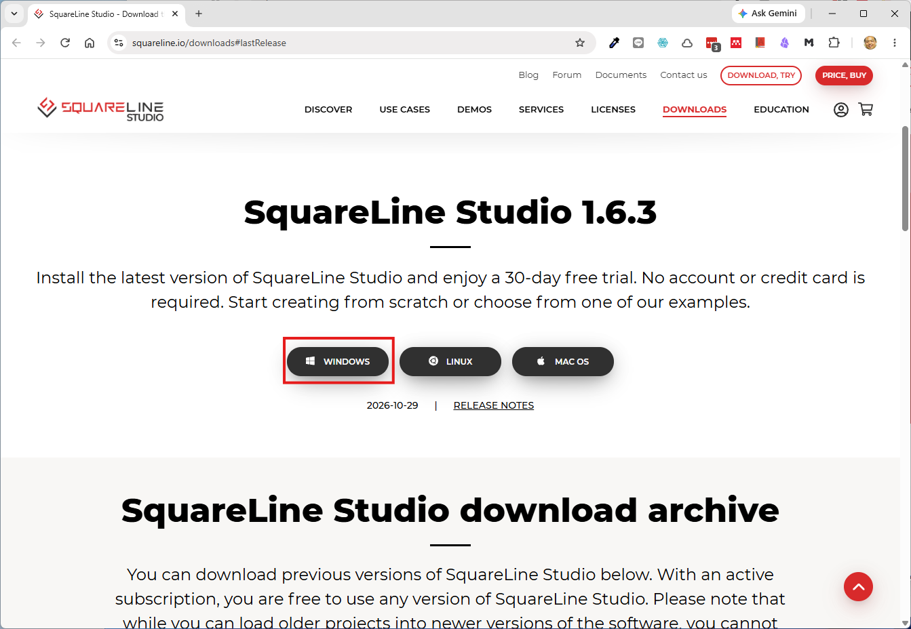
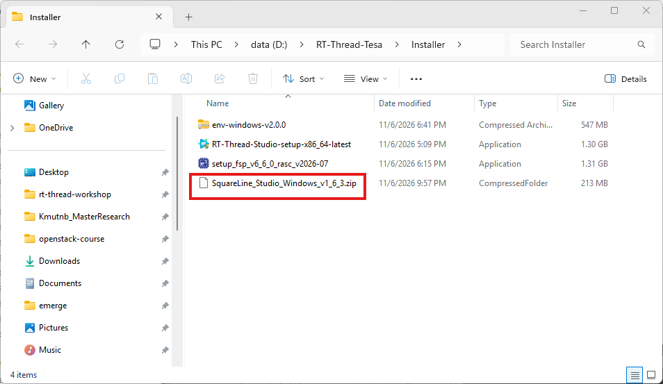
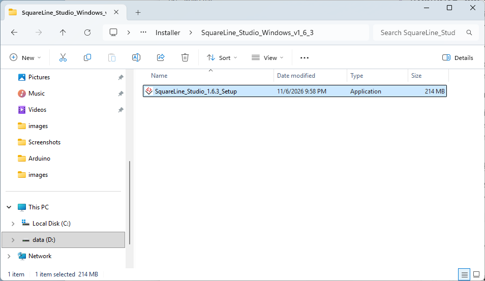
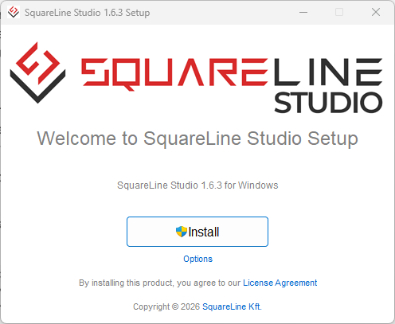
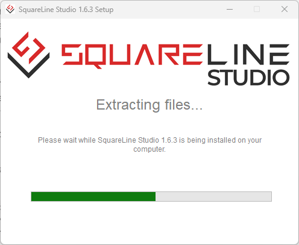
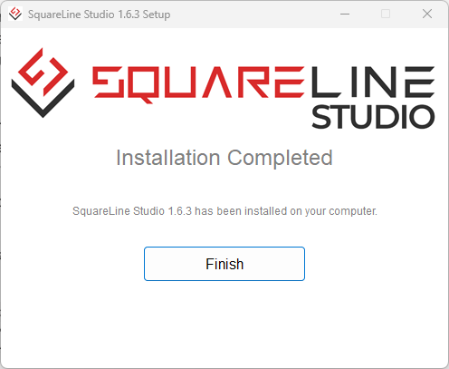
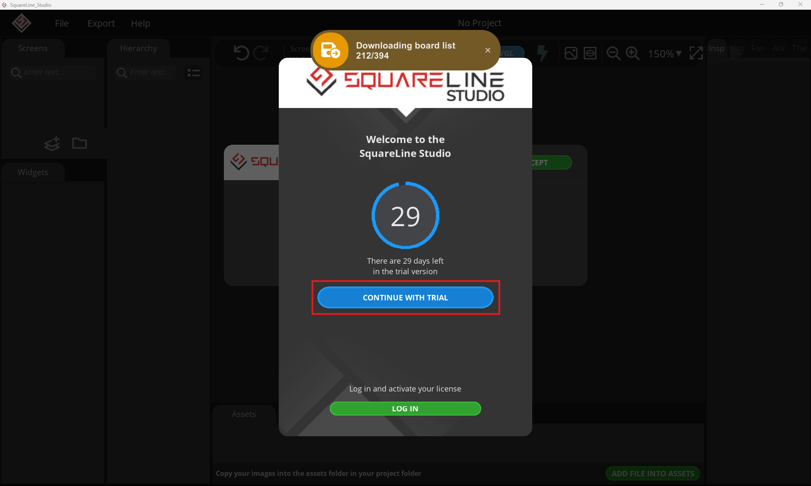
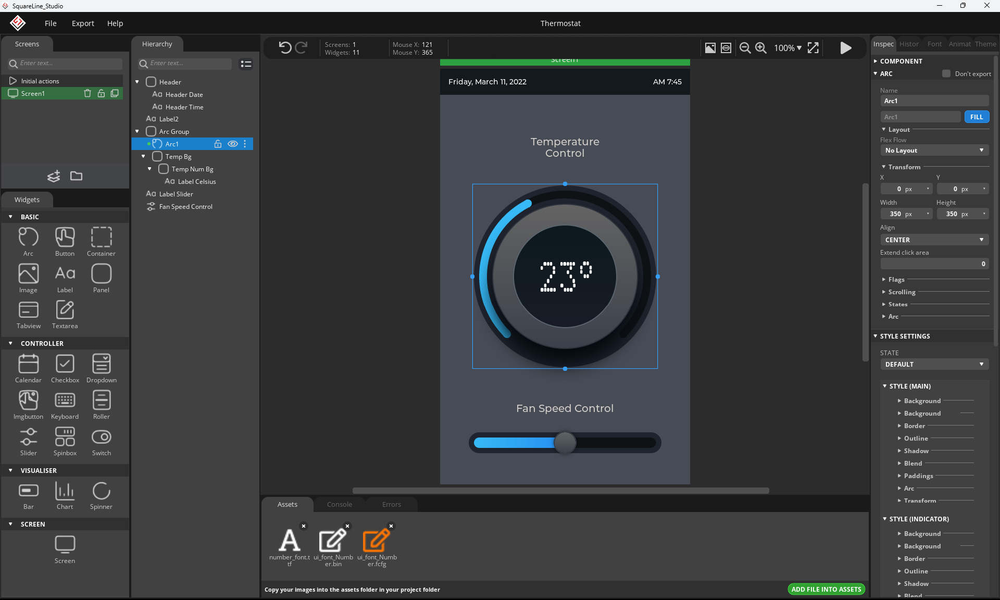
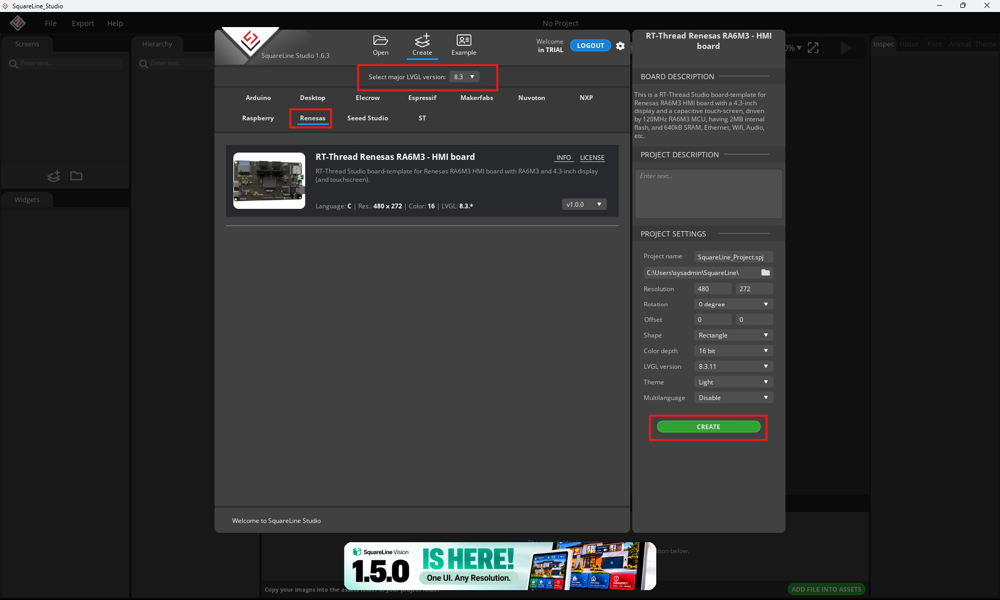
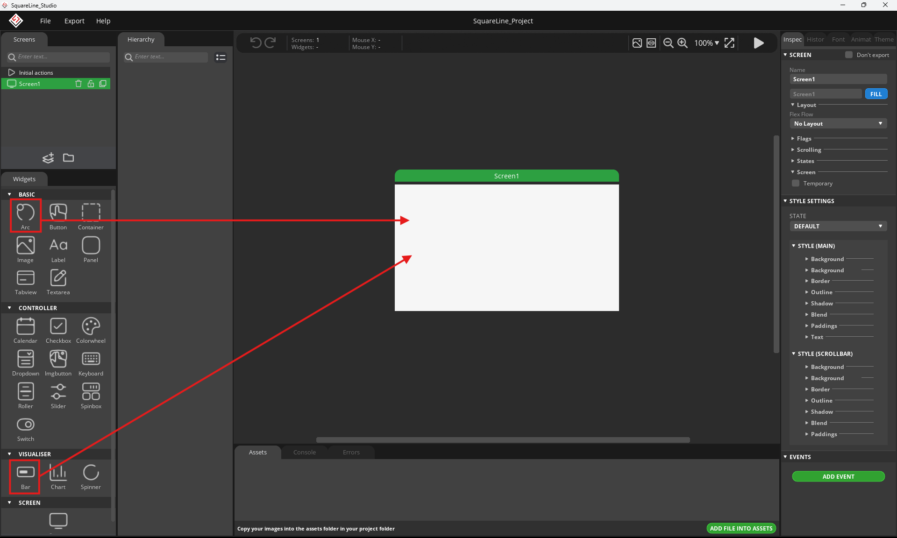

# ติดตั้งและเริ่มต้นใช้งาน SquareLine Studio

<span class="md-tag">GUI & HMI</span> <span class="md-tag">LVGL</span> <span class="md-tag">SquareLine Studio</span>

> 🎨 **ออกแบบหน้าจอสวยระดับมืออาชีพโดยไม่ต้องเขียนโค้ดวาดรูปเอง:**
> **SquareLine Studio** คือโปรแกรมออกแบบหน้าจอ (GUI Builder) แบบลากวาง (Drag-and-Drop) สำหรับไลบรารี **LVGL** คุณสามารถออกแบบและกดรันจำลองหน้าจอบนคอมพิวเตอร์ (**Play Mode**) ได้ทันทีแม้ยังไม่ได้ต่อฮาร์ดแวร์จริง และเมื่อพร้อมก็สามารถกด Export เป็นโค้ดภาษา C นำไปใส่ในโปรเจกต์ **RT-Thread** ของบอร์ด Vision Board ได้ทันที!

---

## 1. การดาวน์โหลดและติดตั้งโปรแกรม

### จุดเด่นของ SquareLine Studio
- **Visual Drag-and-Drop:** ออกแบบหน้าจอสวยงามด้วย Widget สำเร็จรูปมากมาย (ปุ่ม, กราฟ Chart, แถบวัดค่า Bar/Arc, ข้อความ Label, รูปภาพ)
- **Built-in Simulator (Play Mode):** กดทดสอบการทำงานและอนิเมชันบนคอมพิวเตอร์ได้ทันทีโดยไม่ต้องมีบอร์ดจริง
- **C Code Export:** แปลงดีไซน์ทั้งหมดเป็นไฟล์ภาษา C (`ui.c`, `ui.h`) สำหรับ **LVGL** ได้ในคลิกเดียว (มีแผน **Personal / Hobbyist** ให้ใช้งานฟรี)

### ขั้นตอนการติดตั้ง
1. ดาวน์โหลดตัวติดตั้งเวอร์ชันล่าสุดได้จากเว็บไซต์ทางการ: [https://squareline.io/downloads#lastRelease](https://squareline.io/downloads#lastRelease)

   { width="600" }

2. แตกไฟล์ Zip (Extract) และดับเบิลคลิกไฟล์ติดตั้ง (Installer) ทำตามขั้นตอนจนเสร็จสิ้น

   { width="600" }
   { width="600" }
   { width="600" }
   { width="600" }
   { width="600" }

3. เปิดโปรแกรม **SquareLine Studio** และล็อกอินด้วยบัญชีที่สมัครไว้เพื่อเริ่มต้นใช้งาน

   { width="600" }
   { width="600" }

---

## 2. ขั้นตอนที่ 1: เริ่มสร้างโปรเจกต์แรกและทดลองบน PC (ยังไม่ต้องใช้บอร์ดจริง)

สำหรับผู้ที่เพิ่งดาวน์โหลดโปรแกรมมาและยังไม่ได้ต่อฮาร์ดแวร์ สามารถฝึกออกแบบและทดสอบบนคอมพิวเตอร์ตามขั้นตอนนี้ได้เลยครับ:

1. **สร้างโปรเจกต์ใหม่ใน SquareLine Studio:**
   - เปิดโปรแกรม → ไปที่แท็บ **Create**
   - เลือกแพลตฟอร์ม **Desktop / Arduino / Open** → เลือกเวอร์ชันเป็น **LVGL v8.3.x** *(แนะนำ v8.3.6 หรือ v8.3.11 เพราะเสถียรและเข้ากับแพ็กเกจ LVGL ของ RT-Thread ได้ดีที่สุด)*
   - ตั้งค่าความละเอียดหน้าจอ (**Resolution**) ให้ตรงกับสเปกจอของบอร์ด Vision Board ที่เตรียมไว้ (เช่น **`480 × 272`** สำหรับจอ RGB 4.3 นิ้ว หรือ **`800 × 480`** สำหรับจอ MIPI 7 นิ้ว) และตั้ง Color Depth เป็น **16-bit (RGB565)**

   { width="600" }

2. **ทำความรู้จักหน้าต่างหลักและลากวาง Widget:**
   - **Hierarchy (ซ้ายบน):** แสดงลำดับชั้นของหน้าจอ (`Screen1`) และ Widget ทั้งหมด
   - **Widgets (ซ้ายล่าง):** คลังชิ้นส่วนสำเร็จรูป ลองลาก **Label** (ข้อความ), **Arc** (เกจวัดวงกลม), หรือ **Bar** มาวางบนพื้นที่ทำงานตรงกลาง
   - **Inspector (ขวา):** ปรับแต่งสี ขนาดตัวอักษร ตำแหน่ง (X, Y) และ **ตั้งชื่อ Name** ให้จำง่าย (เช่น ตั้งชื่อ Label ว่า `temperature_label`)

   { width="600" }

3. **ทดลองรันจำลองบนคอมพิวเตอร์ (Simulator / Play Mode):**
   - คลิกปุ่ม **Play (▶)** ที่มุมขวาบนของโปรแกรม หน้าจอตรงกลางจะเปลี่ยนเป็นโหมดจำลองการทำงานจริง (สามารถเอาเมาส์คลิกปุ่ม เลื่อน Slider หรือดูอนิเมชันได้ทันทีโดยไม่ต้องมีบอร์ดฮาร์ดแวร์)
   - กดปุ่ม **Stop (■)** เพื่อกลับมาแก้ไขดีไซน์ต่อ

4. **ตั้งค่าและกด Export โค้ดภาษา C (เตรียมพร้อมสำหรับลงบอร์ด):**
   - ไปที่เมนู **File → Project Settings**
   - ในช่อง **UI Files Export Path** ให้เลือกโฟลเดอร์ปลายทาง (แนะนำให้สร้างโฟลเดอร์ชื่อ `ui` เตรียมไว้)
   - ไปที่เมนู **Export → Export UI Files** โปรแกรมจะสร้างไฟล์ภาษา C (`ui.c`, `ui.h`, `screens/`, `components/`) ออกมาให้พร้อมใช้งาน

---

## 3. ขั้นตอนที่ 2: นำไฟล์ UI เข้าสู่โปรเจกต์ RT-Thread Studio (เมื่อพร้อมขึ้นบอร์ดจริง)

เมื่อคุณออกแบบหน้าจอเสร็จและพร้อมนำขึ้นบอร์ด **RA8D1 Vision Board** ให้ทำตามขั้นตอนนี้:

1. **คัดลอกโฟลเดอร์ `ui`:**
   - นำโฟลเดอร์ `ui` ที่ได้จากการ Export ไปวางไว้ในโฟลเดอร์หลักของโปรเจกต์ RT-Thread (ระดับเดียวกับ `src/` และ `libraries/`)

2. **เพิ่มไฟล์ `SConscript` ในโฟลเดอร์ `ui/` (เพื่อให้ระบบ Build มองเห็น):**
   - สร้างไฟล์ชื่อ `SConscript` ไว้ในโฟลเดอร์ `ui/` แล้วใส่โค้ดนี้ลงไป เพื่อให้ SCons รวบรวมไฟล์ `.c` และ `ui.h` อัตโนมัติ:
   ```python title="ui/SConscript"
   from building import *

   cwd = GetCurrentDir()
   src = Glob('*.c') + Glob('screens/*.c') + Glob('components/*.c')
   CPPPATH = [cwd]

   group = DefineGroup('SquareLineUI', src, depend = [''], CPPPATH = CPPPATH)
   Return('group')
   ```
   - จากนั้นใน RT-Thread Studio คลิกขวาที่ชื่อโปรเจกต์ → กด **Refresh (F5)**

3. **เปิดใช้งาน LVGL Package และไดรเวอร์จอภาพ:**
   - ดับเบิลคลิกเปิด **`RT-Thread Settings`**
   - ไปที่ **Software Packages → Multimedia → LVGL** → เปิดใช้งาน **LVGL** (เลือกเวอร์ชัน `v8.3.x` ให้ตรงกับที่ตั้งไว้ใน SquareLine Studio)
   - เปิดใช้งานไดรเวอร์จอ LCD ใน **Hardware → On-chip Peripheral Drivers** ให้ตรงกับรุ่นจอของบอร์ด Vision Board (เช่น MIPI LCD หรือ RGB LCD) แล้วกด **Ctrl+S**

---

## 4. ขั้นตอนที่ 3: แก้ไขโค้ดใน `hal_entry.c` เพื่อเรียกใช้งาน UI

เปิดไฟล์ `src/hal_entry.c` แล้วเพิ่มโค้ดเรียกใช้งาน `ui_init()` และ `lv_timer_handler()` ดังนี้:

```c title="hal_entry.c — แสดงผลหน้าจอจาก SquareLine Studio" linenums="1"
#include <rtthread.h>
#include <rtdevice.h>
#include "hal_data.h"
#include <lvgl.h>
#include "ui.h" /* เรียกใช้งาน Header หลักที่ Export มาจาก SquareLine Studio */

void hal_entry(void)
{
    rt_kprintf("\nInitializing Display and LVGL UI...\n");

    /* 1. ระบบ RT-Thread และ LVGL Package จะทำการ Initialize จอภาพ LCD ให้อัตโนมัติ */
    
    /* 2. เรียกฟังก์ชันสร้างหน้าจอ UI ที่ออกแบบไว้ใน SquareLine Studio */
    ui_init();

    while (1)
    {
        /* 3. วนลูปประมวลผลกราฟิกของ LVGL ทุกๆ 5 มิลลิวินาที */
        lv_timer_handler();
        rt_thread_mdelay(5);
    }
}
```

!!! success "วิธีตรวจสอบความสำเร็จ (Verification)"
    หลังจากกด Build และ Flash ลงบอร์ด Vision Board สำเร็จ หน้าจอ LCD จะแสดงดีไซน์ Widget และข้อความที่คุณจัดวางไว้ใน SquareLine Studio ขึ้นมาทันทีโดยไม่มีอาการจอขาวหรือจอดำ

---

## 5. ขั้นตอนที่ 4: การอัปเดตข้อมูลจริง (เช่น ค่าเซ็นเซอร์ / MQTT) ขึ้นหน้าจอ

หากหน้าจอของคุณเป็นแบบแสดงผล (Dashboard) คุณสามารถสั่งเปลี่ยนข้อความหรือค่าบน Widget แบบ Real-time จากโค้ดภาษา C ได้ตลอดเวลา:

* **กฎการตั้งชื่อตัวแปรของ SquareLine Studio:** หากในโปรแกรมคุณตั้งชื่อ Label ว่า **`temperature_label`** เมื่อกด Export ตัวแปรในภาษา C จะถูกเติมคำว่า `ui_` ด้านหน้ากลายเป็น **`ui_temperature_label`** เสมอ (ประกาศไว้ในไฟล์ `ui.h`)

```c title="ตัวอย่างการอัปเดตค่าตัวเลขอุณหภูมิขึ้นหน้าจอ LVGL"
char buf[32];
rt_snprintf(buf, sizeof(buf), "Temp: %.1f C", current_temperature);

/* สั่งเปลี่ยนข้อความบน Label ที่ออกแบบไว้ใน SquareLine */
lv_label_set_text(ui_temperature_label, buf);
```

!!! warning "ข้อควรระวังเมื่ออัปเดตหน้าจอร่วมกับ Thread อื่น (Thread Safety)"
    ไลบรารี LVGL **ไม่เป็น Thread-Safe** (ห้ามเรียก `lv_label_set_text()` จากใน Sensor Thread หรือ MQTT Thread พร้อมกันกับ Thread ที่รัน `lv_timer_handler()` โดยตรง)
    - **วิธีที่ถูกต้อง:** ให้ Sensor/MQTT Thread อัปเดตค่าลงในตัวแปร Global (หรือส่งผ่าน Message Queue) แล้วให้ Thread เดียวกับที่รัน `lv_timer_handler()` เป็นคนเรียก `lv_label_set_text()` อัปเดตหน้าจอครับ!
