# Workshop 10: ออกแบบหน้าจอ IoT Dashboard ด้วย SquareLine Studio

GUI Design SquareLine Studio LVGL v8.3 No Hardware Required

> 🎨 **เป้าหมายของ Workshop นี้:**
> คุณจะได้ฝึกใช้งานโปรแกรม **SquareLine Studio (v1.6.3)** บนคอมพิวเตอร์แบบทีละคลิก ตั้งแต่หน้าจอว่างเปล่า จนกลายเป็นหน้าปัด **Smart Sensor Dashboard** ที่แสดงค่า **อุณหภูมิ (°C)** และ **ความชื้น (%RH)** พร้อมทดสอบจำลองการทำงานบน PC (**Play Mode**) และสั่ง **Export เป็นโค้ดภาษา C** เตรียมพร้อมสำหรับนำไปรันบนบอร์ด RA8D1 Vision Board ในบทถัดไป!

## สิ่งที่คุณจะได้ทำในบทนี้

- [ ] ตั้งค่าหน้าจอโปรเจกต์ใหม่ให้ตรงกับสเปกของบอร์ด **RA8D1 Vision Board**
- [ ] จัดวาง Layout ด้วย **Panel**, **Arc (เกจวงกลม)** และ **Label (ข้อความ)**
- [ ] ตั้งชื่อตัวแปร Widget แบบ **CamelCase** (ตามกฎของ SquareLine Studio 1.6.x) เพื่อส่งค่าจากภาษา C เข้ามาอัปเดต
- [ ] ติดตั้งและเปลี่ยนฟอนต์ตัวอักษรขนาดใหญ่ (**Font Manager**) สำหรับแสดงตัวเลขเด่นๆ
- [ ] ทดสอบหน้าจอบนคอมพิวเตอร์ด้วย **Play Mode** และ **Export UI Files**

---

## Lab 10.1: สร้างโปรเจกต์ใหม่และตั้งค่าหน้าจอ

1. เปิดโปรแกรม **SquareLine Studio** → เลือกแท็บ **Create**
2. ด้านบนตรงช่อง **Select major LVGL version:** เลือก **`8.3`** *(เพื่อให้ตรงกับแพ็กเกจ LVGL ใน RT-Thread)*
3. เลือกแพลตฟอร์ม:
   - **หมวด Renesas:** เลือก **`RT-Thread Renesas RA6M3 - HMI board`** *(ความละเอียด `480 × 272`, สี `16-bit`, `LVGL 8.3.*`)*
   - *(หรือหมวด **Desktop → C/C++** หากต้องการกำหนดขนาด Resolution เอง เช่น `800 × 480`)*
4. ตั้งค่าพารามิเตอร์ทางด้านขวาดังนี้:
   - **Project Name:** `Vision_Temp_Dashboard`
   - **Location:** คัดลอก Location ของคุณเก็บไว้ เช่น `C:\Users\sysadmin\SquareLine\`
   - **Resolution:** **`480 × 272`** (หรือ `800 × 480` ตามขนาดจอของคุณ)
   - **Color Depth:** **`16 bit`** (RGB565)
   - **Theme:** เลือก **Dark** (พื้นหลังสีเข้มช่วยให้เกจวัดดูโดดเด่น)
5. กดปุ่ม **CREATE**

   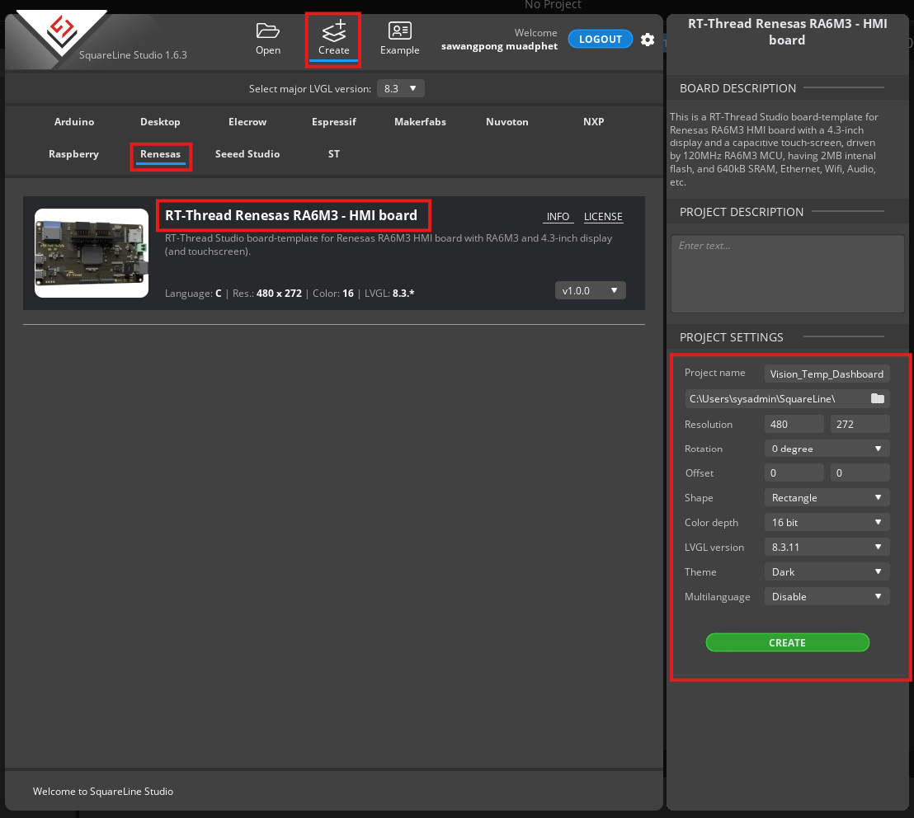{ width="600" }

---

## Lab 10.2: สร้างหัวข้อด้านบน (Header) และกรอบพื้นหลัง (Card Panels)

เราจะแบ่งหน้าจอออกเป็น **2 ฝั่ง (ซ้าย = อุณหภูมิ, ขวา = ความชื้น)** เพื่อให้ดูเป็นระเบียบ:

!!! info "กฎการตั้งชื่อ Widget ใน SquareLine Studio 1.6.x"
    โปรแกรมเวอร์ชัน 1.6.x **ไม่อนุญาตให้พิมพ์เครื่องหมายขีดล่าง (`_`)** ในช่อง Name ของ Widget ให้พิมพ์ติดกันแบบ **CamelCase** เช่น `LabelTitle` หรือ `panelTemp` ซึ่งเมื่อ Export เป็นภาษา C ระบบจะเติม `ui_` ข้างหน้าให้เองเป็น `ui_LabelTitle` และ `ui_panelTemp`

1. **สร้างข้อความหัวข้อ (Header Title):**
   - ไปที่แถบ **Widgets** (ซ้ายล่าง) → ลาก **`Label`** มาวางด้านบนสุดตรงกลางของหน้าจอ
   - ไปที่แถบ **Inspector** (ด้านขวา):
     - **Name:** `LabelTitle`
     - **Align:** เลือก `TOP MID` | **X:** `0 px` | **Y:** `12 px`
     - **Text:** พิมพ์คำว่า `RA8D1 VISION - ENVIRONMENT MONITOR`
     - **Style Settings → Text → Text Color:** สีขาว หรือสีฟ้าอ่อน (`#38BDF8`)

2. **สร้างกล่องการ์ดฝั่งซ้าย (Temperature Card):**
   - ลาก **`Panel`** จากแถบ Widgets มาวางทางซ้ายของหน้าจอ
   - ตั้งค่าใน **Inspector**:
     - **Name:** `panelTemp`
     - **Align:** `LEFT MID` | **X:** `20 px` | **Y:** `15 px`
     - **Width:** `210 px` | **Height:** `200 px`
     - **Style Settings → Background:** ตั้ง **Bg Color** เป็นสีเทาเข้ม (`#1E293B`) และ **Radius** เป็น `15`

3. **สร้างกล่องการ์ดฝั่งขวา (Humidity Card):**
   - คลิกขวาที่ `panelTemp` ในหน้าต่าง **Hierarchy** (ซ้ายบน) → กด **Duplicate** (ทำสำเนา)
   - เปลี่ยนค่าใน **Inspector** ของกล่องใหม่:
     - **Name:** `panelHumi`
     - **Align:** `RIGHT MID` | **X:** `-20 px` | **Y:** `15 px`

   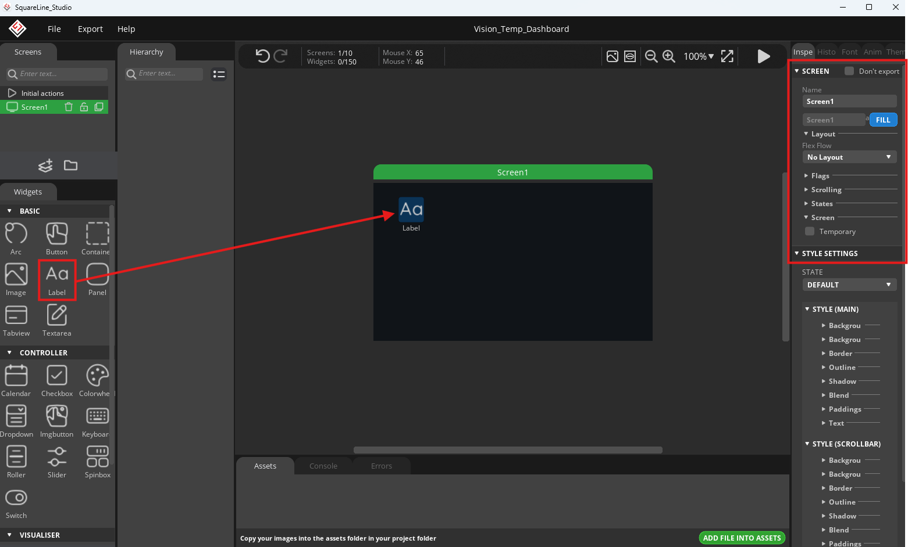{ width="600" }
   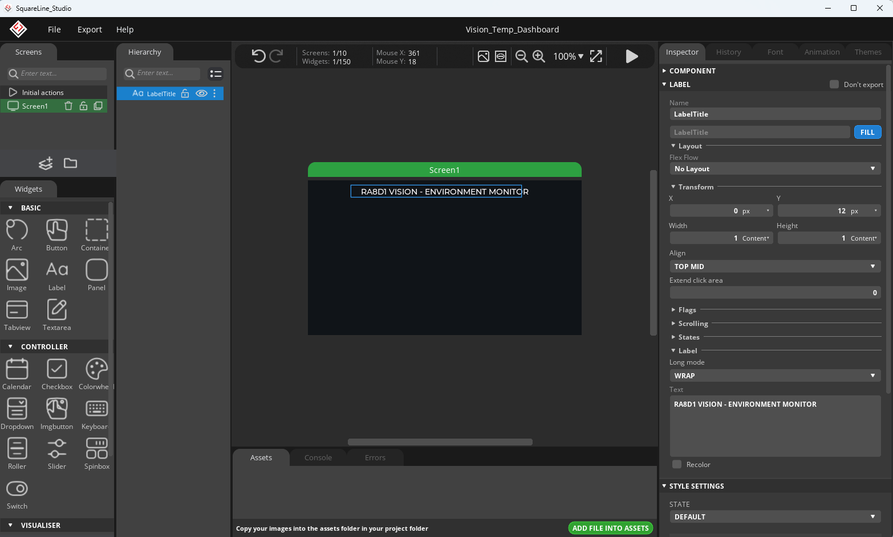{ width="600" }
   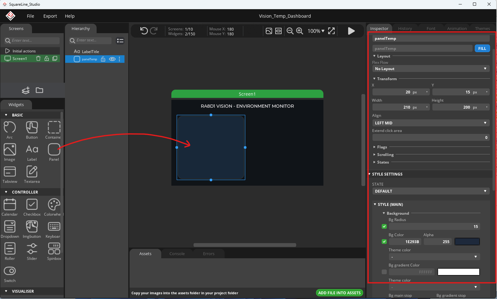{ width="600" }
   click ขวาที่หน้าต่าง Hierachy
   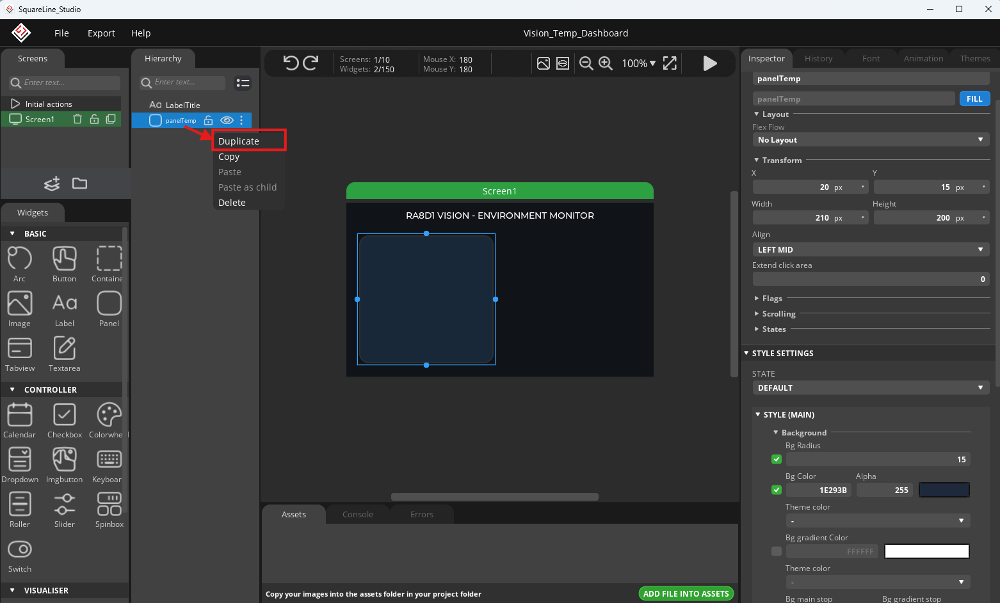{ width="600" }
   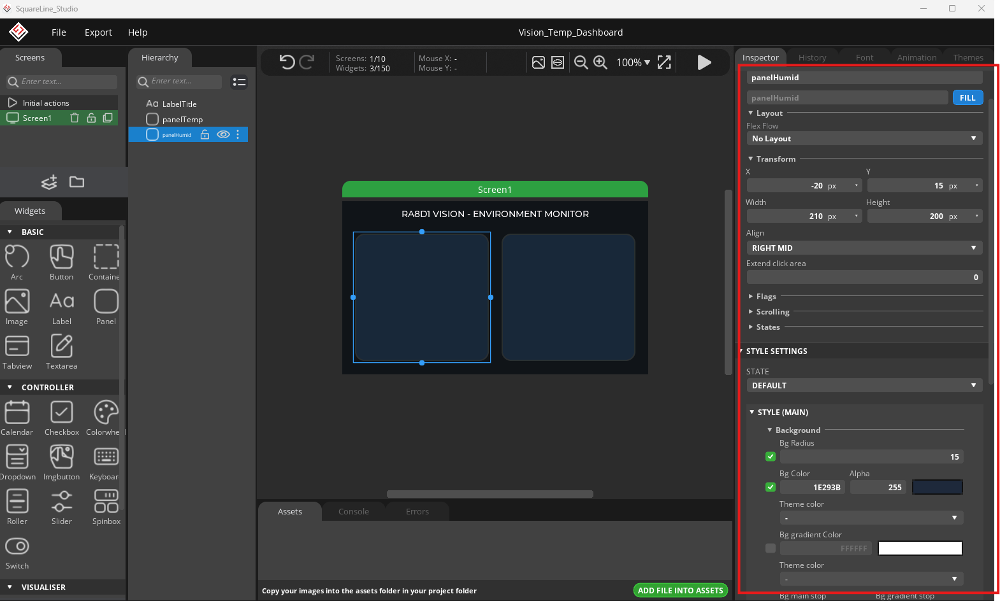{ width="600" }
---

## Lab 10.3: สร้างเกจวงกลม (Arc) และตัวเลขแสดงค่า (Labels)

### ส่วนที่ 1: ฝั่งอุณหภูมิ (Temperature Gauge)
1. ลาก **`Arc`** มาวาง **ข้างใน `panelTemp`** (สังเกตใน Hierarchy ว่า `Arc` ต้องเยื้องอยู่ใต้ `panelTemp`)
2. ตั้งค่า `Arc` ใน **Inspector**:
   - **Name:** `arcTemp` *(จำชื่อนี้ไว้! ในภาษา C จะกลายเป็น `ui_arcTemp`)*
   - **Align:** `CENTER` | **X:** `0 px` | **Y:** `5 px` | **Width:** `140 px` | **Height:** `140 px`
   - **Range Min:** `0` | **Range Max:** `100` | **Value:** `28` *(ค่าตัวอย่างตอนออกแบบ)*
   - **Style Settings (Indicator):** เลือก **Arc Color** เป็นสีส้ม-แดง (`#F97316`)
   - *(หากไม่ต้องการให้มีปุ่มกลมๆ ตรงปลายแถบ)* ให้เลือกส่วน **Knob** → ปรับ **Bg Opa** เป็น `0`

3. ลาก **`Label`** มาวางตรงกลางวงกลม `arcTemp` เพื่อแสดงตัวเลขอุณหภูมิ:
   - **Name:** `lblTempVal` *(ในภาษา C จะกลายเป็น `ui_lblTempVal`)*
   - **Align:** `CENTER` | **X:** `0 px` | **Y:** `-5 px`
   - **Text:** `28.5°C`

4. ลาก **`Label`** อีกตัวมาวางด้านล่างของวงกลมเพื่อบอกชื่อค่า:
   - **Name:** `lblTempTitle`
   - **Align:** `BOTTOM MID` | **X:** `0 px` | **Y:** `-10 px`
   - **Text:** `TEMPERATURE`

### ส่วนที่ 2: ฝั่งความชื้น (Humidity Gauge)
- ทำซ้ำขั้นตอนเดียวกับฝั่งอุณหภูมิ แต่ลากวาง **ข้างใน `panelHumi`** และตั้งชื่อดังนี้:
  - เกจวงกลมตั้งชื่อ: **`arcHumi`** (Range `0–100`, Value `60`, สีฟ้า `#0EA5E9`)
  - ตัวเลขตรงกลางตั้งชื่อ: **`lblHumiVal`** (Text: `60.0%`)
  - ข้อความด้านล่างตั้งชื่อ: **`lblHumiTitle`** (Text: `HUMIDITY`)

   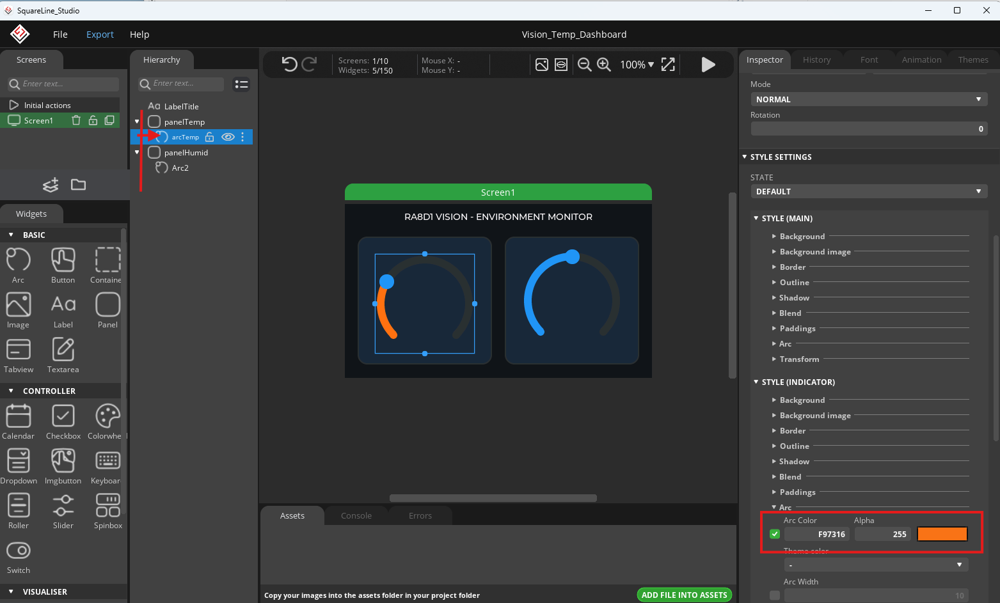{ width="600" }
    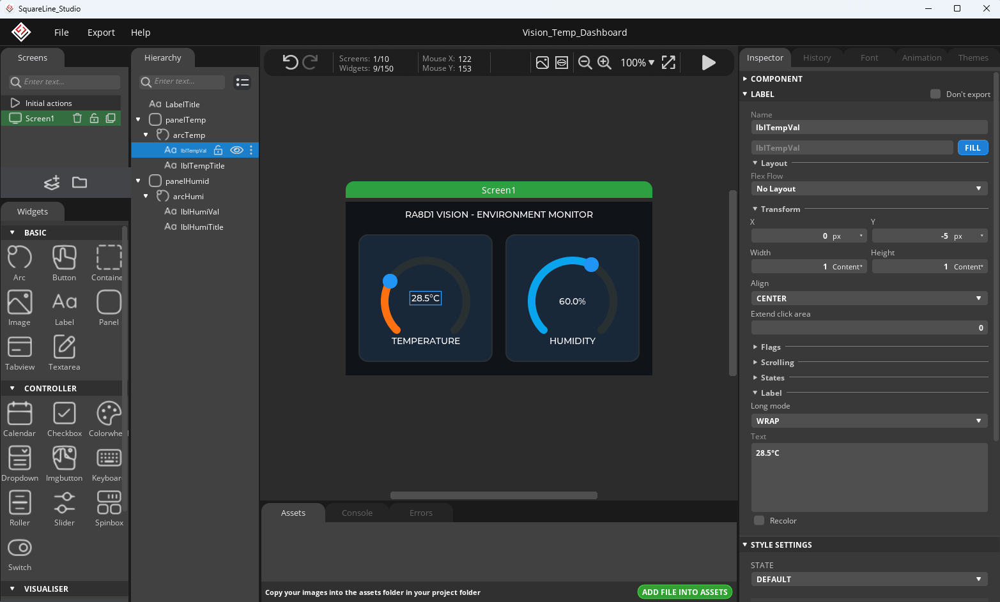{ width="600" }
---

## Lab 10.4: เปลี่ยนขนาดตัวอักษรให้ใหญ่และคมชัด (Font Manager)

ฟอนต์เริ่มต้นของ LVGL มีขนาดเล็ก (14px) เราสามารถสร้างฟอนต์ขนาดใหญ่สำหรับตัวเลข `28.5°C` และ `60.0%` ได้เอง:

### Copy fonts จาก Google font
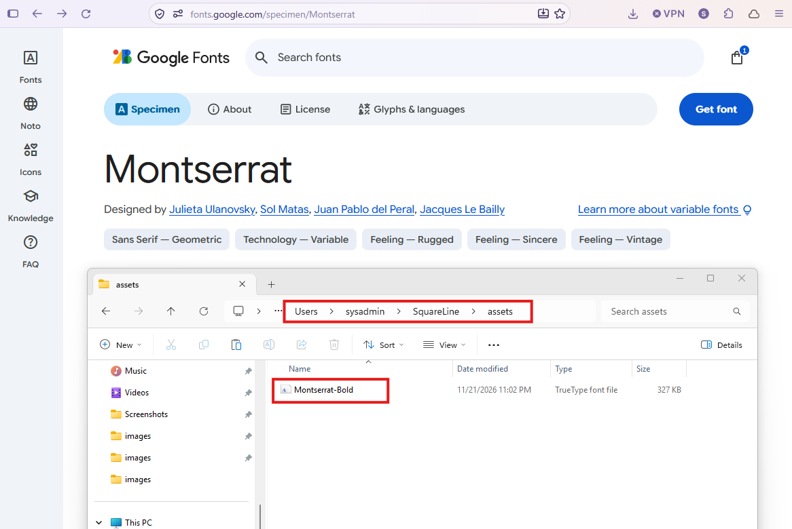

1. เปิดแท็บ **Font** (แถบด้านขวาบน ข้างๆ แท็บ Inspector / History)
2. กดปุ่ม **ADD NEW FONT**
3. ตั้งค่าฟอนต์ใหม่:
   - **Name:** `fontNum28` *(ไม่ใส่ `_` เช่นกัน)*
   - **Font:** เลือก `Montserrat-Bold.ttf` (หรือฟอนต์ที่มีในเครื่อง)
   - **Size:** `28` (px) | **Bpp:** `4 bit-per-pixel` (ช่วยให้ขอบตัวอักษรเรียบเนียน)
   - **Range:** ใส่ `0x30-0x39` *(ใส่เฉพาะตัวอักษรที่ใช้จริง ช่วยประหยัดหน่วยความจำ Flash ของบอร์ดได้มหาศาล!)*
    - **Symbols** ใส่ `0123456789.%°CF-` *(ใส่เฉพาะตัวอักษรที่ใช้จริง ช่วยประหยัดหน่วยความจำ Flash ของบอร์ดได้มหาศาล!)*
4. กดปุ่ม **CREATE**
5. กลับมาที่แท็บ **Inspector** → คลิกเลือกตัวเลข `lblTempVal` และ `lblHumiVal` → เลื่อนลงไปที่ **Style Settings → Text → Text Font** → เปลี่ยนเป็น **`fontNum28`**

   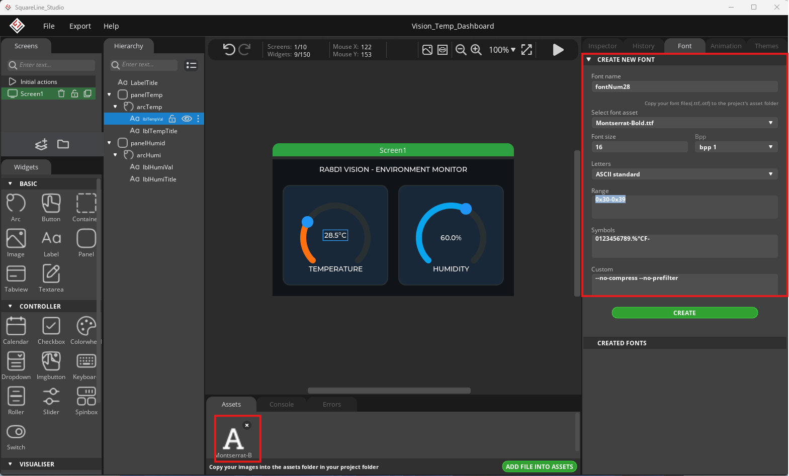{ width="600" }
    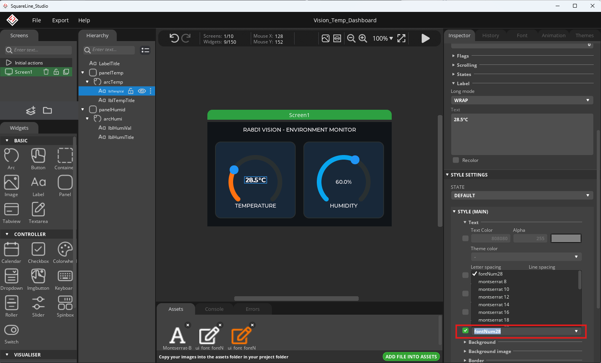{ width="600" }
    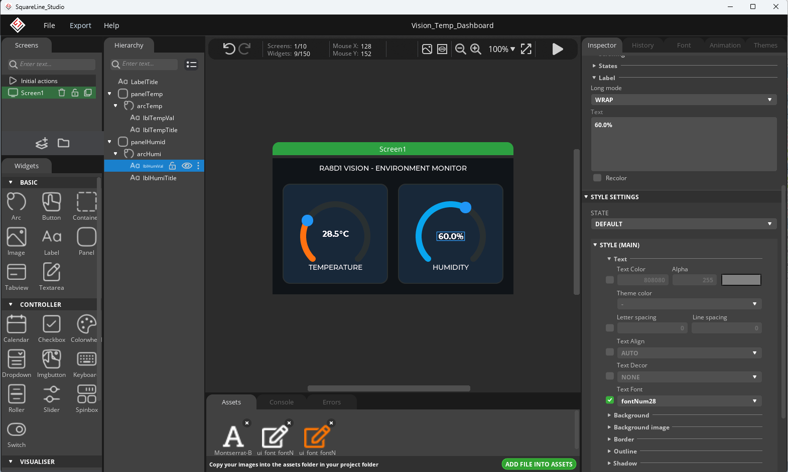{ width="600" }
---

## Lab 10.5: ทดลองรันบน PC (Play Mode) และ Export โค้ด

1. **ทดสอบจำลองบนคอมพิวเตอร์ (Simulator):**
   - คลิกปุ่ม **Play (▶)** ที่แถบเครื่องมือด้านบนของโปรแกรม
   - ลองใช้เมาส์ลากเลื่อนแถบวงกลม `arcTemp` และ `arcHumi` เพื่อดูความลื่นไหลของกราฟิก
   - กดปุ่ม **Stop (■)** เพื่อกลับสู่โหมดแก้ไข

2. **ตั้งค่าการ Export โค้ดภาษา C:**
   - กด **Save** โปรเจกต์ (`Ctrl+S`)
   - ไปที่เมนู **File → Project Settings**
   - ในช่อง **UI Files Export Path** กด Browse แล้วสร้างโฟลเดอร์ใหม่ชื่อ **`ui`** (เช่น `C:\Users\sysadmin\SquareLine\Vision_Temp_Dashboard\ui`)
   - กด **Apply Changes**

3. **สั่ง Export ไฟล์:**
   - ไปที่เมนู **Export → Export UI Files**
   - เปิดเข้าไปดูในโฟลเดอร์ `ui` คุณจะพบไฟล์ภาษา C ที่พร้อมนำไปเชื่อมต่อกับ RT-Thread ในบทถัดไป (`ui.c`, `ui.h`, `screens/ui_Screen1.c`, `fonts/ui_font_fontNum28.c`)

    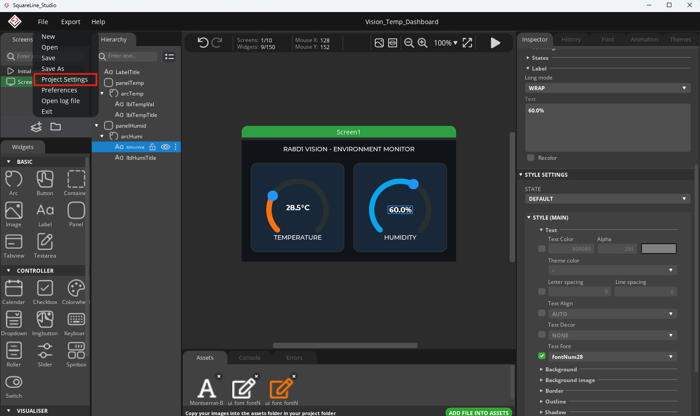
    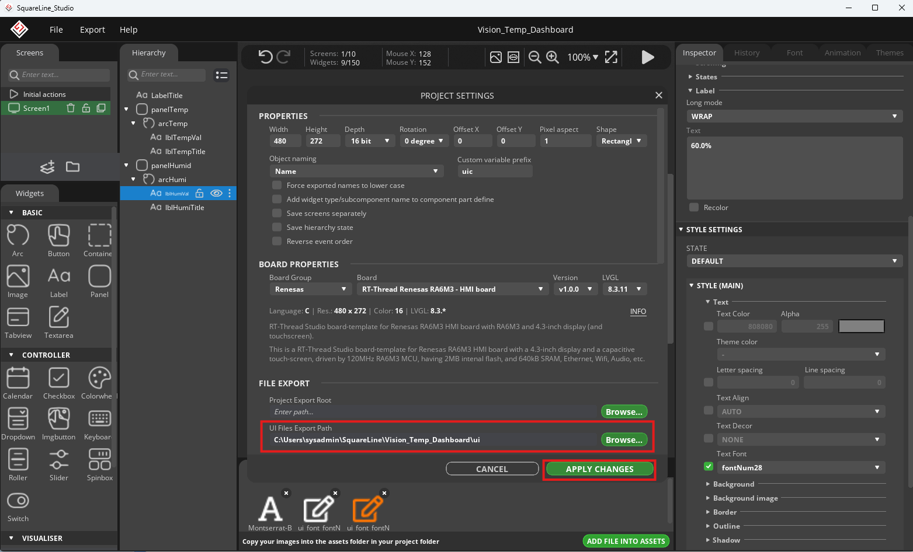
   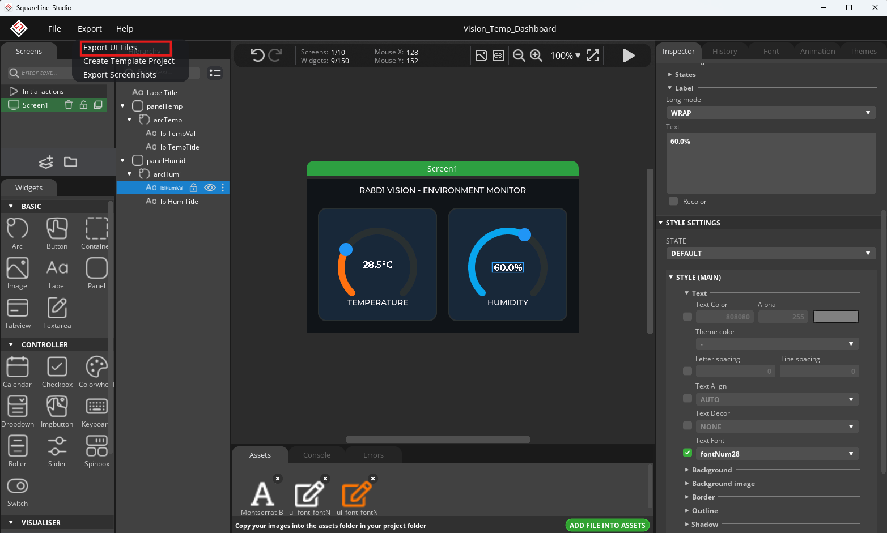{ width="600" }
   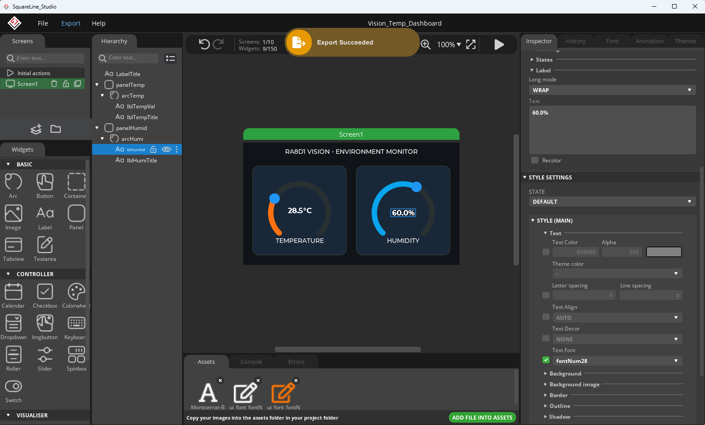{ width="600" }
---

## แหล่งเรียนรู้เพิ่มเติมบน YouTube (สำหรับทบทวนและฝึกขั้นสูง)

คุณสามารถค้นหาและศึกษาเทคนิคการออกแบบเพิ่มเติมจากช่อง YouTube ทางการและชุมชนนักพัฒนา LVGL ดังนี้:

1. **SquareLine Studio Official Channel (YouTube):**
   - ค้นหาคำว่า: `SquareLine Studio Official Tutorial` หรือ `SquareLine Studio Getting Started`
   - เนื้อหาแนะนำ: การใช้ **Flex Layout** (จัดเรียงปุ่มอัตโนมัติ), การทำ **Screen Transitions** (เปลี่ยนหน้าจอเมื่อกดปุ่ม) และการสร้าง **Component** ใช้ซ้ำ
2. **LVGL & SquareLine Studio Dashboard Tutorials:**
   - ค้นหาคำว่า: `SquareLine Studio LVGL Gauge Dashboard Tutorial`
   - เนื้อหาแนะนำ: เทคนิคการออกแบบหน้าปัดรถยนต์, Smart Home Dashboard และการทำอนิเมชันเข็มวัด
3. **RT-Thread + LVGL Integration Tutorials:**
   - ค้นหาคำว่า: `RT-Thread LVGL SquareLine Studio`
   - เนื้อหาแนะนำ: ตัวอย่างการนำโค้ดที่ Export จาก SquareLine Studio ไปรันบนบอร์ดไมโครคอนโทรลเลอร์ตระกูล ARM Cortex-M
