# Workshop 11: Integrate SquareLine UI เข้าสู่ RT-Thread Studio

<span class="md-tag">Integration</span> <span class="md-tag">RT-Thread Studio</span> <span class="md-tag">LVGL</span> <span class="md-tag">Multi-Threading</span>

> 🔗 **เชื่อมโลกการออกแบบเข้ากับระบบ Real-Time OS:**
> ใน Workshop 10 คุณได้สร้างหน้าจอ Dashboard และ Export โฟลเดอร์ `ui/` ออกมาเป็นโค้ดภาษา C แล้ว ในบทนี้เราจะเรียนรู้วิธีนำโค้ดเหล่านั้นมา **ประกอบร่าง (Integrate)** เข้ากับโปรเจกต์ **RT-Thread บนบอร์ด RA8D1 Vision Board** ตั้งค่าระบบ Build (`SConscript`) และส่งข้อมูลจริงจาก **Sensor / MQTT Thread** มาอัปเดตตัวเลขบนหน้าจออย่างปลอดภัย!

## สิ่งที่คุณจะได้ทำในบทนี้

- [ ] นำโฟลเดอร์ `ui/` เข้าโปรเจกต์ RT-Thread Studio และเขียน **`ui/SConscript`** ให้ระบบ Build มองเห็น
- [ ] เปิดใช้งานแพ็กเกจ **LVGL** และไดรเวอร์จอภาพของบอร์ด Vision Board ใน **RT-Thread Settings**
- [ ] สร้าง **LVGL Display Thread** แยกการทำงานออกจาก Main Thread
- [ ] เชื่อมต่อข้อมูลจริงจาก **Sensor / MQTT Thread** มาอัปเดตตัวเลขบนหน้าจอ (`ui_lblTempVal`, `ui_arcTemp`, `ui_lblHumiVal`, `ui_arcHumi`) แบบ **Thread-Safe**

---

## สถาปัตยกรรมการทำงานร่วมกัน (System Architecture)

ในระบบปฏิบัติการ RT-Thread เราจะแยกหน้าที่การทำงานออกเป็น **2 Threads** เพื่อไม่ให้การอ่านเซ็นเซอร์หรือการรับส่ง Wi-Fi/MQTT มาทำให้ภาพบนหน้าจอกระตุก (และป้องกันปัญหา LVGL ไม่รองรับ Multi-thread):

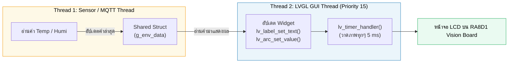

---

## ขั้นตอนที่ 1: นำโฟลเดอร์ `ui/` เข้าโปรเจกต์และสร้าง `SConscript`

### สร้าง project ทดสอบ `LVGL_Dashboard`
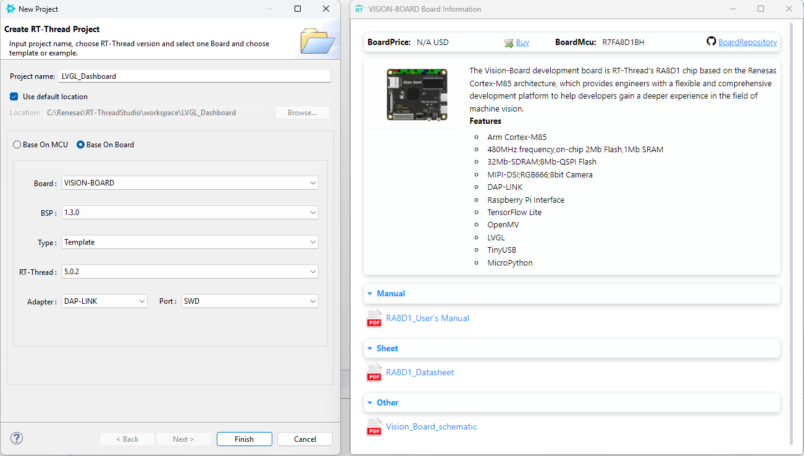

1. คัดลอกโฟลเดอร์ **`ui/`** (ที่ได้จากการ Export ใน Workshop 10) ไปวางไว้ในโฟลเดอร์หลักของโปรเจกต์ RT-Thread Studio:
`C:\Renesas\RT-ThreadStudio\workspace\LVGL_Dashboard`

   ```
   LVGL_Dashboard/
   ├── applications/ (หรือ src/)
   ├── libraries/
   ├── packages/
   ├── rt-thread/
   └── ui/                       ◀── วางโฟลเดอร์ ui ที่นี่
       ├── SConscript            ◀── สร้างไฟล์นี้เพิ่มเพื่อให้ SCons รู้จัก
       ├── ui.h
       ├── ui.c
       ├── screens/
       │   └── ui_Screen1.c
       └── fonts/
           └── ui_font_fontNum28.c
   ```
    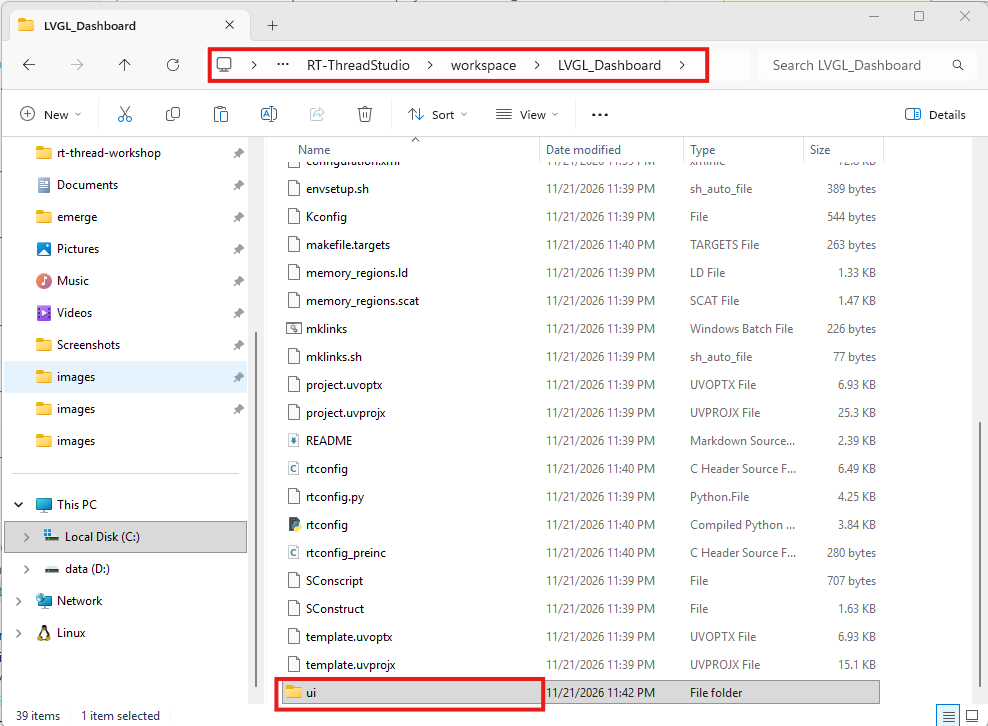

    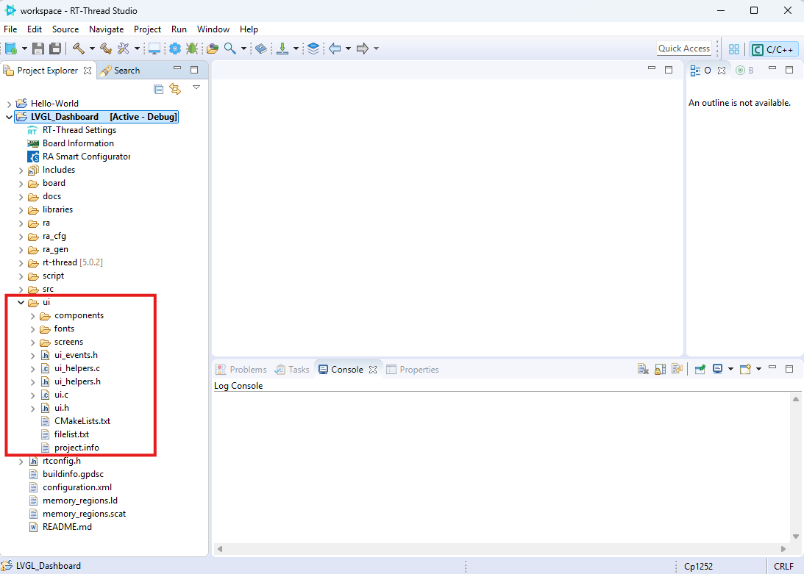

    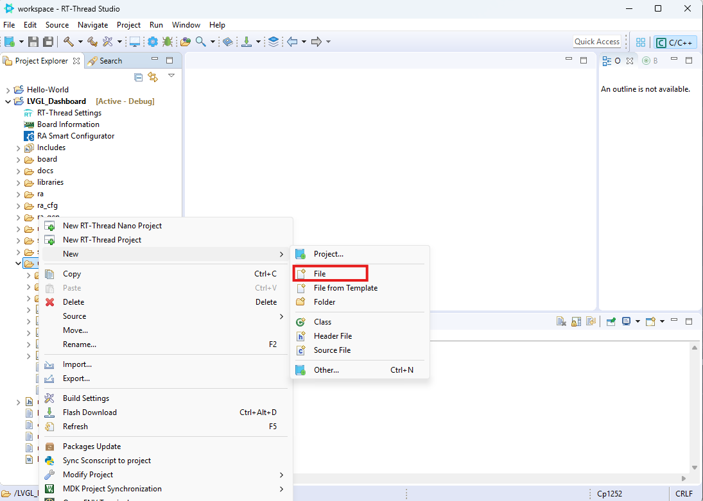

2. **สร้างไฟล์ `ui/SConscript`** (คลิกขวาที่โฟลเดอร์ `ui` ใน RT-Thread Studio → `New → File` ตั้งชื่อว่า `SConscript`) แล้วใส่คำสั่งนี้ลงไป:

   ```python title="ui/SConscript" linenums="1"
    from building import *
    import os

    cwd = GetCurrentDir()

    # Collect all .c files in the ui folder and subdirectories (screens, fonts, components, images)
    src = Glob('*.c')
    for subdir in ['screens', 'fonts', 'components', 'images']:
        subpath = os.path.join(cwd, subdir)
        if os.path.isdir(subpath):
            src += Glob(os.path.join(subdir, '*.c'))

    # Add the ui folder to Include Paths so other files can directly #include "ui.h"
    CPPPATH = [cwd]

    group = DefineGroup('SquareLineUI', src, depend = ['PKG_USING_LVGL'], CPPPATH = CPPPATH)
    Return('group')

   ```
   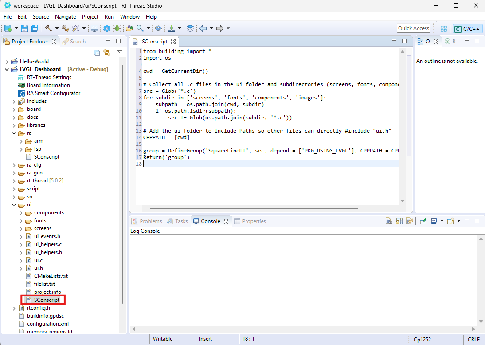

3. คลิกขวาที่ชื่อโปรเจกต์ `LVGL_Dashboard` ใน RT-Thread Studio  → กด **Refresh (F5)**

   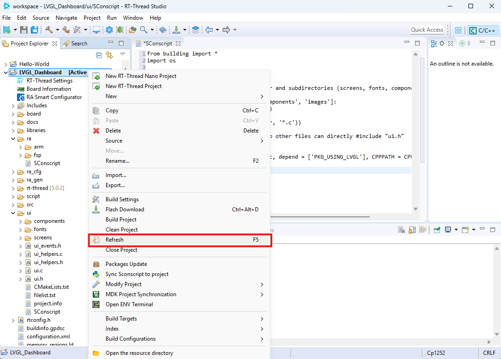{ width="600" }

---

## ขั้นตอนที่ 2: เปิดใช้งาน LVGL และ Display Driver ใน RT-Thread Settings

1. ดับเบิลคลิกเปิด **`RT-Thread Settings`**
2. ไปที่ **Software Packages → Multimedia → LVGL**:
   - เปิดใช้งาน **LVGL: powerful and easy-to-use embedded GUI library**
   - เลือกเวอร์ชัน **`v8.3.x`** (ให้ตรงกับเวอร์ชัน `8.3` ที่ตั้งไว้ใน SquareLine Studio)
3. ไปที่ **Hardware → On-chip Peripheral Drivers**:
   - เปิดใช้งานไดรเวอร์จอ LCD ให้ตรงกับรุ่นจอที่ต่อกับบอร์ด Vision Board (เช่น `Enable LCD` / `MIPI-DSI` หรือ `RGB LCD`)
4. กด **Ctrl+S** เพื่อบันทึกและรอให้ IDE อัปเดตแพ็กเกจเสร็จสิ้น

    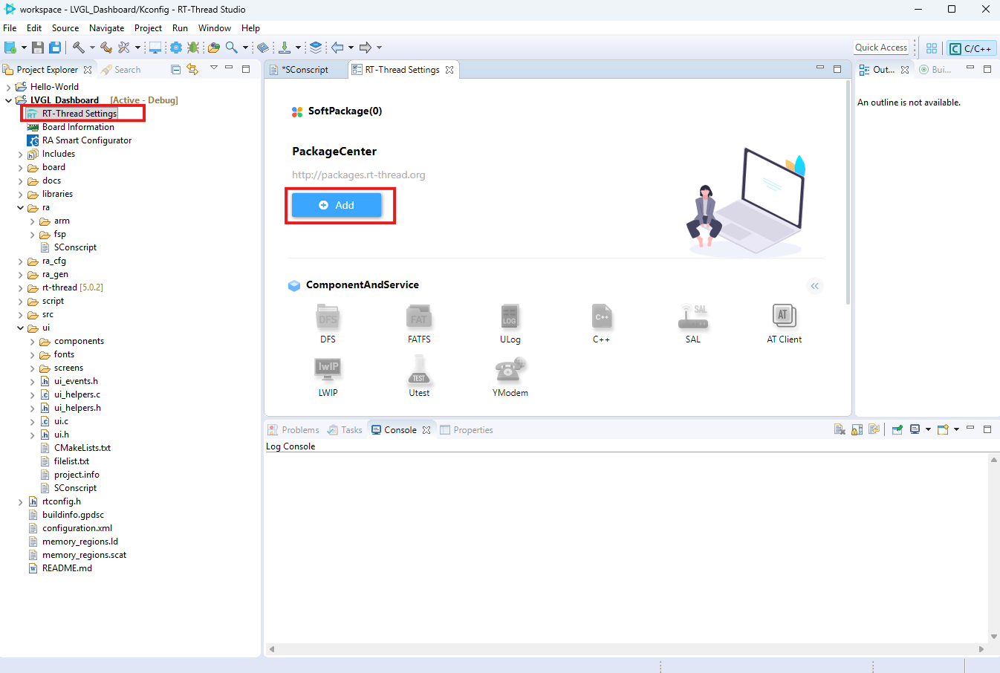

    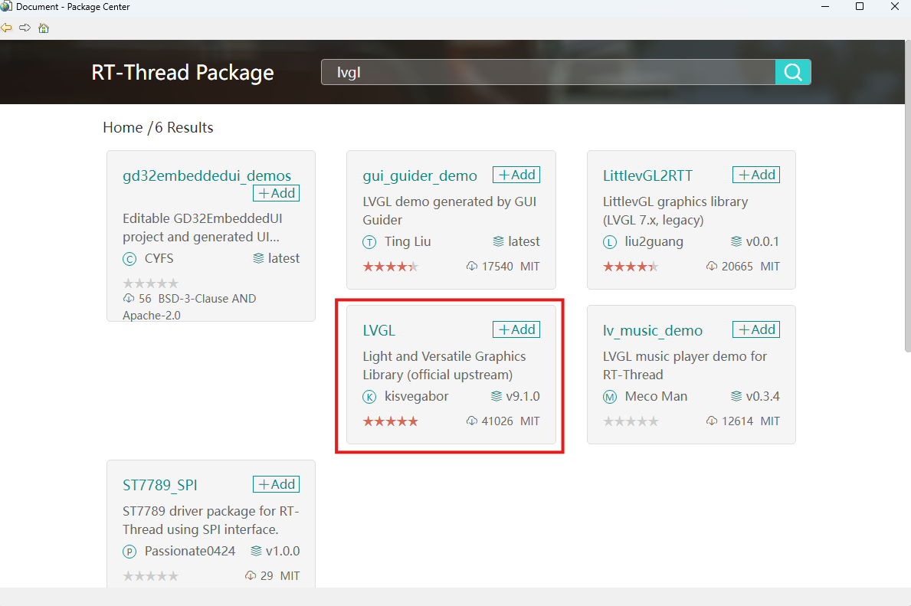
    เลือก Config
    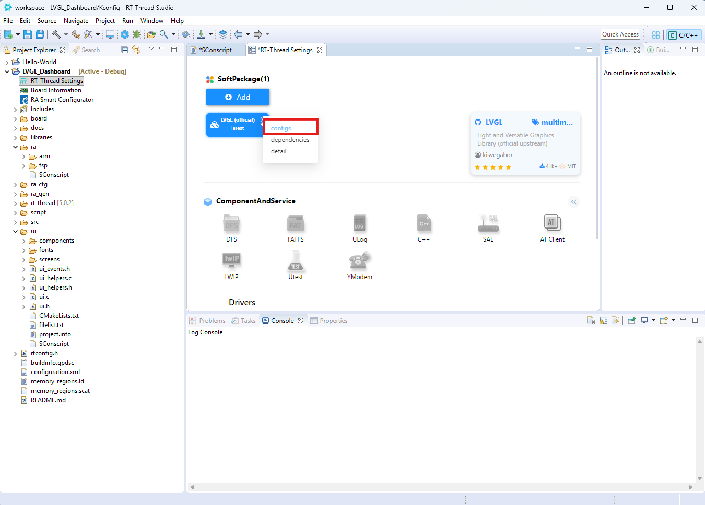
    enable
    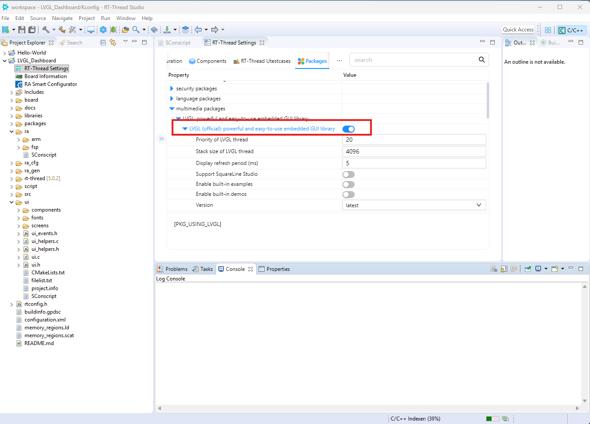

    version 8.3.*
    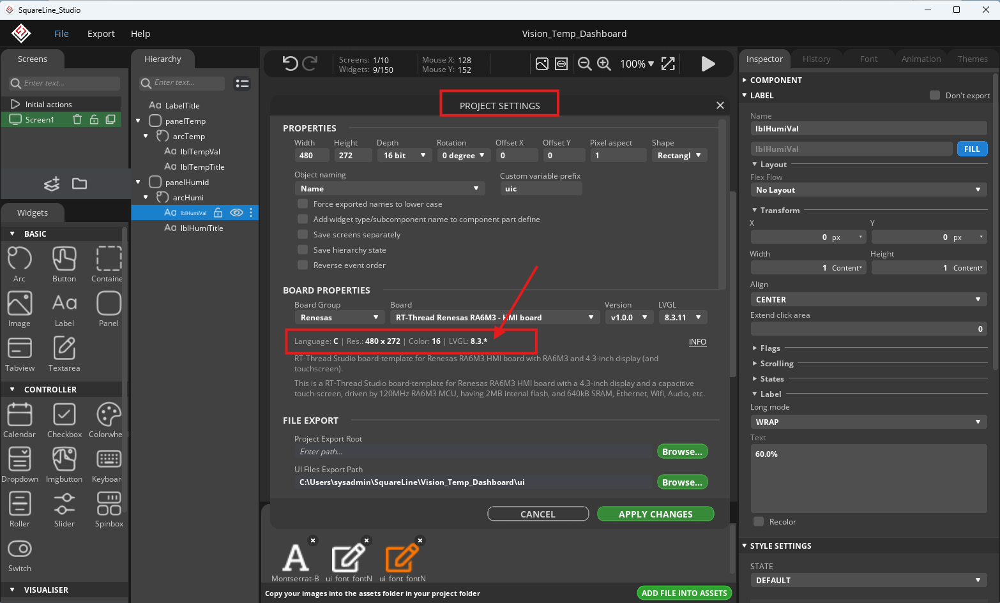
    lvgl version setting
    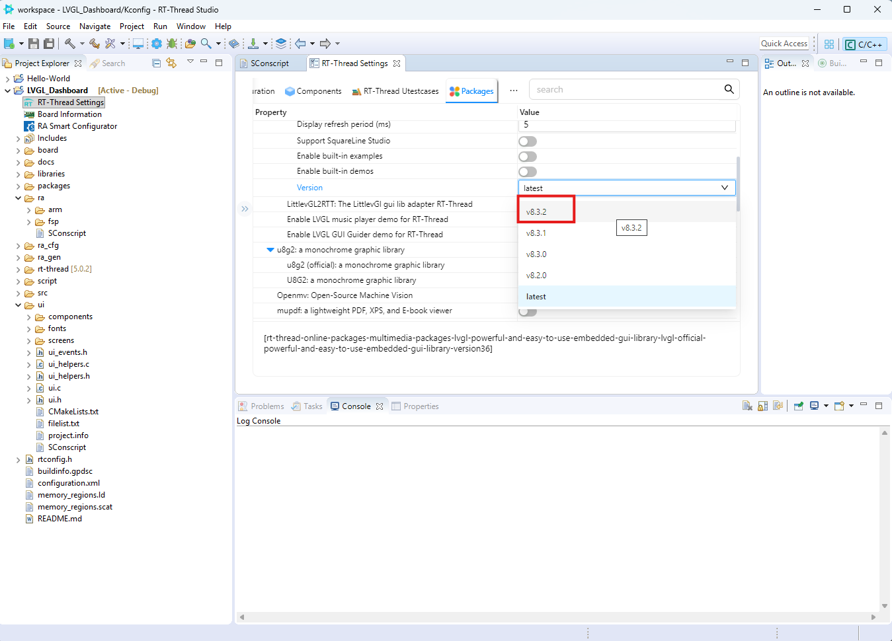
    save lvgl config
    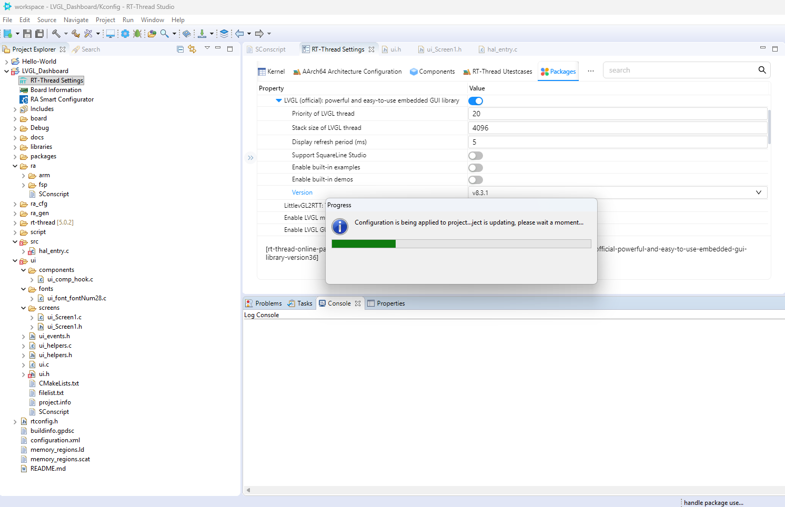

    save all
    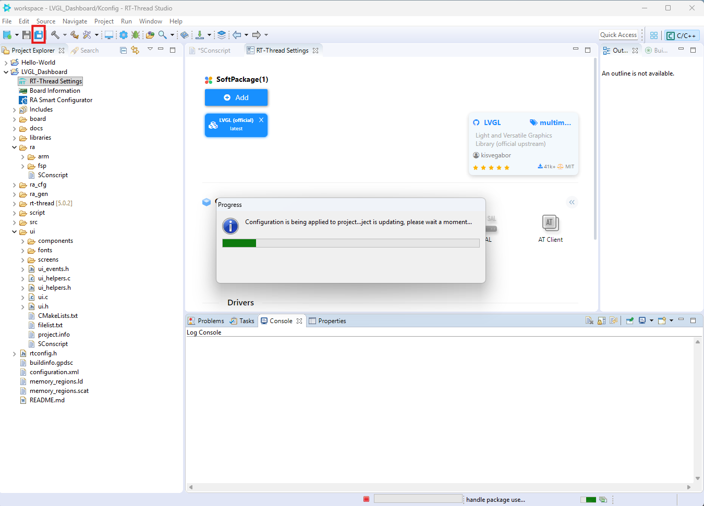


---

## ขั้นตอนที่ 3: ตรวจสอบรายชื่อตัวแปร Widget ใน `ui.h`

เปิดไฟล์ **`ui/Screens/ui_Screen1.h`** ขึ้นมาตรวจสอบชื่อตัวแปรภาษา C ที่ SquareLine Studio (v1.6.3) สร้างให้จากชื่อ CamelCase ที่เราตั้งไว้ใน Workshop 10 (ระบบจะเติม `ui_` นำหน้าชื่อเดิมเสมอ):

```c title="ตัวอย่างตัวแปรในไฟล์ ui/ui.h (ตรงกับ Workshop 10)"
// SCREEN: ui_Screen1
extern void ui_Screen1_screen_init(void);
extern void ui_Screen1_screen_destroy(void);
extern lv_obj_t * ui_Screen1;
extern lv_obj_t * ui_LabelTitle;
extern lv_obj_t * ui_panelTemp;
extern lv_obj_t * ui_arcTemp;
extern lv_obj_t * ui_lblTempVal;
extern lv_obj_t * ui_lblTempTitle;
extern lv_obj_t * ui_panelHumid;
extern lv_obj_t * ui_arcHumi;
extern lv_obj_t * ui_lblHumiVal;
extern lv_obj_t * ui_lblHumiTitle;
```

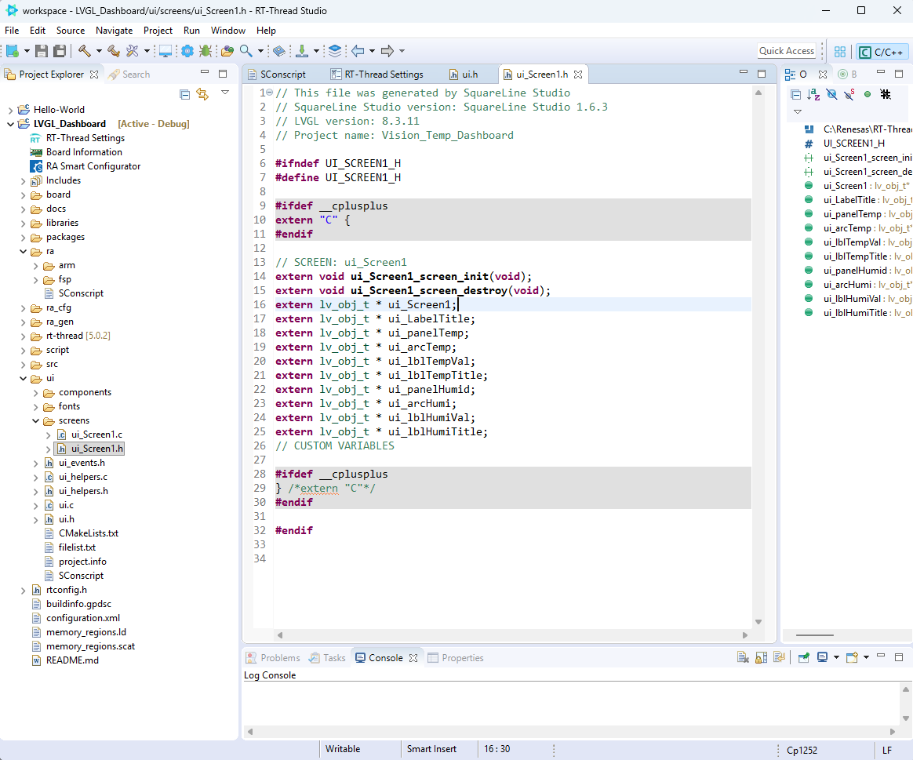

---

## ขั้นตอนที่ 4: เขียนโค้ดเชื่อมข้อมูลและรัน LVGL Thread (`hal_entry.c` หรือ `main.c`)

โค้ดตัวอย่างด้านล่างนี้สร้าง **LVGL Thread** ขึ้นมาดูแลหน้าจอโดยเฉพาะ และดึงค่าจากโครงสร้างข้อมูลกลาง `g_env_data` (ซึ่งสามารถรับค่ามาจาก Sensor I2C หรือ MQTT Thread ได้) มาอัปเดตขึ้นหน้าจอทุกๆ 500 มิลลิวินาที:

```c title="ตัวอย่างการ Integrate SquareLine UI กับ Sensor/MQTT Thread" linenums="1"
#include <rtthread.h>
#include <rtdevice.h>
#include "hal_data.h"
#include <lvgl.h>
#include "ui.h"         /* Include UI header generated from SquareLine Studio */

/* Shared data structure for exchanging values between threads */
typedef struct {
    float temperature;
    float humidity;
    rt_bool_t updated;
} env_data_t;

static volatile env_data_t g_env_data = {28.5f, 60.0f, RT_FALSE};

/* =========================================================================
 * Thread 1: LVGL Display Thread (Handles all screen rendering and updates)
 * ========================================================================= */
static void lvgl_gui_thread_entry(void *parameter)
{
    char text_buf[32];
    rt_tick_t last_ui_update = 0;

    /* 1. Initialize all UI screens designed in SquareLine Studio */
    ui_init();

    while (1)
    {
        /* 2. Check if it is time to update screen values (every 500ms) */
        if (rt_tick_get() - last_ui_update >= rt_tick_from_millisecond(500))
        {
            last_ui_update = rt_tick_get();

            /* Update temperature widgets (ui_lblTempVal label + ui_arcTemp arc) */
            rt_snprintf(text_buf, sizeof(text_buf), "%.1f°C", g_env_data.temperature);
            lv_label_set_text(ui_lblTempVal, text_buf);
            lv_arc_set_value(ui_arcTemp, (int16_t)g_env_data.temperature);

            /* Update humidity widgets (ui_lblHumiVal label + ui_arcHumi arc) */
            rt_snprintf(text_buf, sizeof(text_buf), "%.1f%%", g_env_data.humidity);
            lv_label_set_text(ui_lblHumiVal, text_buf);
            lv_arc_set_value(ui_arcHumi, (int16_t)g_env_data.humidity);
        }

        /* 3. Process LVGL graphics tasks and refresh the display */
        lv_timer_handler();
        rt_thread_mdelay(5);
    }
}

/* =========================================================================
 * Thread 2: Sensor / MQTT Simulation Thread (Pushes updated data)
 * ========================================================================= */
static void sensor_sim_thread_entry(void *parameter)
{
    float sim_temp = 25.0f;
    float sim_humi = 50.0f;

    while (1)
    {
        /* (In production, replace with actual SHT30/BME280 reading or MQTT callback) */
        sim_temp += 0.3f;
        if (sim_temp > 38.0f) sim_temp = 24.0f;

        sim_humi += 0.5f;
        if (sim_humi > 85.0f) sim_humi = 45.0f;

        /* Save values to the shared structure for the LVGL thread to display */
        g_env_data.temperature = sim_temp;
        g_env_data.humidity    = sim_humi;
        g_env_data.updated     = RT_TRUE;

        rt_thread_mdelay(1000);
    }
}

void hal_entry(void)
{
    rt_kprintf("\n=== RA8D1 Vision Board: SquareLine LVGL Integration ===\n");

    /* Create LVGL Thread (requires a large stack size, e.g., 4096 or 8192 bytes) */
    rt_thread_t gui_tid = rt_thread_create("lvgl_gui",
                                           lvgl_gui_thread_entry,
                                           RT_NULL,
                                           8192,
                                           15,
                                           10);
    if (gui_tid != RT_NULL)
    {
        rt_thread_startup(gui_tid);
    }

    /* Create Sensor Thread */
    rt_thread_t sens_tid = rt_thread_create("sensor_sim",
                                            sensor_sim_thread_entry,
                                            RT_NULL,
                                            1024,
                                            20,
                                            10);
    if (sens_tid != RT_NULL)
    {
        rt_thread_startup(sens_tid);
    }
}

```

---

??? failure "แก้ปัญหาเบื้องต้น (Troubleshooting)"
    **Build Error: `ui.h: No such file or directory` หรือ `undefined reference to ui_init`**
    - ตรวจสอบว่าในโฟลเดอร์ `ui/` มีไฟล์ **`SConscript`** อยู่จริง และไม่มีนามสกุล `.txt` ต่อท้าย
    - คลิกขวาที่โปรเจกต์ใน RT-Thread Studio → กด **Refresh (F5)** แล้วกด **Build** ใหม่

    **หน้าจอแสดงตัวเลขเป็นสี่เหลี่ยม `□□` แทนที่จะเป็นเครื่องหมายองศา `°`**


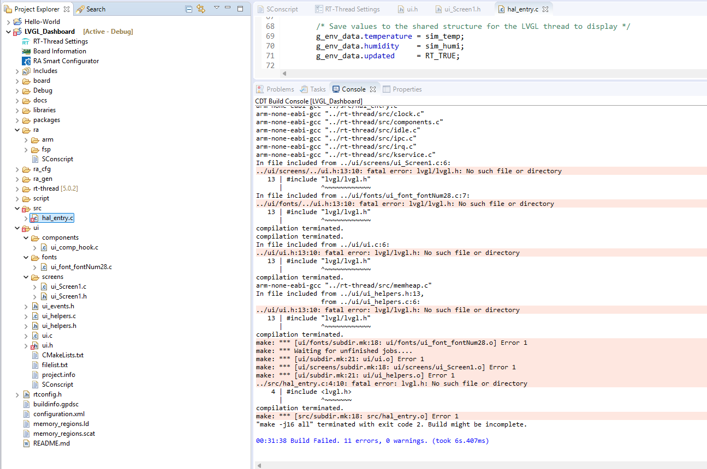

จากหน้าต่าง Console ในภาพ สาเหตุที่ Build ไม่ผ่านเกิดจาก โปรเจกต์ยังไม่ได้ติดตั้งหรือเปิดใช้งานแพ็กเกจ LVGL (สังเกตได้จากทั้ง #include "lvgl/lvgl.h" ในไฟล์ของ SquareLine และ #include <lvgl.h> ใน hal_entry.c ต่างก็แจ้ง Error No such file or directory ทั้งคู่)

ขั้นตอนการแก้ไขให้ Build ผ่าน

1. เปิดใช้งานแพ็กเกจ LVGL ใน RT-Thread Settings:
	• คลิกที่แท็บ RT-Thread Settings ที่เปิดค้างไว้อยู่ด้านบน (ข้างๆ แท็บ SConscript)
	• กดปุ่ม Add (เครื่องหมาย +) เพื่อค้นหาและเพิ่มแพ็กเกจ LVGL (หรือคลิกที่รูปประแจ/ไอคอนกราฟิกเพื่อเปิดใช้งาน LVGL)
	• ตรวจสอบให้แน่ใจว่าเลือกเวอร์ชันเป็น v8.3.x (เช่น v8.3.11) จากนั้นกดบันทึก (Ctrl + S) เพื่อให้ RT-Thread Studio ดาวน์โหลดแพ็กเกจ LVGL ลงในโฟลเดอร์ packages
2. ตั้งค่า Include Path ใน SquareLine Studio ให้ตรงกัน:
	• ใน SquareLine Studio เปิด Project Settings
	• เปลี่ยนช่อง LVGL Include Path จาก lvgl/lvgl.h เป็น lvgl.h แล้วกด Export UI Files มาทับไฟล์ในโฟลเดอร์ ui อีกรอบ (หรือจะใช้ Find & Replace แก้คำว่า "lvgl/lvgl.h" เป็น "lvgl.h" ในโฟลเดอร์ ui ก็ได้เช่นกัน)
3. ตรวจสอบชื่อไฟล์ SConscript ในโฟลเดอร์ ui:
	• จาก Project Explorer ด้านซ้ายมือ สังเกตเห็นไฟล์ SConscript อยู่ในโฟลเดอร์ ui แล้ว (ยอดเยี่ยมมากครับ)
	• หลังจากติดตั้งแพ็กเกจ LVGL เสร็จ ให้คลิกขวาที่ชื่อโปรเจกต์ LVGL_Dashboard > เลือก Update All Projects เพื่อให้ระบบสร้าง Include Path ของ LVGL เข้าไปในตัวคอมไพเลอร์
4. กด Build ใหม่อีกครั้ง:
	• กดปุ่ม Build (รูปค้อน) เพื่อทดสอบคอมไพล์ใหม่
หากเปิดหน้า RT-Thread Settings แล้วหาแพ็กเกจ LVGL ไม่เจอ หรือกดอัปเดตแล้วมี Error อื่นแจ้งเตือนขึ้นมาใน Console สามารถส่งภาพหน้าจอหรือคัดลอกข้อความมาให้ช่วยดูต่อได้เลยครับ


# search กด Ctrl + h
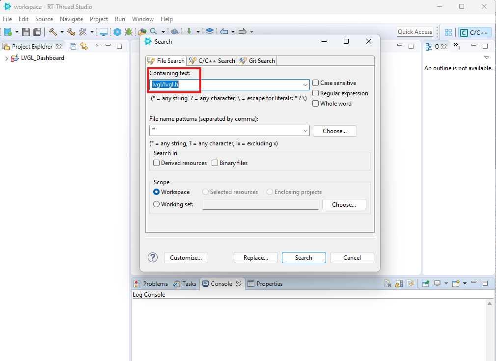

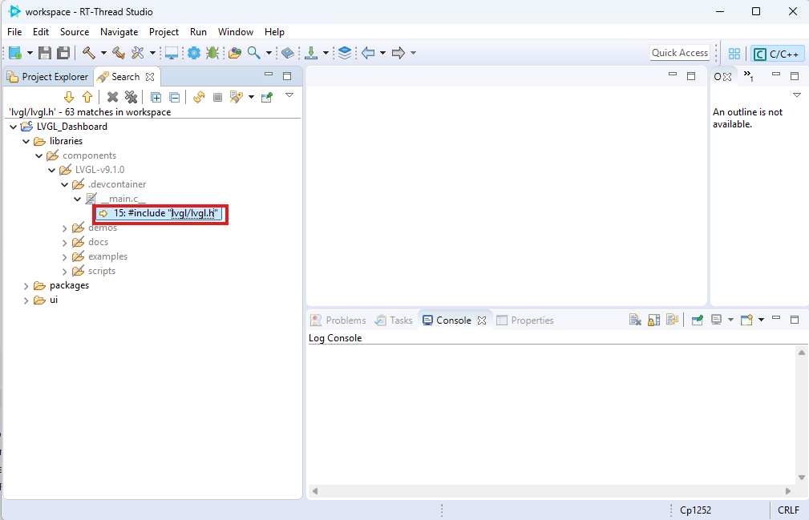


1. ห้ามแก้ในโฟลเดอร์ libraries (และต้องลบ LVGL-v9.1.0 ออก)

• ในผลลัพธ์การค้นหา มีไฟล์ที่อยู่ใน libraries/components/LVGL-v9.1.0 ติดมาด้วย ซึ่ง ห้ามไปแก้โค้ดข้างในตัวไลบรารี LVGL เอง
• ยิ่งไปกว่านั้น สังเกตว่าใน libraries/components/ มี LVGL-v9.1.0 ติดตั้งมากับ BSP ของบอร์ดอยู่แล้ว ซึ่งเวอร์ชัน 9.1.0 จะขัดแย้ง (Conflict) และเข้ากันไม่ได้กับโค้ดจาก SquareLine Studio ที่เป็นเวอร์ชัน 8.3.11

2. วิธีแก้ lvgl/lvgl.h เฉพาะในโฟลเดอร์ ui เท่านั้น

• ในหน้าต่าง Search (Ctrl + H) ให้เลือก Scope เป็น Selected resources (โดยคลิกเลือกเฉพาะโฟลเดอร์ ui ใน Project Explorer ก่อน) หรือในหน้าต่าง Search ตอนนี้ ให้คลิกขวาที่โฟลเดอร์ ui ด้านล่างสุดของรายการค้นหา แล้วเลือก Replace Selected... เพื่อแก้เฉพาะในโฟลเดอร์ ui เท่านั้น

3. จัดการเวอร์ชัน LVGL ไม่ให้ชนกัน (v9.1.0 vs v8.3.11)

เนื่องจากบอร์ด RA8D1 Vision Board มีโฟลเดอร์ LVGL-v9.1.0 แถมมาใน libraries/components/ และคุณเพิ่งเพิ่มแพ็กเกจ LVGL เข้าไปใน packages/ ให้ตรวจสอบดังนี้:
1. ปิด LVGL v9.1.0 ที่ติดมากับบอร์ด (ถ้าเปิดอยู่):
	• เปิด RT-Thread Settings > กดลูกศร << (มุมขวาบน) เพื่อเข้าหน้าตั้งค่าละเอียด
	• ไปที่แท็บ Hardware (หรือ Components) ตรวจสอบว่าไม่ได้ติ๊กเปิดใช้ LVGL v9.1.0 ของบอร์ดซ้ำซ้อนกับแพ็กเกจใน packages
2. ตั้งค่าแพ็กเกจใน packages ให้เป็น v8.3.11:
	• ในหน้า RT-Thread Settings คลิกที่กล่อง LVGL (official) เปลี่ยนเวอร์ชันจาก latest เป็น v8.3.11 แล้วกด Ctrl + S
3. อัปเดตโปรเจกต์และ Build:
	• คลิกขวาที่โปรเจกต์ LVGL_Dashboard > Update All Projects แล้วกด Build
หากแก้เฉพาะในโฟลเดอร์ ui และเปลี่ยนแพ็กเกจเป็น v8.3.11 แล้ว กด Build มี Error แจ้งเตือนเรื่องไฟล์ซ้ำซ้อน (Multiple definition) ระหว่าง libraries กับ packages หรือไม่ครับ สามารถแจ้งผลลัพธ์ใน Console ได้เลยครับ
