คู่มือขั้นตอนการ Clone ซอร์สโค้ดของ **RT-Thread RTOS** จาก GitHub และนำมา Build สำหรับบอร์ด **Renesas RA8D1 Vision Board** บนระบบปฏิบัติการ Windows 11 ผ่านเครื่องมือ **RT-Thread Env**

---

## 1. เตรียมเครื่องมือที่จำเป็นบน Windows (Prerequisites)

1 **Git for Windows:** ใช้สำหรับ Clone Repository ของ RT-Thread และดาวน์โหลด Software Packages
2 **RT-Thread Env Tool:** เครื่องมือ Command-Line อย่างเป็นทางการของ RT-Thread ที่รวม SCons Build System, Menuconfig (Kconfig) และ Python ไว้ครบชุด
* ดาวน์โหลดได้จาก [RT-Thread Env Releases (GitHub)](https://github.com/RT-Thread/env/releases) (เลือกไฟล์ `env-windows-vX.X.X.zip`)
* แตกไฟล์ไว้ในโฟลเดอร์ที่ **ไม่มีช่องว่างและไม่มีอักษรภาษาไทย** เช่น `C:\rt-thread-env`


3 **Arm GNU Toolchain (`arm-none-eabi-gcc`):** คอมไพเลอร์สำหรับสถาปัตยกรรม Arm Cortex-M85 (แนะนำเวอร์ชัน 10.3 หรือ 13.2 ขึ้นไป)
* ดาวน์โหลดได้จาก [Arm Developer Downloads - https://developer.arm.com/-/media/Files/downloads/gnu/13.3.rel1/binrel/arm-gnu-toolchain-13.3.rel1-mingw-w64-i686-arm-none-eabi.zip](https://developer.arm.com/-/media/Files/downloads/gnu/13.3.rel1/binrel/arm-gnu-toolchain-13.3.rel1-mingw-w64-i686-arm-none-eabi.zip) และติดตั้งไว้ที่ เช่น `C:\Renesas\ARM\13.3`


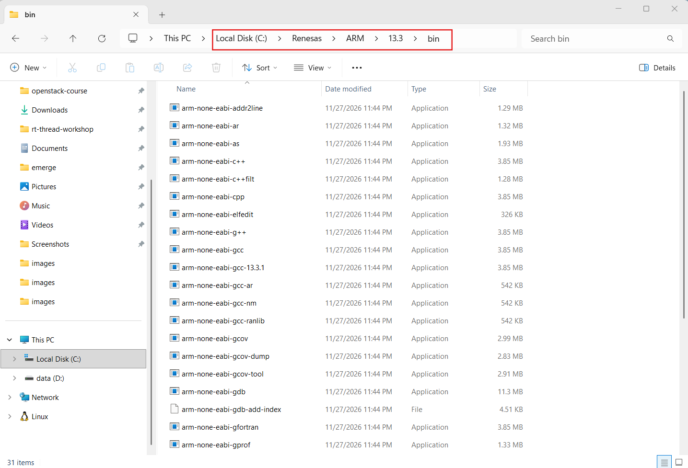

```
C:\Renesas\ARM\13.3\bin
```


4. **PyOCD:** ใช้สำหรับ Flash ไฟล์เฟิร์มแวร์ (`.bin` / `.hex`) ลงบอร์ดผ่านชิป DAPLink (`AT32F425KBU7`)
* ติดตั้งผ่าน Python ด้วยคำสั่ง `pip install pyocd` และติดตั้ง Pack สำหรับชิปตระกูล RA8D1 ด้วยคำสั่ง `pyocd pack install R7FA8D1BH`


!!! note
    PyOCD คือเครื่องมือโอเพนซอร์ส (Open-source) แบบ Command-Line และ Python Library สำหรับใช้ อัปโหลดเฟิร์มแวร์ (Flash) และ ดีบัก (Debug) ไมโครคอนโทรลเลอร์ตระกูล Arm Cortex-M (เช่น Renesas RA8D1 ที่ใช้แกน Arm Cortex-M85) บนเครื่องคอมพิวเตอร์ผ่านโปรโตคอล CMSIS-DAP

---

## 2. ขั้นตอนการ Clone ซอร์สโค้ด RT-Thread

เปิดโปรแกรม **Git Bash** หรือ **PowerShell** แล้วไปยังไดรฟ์ที่ต้องการเก็บซอร์สโค้ด (แนะนำ Path สั้นและไม่มีช่องว่าง เพื่อป้องกันปัญหา Path ยาวเกิน 260 ตัวอักษรบน Windows)

1  **สร้างโฟลเดอร์ทำงานและ Clone Repository หลัก:**
```bash
cd C:\Renesas
git clone --depth=1 https://github.com/RT-Thread/rt-thread.git

```
!!! info
    *(หมายเหตุ: การใส่ `--depth=1` ช่วยให้ดาวน์โหลดเฉพาะ Commit ล่าสุด ทำให้ Clone เสร็จเร็วขึ้นมาก)*

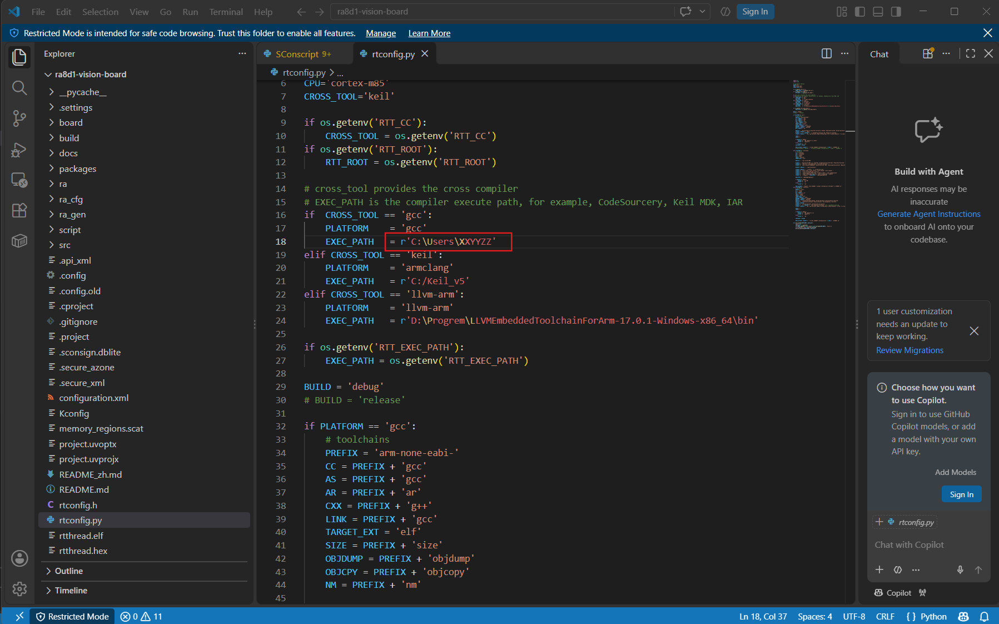

- กำหนด path cross compile แทนด้วย `C:\Users\XXYYZZ`  เป็น  `C:\Renesas\ARM\13.3\bin`

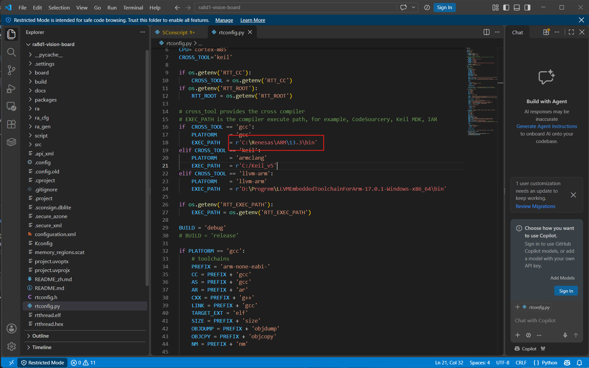


2 Download  Environment สำหรับ การ Build
- ไปที่ [https://github.com/RT-Thread/env/releases](https://github.com/RT-Thread/env/releases) เพื่อ Dowload zip
- แตก ไฟล์ C:\Renesas\env-2.0.2

```
cd C:\Renesas\env-2.0.2>

# ปลดล็อก Execution Policy ชั่วคราวสำหรับหน้าต่าง PowerShell นี้
Set-ExecutionPolicy -ExecutionPolicy Bypass -Scope Process -Force

#ปลดบล็อกไฟล์ที่ดาวน์โหลดมาจากอินเทอร์เน็ต (กรณีไฟล์ติดสถานะ Blocked จาก Windows):
Unblock-File -Path .\install_windows.ps1

.\install_windows.ps1
```
รอประมาณ 2-3 นาที
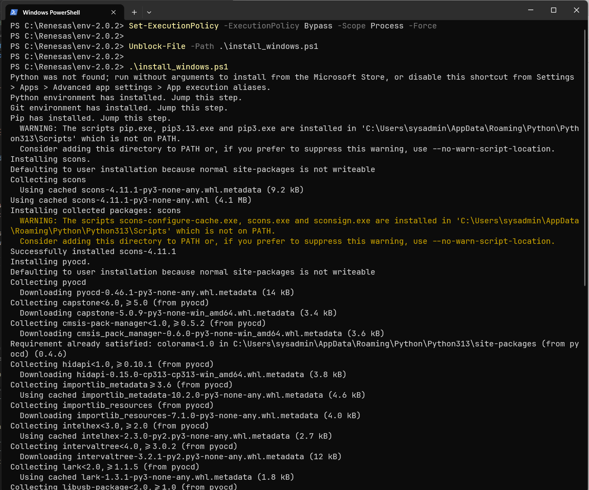

- start environment (env.ps1) ทุกครั้งที่ จะ Build 
```
cd $HOME
.\.env\env.ps1

# ติดตั้ง pyocd
pip install pyocd
```

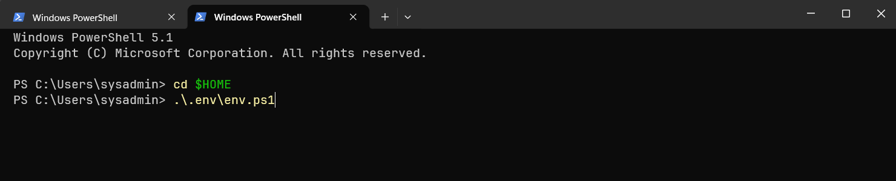

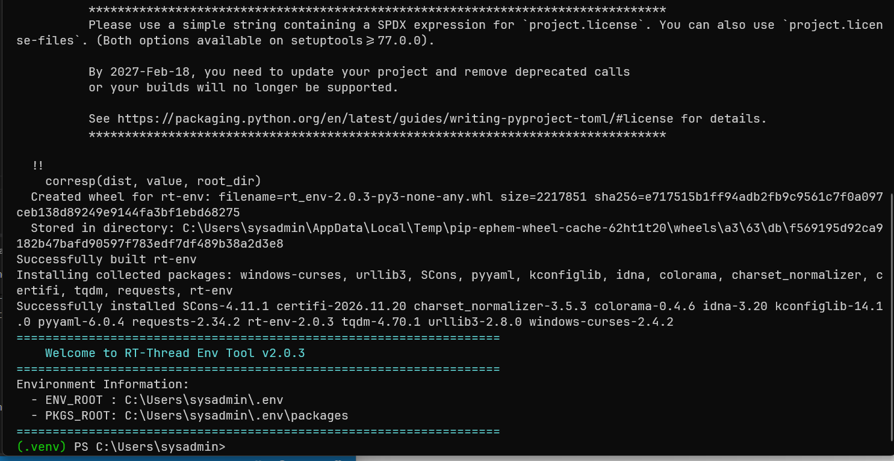

!!! info
    ===================================================================
    Welcome to RT-Thread Env Tool v2.0.3
    ===================================================================
    Environment Information:
    - ENV_ROOT : C:\Users\sysadmin\.env
    - PKGS_ROOT: C:\Users\sysadmin\.env\packages
    ===================================================================


2 **เข้าไปยังโฟลเดอร์ BSP ของบอร์ด Renesas Vision Board:**
```bash
cd C:\Renesas\rt-thread\bsp\renesas\ra8d1-vision-board
menuconfig
```
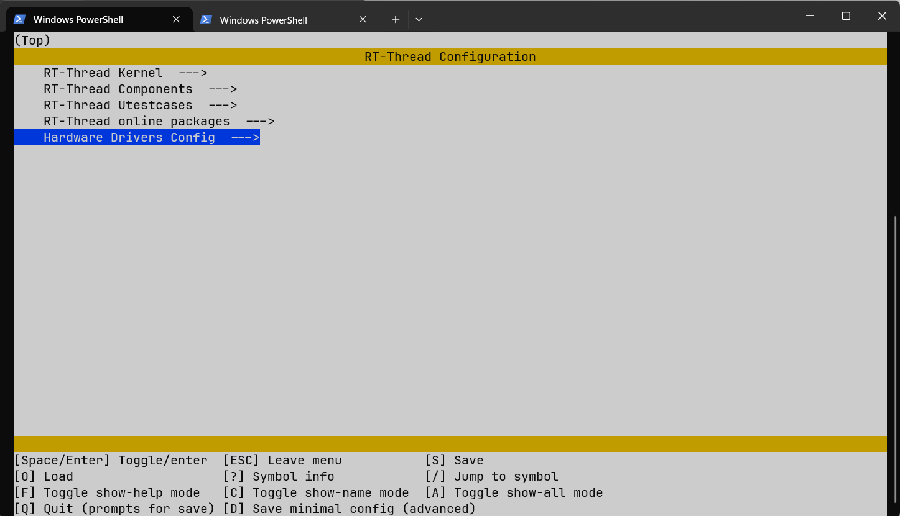

ค่า Config ที่ถูกแก้ไขจะ save ใน .config
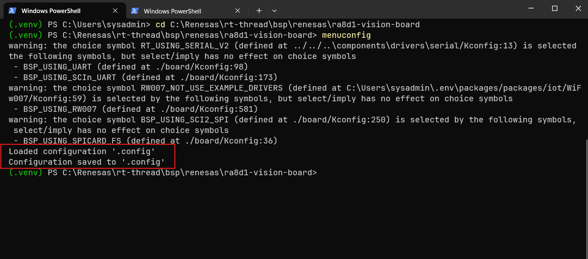

```
pkgs --update
scons
```
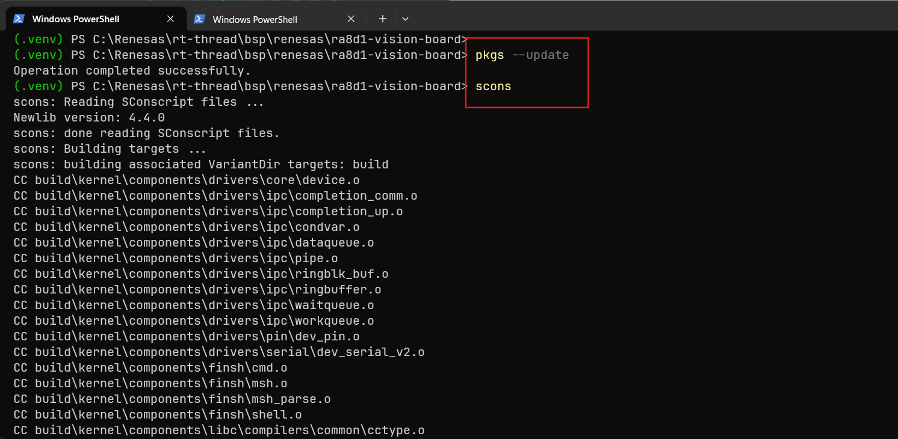

- Build สำเร็จ จะได้ file  rtthread.elf rtthread.hex ตามรูปด้านล่าง

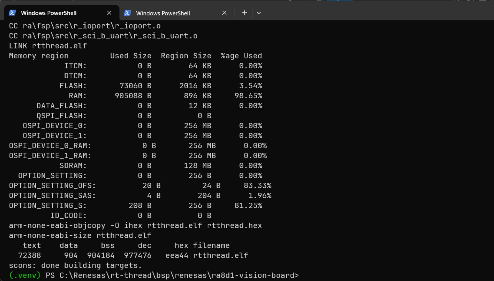

Build สำเร็จเรียบร้อยครับ (`scons: done building targets.`) ได้ไฟล์ `rtthread.elf` และ `rtthread.hex` ออกมาพร้อมสำหรับ Flash ลงบอร์ด Renesas Vision Board แล้ว

### สรุปผลการวิเคราะห์หน่วยความจำ (Memory Footprint Analysis)

1. **ความหมายของตัวเลขจาก `arm-none-eabi-size`:**
* **`text` (72,388 B / ~70.7 KB):** ขนาดของ Machine Code และค่าคงที่ (`const`) ที่เก็บอยู่ใน **FLASH** ใช้ไปเพียง **3.54%** ของพื้นที่ทั้งหมด 2,016 KB
* **`data` (904 B):** ตัวแปร Global/Static ที่มีการกำหนดค่าเริ่มต้น (Initialized Data) ซึ่งเก็บค่าตั้งต้นไว้ใน FLASH และคัดลอกลง RAM ตอนเปิดเครื่อง
* **`bss` (904,184 B / ~883 KB):** พื้นที่ตัวแปร Global/Static ที่ยังไม่ได้กำหนดค่า และ **RT-Thread System Heap** ที่จองพื้นที่ใน Internal SRAM ของชิป RA8D1 ไว้เกือบเต็ม (98.65% ของ 896 KB) เพื่อใช้สำหรับจัดสรรหน่วยความจำแบบไดนามิก (`rt_malloc`, Thread Stack, Message Queue)
* **`SDRAM` (0 B / 128 MB):** ในโปรเจกต์เริ่มต้นนี้ยังไม่ได้เปิดใช้งาน External SDRAM (32MB บนบอร์ด) หากในอนาคตเปิดใช้งานหน้าจอ LVGL หรือกล้อง (Frame Buffer) ระบบจะย้ายพื้นที่ Buffer ขนาดใหญ่ไปไว้ในส่วน SDRAM นี้แทน


---

### ขั้นตอนถัดไป: การอัปโหลดเฟิร์มแวร์ (Flash) ลงบอร์ดจริง

1. เสียบสาย USB Type-C จากคอมพิวเตอร์เข้าที่พอร์ต **`USB-DBG`** (ช่องล่าง) ของบอร์ด Vision Board
2. รันคำสั่ง Flash ด้วย `pyocd` ในหน้าต่าง PowerShell เดิม 

```powershell
# update ข้อมูล pack ของ pyOCD
pyocd pack update

# install package Renesas RA8D1
pyocd pack install R7FA8D1BH
```

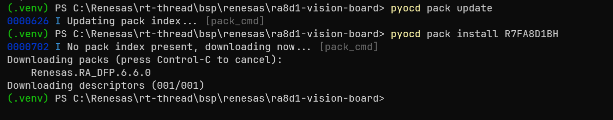

```
pyocd list --targets
pyocd list --targets | Select-String "r7fa8d1"
```

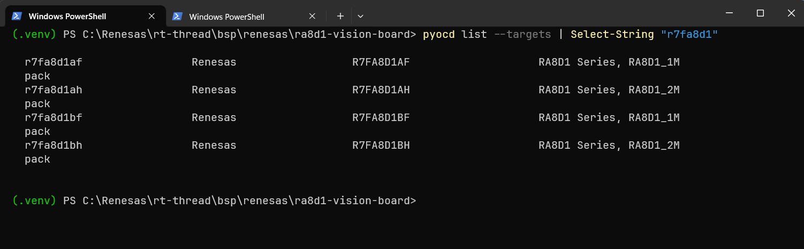

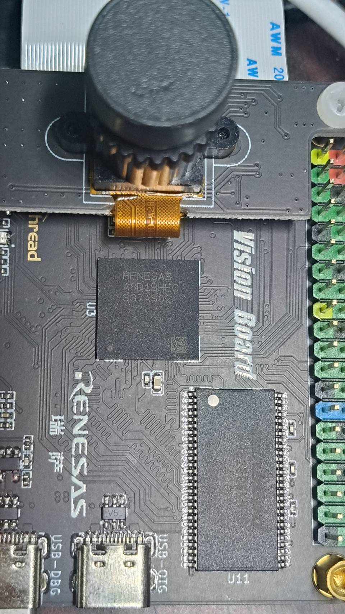


- การตรวจสอบ: รัน pyocd list ต้องเห็นชื่อ Probe (CMSIS-DAP / DAPLink) แสดงขึ้นมา
```
pyocd list

  #   Probe/Board                   Unique ID      Target
-----------------------------------------------------------
  0   RTThread ART-Link CMSIS-DAP   0F6E917505A6   n/a
```

### ต้อง upload file อะไร
- rtthread.hex (แนะนำที่สุด): เป็นไฟล์ข้อความมาตรฐาน (Intel HEX) ที่มีข้อมูล ตำแหน่งหน่วยความจำ (Memory Address) ฝังอยู่ครบทุกบรรทัด ทั้งส่วนโค้ดหลัก (0x02000000) และส่วนตั้งค่าฮาร์ดแวร์ของชิป RA8D1 (Option Setting Memory) ทำให้ PyOCD เขียนลงบอร์ดได้แม่นยำและปลอดภัยที่สุด

- rtthread.elf (ใช้ได้เช่นกัน): เป็นไฟล์ Executable สำหรับการดีบัก (มีทั้ง Machine Code, Address และข้อมูล Debug Symbol) เมื่อสั่ง Flash ด้วยไฟล์นี้ PyOCD จะดึงเฉพาะส่วน Code และ Data มาเขียนลงบอร์ดให้อัตโนมัติ

### ไฟล์อื่นๆ ในโฟลเดอร์ (ไม่ต้องอัปโหลด)
- rtthread.map: ไฟล์ข้อความรายงานการจัดสรรหน่วยความจำและตำแหน่งฟังก์ชัน (เอาไว้อ่านตรวจสอบขนาด RAM/Flash เท่านั้น)

- rtconfig.h / rtconfig.py / SConscript: ไฟล์ตั้งค่าและสคริปต์สำหรับคอมไพล์โค้ดบนเครื่อง PC

- template.uvprojx / template.uvoptx: ไฟล์โปรเจกต์สำหรับเปิดในโปรแกรม Keil MDK

```
# ดูเบอร์ Chip
pyocd flash -t r7fa8d1bh -f 1000000 rtthread.hex
```


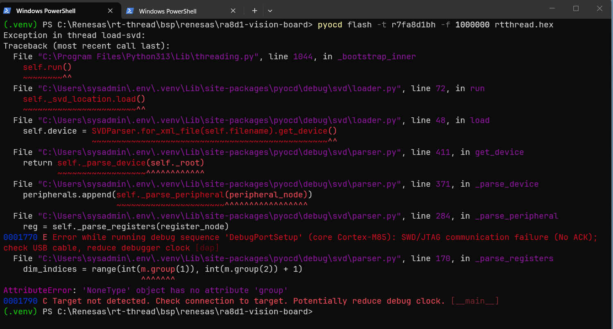


ตัวเลข **`1000000`** ในพารามิเตอร์ `-f 1000000` ของคำสั่ง PyOCD คือ **ความถี่สัญญาณนาฬิกาของโปรโตคอล SWD (SWD Clock Frequency)** มีหน่วยเป็น **เฮิรตซ์ (Hz)** ซึ่งเท่ากับ **1 MHz (1,000,000 Hz)** ครับ

### รายละเอียดการทำงาน

* **ค่าเริ่มต้น (Default):** ปกติ PyOCD จะตั้งความเร็ว SWD ไว้สูง (มักอยู่ที่ `4000000` Hz หรือ `4 MHz` ถึง `10 MHz` ขึ้นอยู่กับตัว Probe) เพื่อให้อัปโหลดไฟล์ขนาดใหญ่ได้เร็วที่สุด
* **ทำไมต้องลดเหลือ `1000000` (1 MHz):**
* เมื่อบอร์ดมีปัญหาการเชื่อมต่อ (`SWD/JTAG communication failure (No ACK)`) สัญญาณความถี่สูงอาจถูกรบกวนบนลายวงจร สาย USB หรือเกิดจากชิปหลัก `R7FA8D1BH` ยังไม่พร้อมรับสัญญาณความเร็วสูงขณะกำลังบูตหรืออยู่ในโหมดประหยัดพลังงาน
* การลดความถี่ลงเหลือ **1 MHz (`1000000`)** หรือ **500 kHz (`500000`)** จะทำให้ขอบสัญญาณไฟฟ้าของขา `SWCLK` และ `SWDIO` ชัดเจนและเสถียรขึ้น ช่วยให้ชิป DAPLink (`U10`) จับจังหวะสื่อสารกับชิปหลักได้สำเร็จ


### รูปแบบการเขียนค่าความถี่ใน PyOCD

นอกจากเขียนเป็นตัวเลขเต็มหน่วย Hz แล้ว PyOCD ยังรองรับการใส่หน่วยย่อ `k` (kHz) และ `M` (MHz) ได้เช่นกัน (มีความหมายเดียวกันทั้งหมด):

* `-f 1000000` = `-f 1000k` = `-f 1M` (ความเร็ว 1 MHz)
* `-f 500000` = `-f 500k` (ความเร็ว 500 kHz สำหรับกรณีที่สัญญาณรบกวนสูงมาก)


อาการ `SWD/JTAG communication failure (No ACK)` ขณะที่ `pyocd list` มองเห็น Probe (`RTThread ART-Link CMSIS-DAP`) แล้ว เกิดจากชิปหลัก `R7FA8D1BH` ยังรันเฟิร์มแวร์เดิมที่ปิดการทำงานของขา SWD ไว้ หรือเกิดจากสถานะ TrustZone / Option Setting ของชิปยังล็อกอยู่ ทำให้ต้องบังคับให้ชิปหยุดทำงานด้วยปุ่มบนบอร์ดร่วมกับคำสั่งล้างชิปหรือเข้าโหมด Bootloader ครับ

ดำเนินการแก้ไขตามลำดับต่อไปนี้:

### 1. ตรวจสอบจุดเชื่อมต่อทางกายภาพบนบอร์ด Vision Board

1. **ตรวจสอบสายที่ 40-Pin Header:** ถอดสายจัมเปอร์หรือโมดูลภายนอกทั้งหมดที่เสียบอยู่บนขา 40-Pin Header ออกชั่วคราว (โดยเฉพาะตำแหน่งที่ตรงกับขา `P108` / `SWDIO` และ `P300` / `SWCLK`) เพื่อไม่ให้โหลดภายนอกดึงสัญญาณ SWD ตก
* *Verification:* ไม่มีอุปกรณ์หรือสายไฟใดๆ เสียบค้างอยู่ที่แถวพิน 40-Pin ของบอร์ด


2. **ตรวจสอบช่องเสียบ USB:** ยืนยันว่าสาย USB-C เสียบอยู่ที่ช่อง **`USB-DBG` (ช่องล่าง)** เพียงเส้นเดียว
* *Verification:* ไฟ LED แสดงสถานะพลังงานบนบอร์ดติดสว่างคงที่


---

### 2. บังคับเข้าโหมด Bootloader เพื่อปลดล็อกขา SWD และล้างข้อมูล Flash

การกดปุ่มตามจังหวะนี้จะบังคับให้ชิป RA8D1 บูตเข้า Internal Bootloader แทนการรันเฟิร์มแวร์เดิมที่ปิดขา SWD:

1. **กดปุ่ม `USER/BOOT` ค้างไว้** (ปุ่มกดบนบอร์ดที่ระบุชื่อ BOOT / USER)
2. ขณะที่ยังกดปุ่ม `USER/BOOT` ค้างอยู่ ให้ **กดปุ่ม `RST` 1 ครั้งแล้วปล่อย**
3. นับ 1 วินาที แล้ว **ปล่อยปุ่ม `USER/BOOT**`
* *Verification:* ไฟ LED บนบอร์ดที่เคยกะพริบตามโค้ดเก่าจะหยุดนิ่งสนิท


4. รันคำสั่งล้างข้อมูลในชิปทั้งหมดด้วยความเร็วต่ำ (`500 kHz`) และบังคับ Reset ระหว่างเชื่อมต่อ:
```powershell
pyocd erase -t r7fa8d1bh -f 500000 --connect under-reset --chip

```


* *Verification:* หน้าจอแสดงข้อความ `Chip erase complete` โดยไม่มี Error `No ACK` (หากขึ้น `Chip erase complete` แล้ว ให้ข้ามไปขั้นตอนที่ 4 ได้ทันที)


---

### 3. กรณียังขึ้น `No ACK`: ใช้เทคนิค "จับจังหวะปล่อยปุ่ม RST" (Manual Reset Catch)

หากสายสัญญาณ Reset (`nRESET`) ระหว่างชิป DAPLink กับชิป RA8D1 ไม่ได้สั่งงานฮาร์ดแวร์ได้เต็มรูปแบบ ให้ใช้วิธีจับจังหวะด้วยมือ:

1. บนบอร์ด Vision Board ให้ **กดปุ่ม `RST` ค้างไว้** (อย่าเพิ่งปล่อย)
2. ในหน้าต่าง PowerShell ให้พิมพ์คำสั่งเตรียมไว้แล้วกด `Enter`:
```powershell
pyocd flash -t r7fa8d1bh -f 500000 rtthread.hex

```


3. ทันทีที่กด `Enter` (ภายในเสี้ยววินาทีที่คำสั่งเริ่มทำงาน) ให้ **ปล่อยมือจากปุ่ม `RST**` ทันที เพื่อให้ PyOCD ส่งสัญญาณเข้าจับขา SWD ก่อนที่โค้ดเก่าจะทำงาน
* *Verification:* แถบสถานะการเขียน Flash ปรากฏขึ้นและวิ่งจนครบ `100%`


---

### 4. สั่ง Flash เฟิร์มแวร์ `rtthread.hex` (หลังจากล้างชิปสำเร็จ)

เมื่อผ่านขั้นตอนที่ 2 หรือ 3 แล้ว ให้สั่งเขียนไฟล์ `rtthread.hex` ลงบอร์ด:

```powershell
pyocd flash -t r7fa8d1bh -f 1000000 rtthread.hex

```

* *Verification:* แสดงแถบความคืบหน้า `[====================] 100%` และจบการทำงานโดยไม่ขึ้น `Target not detected` จากนั้นกดปุ่ม `RST` 1 ครั้งเพื่อเริ่มรัน RT-Thread

---

### ทางเลือกสำรอง: กรณีชิป RA8D1 ติดล็อก TrustZone / Option Setting Memory

หากทำทั้ง 3 ขั้นตอนแล้วยังขึ้น `SWD/JTAG communication failure (No ACK)` ตลอดเวลา แสดงว่าหน่วยความจำส่วน **DLM (Device Lifecycle Management)** หรือ **TrustZone Boundary** ของชิปถูกตั้งค่าป้องกันไว้ ซึ่งต้องล้างด้วย **Renesas Flash Programmer (RFP)** ผ่านพอร์ต `USB-OTG` (ช่องบน) ในโหมด Boot:

1. ดาวน์โหลดและติดตั้งโปรแกรม **Renesas Flash Programmer (RFP) V3** (ฟรีจากเว็บไซต์ Renesas)
2. เสียบสาย USB-C เข้าช่อง **`USB-OTG` (ช่องบน)** ของ Vision Board แล้วกด **`USER/BOOT` ค้างไว้ $\rightarrow$ กด `RST` $\rightarrow$ ปล่อย `USER/BOOT**` (Windows Device Manager จะเห็นอุปกรณ์ใหม่ชื่อ `Renesas RA USB Boot`)
3. เปิดโปรแกรม RFP เลือกชิป `RA` เชื่อมต่อผ่าน `USB Direct` แล้วกดคำสั่ง **Initialize Device** เพื่อคืนค่าโรงงานและปลดล็อกขา SWD ให้กลับมาใช้งานกับ PyOCD ได้ตามปกติครับ