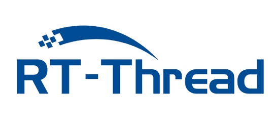

Beginner Friendly Embedded Systems IoT

{ .card }

**คณะเทคโนโลยีสารสนเทศและการสื่อสาร** มหาวิทยาลัยมหิดล
(Faculty of Information and Communication Technology, Mahidol University)
{ .card }

## สวัสดีครับ ยินดีต้อนรับทุกท่าน
#### (update Sep 2026)

{ width="600" }

---

## :simple-readthedocs:{style="color: orange; font-size: 30px;"} พื้นฐาน RT-Thread
!!! info "ระยะเวลา"
    9.00–10.30 น.

- [พื้นฐาน RT-Thread Kernel](./01_rt-thread/01.1_rtthread_kernel.md)
- [พื้นฐาน Kernel](./01_rt-thread/01.2_basic_kernel.md)
- [แนะนำ STM และ ARM](./01_rt-thread/01.3_stm_arm.md)
- [แนะนำ Renesas Vision Board](./01_rt-thread/01.4_vision_board.md)

---

## :fontawesome-solid-list:{style="color: orange; font-size: 30px;"}  การเตรียมการ
!!! info "ระยะเวลา"
    10.40–12.00 น.

- [ติดตั้ง RT-Thread IDE](./02_Preparation/02.1_install_rt_thread_ide.md)
- [ติดตั้ง FSP](./02_Preparation/02.2_install_fsp.md)
- [ติดตั้ง Env Tool](./02_Preparation/02.3_install_env_tool.md)
- [ติดตั้ง OpenMV](./02_Preparation/02.4_install_OpenMV.md)

---

{ width="300" }

## :file_folder:{style="color: orange; font-size: 30px;"}   Workshop: RT-Thread
!!! info "ระยะเวลา"
    13.00–14.30 น.

- [Workshop 1: RT-Thread IDE Basic](./03_workshop1/03.1_workshop1.md) Beginner 30 นาที
- [Workshop 2: GPIO - Interrupt](./04_workshop2/04.1_workshop2.md) Intermediate 45 นาที
- [Workshop 3: Dummy Device](./05_workshop3/05.1_workshop3.md) Intermediate
- [Workshop 4: WiFi RW007](./06_workshop4/06.1_workshop4.md) Intermediate
- [Workshop 5: IoT Programming](./07_workshop5/07.1_workshop5.md) Advanced
- [Workshop 6: OpenMV](./08_workshop6/08.1_workshop6.md) Advanced

{ width="300" }

---

## :fontawesome-solid-microchip:{style="color: orange; font-size: 30px;"} Workshop: AI & Edge
!!! info "ระยะเวลา"
    14.45–16.00 น.

- [Workshop 7: MicroPython](./09_workshop7/09.1_workshop7.md) Intermediate
- [Workshop 8: Face Detection](./10_workshop8/10.1_workshop8.md) Advanced
- [Workshop 9: Edge Impulse](./11_workshop9/11.1_workshop9.md) Advanced Machine Learning
